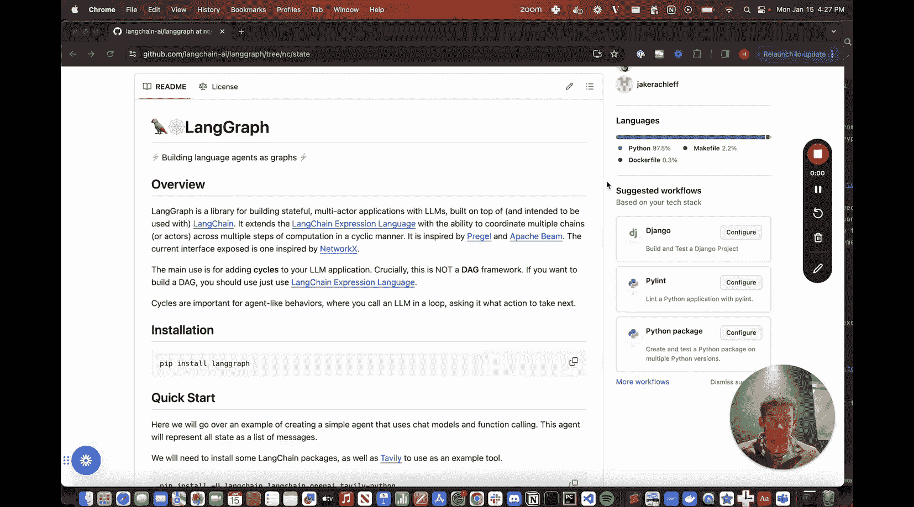
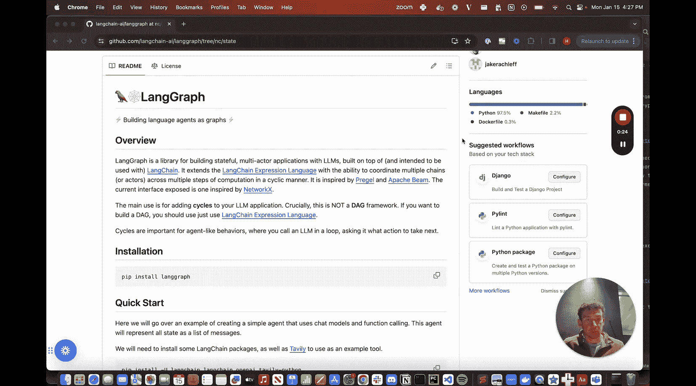
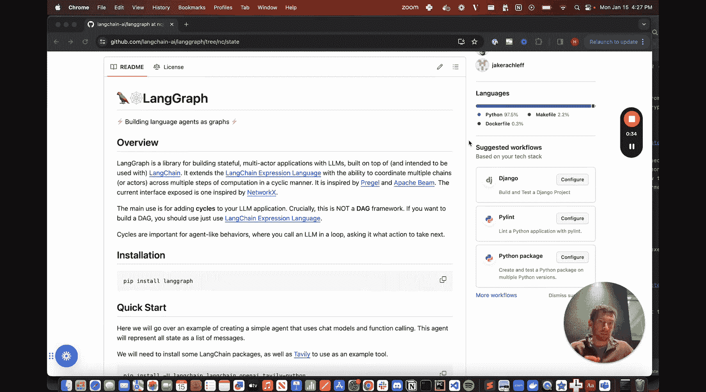
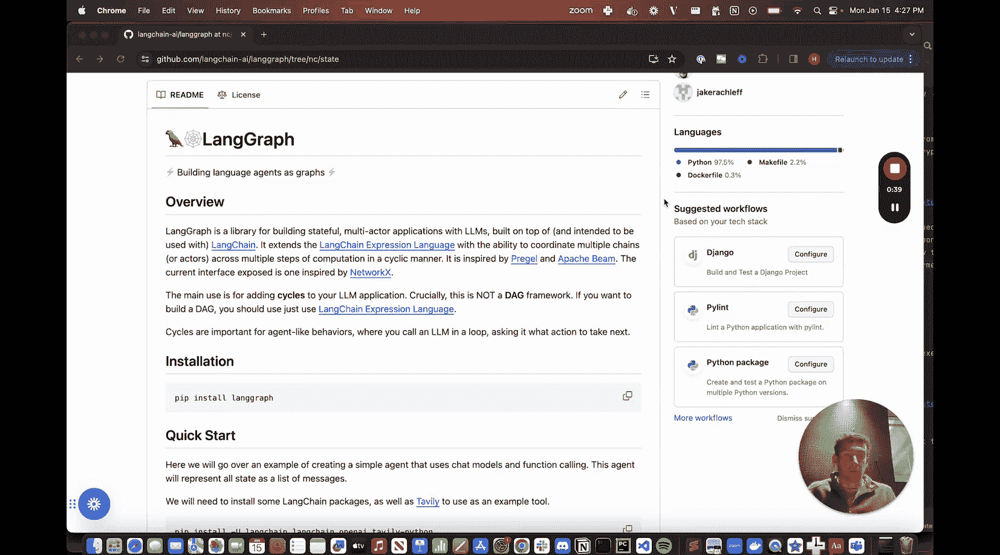
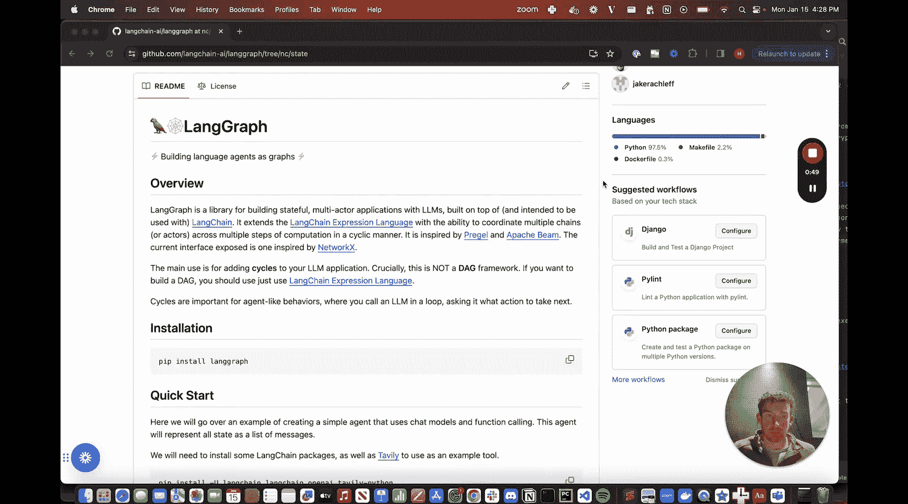
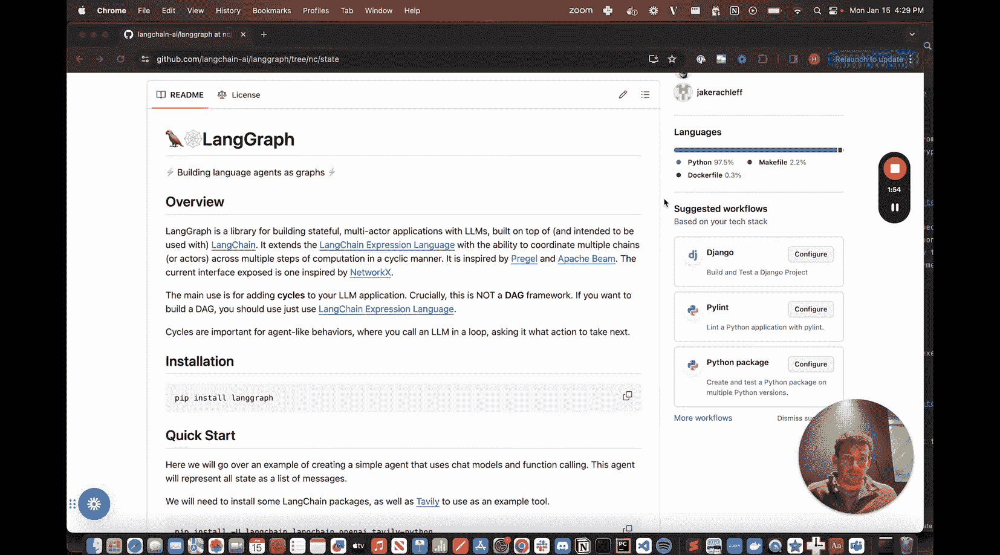
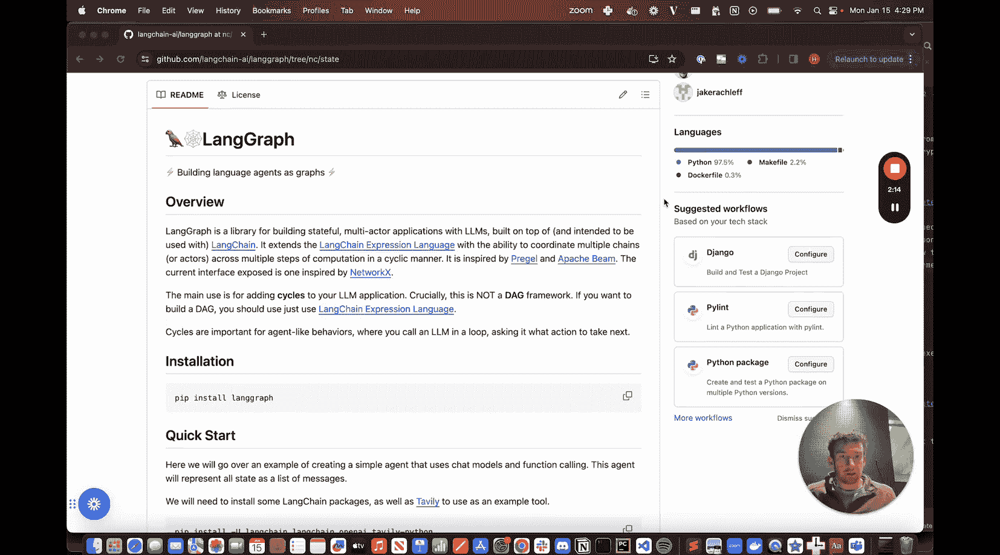
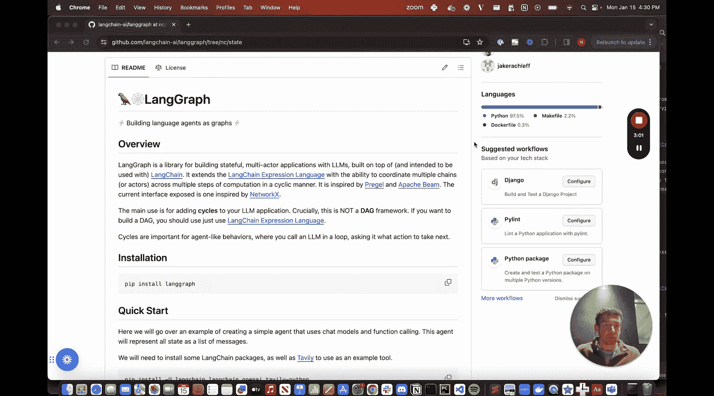

# LangChain【中英⚡LangGraph 使用指南｜LangGraph (Python)】 p01 P1 LangGraph： Intro -BV1vJfMYuEon_p1-

Hello， everyone。Today， I want to talk about Lgrath， a new library that we're releasing。

So Langgraft builds on top of L chain and makes it really easy to create agents and agent runtimes。

So what exactly is an agent and an agent runtime。 So in lane chain。

 we define an agent as a system powered by a language model that decides what action to take。

There's then an agent run time that basically runs that agent in a loop。

 calls that agent decides what action is take， then takes that action。

 and then records the observation and then passes that back in and starts to loop over again and continues going through that loop until the agent decides that it is finished。

So we've made it easy over the past few months to customize agents in La chain with La chain expression language。

 and I'd recommend checking those out if you haven't。

What we're doing with Laing graph is we're making it easy to customize the agent runtime。

 So previously， the agent runtime was always the agent executor class。

 And this was basically something that ran in the loop and called tools in a specific way and handle errors in a specific way。

 And that was great。 But it was just one way to create this runtime。

 And so we want to create more ways to create this runtime and ways to create them more flexibly and dynamically。

😊。

And a key part of this runtime is the ability to add cycles。 So。

 you know the whole point of the agent runtime is running this agent。

 this LLM powered agent in a loop， and so you need to be able to have cycles and lane chain expression language and other you know dag like frameworks are non they're not cyclical and so that's why we're introducing La graph for it's a way to create these cyclical agent runtimes。

So that's hopefully an overview of what Lang graph is and why we created it。

 The rest of the videos in this series are going to focus on two of the main agent runtimes that we've added to start。

 So first， we've added agent executor very similar to the agent executor in La chain。

 So we've recreated that agent executor with Lang graphra。

 And then we've added a chat agent executor。 The chat agent executor takes in a list of messages and then represents the agent state just as a list of messages。

 And so returns a list of messages as well。

The reason we did this is that a lot of the newer models are chat based models。

 and they intrinsically represent function calling as as basically parameters as part of a message。

 and then they also have function responses being a separate type of message。

 And so representing this agent state as a list of messages is very natural for these types of models。

 And so we've added a separate agent executor， particularly for that。

Then I'm going to highlight a bunch of different ways that you can modify the base agent executors to do things like add human in the loops。

 force a specific tool to be called first and other exciting things like that。 Hope you enjoy。

