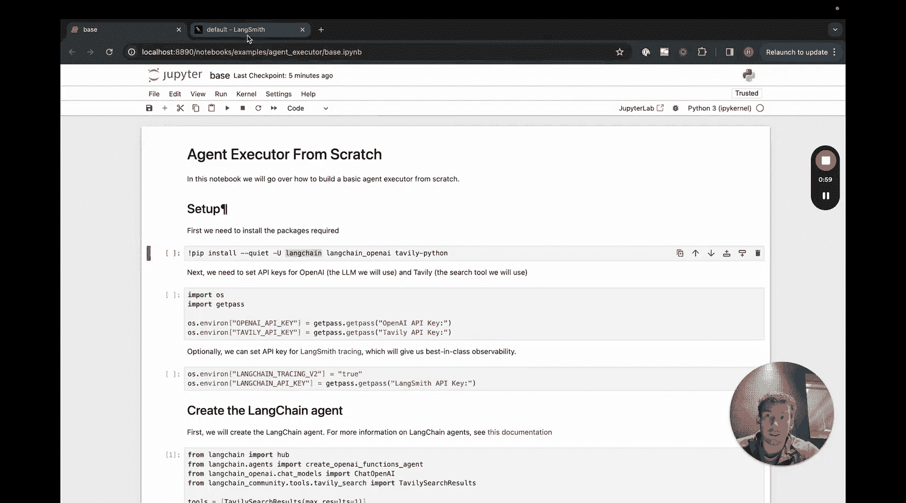
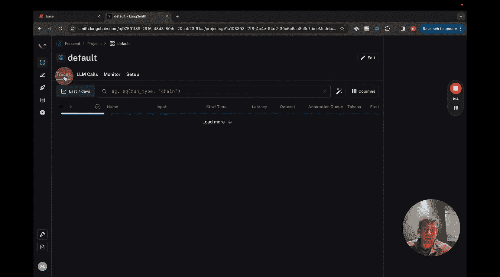
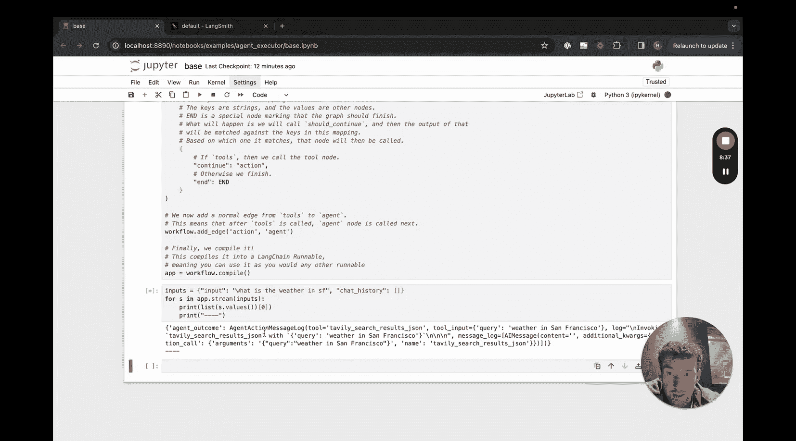
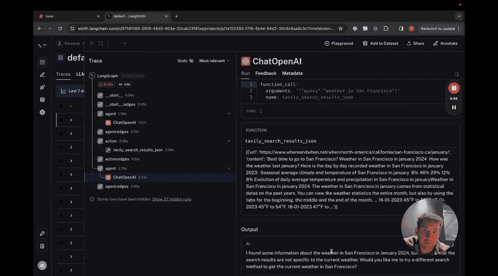
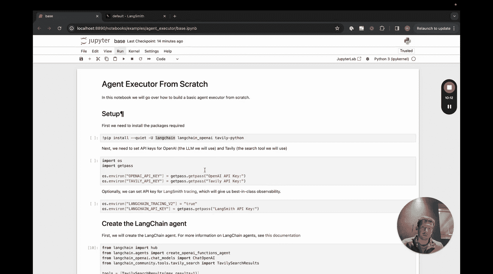

# LangChain【中英⚡LangGraph 使用指南｜LangGraph (Python)】 p02 P2 LangGraph： Agent Executor -BV1vJfMYuEon_p2-

Alright。 So in this video， we're going to go over how to build the equivalent of the current lane chain agent executor from scratch in La graph。

 and we'll see how easy it is。So in order to do this， we're first going to set everything up。

 We need to install a few packages。 We need to install La chain。

 so we'll use this to use the existing agent classes in La chain。

 we can still easily use those agent classes in La graph。

We'll also install Lankin Open AI so that we can use the open AI package and we'll use that to power our agent。

 and then we'll also install Phil Python， this will power the search tool that we'll use as one of our tools for the agent。

After we do that we'll set the open AI API key， we'll set the Tvi API key and then we'll also set the Lsmith API key and so here these two variables Linkin tracing V2 and Lnktrainin API key if you set those those will set things up so things start getting logged to Lsmith which is our observability platform and so you can see the instructions here and you'll also need to grab an API key from here if you don't have access to Lsmith yet it's currently in a private be just DME on Twitter or LinkedIn and we can get you that。

Going back to this notebook， the first thing we're going do is create the L chain agent。

 And so this is the exact same code that we used in L chain。

 So I'm not going to go over in too much detail if you want more information on that。

 check out the La chain documentation， but basically we'll create a tool。

 which is this Tivli search tool。 We'll get our prompt， which we're pulling from the hub。

 We'll choose。The LLM that we want to use， which is this which is this open AI LLM。

 and then we'll create this open AI functions agent， which is a particular type of agent。

We will then define the graph state。So this is the state that's going to be tracked throughout the graph over time。

 and basically the reason that this is important is that once we establish this state。

 each node can basically push updates to that state。

 so we don't have to pass around this state from node to node all the time。 Rather。

 what we can do is we can just pass updates to that state。As part of that。

 we need to specify what type of updates push that we were pushing to that state。 So by default。

 the updates will basically override the existing attribute for that state。

That's useful in some cases， but in other cases， you want to actually add to the existing state that exists。

 And we'll see an example of that here。 And so， again， default will override。

 but oftentimes you want to add to to the attribute for that state。

 And so if we look at the existing agent state， we can see here that the first two things are basically inputs。

 So the input message to the conversation and then the chat history if。

 if there happens to be any chat history。 And so those will be things that will pass in。

 as we see later on。The next two are things that the graph will add over time。

 So agent outcome will be set by a few nodes or by one node in particular when after the agent is called。

 and then that will be basically the basically tool that it should call or the final result that it should pass。

 And so we have agent action and agent finish to basically represent that tool and then the final result。

 we also have none because that's what this is will default to when it starts。

 So this will be none to start。Finally， we have a list of the steps that the agent has taken thus far。

So this is one of the ones that we don't want to override this。

 but rather we want to append to this over time and keep on growing this。

 And so here we've annotated this with the addd operator。

 And so this means that any time a node writes to this attribute。

 It will basically add it to the existing value rather than override it。

 And we type this as a list of tuples of agent actions and strings。

 these are the these are how intermediate steps are represented in the current lane chain agents。

So we can run that。Then what we need to do is define the nodes。

 So here we define the nodes and define the edges。 So first， we really have a need for two nodes。

 First， the agent node， which uses the agent to determine what action to take。

 And then basically the node that invokes the tools。

 So takes in the the agent decision calls that tool and then， and then does something with that。

Besides those nodes， we also need to add some edges。 So there's two types of edges。

 basically a conditional edge， which will kind of it's basically one node leads to a fork in the road。

 And there's two different directions or three different directions or four different directions。

 But basically there's different edges that it could take conditional on kind of like the result of the previous node。

 And so we'll see an example of adding in that， The example that we'll add is basically based on the agent outcome。

 We either want to call a tool。 or we want to return to the user。

 And so that'll be the forking decision that we have to make。 Then there's a normal edge。

 And this is where this always happens。 And so an example of that is after we call a tool。

 we always want to return back to the agent to let it to decide what to do next。

So let's take a look at the nodes that we have here。 First， we have this run agent node。

 which calls the agent it takes in the data， calls agent runnable do invoke。

 and then assigns this to the agent outcome。 So this will override the existing value of agent outcome and put this new output there。

Then we have this execute tools function， which takes in the data， gets the current agent outcome。

 executes it with this tool executor， which is the nice little helper function we've made to just easily basically say。

 you know to run this tool with this function。 and then it will return intermediate steps。 Remember。

 intermediate steps is the one that we're adding to。 So here we define a list of this agent action。

 and then the output cast to a string and this list will get appended to the existing list。

And then finally we add this function should continue and this is basically going to be used to create that conditional node or conditional edge。

 so we look at the agent outcome and if it's a finish， if it's agent finish。

 then we return end and if otherwise we return continue and we'll see how we use these later on when we construct the graph。

 which we'll do right now。So first， we define a new graph。

 so we import state graph from Laing graph do graph， and we pass in agent state。

 which is the state that we defined above。 We then add the two nodes。

 So we add them by specifying the name of the node as a string。 And then the function。

 and this can be a function or a runnable either or And so you can specify that here。

 And the reason that we do this is so then that we can refer to this node down below。

We set the entry point as agent， so this is using the same string that we set here。

 and this is basically just saying this will be the first node that is called when input gets in。

We then add a conditional edge。So first， we define the start。 So this is saying after the agent。

After the agent node is finished running， what we'll do is we'll call this function。

 the should continue function。 So this should continue function gets the output of anything after the agent node is called。

 and then it will look at data and return end or continue。 And so if we look down here。

 the last thing we pass into this is this mapping of string to string。

 And so basically we have this key， this key should match the output of should continue。

 And so if should continue returns continue， then we call the action node， which we defined above。

 if it returns end， then we call this special end node。

 which is a built in node that denotes that we should end and return to the user。

We then add a normal edge from action back to agents。 This is after the tool is called。

 we then return back to the agent。 And then finally， we compile the graph。

 And this basically converts this graph structure into a lane chain runnable that we can then use so we can use invoke。

 We can use stream and everything with it。Taking a look at what this looks like， we can now call。

We can run this and then we can call it with some input。

 so remember we need the input key and we need chat history as as as the two inputs。

 and we'll use the stream method after this and this will print out the results of each node。

So we can see here that we get。

The agent outcome and so this is the first， the output of the agent node。

 we get back this thing that says used tool to Vi search results JSson with this tool input query。

 whether in San Francisco we then get back intermediate steps and so the intermediate steps are tuple of this of this tool with the results of calling that tool and then we get back a new agent outcome。

 and this is this is calling agent finish， so this is saying we're done with the agent and then this is the final thing that's returned。

 which is just basically the whole state， so it includes the input， the chat history。

 the current agent outcome and then in any intermediate state steps。

We can see what this looks like in Lsmith for perhaps a better example。

 so if we click into the Laing graph， we can see that it starts。

 it then calls the agent under the hood the agent is calling openAI and so we can see the exact prompt that goes in and so we can see we get back this function call we can then see the function call in this action and here we get back this result and we can see it goes back into agent after that it calls open AI again it's now got this stuff in it and it says that it gets some response back。

So that's basically how to use the or how to create an agent executor。

 very similar to the existing agent executor in La chain from scratch， which lay graph。

We'll go over a few additional things in future videos。

 like one we'll do a deeper dive on the interface that this state graph exposes。

 and then two will cover streamy more and different ways that you can stream results back。

