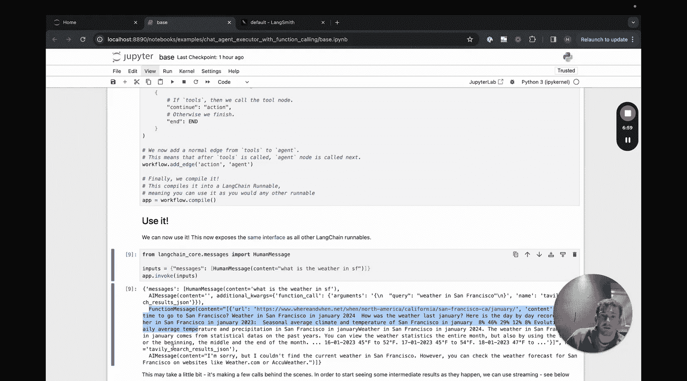
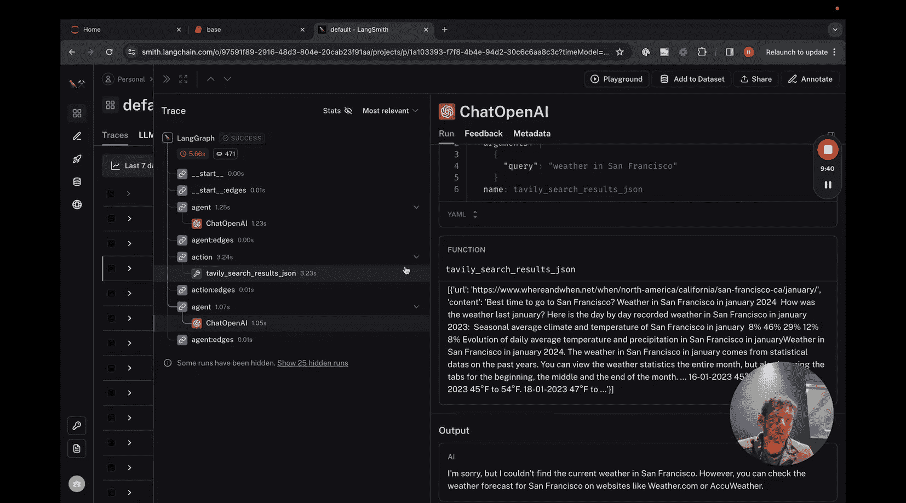

# LangChain【中英⚡LangGraph 使用指南｜LangGraph (Python)】 p03 P3 LangGraph： Chat Agent Executor -BV1vJfMYuEon_p3-

In this video， we're going go over the chat agent executor that we've added to Lagra。

So the chat agent executor is basically an agent executor that works solely on a list of input messages and then basically adds messages to that list to keep track of the agent's state over time。

This is useful and interesting because a lot of the newer models are chat based models that represent function calling and function responses as messages。

 And so we can just append it to this list of messages and keep track of it that way。

Compared to the other video on using La chain agents， this will actually use less La chain concepts。

 so we'll just use the open AI model， it can use any model that supports function calling but will use the open AI model for this video and it will use tools from La chain but it won't use the La chain agent abstractions so it will be more kind of like bare bones。

So let's take a look at setting it up， we're going to require Lang chain package。

 we're going to try a L chain open AI package to use the open AI model。

 and we're going to require it to Vly package， which will be the search tool that we'll use we'll set the API keys for that and then we'll also set up Lang chain tracing from Langsmith。

 so this isn't required， but this is a really good way to observe what's going on under the hood with your agents。

So first we're going to set up the tools， we can do that pretty easily。

 we're going to be using T search here， and then we're just going to set up the tool executor。

 which is a helper method to basically invoke these tools。

After that we're going to set up the model So what we're going to do is we're going to import the chat open AI model from the lane chain integration。

 but we're going to initialize it we're going to set streaming equals to true and we'll see why this is important later on。

 but basically we can stream back tokens this way and then what we're going to do is we're going to basically attach the functions that we want the model to have the ability to call to this object so we can call this format tool to open AI function method which takes in the lane chain tools and converts it to the format that the open AI functions calling Xs。

Once we do that， we can define the agent state， so the agent state is the thing that is passed around and all nodes in the graph will basically update this state over time。

So here the state's really simple， it's just to require。

 it's going to be a dictionary and there's going to be one key in it。

 and it's going to be this list of messages。This list of messages we want to append to over time。

 So there's two different ways that you can update the state of you can update the state over time。

 You can either overwrite the individual attributes or you can add to it here we want to add to it。

 So we're going to use annotated and then this operator a to note that any updates from nodes to this messages thing are going to add to it over time。

 And this is nice so we just so we can just return only the new messages and not have to worry about returning the old messages plus the new messages。

After this， we're going to define the nodes and the edges。

 so the nodes are things that do work and then edges are basically things that connect them。

So we're going to want a few things here， we're going to want an agent node that basically calls the language model and gets back a response。

 and then we're going to want an action node which will take the response or the list of messages。

 see if there is any tools that should be called， call those tools and then append them to the list of messages。

We're also going to need a way to determine whether we want to go from the agent to the tool calling thing or to finish。

 so remember the agent doesn't always have to call it tool it finished when it's called as many tools as it wants to and it wants to finish it can just return directly and so we need to have a function that determines which of those paths to go down and that's called a conditional it we'll see that later on。

So here we'll first define this function that determines which branch to go down。

 it's going to look at at the current list of messages。

 if there's a function call in the last message， then we're going to or sorry if there's not a function call in the last message then we're going to end if there is a function call。

 then we're going to continue and so we'll use this to create that conditional edge later on。

Then we have this function that calls the model here。 we just get the messages。

 pass it into the model and then append that response。

 This response will be a single message and well use a list here。

Because this is getting added to the current messages value。

 So we need it to be something that can be added with a list。And then finally。

 we'll have this call tool node， and this will take in the messages。 it will get the last message。

 it will create this tool invocation， which basically just has the tool and then the tool input and we'll load those from the function calling that's returned from Open AI function calling。

 We will then call the tool executor with with this tool invocation We'll create a function message and then we'll append this function message to the list of messages by returning this function message as its own list。

Once that's done， we can now define the graph。 So we create a graph by passing in the agent state we defined above。

 We then create two nodes， the agent node， and the action node。

We then set the entry point to be the agent node， and so this is basically saying as soon as the input gets in。

 the first node that we're going to send it to is the agent node。

We're then going to add a conditional edge after the agent is called。 So after the agent is called。

 we either want to go to the action node or we want to finish。

 And we want to do that based on the logic that's up here in the should continue function。

So we're going to。 we're going to add conditional edges from the agent node。

 It's going to use should continue as the function。 And then basically。

 we're going to pass in a mapping from string to some other node name。 So continue an end。

 These are the two values that are returned from the should continue function。 and basically。

 if continue is called。 Then we're going to go to the action node that we defined above。

 If end is called。 Then we're going to go to this end node。

 And this is a special node that denotes the end of agent。

Now we can add an edge from the action node to the agent node and we're going to do this because we always want to go to the agent node after we call an action and then we can compile this graph into something that we can use like a lane chain runnable and so we'll expose a lot of similar interfaces as lane chain runables do and we'll use these below。

So in order to use it， we need to create our input。 our inputs going to be a dictionary。

 It's going to have a message key and that message key is just going to be a list of messages Here。

 I just have one human message， but I can easily add a system message， a system message。

 a human message， an AI message and then another human message， anything there。

 So I can I have full control over the list of inputs。 It's just a list of messages。Once I call it。

I need to run the above cell once I call it， it will take a little bit because it's doing a bunch of calls under the hood。

 but it will eventually return an answer and it will return an updated thing with this messages and this messages will be the list。

 it has in the human message that we passed in and then the AI message。

 which is the first call that it made a function message， which is the result and then an AI message。

 which is the final result。 if we want to see what's going on under the hood。

 one way that we can do that is with Langsmith。

So we can go in here and we can see that there's a few things that are happening under the hood。

 First， we're calling open AI， the inputs this list of messages， which is just a human message。

 gets back this function call thing。We then call this we then go to the action node and we call to Vily search and so we get back this list of results and then we have another call to the agent where we have this list of messages as input and we have this output So this shows what's going on under the hood as you have noticed took a little bit to get this And so one of the things that's really nice about La graph is it also has a few different streaming capabilities and that's what we'll cover in the next video。

