# LangChain【中英⚡LangGraph 使用指南｜LangGraph (Python)】 p04 P4 LangGraph： Human-in-the-Loop -BV1vJfMYuEon_p4-

Here， we're going to go over how to modify the chat agent executor to add a human in the loop component where it validates that you approve a tool action before it takes that action。

So it's going to build off the base notebooks so if you haven't already run that notebook。

 I'd highly recommend going over that notebook as we're largely going to focus on just any modifications from that notebook in this video。

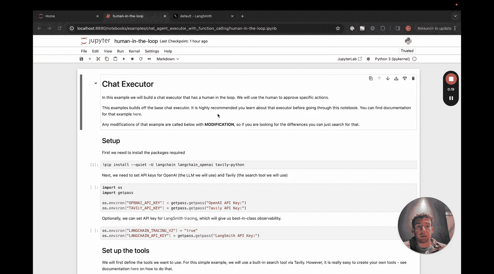

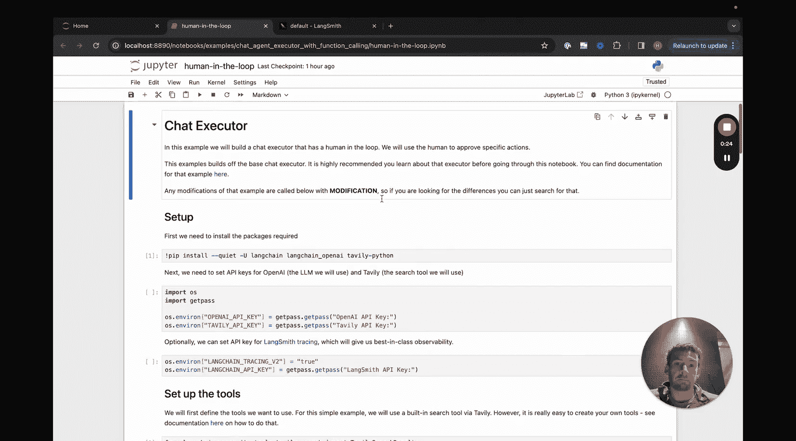

So we're going to set it up as before。 there's no extra installs that we need to do。

 We're going to create our tool， we're going to create our tool executor。

 we're going to set up our model， we're going to bind tools to that model。

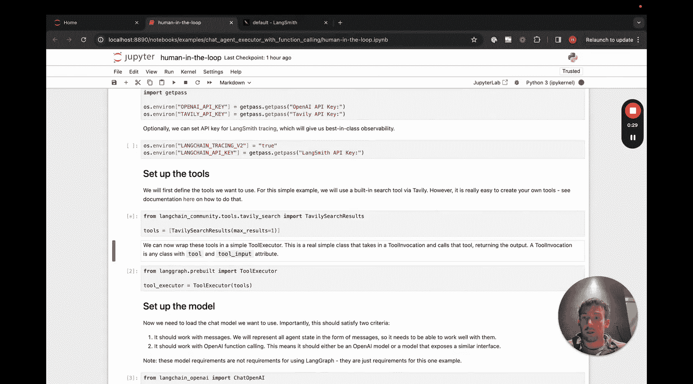

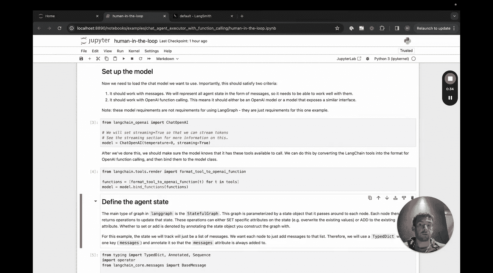

We're going to define the agent state。 All this is the same as before。

 And the first thing that's different is when we start to define the nodes。

 The should continue logic and the call model logic is the same。

 But what's different is this call tool function。

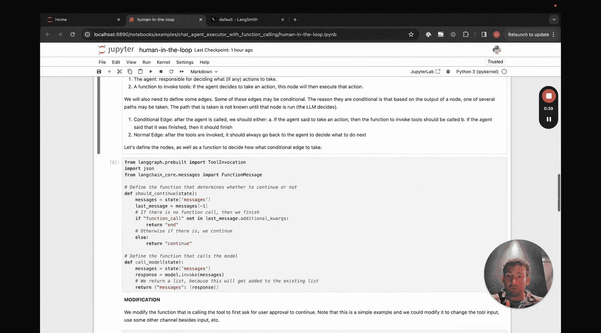

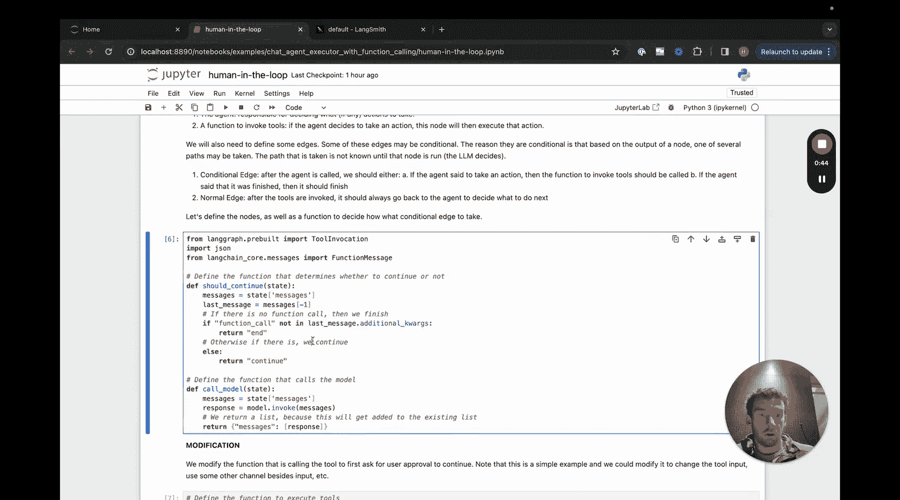

So here we're now adding this logic where here we're just going to prompt the user in this interactive IDE。

 should they continue with this action， and if the response is no。

 then we're going to throw an error and basically stop。

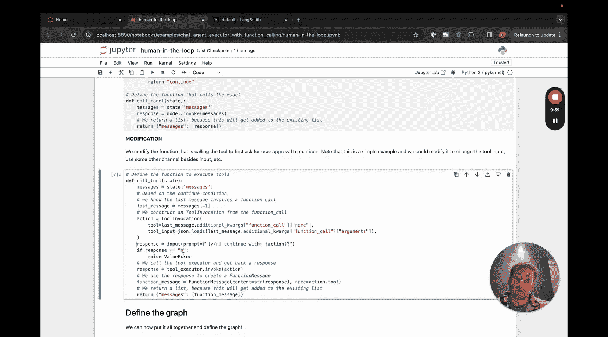

So where where this is the only modification that we make。

 the graph's going to be the exact same and now we can use it， and so when we call it。

 what we can see has happened is when before we call this tool it gives this and if we say yes。

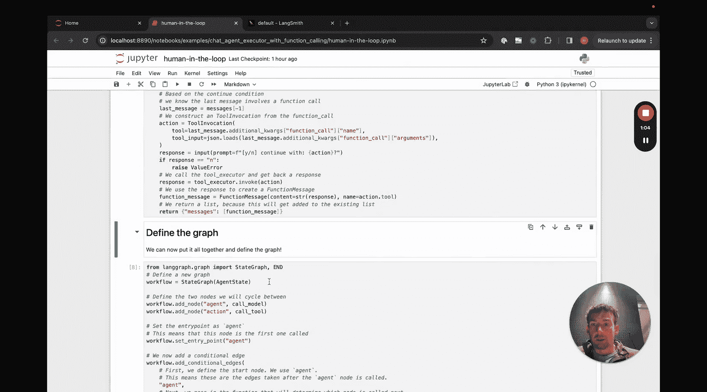

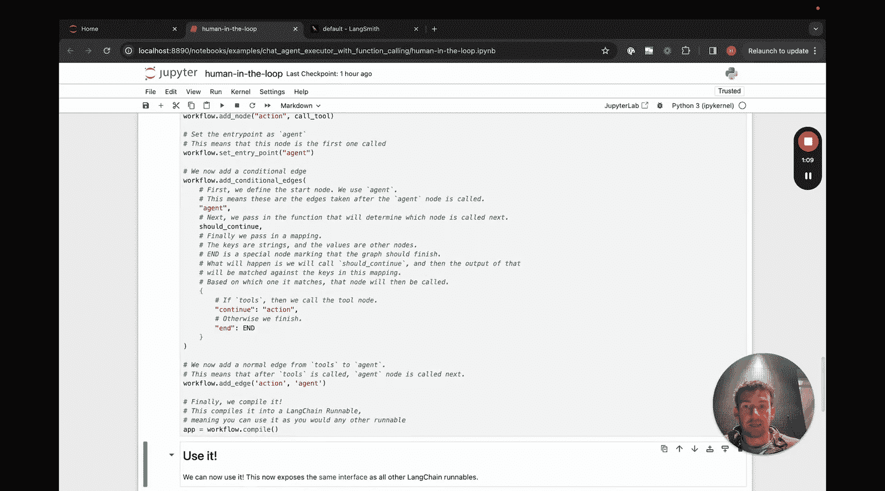

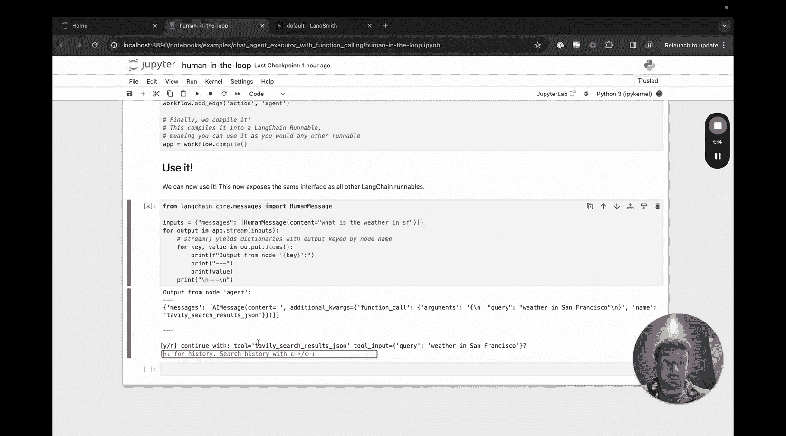

Then it will continue， it will call the tool， and will' get back a response as normal。

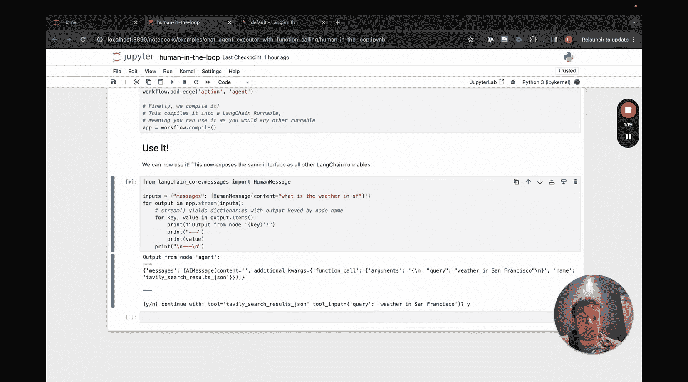

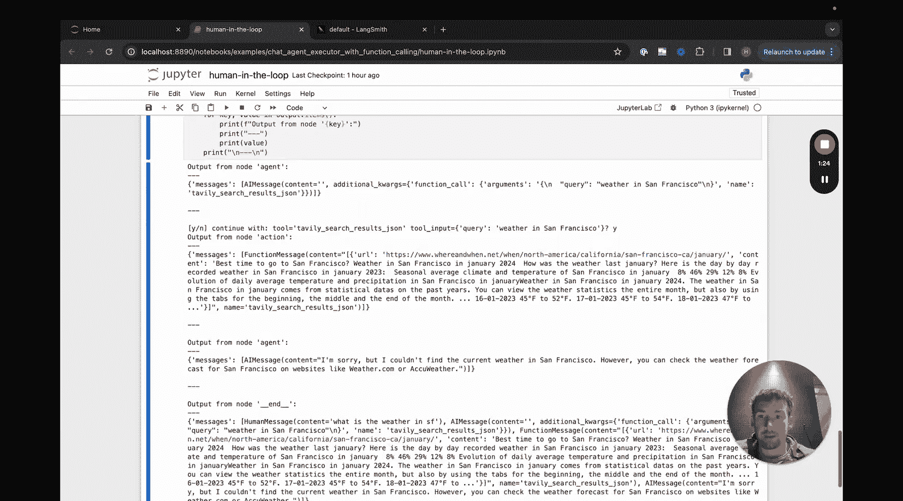

What we can also do though is we can see what happens if I say no， so if I say no。

 then we'll raise a value error and it will stop。 So this is a really simple example。

 you know you'd probably want to do something besides raise the value error and you'd probably want this not in the Jupyter notebook and in some other UI but this hopefullyfully shows how you can add a really simple human in the loop component to Laing graph agents。

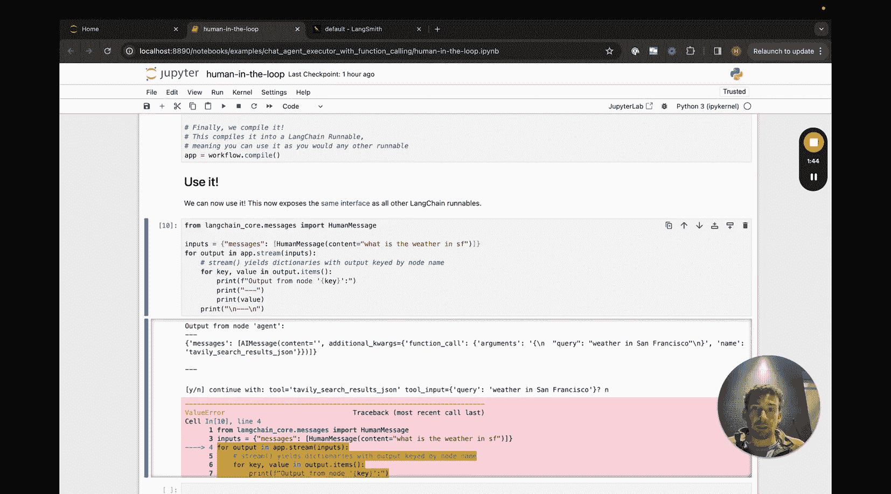