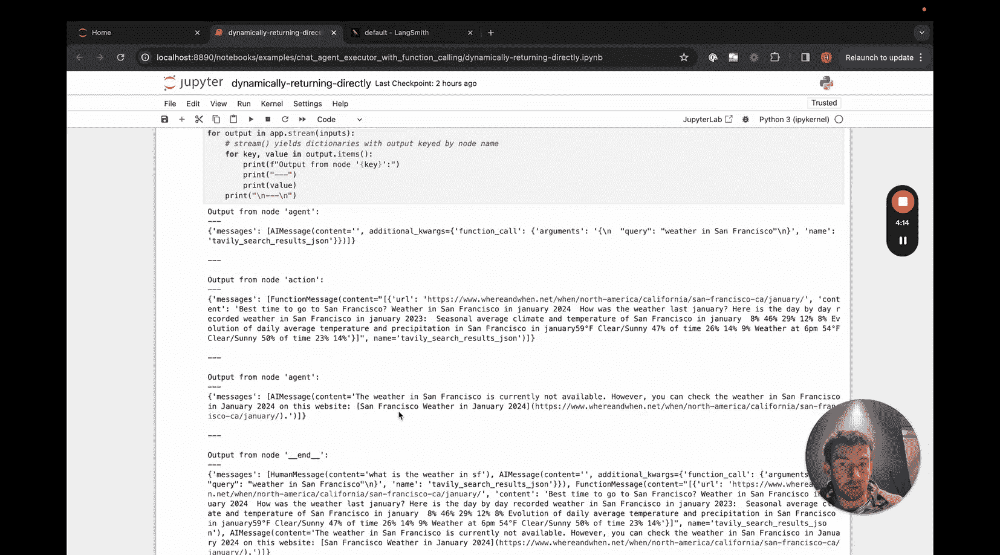
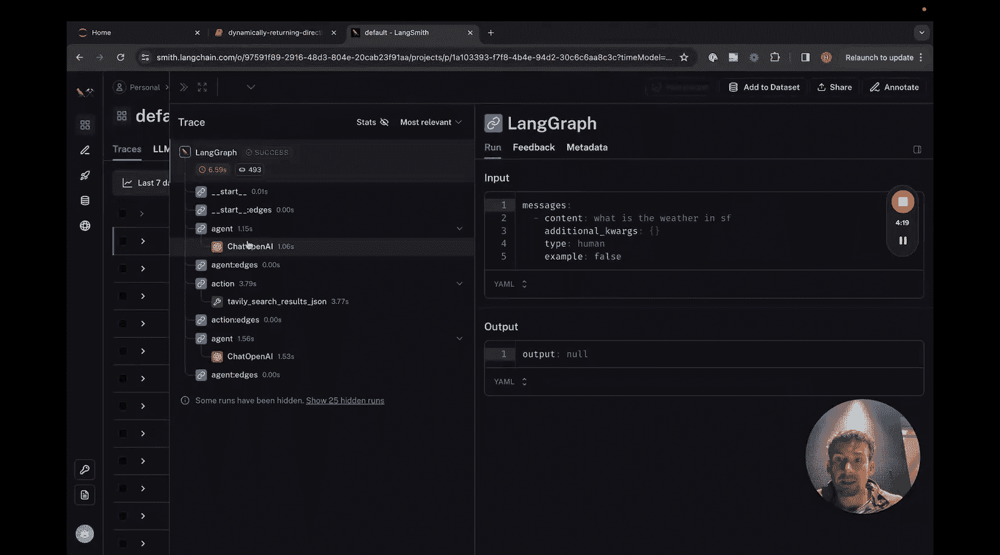
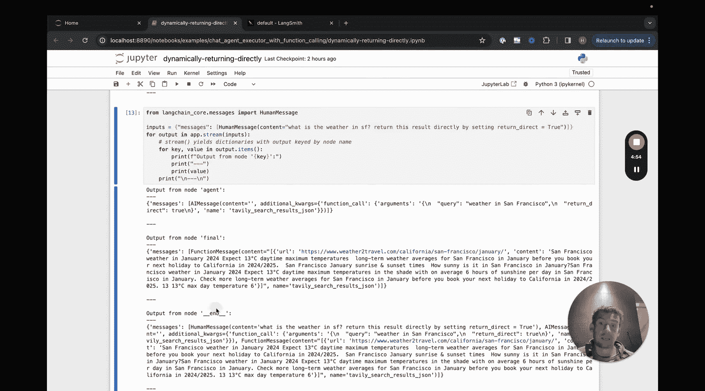
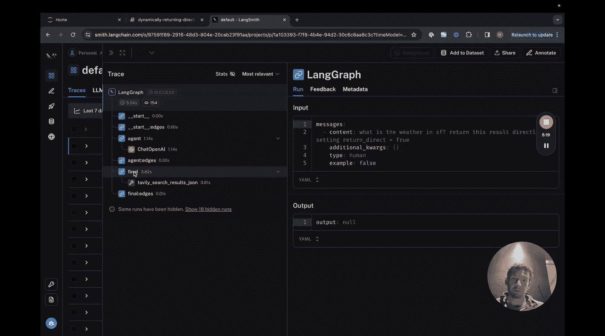

# LangChain【中英⚡LangGraph 使用指南｜LangGraph (Python)】 p05 P5 LangGraph： Dynamically Returning a Tool Output Directly -BV1vJfMYuEon_p5-

The base chat agent executor that we created goes through this loop of calling a language model to determine either to exit or to call a tool。

 If it determines to call a tool， then it calls that tool。 it gets back the response。

 and then it goes back to the language model Here， we're going to do a slight modification where we give the agent the ability to basically say go call that tool and then pass that tool response as the final thing to the user。

 And so this is useful when we have some tools that we know can sometimes return valid responses。

 And we just want to return those。 We don't want to have the agent do any additional summarization or interpretation of the tool responses。

And importantly， this is useful when only sometimes do you want that to happen。

 If you always want that to happen， you can set a property on the link chain tools called Return Direct where it always returns directly to the user here。

 we will let the agent dynamically determine whether it wants to do that。

 So this is a modification from the base a chat agent executor notebook if you haven't already done that notebook。

 Please go do that first。 we're going to build off that notebook and we are only going to change or we're only going to talk about things that we change。

So to start， we're going to change the tool specifically。

 we're going to add this method to the tool schema called returnturn Direct。

 which is going to be a Boying， it's going to default to false。

 and this is basically what the agent will set if it wants to dynamically return this tool to the user。

So this will not actually get used by the tool， and so we'll see how we deal with that later on。

 but basically we're adding it to the schema of the tool so we're defining it here。

 and we're then passing it in as arg schema， we're defining it here so that the agent knows that it has this option and that it can specify sometimes that it should return direct equals true and return to the user。

We can then create the tool executor， same as before， we can then create the model， same as before。

 bind the tools to it， same as before， create the agent state， same as before。

 and now we can define the nodes。So here we're going to change a few things。 First。

 we're going to change the should continue function。

 So the previous logic was that if there was no function call in the additional quarks。

 then we'd end。 Now we also want to end or now we want to go to this final step when there is this return direct value set in the argument。

 So we're going to add this final step。 And then if， if， if the return direct is not true。

 then we're going to pass， then we're going to say continue。

The call model node is going to be the same as before。

 But now this call tool thing is going to be slightly different because remember。

 we have this value return direct。 that's not actually being used in the tool。

 but the agent is returning it。 So what we want to do is we don't actually want to pass that into the tool。

 And so we can see that that's what we're doing here。

 we're extracting the tool name and the arguments。 And then if this tool name is the name of the tool。

 which we know has this return direct parameter and if return direct is in arguments we're deleting it。

 And so that means that when it gets past the tool and tool executor here。

 this return direct won't be present if it was present， it would cause some errors because again。

 that tool doesn't do anything with the return direct。

 That's just for the agent to know that it should return directly。

So now we're defining the graph and so one modification that we're going to make is we have this final node。

 And so this is going to be the final tool call。 And the reason that we have this as a separate node from the action which also uses the same function is that basically we want the responses from this to be handled in different ways。

 And so we'll see that when we create the edges later on。 so we set the entry point。

 we create this additional thing， but now we have。These。

 or we have these two different we have these two different edges that we add here。

 So for the first action node， this is when return direct is not true。

 We always we're going to return to the agent。For this final node， when。

 and this is when return direct is true。 we are going to go to end。

 which is this at the end of the agent。 So that's the reason that we have these two separate nodes is because we have these two separate outbound edges from them。

 We can create the graph that way。 And now we can use it。 if we use it normally。

 we can see that it will call the language model。It'll make a tool call。

 It'll make another call to language model， and then it will finish。

 And so if we go see what that looks like in Lsmith， we can see that we have this call to Open AI。

 the call to to Vily， call to Open AI and it's done。

Now we're going to try to make it return directly， so we're going to ask the same question。

 but we're going to say return this result directly by setting return directly to equalster this is a little bit。

 you know ideally the agent would recognize when it wants to do this dynamically。

 you'd probably do that through some form of prompt engineering， but for demonstration purposes。

 we're just going to put this really simple here。And so we can see in the streaming that we get back this output from the agent node。

 we get back the output from this final node， so it's going down a different path and then it ends。

 and so if we go see， remember， previously it was open AI to Vi。

 open AI if we go to the other trace now we can see it's just open AI to v because it goes to this final node instead and it ends。

So this covers how we can make agents sometimes return the results of tools directly to the user。

 Again， if you always want a tool to return directly， then you don't need to do this。

 You can just set return direct equals true on the tool type。

