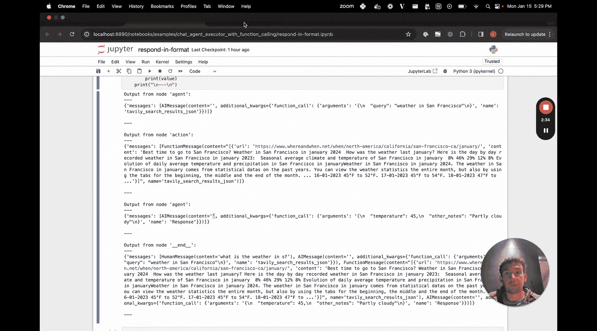
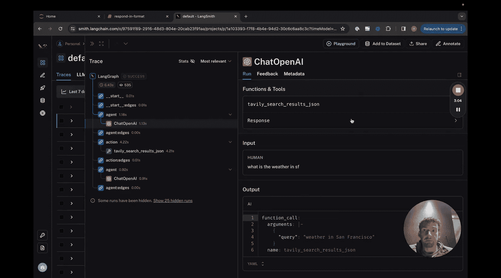

# LangChain【中英⚡LangGraph 使用指南｜LangGraph (Python)】 p06 P6 LangGraph： Respond in a Specific Format -BV1vJfMYuEon_p6-

Here， we're going to cover how we can get a chat agent executor to respond in a specific format。

And so this is often useful when you know that you want your agent to respond in a specific format and you want to enforce that via function calling。

 And so we're going to cover how to do that here。 This is building off of the base chat agent executor notebook。

 So if you haven't already gone and looked at that notebook。

 please do that before you get started because in this notebook。

 we're just going to cover the things that are different。

So we're going to start by creating the the tool and then creating the tool executor。

 This is all the same as before。 We're going to create the model。 This is the same as before。

 but now we have this modification to it。So what we're doing is previously we just binded only the tools that it could call as functions to the model but now we also want to bind this other function definition to the model。

 And this is the response schema that we want the agent respondent。 So here we're making one up。

 we're going say we want to respond with a temperature and then other notes， which is a string。

 And so what we're going to do is first we create functions which are from the tools。

 So this takes in the tools and it converts them to open AI function calling。

 Then we're also adding in this response schema。 And so this response schema is this converted to open AI function calling。

 And wherere binding that as functions to the model。Now， the rest of it here。

 we're defining the agent state。 that's the same as before。 And now we're defining the nodes。

 and there's some differences here。 So first， in the should continue state。 So previously。

 this so this is the same as before right here。 If there is no function call in the last message。

 then we want to end。 If there is a function call。 and the function call name is response。

 then we also want to end。 And then if there is a function call and the function call name is not response。

 then we continue。And other than that， the other two nodes are the same， so we'll define this graph。

 The graph is the same as before， and now we can use it。

 So here let's call it we can start to see some responses stream back。

We get back an AI message first， which calls this function， we get back the function message。

 which has a result， we get back another AI message， which calls this function。

 but this function is response。And so then we end。 and so this this is slightly different from previously。

 previously the response was in content， which was great。 It's a string here。

 we have a structured response and it still ends。 And so if we take a look at what's going on under the hood in Lsmith。

 we can see that we have a call to open AI， this tivly search and then a call to chat open AI if we click on here。

 we can see that we now have two functions in tools。 we have this tivli search results Json。

 which it's using as a tool， but then we also have this response。

 which it's using to respond to the user。😊。

So this is how you can use an agent executor in Lgrath to respond in a specific format with an agent call。

