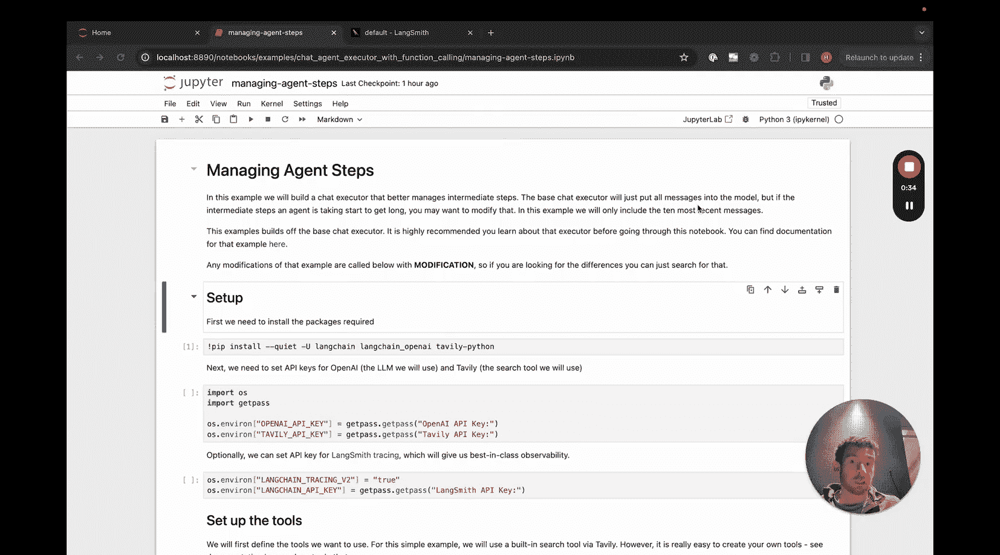
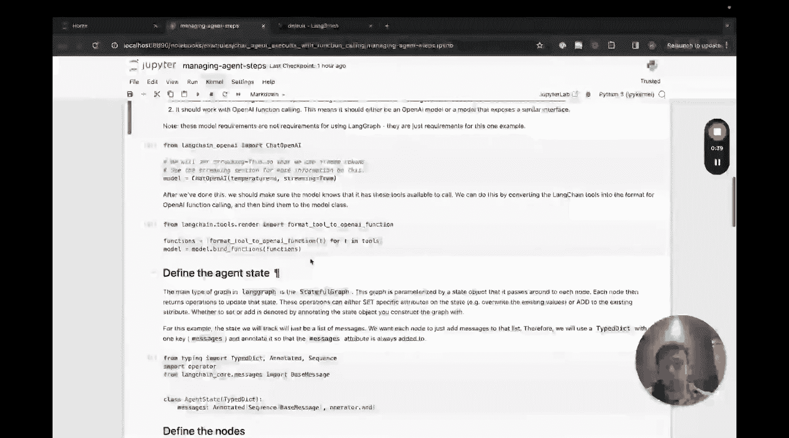
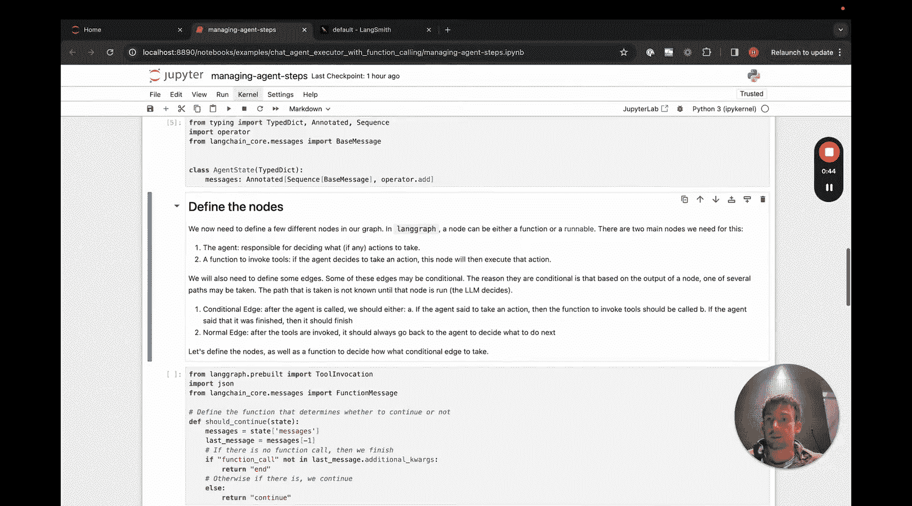
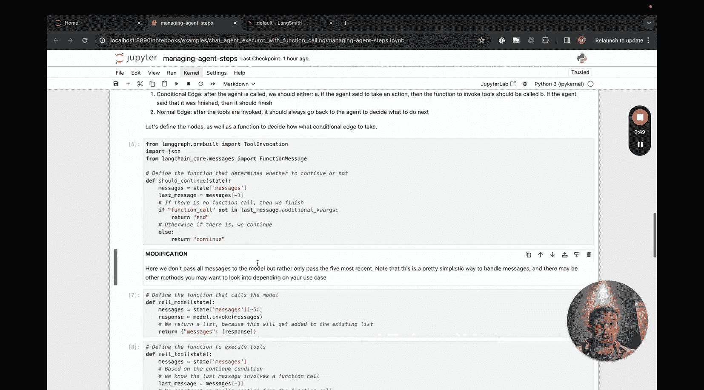
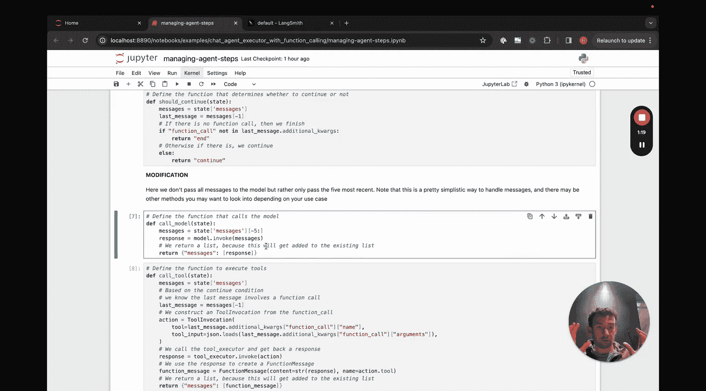
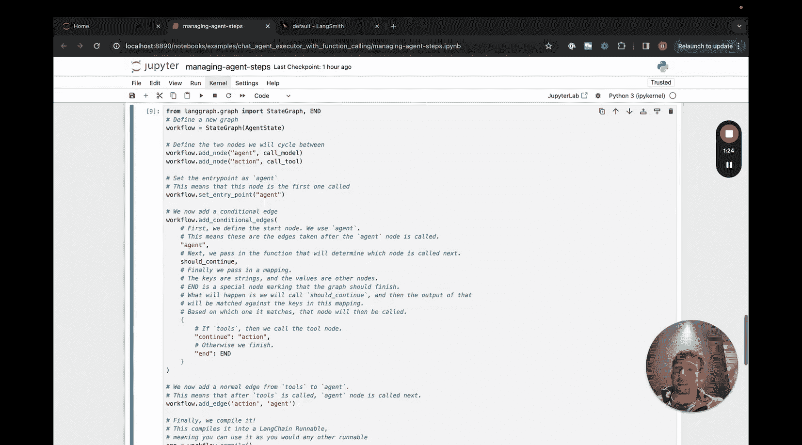
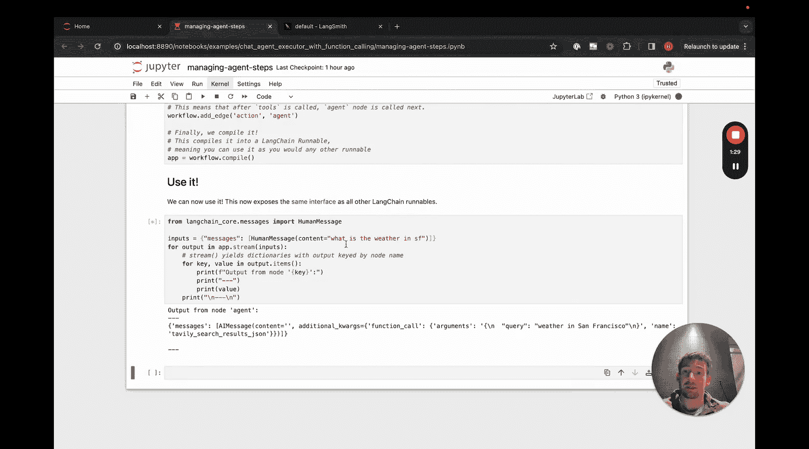
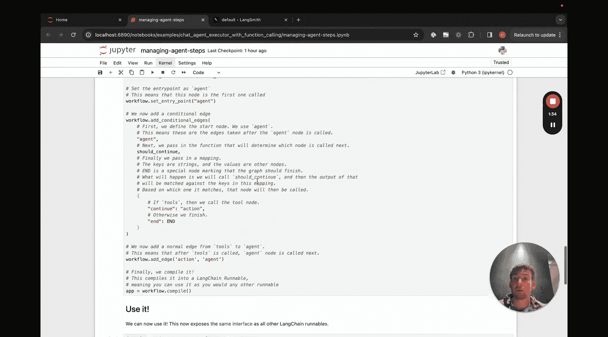
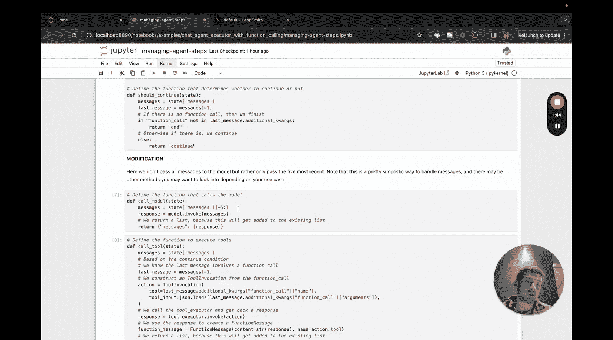

# LangChain【中英⚡LangGraph 使用指南｜LangGraph (Python)】 p07 P7 LangGraph： Managing Agent Steps -BV1vJfMYuEon_p7-

One of the common questions that we get is， how can I modify the existing agent executor to do different things with the internal state。

 And previously， that wasn't super possible because it was always in this lane chain agent executor class。

 But with lane graph， where it's all exposed there。

 you can easily modify it to do anything with the agent steps that happen as the agent is progressing。

And so in this notebook， we'll go over how to do that。

 It builds off the base chat agent executor notebook。 So if you haven't already done that notebook。

 please go and do that。 We're only going to cover the modifications you make， which are very。

 very small ones。

So we're going to set up our tools。 This is all the same as before。 We're going to set up the model。

 This is all the same as before。 We're going to define the agent state。

 This is all the same as before。 And now we're going to define the nodes。

 that should continue edge logic is the same。 But the modification that we're making now is we're just adding some logic in here to filter the messages that we end up passing to the model。

So if we want to only pass the five most recent messages。

 we could put it here if we want to add some different logic where we you know take the system message and then the five most recent messages we could put that here if we want to do some sumization of any of the messages that are older than five we could put that here。

 And so this is where you can add in logic to handle how the intermediate steps of the agent are handled So we'll do that here。

 and then everything else is the same So it's a very minor modification， which we can then use。

 there's actually gonna be to know different here because I only have one message that's passed in and the intermediate steps only get up to length too。

 but any logic， the important part is that any logic that we want to put to modify how the agent steps are represented can go here。

And so this is for modifying a chat agent executor。

 although the same exact stuff holds if we're doing this with a normal agent executor。

