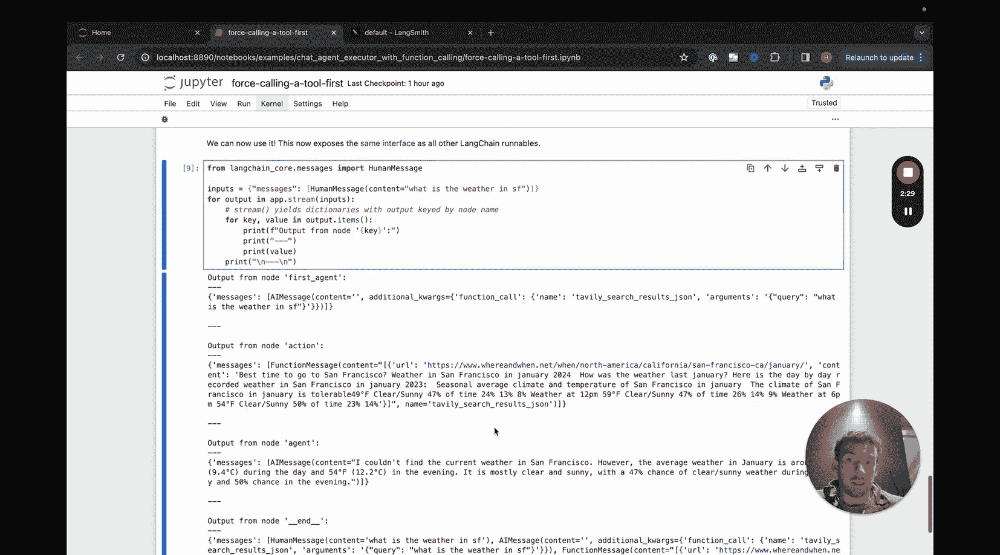
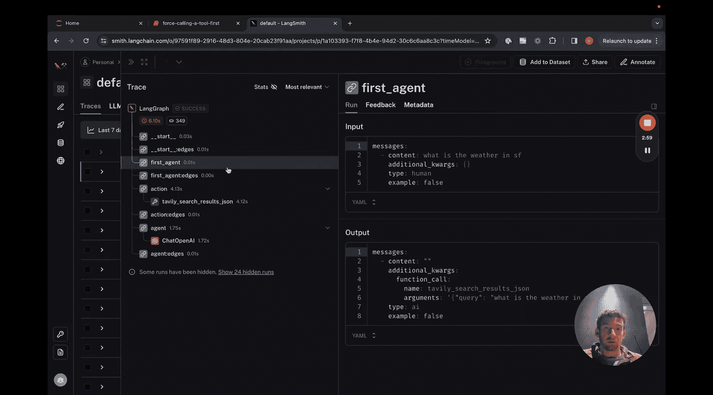

# LangChain【中英⚡LangGraph 使用指南｜LangGraph (Python)】 p08 P8 LangGraph： Force-Calling a Tool -BV1vJfMYuEon_p8-

In this video， we're going to make a really simple modification to the chat agent executor so that we always call a tool first。

So if you haven't already watched the chat agent Executor video， please do that。

 We will work off of that notebook that we have there and we'll only make a few modifications and in this video we're only going to cover those modifications。

 So if you want more context on what's going on in the notebook。

 please check out the video and the notebook for the base chat executor。Alright。

 so we're going to set this up we're first calling a tool first。 Most of the setups the same。

 We're going to create our tools。 We're going to create this tool executor to call them。

 We're going to create our model。 We're going to bind the tools to the model。

 we're going to define an agent state， This is all exactly the same。

 and we're going to actually define the same exact states that in our nodes and edges that we had before。

 but we're also going to define an additional node。

So this is we're going to call this the first model node。

 and this is basically this is gonna be the first node that gets called。

 and we want this to return a message that says to call a specific tool。

 So we have this tvili search results。 JSO tool。 That's the name of the tool that we defined above。

 If you want it to call a different tool。 You you have to pass in the different name here。

 And then we're going to pass in the inputs that we want it to call with。

 So we're going to basically call it with query， and we're going to get the most recent message and get the content from that message and pass that in as a query。

So we're going to create this function， and now we're going to modify the graph。

So compared to the previous graph， we now have this new entry point， which is called first agent。

 We have the same two other entry points as before agent in action。

 and we're going to set the entry point to be first agent。 So this is a change from before as well。

 So now we're setting that this first agent node is always called first。

 We then have a conditional node from agent to action or N。 This is the same as before。

 We now have this node from action to agent。 This is the same as before。

 But we have this new node from first agent to action。Which we're going to set。

 And this is basically saying， after we call the first agent， we always want to call an action。

 and we know that we always want to call an action because we are forcing it to call a AI message with this function call。

 So we always wanted to call this tool。So we can create this graph。 and now if we use it。

 we can see that we get the first result back really。

 really fast because it's not actually calling a language model it's just passing this message in as the argument and then we can see the other things as well。

 If we take a look at what's going on under the hood in Lsmith。 we can see this even better。

 So we have this result here， we can see that the first agent you know we pass in this message and we get back this other message。

 but there's actually no language model call going on under the hood。

 and the tool is really the first thing that's ever invoked。

 And then there is a language model call at the end。

 but we can see that we skip this entirely because we are forcing the agent to basically always call this tool first。

