# LangChain【中英⚡LangGraph 使用指南｜LangGraph (Python)】 p09 P9 LangGraph： Multi-Agent Workflows -BV1vJfMYuEon_p9-

Hey everyone， this is Harrison from Lang chainin here， wanteding to do a video on Langgra。

 which is a new library we released。Pretty recently and how you can use La graph to create some multi agent workflows。

 So for those of you who aren't caught up on La graph。

 we have a whole series of videos going through it。 and it's basically a way to dynamically create。

Agent like workflows as graphs and so what do I mean by that by an agent like workflow I generally mean running a language model in a loop in a variety of ways and that there's different structure and how you might want to run that language model in a loop and so La graph is useful for defining that structure and specifically it allows for the definition of cycles because this is a loop after all。

 Another way to think about this is thinking about it as a way to define kind of like state machines。

And so a state machine and a labeled directed graph are pretty similar in that you have different nodes and if you think of this as a state machine then a node would be a state and if you think of it as kind of like in this multiagent workflow then that node state is an agent and then you have these edges between them and so in a graph that's an edge in a state machine that is transition probabilities and when you think of these multiagent workflows。

 then those are basically how do these agents communicate to each other So we'll think about building multiagent workflows using La graph the nodes are the agents。

 the edges or how they communicate if you have them already checked out La graph again I highly recommend that you check out the video that we have at a high level the syntax looks like this it's very similar to network X you define a graph that track some state over time you then add nodes into that graph you then define edges between those nodes and then you can use it like you would any other。

Lane chain chain。So today I want to talk about three different variants of multi agent workflows that we're going to use Laing graph to create。

So the first one is what we're calling multi agent collaboration。

And so this is largely defined as you have multiple agents working on the same state of messages。

So when you think about multiple agents collaborating。

 they can either kind of like share state between them or they can be kind of like independent and work on their own and then maybe tasks like final responses to the other。

 And so in a multiagent collaboration， they share the state。

 And so specifically this example that we've set up， it has two different agents。

 and these are basically prompts plus LLMs。So there's a prompts plus an LLM for a researcher and there's a prompts plus an LLM for a chart generator that each have a few different tools that they can call。

 but basically the way that it works is we first call the researcher node or the researcher agent。

 we get a message and then from there there's three different ways that it can go one。

 if the researcher says to call function then we call that tool and then we go back to the researcher。

Two， if the researcher says a message that says final answer。

 so in the prompt we say like if you're done， say final answer。

 so if the researcher says final answer， then it returns to the user and then three。

 if it just sends a normal message， there's no tool calls and there's no final answer。

 then we let the chart generator take a look at the state that's accumulated and kind of respond after that。

So we're going to walk through what this looks like we're first going to set up everything we've need I've already done this  importantly we're going to be using Langsmith here to kind of like track the multiagents and see what's going on for a really good debugging experience Langsmith right now is in private beta if you don't have access。

 shoot me a DM on LinkedIn or Twitter and we can get you access。

So the first thing we're going to do is we're going to define this helper function that creates an agent so basically we're going to create these two kind of like agents up here and these agents are parameterized by an LLM。

 the tools they have and a system message and so then we're taking kind of like we're basically creating this mini chain。

 this very simple minicha that is a prompt which has the system message in it and then it's a call to the LLM and it has access to some tools so let's define this helper function。

We're then going to find the tools that we want the agents to be able to call。

 so we'll have one search tool we'll use to Vi search for that。

 and then we'll have one Python tool that can run Python code。Now we can start to create our graph。

 So first， we're going to define the state of what we want to track。

 So we want to track the messages。 And so again， like each agent will add a message to this message's property。

And then we also want to track who the most recent sender is。

 And the reason we need this info is because after we call this tool。

 we're going to check who the sender was and we're going to return to them。 So this is just some。

 some state that's useful to track over time。So let's define this state。

 we're now we're going to define some agent nodes。So here we've created a little helper function to create an agent node and so specifically this agent node is going to take in state agent name。

 it's going to call the agent on the state and it's then going to look at the result。

 we need to do a little bit of kind of like converting here so the agent is going to respond with an AI message but when we add that to the message it states that's accumulated over time。

 we want to represent that as a human message actually because we basically want the next AI that sees this to kind of like work with that and sore if it's a function message then we're going to represent it as a function message because it will just stay a function message otherwise we're going to cast it to a human message。

And we're going to give it a specific name， we're going to give it the name of the agent so that it knows basically is this message that it sees again。

 because we're keeping track of this global state and so in the global state。

 when it sees a human message， is it from this researcher or is it from this charge generator？

And so we're going to do that and we're going to create two nodes。

 we're going to create this research agent node by basically paring out the agent node function。

 and then we're going to create this chart generator node。We're now going to find the tool node。

 this is the node that just runs the tools， it basically looks at the most recent message。

Loads the tool arguments， it kind of it will call it， it will call the tool executor。

 the tool executor is just a simple wrapper around tools that makes it easy to call them。

 and then it will convert the response into a function message and append that to the messger's property。

And now we need the edge logic， so this is the big router logic here。

 which basically defines some of the logic of where to go。So。We look at the messages。

 We look at the last message。 If there's a function call in the last message。

 then we go to the call tool， or then we return call tool， and we'll see what that leads to later on。

 If there's final answer in the last message， then we return end。 Otherwise we return continue。

 And so let's see how we use this in the graph。 So first， we create this graph。

Let me run this mess first first we create this graph with the agent state。

 then we add the three nodes that we have， the research node， the chart node and the tool node。

 we then add this conditional edge So the researcher after we call the researcher。

 uses the router logic。If， if the router returns continue， then we go to chart generator。

 So if the researcher returns。Basically， something that doesn't have a tool and something that isn't final answer。

 then we return to continue in which case we go to the chart generator。

 if the router returns call tool， then we call the tool and if it returns end。

 then we end similar with the chart generator and then we add this conditional edge after call tool。

 So after we call the tool we basically look at who the sender is and if the senders the researcher。

 then we go to the researcher， if the senders the charge generator then we go to the chart generator and we set the entry point to be the researcher node。

Now we can invoke it。 We'll use the stream method so that we can see things being printed out。

 We'll pass in this human message asking it to fetch the UK's GDP over the past five years then draw a line graph of it。

 and then after we code it， finish it and we'll run this。

 it'll take a little bit so I'll probably pause the video here， I'll kick off the I'll kick it off。

 pause it， come back when it's finished and then we can see what it looks like in Lismith as well。

Allright， so it's finished so it was streaming out so we can take a look at the whole stream of things in here if I can figure out how to expand it so we can see the researcher。

 you know the first thing it does is it queries UK GDP data for the past five years then calls a tool and then it kind of keeps on going at some point there's this chart so you know it plots it over the past three years it looks like so it didn't quite get all all the data it needs so you can see yeah you can see it says that the data for years。

 2018 and 2019 is missing and so it plots that and then this is just the final response so that's why it shows up so big if we want to see this in a little bit nicer view because this is a lot to digest we can go to Langsmith and so Langsmith at the top of the notebook I said it so that it would log to this specific project the multiagent collaboration I can see that I've got one run can see some basic stats on it like it took over a minute it's got some tokens on it if I click into it I can now see exactly what was gone on under the hood so。

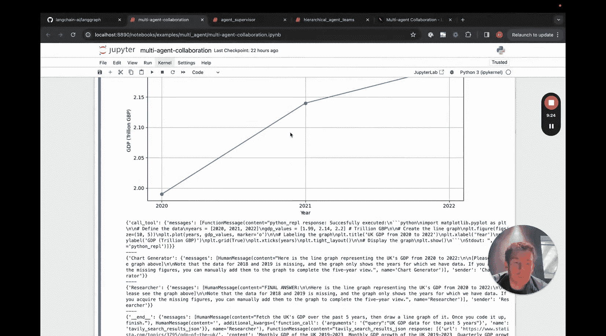

called the researcher and we can click into here and we can see the exact call that it made to open AI and so there was this system prompt and then this was the user's first message and then I this it then called to Vily which is the search tool we can see the results there。

 it then called the researcher again， we can see that you know there's now more in it because we start to build up this message bank we can see it calls to ViI again。

Okay， so now the researcher and it doesn't call to fill， okay， interesting。

 let's see what's going on here。So at the bottom it basically says， okay。

 so now it's responding what the values are and there's no tool call and there's no thing saying that it's finished。

 so that means that it goes to the next one， which is the chart generator so it calls the chart generator under the hood that calls open AI we can see that down here we get a function call and this is running Python code so it prints this out calls the Python Reple。

We can see that it runs this， the chart generator then goes and the chart generator says， you know。

 here's the line graph， see the chart above， the researcher then goes and it says。Final answer。

 So now that there's final answer， it's finished and that's basically what happened。

 So that's the multi agent collaboration bit。

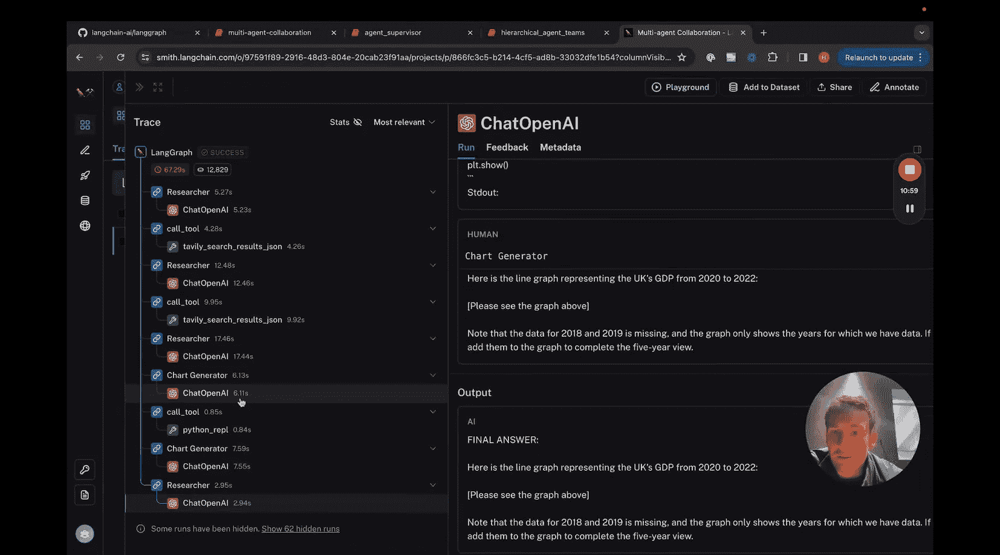

The the kind of like specific thing about this that's interesting is it has this global state of messages that each LLMC is and appends to。

 so keeps on adding to this over time。 and so on one hand。

 this is good because it allows each agent to see kind of like exactly the other steps that the other one is doing and that's why we called it collaboration。

's very collaborative。The other version of this is that you have agents that have their own independent scratch pads。

 and so we'll take a look at the next multi agentent example that we have。

 which is this agent supervisor。So here we have the supervisor。

 which basically routes between different independent agents。

So these agents will be lane chain agents， so they'll basically be an LLM。

That's run with the agent executor in a loop。The LLM decides what to do The agent executor then calls the tool。

 goes back to the LLM， calls another tool， goes back to the LLM and then then finishes and then there's basically the supervisor。

 The supervisor has its own list of messages and essentially what it will do is it will call agent one。

Agent 1 will go do its work， but it will return only the final answer。

 Only that final answer is then added。 The supervisor only sees his final answer。

 And then based on that， it can call another agent or can call another agent。

 Another way to think about this is that this is essentially， you know。

 the supervisors and agent and it's got a bunch of tools and these tools themselves are agents。

 So it's a slightly different framing than before it's not as collaborative if they're not working on kind of like the same sections。

So let's get this started。Again， we're going to be I'm going to let me restart my kernel。

 we're going to be using Lsmith， So again， hit me up if you don't have access to that。

 first thing we're going to do is we're going to create some tools。

 We'll use the same tool tools as before the Tivli tool and the Python tool。

We'll next define some helpers again to create these agents as the individual nodes。

 so we have this create agent function similar to last time。

 the difference is now that it's actually doing a little bit more work under the hood so it's not just a prompt plus a language model it's actually creating an open AI tool agent which is an agent class that we have in La chain from there it's creating an agent executor。

 which is also in La chain and we're returning that that's the final agent。So let's run that。

 then what we're doing is we're also creating some little last time this agent node thing。

 which does this human message conversion， just like we did last time is' taking the agent result。

 which is an AI message and converting it into a human message with a name so we know kind of like where it's coming from。

Now we create the agent supervisor， so this is going to be the system that's responsible for looking at the different agents that it has and deciding which one to pass it on to。

So， here。You can see that we're defining a bunch of stuff。

 we're defining a system prompt your supervisor task with managing conversation between the following workers。

 and it's basically using this function definition to select the next role to send things to。

 and it or it's selecting finish finishes another option， we're creating this prompt template。

 we're creating this LLM and we're creating this supervisor chain which basically has a prompt it's got an LLM with some function that it can call specifically we're forcing it to call this route function where it selects the next best role。

 and then we're parsing the response in JSON， and we're using that to determine where to go do next。

Now that we've got that we can create the graph， so we've got this agent state which is messages and then the next field。

 we've got this research agent so we create the agent， we then create the node for it。

 so we partial out agent node， we then do the same for the code agent and then we start creating the graph so we create the graph with the agent state and we add the three nodes。

We now connect the edges in the graph。Okay， so for all the members and again。

 if we look at where members is defined， members is defined up here， so it's the research encoder。

 it's the two basically sub nodes。Or subagent， so for those after we call those agents。

 we go back to the supervisor。Um。Then we also have this conditional edge so from the supervisor after the supervisor is run。

 we look at what's in next and we look in the conditional map and the conditional map is basically a mapping between the members and finish so you know if it says researcher。

 then we go to research note if it says coder， then we go to coder note if it says finish then we finish。

We set the entry point to the supervisor and then we run the graph。Now we can do the same thing。

 we can invoke the team， we can see what happens and see how it performs。Allright， so it runs it。

 you can see that it calls the coder， so here we're asking it to print out or to say hello world and print it to the terminal。

 so it calls the coder and then it finishes here we can write a brief research report on Ps。And。

It will do that。While that's running， we can maybe look in Langsmith to see the previous ones so here we have the coding one we can see that we first called the supervisor agent。

 it's got this call to open AI again it's got this system prompt and then the human and then it decides what to do next and it it's using this function call we can see it has this function definition of route here based on that it goes to the coder so now there's the coder agent。

 the coder agent does several things under the hood it calls open AI first it does a function call。

 it then calls the Python Reple and then it calls open AI again。

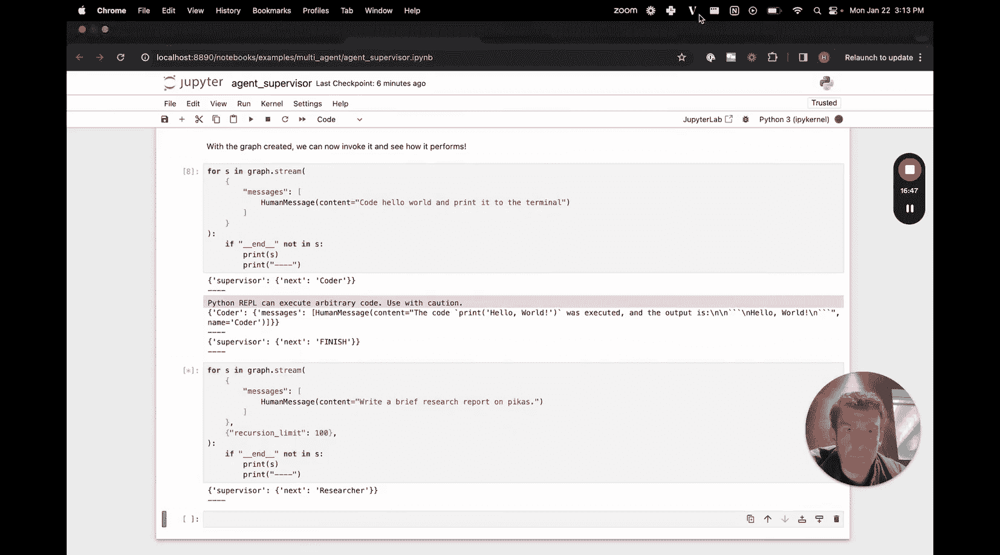

And so。When we go back to the supervisor， if we look up what the supervisor she says。

It just sees the response from the coder。So there's a human message with the name coder and it gets this response。

 it doesn't see any of these calls though or any of the calls of the Python Reple。

 and then we get a response and it says to finish。So this is an example of where you know there's many calls。

 but they're kind of hidden within one agent state。

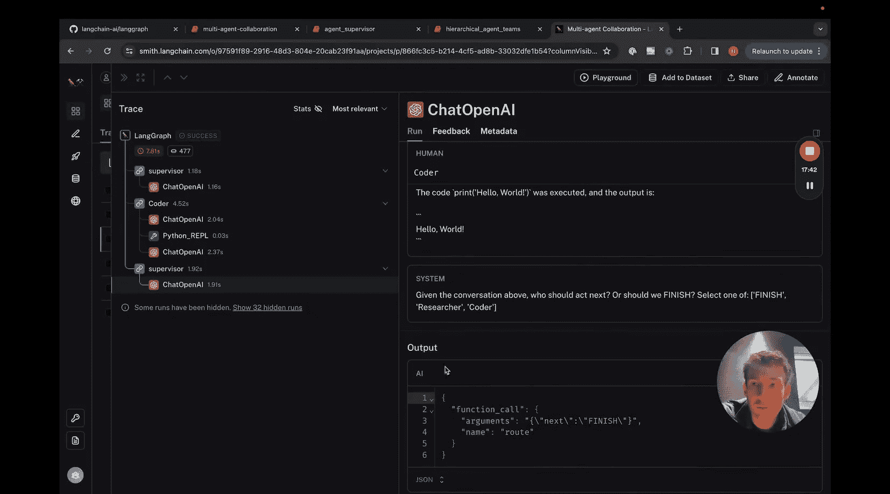

We can also see that it finished writing the research report on Ps， so if we go back here。

 we can see that it's finished running and if we take a look it now calls the researcher agent under the hood and we can see here if you know this is interesting because this took a pretty long time。

 45 seconds we can quickly drill in and see that the longest call was this call to open AI inside the researcher agent where basically it has。

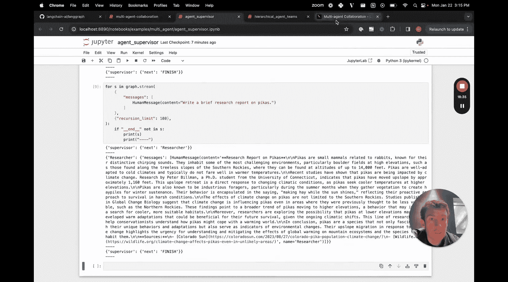

It has all these information from the internet and it writes this long research report。

So that's pretty much it for the agent supervisor now I want to talk about the third and final type of agent that we have an example of。

 which is the hierarchical agent teams。

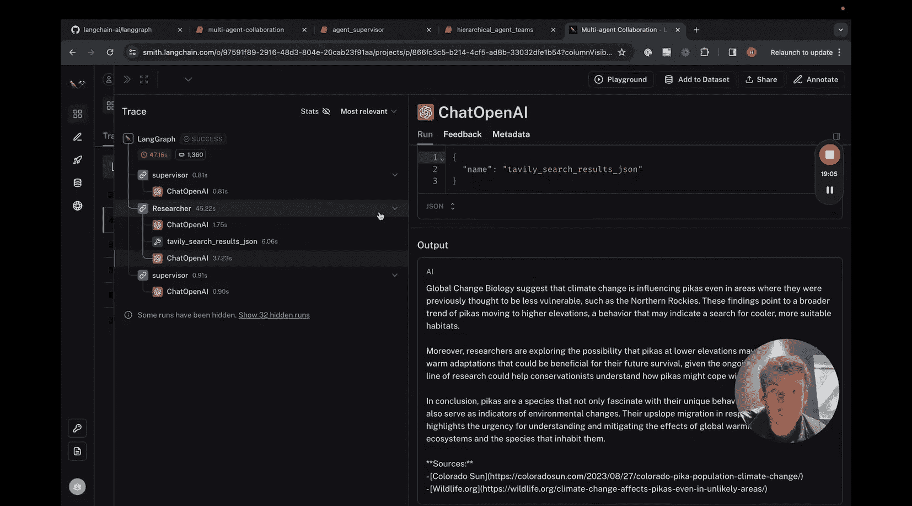

So this is very similar to the previous concept， it's just changing what's going on in the。

It's just changing what's going on in the sub things。

 So now each agent node is itself a different kind of like supervisor agent set up。

And so what this means is that it's going to be a lot more kind of like a lane graph and a little bit less of lane chain。

We can get started by setting up the environment similar to last time we now create the tools so there's two different sets of tools that we need to create ones for the research team。

 it's the searcher and webs scrapper， the others is for this document authoring team and it's these three tools here so we can do that we can load to Vily we can create our scrappe webp tool and then we can start creating these other tools as well and these are for the writer team so we create one that creates an outline。

 read documents， write documents， edit documents and then a Python Reple tool as well。

We're going to create a few helper utilities that make it easier to basically construct this pretty complicated graph。

 so we have one that creates an agent， we then have an agent node and we then have this team supervisor idea and so these are kind of like taking a lot of the concepts that we had in the last notebook and extending them。

Now， we can define these agent teams。 They're hierarchical teams。So we have this research team。

 this research team has a few different attributes on it the main things here are this messages。

 we create we initialize an LLM， we create the search agent and then the search node。

 the research agent and then the research node， and then we have the supervisor agent as well。

We not put this all together， I'm not going to go over all the edges because it's very similar to some of the notebooks that we did before。

 but the end result is that we have this。Graph that we create in order for this graph to be used in as a subgraph and another component。

 we're going to add this enter chain function， which basically is just a converter to make it easier to use。

We can use this directly so we can try out and again， this is just one of the sub teamsams。

 but we can try asking it a question and we can see that it does a search。

 it has a search tool so it'll get a response from there and it will give us an answer。

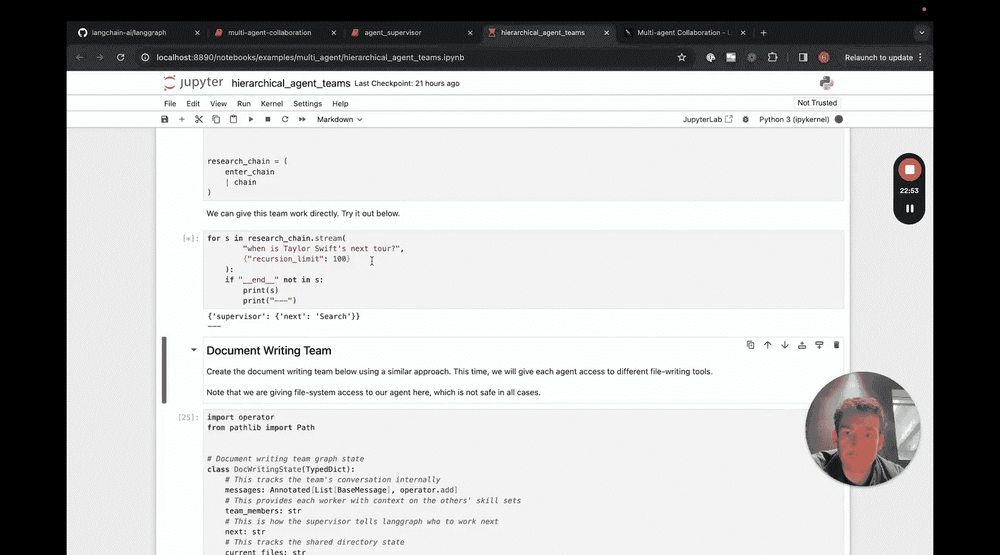

We can see that we get back a response here and if we look at that in Lsmith。

 we can see that it's doing a pretty similar thing to before。

 it's got the supervisor agent it's calling search and then it response with the supervisor we're now going to put together another agent or another graph of agents so it's this document writing team So here we are defining a bunch of stuff we're defining the state that we're tracking it's largely this messages there's then some logic that's run before each worker agent begins so that it's more aware of the current state of everything that exists This is basically with populating relevant context。

 We then create a bunch of agents and a bunch of agent nodes and then we create the doc writing supervisor Now that that's done we can create the graph so we're adding a bunch of nodes we're adding a bunch of edges。

 we've got some conditional routing edges。

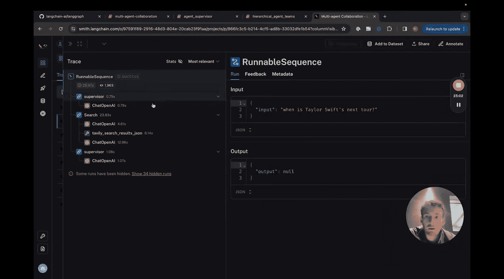

We set the entry point and that now that we have this， we can do something simple。

 like write an outline for a poem and write the poem to disk。

We can see that this is finished and if we look at this in Langsmith。

 we can see that it also looks fairly similar as to what we were doing before。

 We've got the supervisor， we do a bunch of note taking， and then the supervisor finishes。

 it doesn't see any of the internal things it just sees the final response。

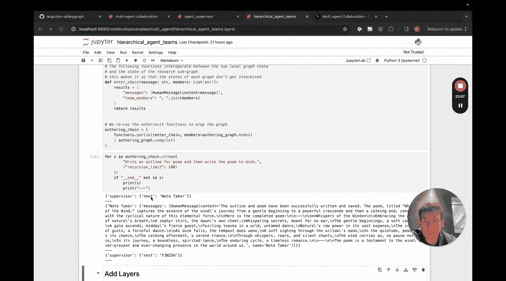

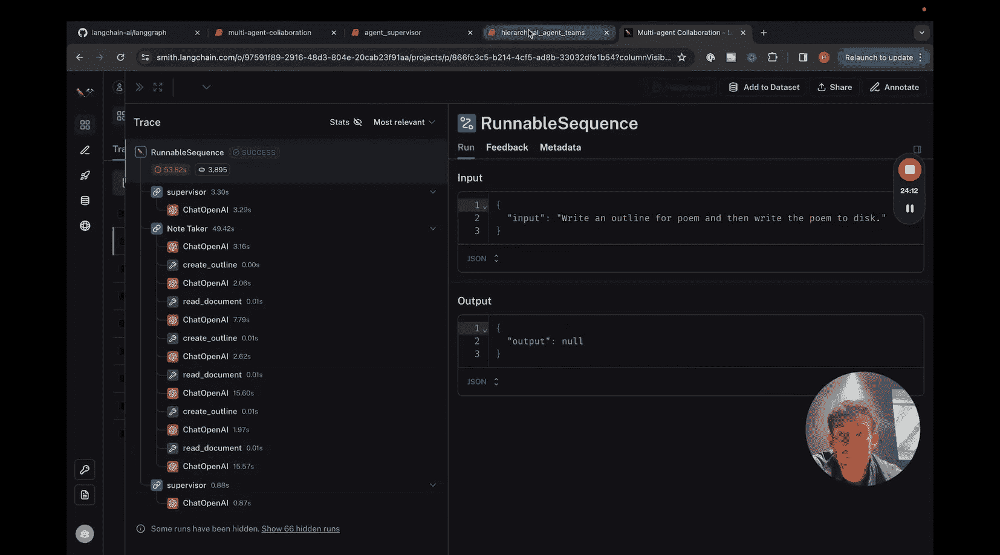

And we can now put this together， so we now have a layer on top of this。

 we've got this team supervisor and now we have this topleve graph states， just a list of messages。

 we have some helper functions， we start creating the graph。

 we add the research team as its own node it's got a little bit of it's got a little bit of wrappers around the previous chain to like get the previous message and and then at the beginning。

 pass it in that into the chain and then called join graph to join it with the rest of the stuff same with the paper writing team。

 we then add the supervisor， we then add some nodes。

 we compile it all right and so now we can do a more complex thing where we call ask it to write this brief research report on the North American Sturge include a chart。

So let's kick this off and I'll come back when this is done。

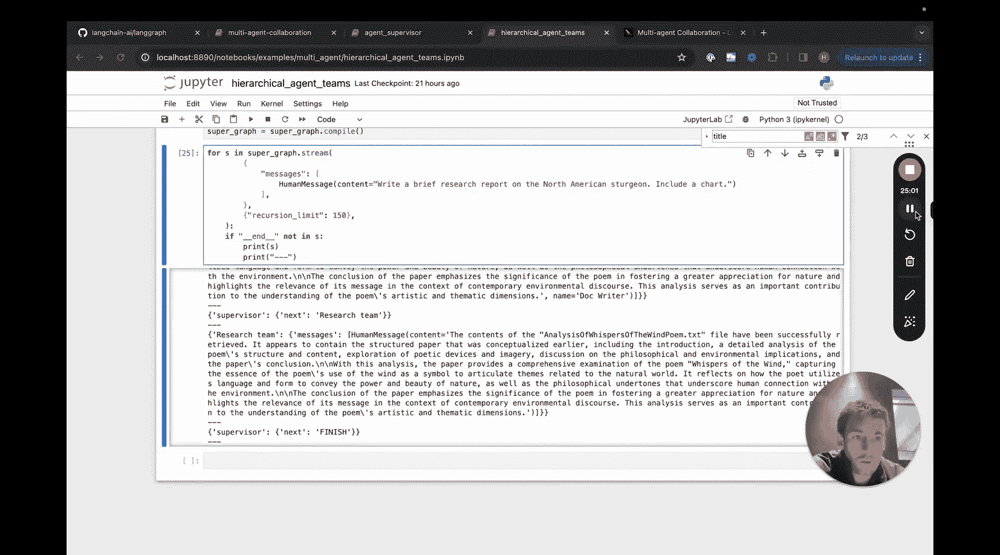

All right， so it's done， took a while if we go to Langing Smith。

We can see that we have this most recent trace took 400 seconds。 If we click inside it。

 we can see that there is a lot going on。 So a lot of calls down the hood。

 it looks like there's this big call to the paper writing team at one point that took a while。

 Theres also this big call to the research team to start that took a while I can click into any of these。

 I can see like what exactly is going on at any point in time， what exactly was happening。

 So this is pretty helpful for understanding what's going on。 Yeah， wow， that's a lot it's open。

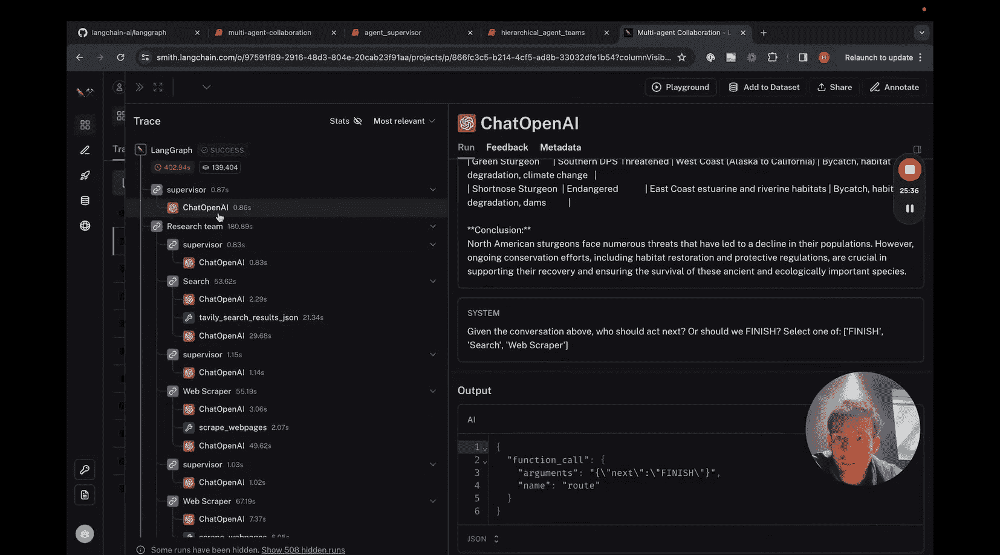

嗯。Anyways， yeah， that's pretty much it for the multi agent stuff。 Hope this was helpful。 I think。

 you know， the the benefits of thinking about things as a multi agent way are really that it。

 I think it helps compartment to mentalalize what you expect different。

Functions to be happening inside this system。 So， you know， each agent basically has its own prompt。

 its own tools， even its own LM at times。 And so you can really focus it on just doing specific things as opposed to having one general autonomous agent with lots of tools。

 And so even if you， you know， even if you have all those same tools and just organize it a bit more hierarchically that can often be helpful for。

 for doing kind of like complex task， because well as just a good mental model to how to think about things。

 So hopefully， this has been a good introduction to that。 These are， again。

 probably only a few of the ways that you can create multiagent workflows with Lgraff really excited to see what other ones emerge。

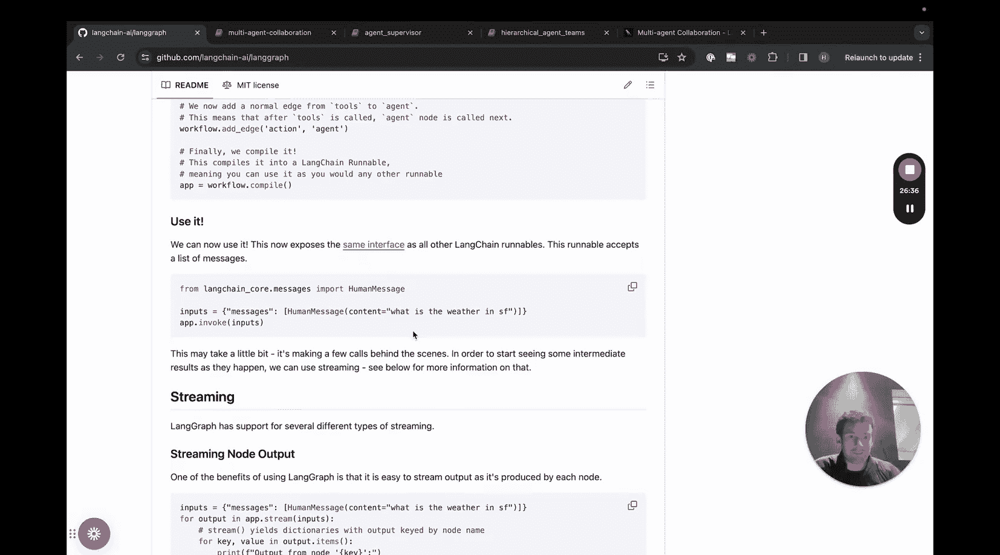