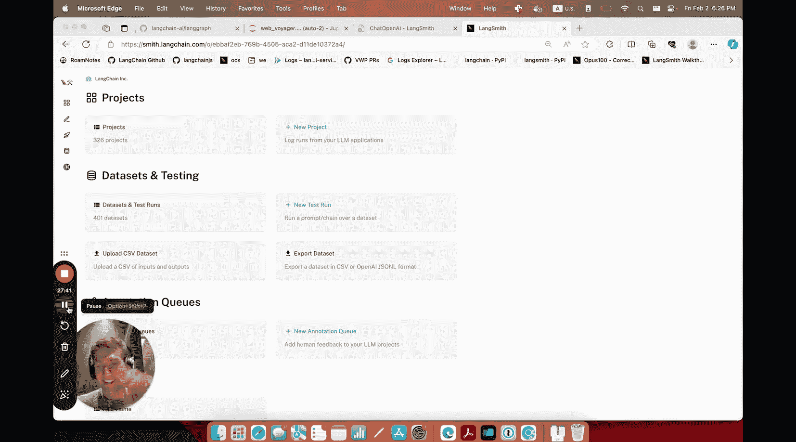

# LangChain【中英⚡LangGraph 使用指南｜LangGraph (Python)】 p11 P11 WebVoyager -BV1vJfMYuEon_p11-

Ever wondered how to build an AI agent that can see。In this tutorial。

 you will learn how to create an autonomous agent that can surff the web and assist you in performing complex tasks solely using vision。

H， it's Will from Lang Chain。 Today I'm going to be teaching you how to build a vision enabled web browsing agent using Lagraph。

Langgraraft is an open source framework from the Langchin team that makes it easy to balance expressivity and control when buildingcyclic type LLM workflows such as those commonly used for AI agents。

If you're not familiar with Laang graph， we've got a nice introductory series of videos on YouTube that you can check out。

 as well as a number of examples in this repository here that you can see to see more basic examples of how to build with it。

Hopefully through the course of building this vision enabled agent。

 you'll see a little bit more and understand a little bit more。

 but with types of workflows that it really empowers you to build。For our example。

 we'll be building this based on the web  Voyager paper by Hu Eo of Zijiang University。

They haven't released the code yet， so this is my best impression or understanding of how the agent operates based on their description in the paper。

The agent itself is a basic reasoning at action loop type of agent if you're familiar with react style agents。

 what it does is it generates a chain of thought， saying why it's going to make the next action to improve its accuracy there。

 and then itll give the action for the tool and then the arguments is going to be passing that and then that will then call an API and then we return and decides to continue to loop until the LLM decides it has the answer has accomplished。

 the goal that it was set out to accomplish once that state is reflective then it returns that output or response to the user there。

When building a web browser agent， there's a number of considerations that you're going have for one。

 if you're just feeding it raw text， it's going to have a lot of useless information that is all going into this machine machine code that actually isn't helpful in getting it to the end state in general when building agents。

 you want to reduce the complexity as much as possible。

 reduce distractions as much as possible so that you can make it as resilient as possible and give it a better likelihood of actually accomplishing its angle goal。

是。The web was designed for human eyes， but even then if you pass in a big screenshot like this。

 it's kind of hard for it to get that level of precision just from generating text so they have a nice approach that uses this set of mark style bounding box annotation that will generate these bounding boxes around the different things and then it can then select these elements by number and then use the or the mouse in order to make these clicks and other types of actions。

 It is a nice way of creating affordances for the or UI affordances for the agent so that it can actually interact in a more successful way。

If we look at this diagram I made the basic structures as follows， you have the state of the graph。

 which is basically web browser that we annotate with this baning boxes。 you have the question。

 the trajectory， which is just the past series of actions that it's taken so it knows not to repeat itself or it knows what it's tried before you have the LOM andro here andd by the brain and then you have the tools tools in general are just the API between the LLM and the outside world in our case。

 the outside world is the web browser So we have things like scrolling， typing， clicking， waiting。

 going back and going to a search engine I put to of this together pretty quickly I haven't optimized it at all。

 So a lot of these examples could probably be made more resilient by either giving it more tools increasing the parameter size or or improving the prompts etc。

 And so a lot of this type of building you can probably optimize more for your use case。

 one thing that makes it really easy to do that is links with so you can click here and you can sign up for an account already do。

And this gives us a nice set of traces that you can look through and help debug and develop your application regularly。

We'll get back to this a little bit later once we actually start running code。

 So once you've set up for that， again， it's optional， but highly recommended。

 And if you need to get an account or off the wait list。

 you can feel free to follow up with us offline。 you can email us at support atlycha。 devv。😊，嗯。

So we'll set up the API key here and then we're going be sending all of these to this little project here to a webvoyage drill and then installing the requirements we required la graphft this package and a length method for tracing and the LinkIn Open AI wrapper。

 which is gives a runnable API to the Open AI SDDK。And then if you haven't already。

 you can install playwright。 Playwright is the browser technology that allows the LM to be giving a control to that。

 You could also use Selenium or other things like that。 It's not super important for this case。

 And then this is just a step that。Allows the Async browser to be operating a Jupyter notebook。

 So wouldn't need that in production。 But for the sake of the notebook， could do that。

on stage agent basically when you're creating a graph is a staple graph and you can think of it as a state machine。

 So then what dictates the next step is both the state and the series of connectionss within the graph to determine what we're gonna be doing next In our case。

've got a number of elements here。 you've got the web page itself。

 So this is a page within playwright you've got the user input and then you've got some things like the image and the bounding boxes as well as the prediction and then you have other things the observation of the tool once it actually does and clicks or types on things It's just a simple string and then the list of messages so that it's going to be saving additional information and the messages so we can keep track of it there。

 you can try tweaking this to see if you can get better performance than what I have already configured here。

Once you define that state。We'll start creating the tools， which again。

 at the API between the LLM and the browser。 you see in La graph and in the stateful graph。

 we accept this state into each of these tools and each of these functions。

 which are nodes in the graph。 So in this case， the click operation。

 where we get the page and then the arguments that are passed by the LLM， which in this case。

 are the bounding box that we have as well as the。that's actually it。 The ving box。

 then we can look up in this list of B boxes。U aboveve， and we can get the X， Y coordinates。

 such are the pixel level information about where we're going click。

The other functions are defined similarly so they're typing text again the batting box and then you also have the the text content that you're going be typing into So if it needs to search if it needs to be filling out forms you can use this we've got some information to overwrite here and all that other stuff。

We've got this scroll operation。 right now， I'm keeping it simple and not even letting it tell。

The tool， how far to scroll。 This could definitely be improved。

 but it lets it go and navigate about whenever you can't see all of it in a single browser view。

 It can wait for things to load。 It can go back a page。 says it traverses。

 and it can jump back to Google， which is kind of like a get jail free card here in this case。

I'll run this cell。And I forgot to run the for yourself。So we go。 Now that we have the tools。

 We can actually define the agent。 This is kind of the fun part。 The agent， as we mentioned before。

 is really composed of a couple of things。 There is the the annotation part。

 So the thing that actually goes and takes the screenshots and generates the bounding boxes。

 And then that image will be passed to the LLM。 And then there is the prompt and the LLM。Here。

 I have a ja file。 it's also in this repository。 It just generates bounding boxes so that we can screenshot it and well just unmark the page afterwards that we don't have those bounding boxes follow us along as we go and navigate the web this will be thenot function and then we have this parsing function here。

 So when the LOM generates raw text， we take that and then we look for this action prefix and then whatever arguments are semicolon separated and sharing it there again。

 you can try playing around of different formats and other types of things to make this more robust if you need to。

We are storing the prompt on the Langsmith H。So you can see what it looks like here。

You go have this prompt ready。 Then you can compose it with the LM and the agent。 This pipe syntax。

 if you're not familiar with it is。Basically， part of the root length and expression language。

 All it does is it creates a new object by composing these together。

 So the output of prompts goes into LLM， which then goes into this output par or thing that takes the text from the overall output message。

 and then this function we just find above which is parse。

This is a single unit and we're assigning it to this variable prediction in the output and then composing that with annotate here。

 this annotate function again， here is what takes the browser and generates the bounding boxes。

Once you define this， if you want to see in a more visual format， I'm scroll that。You can even。raft。

askき。I now I need to print that。And you can see basically as saying。 So again。

 it's all piping similar to batchsh piping。 the data will flow through these different types。

 and then the output of this will be assigned to the prediction value here。

 And then the output of this， whatever keys are going into here will then be joined in the output。

Ajupiter is messing up there for a second。If you want a quick view of what the body boxes look like。

 I pulled up this screenshot here。 so you can see we should go and look for things with HF basically。

 and then we'll draw these things around it。 The LM thing is to say。

 I'm gonna click on number 18 here。 And so then we can resolve those using the bombing boxes to these things here。

 It makes it easy again to help the Egypt interact with this world。Once we go here。

We are time to start creating the actual graph。We've got one more function that we need to define in order to finish our workflow here。

 which is the update Sc pad。 Basically anytime this agent of a loop。

 we want to be able to format the observations， the tools into a structure that we can then put back into the problem。

 eventually So what this does is it looks at the string output of those functions that we defined about as tools and we then we'll be pricing a little bit and then just putting it into this list of previous actions and we'll list number of steps and putting down the Scpa variable when we investigate the traces of Mike and get a better sense of how this is working。

Now it's time to actually compose the graph。 So if you're not as familiar with La graph。

 I'll take a little bit longer to describe these of these operations for you。

 if you are very familiar with it， then you can probably skip forward a few seconds。

The basic steps here are you're gonna to create this graph builder object from the street graph。

 which then takes in that agent state above this type that we define above。

 And that is basically the state that is that part of the state machine。

 So any time I know it returns， it updates the state。

We then start adding nodes and defining edges nodes again。

 do the work E to find how the work is then routed between each of the different units。

 So we add the agent that we did above， we only set it as the entry point。 So when the user calls it。

 it first goes to the agent。Next， we're going to add this update Sc padd functions。

 we just created it， and we're going to say every time the update Sc padd function returns next。

 pass that state over to the agent。 Again， this is because we're completing the loop there for point any time the tool is called and it goes back to the agent to make the decision what to do next。

After that， we've got this list of tools here that we're going to give each a name。

 and were going to add them to the graph。And then we're going to add an edge that says anytime this tool completes。

 go back to that update scratch pad node we define here。And then finally， before I get too far a see。

 this is again， that piping expression language syntax。

 All this does is it says the tool function we defined above。

 first do that and then wrap that in a key called observation。 So it takes a string， plus that in。

 and then says this is the observation key that you turn from it。 And again。

 this is because we define the observation and the La graph state。

 It will then update that after this node is called。

We finally will create this single conditional edge that will determine the whole structure of how logic is routed。

 basically after the agent runs。This function。Will be called。

 and then it will take the output of the agent and then decide which of the other nodes to go to。

So if the action is answer， then we'll end。 And so the user can see the final result that the agent returned。

 If the action is retry， which if you look back above， is just output。

 if we have a parsing error or something like that。

 this lets the agent handle issues if the outputs in the wrong structure。 Otherwise。

 return the actual action itself。 Since we named the action。

 the same value that we put in the prompt for the LLM， we can just directly have an output。

 It'll route it right back to that node。So do this。

 the compiled step just takes is builder and creates the graph itself。

And then it's time to play around with it。 Let's see how we did。 First。

 we're gonna create the actual browser object。 And then there's a helper function。

 which will just print all the things up to the notebook so we can watch it running in real time。

 So notice it opened the browser and navigate it to Google。 I'll go back here first。All right。

 for our first question， we're going to ask。Can you explain the Web voyager paper on archives。

 So I'll do it a little guidance here， as you remember。LMs is today。

 they haven't been trained on data that's very recent。

 So it certainly doesn't have baked in knowledge within its parameters of this paper。

 So it needs to use the web browser to see。 So you can see first， it sees it says。

 I'm gonna type in web Voage your paper archive。 It knows how to go good。

 And then it clicks number 27。 So this little paper here。 And then。

Once it actually decides to move on from there， you can see it opens it up。

 And you can see follow along also in the browser here。 You can see it's opening there。

 And then it responds to the answer。 So it presents a study on building engine and Web agent with large multimodal models。

 It an advancement and。S what PT models， architecture training。 And okay， so it doesn't。

 It's a little bit lazy。 It just likely details this。 It doesn't actually go and scroll through。

 But you know， it got the j Is able to get there。 So let's give it another question。

 Maybe explain today's X KCD comic for me。 Why is it funny。

 So I'm not sure how much of a sense of humor these models have。 But we'll see if it can explain。

It's starting for the same point that we left off before， because as we mentioned， the。

 the browser is just， it's there so that it knows to go back to the start。

 And then it searches today's X KCD comic and it goes and goes to the search bar there， finds it。

 It you see。 It has these。Thanksh here。 And then。It's all these nice pop ups。

 but it's able to stay true and ignore them for now。And we'll see if it can click number 24。

Which one is that。It actually takes mee a while。 Oh yeah。 just clicks the link there。

This is on a flight delay。So you can see it actually did open it up。

 And what I like about this little display is it shows what it looks like to the agent as you go through。

 So it gets the final response and says shows an image seems to be keeps observation information about the greenhouse effect。

 shows a timeline with two significant historical fence。 talks about James Watt。

 who kickedked off the industrial revolution。 And then some of it。

 So the humor is of the early pre recognition of the situation It's been a while。

 So we haven't made that much progress a little bit of deing comic。 but you， a classic for XKCD。

We can see if it knows how to find what the latest blog posts are from L chain。 Again。

 it may or may not know what L chain is， but it knows how to use these tools because we've given instructions。

 So it starts at X KCD。 looks up Google。And then。I'll see what it does after that。

These first couple of questions follow a similar pattern where it goes to Google。 and does a search。

 does a couple of clicks， relatively straightforward。嗯。

So maybe we can see if it can do a more complicated task next。It's going through。Ps this up。

 And then it's able to read that it has open GTs and multi agentent workflows and La graphs。

 So look at that。 It seems like they're actually getting the right stuff。 Again。

 this model is only taking in the image and then some of the instructions that we're having。

 So it's kind of impressive it's able to read all of this from the browser。

Let's give it a more challenging one。 Let's tell it to search a one way flight from New York to Reykjavik for one adult and analyze the price graph for the next two months。

 so。Lots of steps。 We implicitly， if you remember above， give it only150 steps to complete。

 So we can see if it can complete on time。 So it' starting from the line chain blog and。See。

 it goes back to Google there to start out。 agent。 We see if it can use Google Maps。

 This is a little bit more challenging since it's less of a a strict web old fashioned web page。

 You have to navigate different things within it。 We'll see what time it needs or I should leave to get to SFO by 7 o'clock。

 starting from S F downtown。And then let's see what it does。Itll take a little bit of time。So again。

 it's goes to Google， looks at Google Maps。We can even follow it in real time on the browser。

 looks like it's opened it up。What is it gonna do next。嗯。Alright， for our last one。

 we'll ask it something a little bit different。 We'll see if they can navigate Google Maps。

 So what time shall I use to get to SFO by 7 o'clock， starting from S F downtown。

And this one will probably take a little bit of time and we'll see how it does。

Start by searching for。Us of downtown。 So it doesn't even start by doing to。F maps。

him not sure where it's going。 actually， out there goes cool maps。It's got there。

Looks like it is thinkinging at 7 AM because I haven't passed it the current time。

 So that's another thing that I can probably improve。Like，0。Its X out of there。A interesting。

Looks like this is what it's seen。So that's going through and clicking a few things looks like。

The driver had an error here。But it's gonna try to。Get there some things。

And it's starting a little bit。 One thing that we can do as as good at a China as any to check out is you can look at all these operations within Lsmith。

 And then you have this whole record that you can share with your team to go and debug exactly the steps and inputs that you had that LED to each situation。

嗯。You can look at all these LM calls， which again， is correspond to those agent calls to see the series of steps it had。

 So， again， we asked it。So if you check here。 and then this is what it was fed in。

 And then you can say it thinks。 So fine， I need to search for this information on Google Appbs。

 first， just just going type and see us at downtown。It goes through making some decisions。

 you can check SF here。You can look at click 10。These things。

 you notice that we're only passing the most recent screenshot。

 We're not passing previous ones to show these different observations or anything like that。

Maybe it's something you could try out later on to see if it improves。

You can go to 7 these decisions， and it looks like it's fed here。 and it says， you for this。

 I should initiate a search for directions on the map。 And this is click 0。 And see that's。

 that's a little bit interesting。 One of the things that I like to do with here is you can open up in a playground。

And then say， maybe if I updated the instructions here， I can actually。Trus it out， test it out。

 So it's not actually trying to click0。 And then it's trying to type 0。

 So maybe I can go in and change some of these instructions here or say web browsing。And say。

Rememberumber to T。When needed。And space will also select。Amit to。Request。Are you。some。

I am not an expert account engineer， so we'll see how that goes。And then once you have that。

 I've already added my API key and you can hit start。At C4 these， it takes a little of time。

 But then you can start seeing one little sick。 So yes， oh。

 this is the search query here is already entered。 And so it is So you can make some updates。

 You can keep on changing around things。 The USA it's click here。Et cetera。

 I think one other issue with this is it seems like the bonding boxes isn arent correct。

 So you could improve that actual affordance slave。 But again。

 all of this lets you go and see the exact steps you need to taking and then go and play around with it to improve in the U I without having to change any of your code initially。

 you can go and step3 to of these steps and then see exactly what has been done。We'll go back here。

 it seems like it's getting a little bit closer， but it ran out of steps it is a little bit too challenging for this agent using the existing setup。

 and so we will have to go in make some improvements if we wanted it to be able to do something like this。

Anyways， I think that's enough for today。 Hopefully， I've shown you a couple of things。

 You've learned how to build something that looks like this web Voyager paper。

 which I think is a pretty cool set of ideas。 I've taught to you and you've been able to build something with lay graph。

 which lets you go in write regular Python code or the jascript code as well。

 just compose everything together in nice little graph that you can then build and improve to balance some of this control with some of that more magical AI tech experience。

 And you've also gotten something that can go and browse the web for you。😊，2。I guess again。

 if you wanna get access to Langsmith or you want to try building this out。

 you can check out the L graph repo to see these examples that we've shared。

 or you can sign up for Langsmith at Smith dot L chain dot com。And finally。

 don't forget to subscribe to the Lang chain channel。

 This will help you stay on top of all the most recent AI advancements and give you nice tutorials such as this on how to build different types of agents。

 Rag evaluations and all those types of things。 We'll make sure that we keep the content fresh。

 And that you see it today。 So thanks again。 And until next time。

