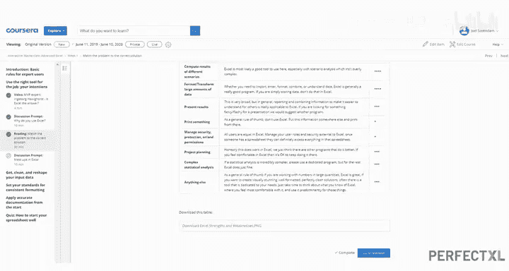
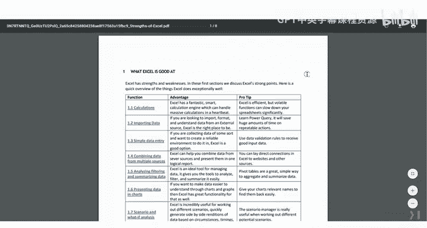
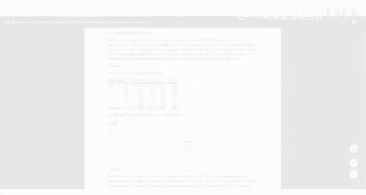
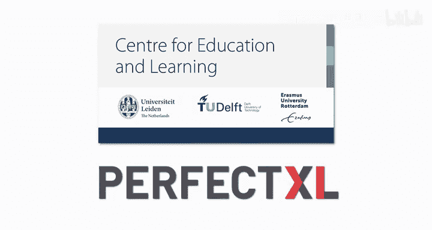

# 1：Excel 专业课程导论 📘

在本节课中，我们将了解《专业人士的 Excel 建模：最佳实践与陷阱》这门课程的整体结构、学习资源以及如何高效地利用它们完成学习目标。

大家好，我是 Janm Stpe。欢迎来到这门 Excel 课程。

我将引导大家了解本课程的结构与目标。

## 🗓️ 课程结构与学习节奏

上一节我们了解了课程的基本介绍，本节中我们来看看课程是如何组织的。

每周的学习内容将包含一个介绍视频、若干课程小节以及一项用于检验学习成果的作业。

## 📚 课程小节的学习资源

每个课程小节都包含以下核心学习材料：

*   一段由 Excel 专家讲解的视频。
*   一个用于保持学习参与度的讨论主题。
*   一份包含核心知识点的阅读材料。

每份阅读材料会被划分为若干部分，并且每个部分都配有表格或简介，以帮助你了解随附的下载文件中包含哪些内容。

## 💾 如何高效利用下载资料

下载资料包罗万象，信息量非常丰富。但我们理解，过多的信息有时会让人难以消化。

因此，请务必利用资料中的表格作为指引，快速定位对你而言最相关的信息。

## 🎯 个性化你的学习路径

学习不再是静态的，而是动态的，它需要为你服务。

请以最适合你自己的方式跟随课程进度。不必急于求成，享受学习的过程。提升 Excel 技能无疑是一件有益的事。

---

本节课中，我们一起学习了本 Excel 专业课程的基本框架。我们明确了每周的学习流程、每节课的资源构成，并掌握了高效利用丰富下载资料的方法。最后，我们认识到采用适合自己的动态学习方式至关重要。从下一节课开始，我们将正式进入 Excel 建模核心知识的学习。