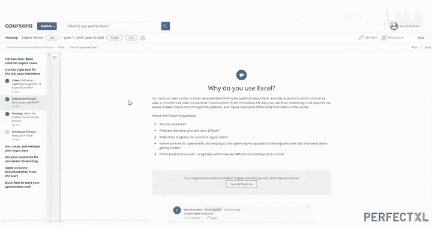
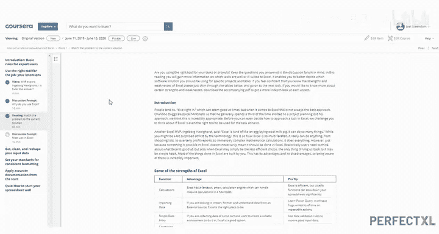
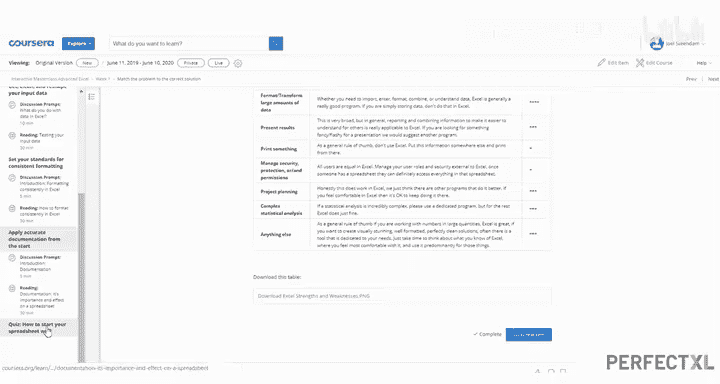

# 6：Excel建模基础与核心要点回顾 📘

在本节课中，我们将回顾Excel建模的基础知识，并介绍下一周的学习内容。课程将涵盖Excel的核心概念，包括数据输入、格式化和文档化，以及如何有效使用函数和公式。

---

## 👨‍🏫 讲师介绍

我的名字是Jan Stpe，我是鹿特丹伊拉斯姆斯大学经济学院的副教授。我的研究方向包括实验室和实地中的社会行为实验。Excel在这些研究中是不可或缺的工具，但正确使用Excel至关重要。

---

## 🎯 第一周内容回顾

在第一周，我们讨论了使用Excel的意图。我们探讨了为什么选择使用Excel，以及你使用Excel的目的是什么。

以下是第一周的核心要点：

*   **数据输入**：这是任何电子表格的原始材料，必须妥善处理并确保其准确性。
*   **格式化**：在我们开始构建电子表格时，如何构建其结构。
*   **文档化**：如何确保Excel文档对他人也是可理解的。

通常，你不是唯一使用某个Excel表格的人。使用清晰的文档可以为你的同学或同事在合作项目中节省大量时间。

---

## 🔮 下一周内容预告

遵循这一脉络，下周我们将讨论Excel的命脉——**公式**。

我们将看到一些世界知名Excel用户的访谈，例如：

*   **Osdu Sole**（来自波特兰）：他将谈论一些常用函数和公式的陷阱。
*   **Charles Williams**（来自英格兰）：他将讨论一些可能真正考验Excel计算引擎、导致某些电子表格运行变慢的函数和公式。
*   **Liilla Garrani**：她将告诉我们一些与函数和公式相关的良好使用最佳实践。

掌握函数和公式就等于掌握Excel。这正是我们将帮助你实现的目标。

---

## 💎 总结

本节课我们一起回顾了Excel建模的基础，包括数据、格式和文档的重要性，并预告了下周深入学习函数与公式的核心内容。

我下周会回来与你同步进展。现在，我邀请你立即开始深入学习。不要害怕向你的讲师、同学和同事提问。Excel是一门最好共同学习的技能。

祝你学习愉快，好运！

