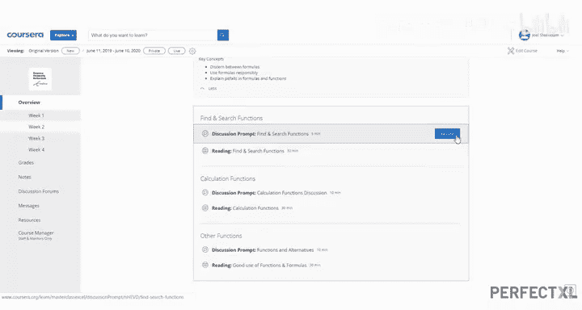
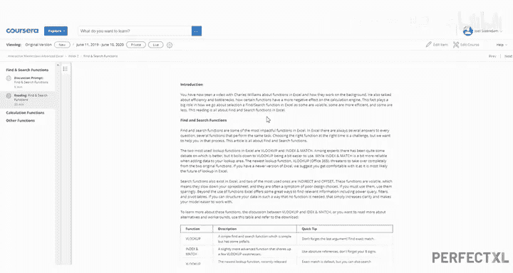
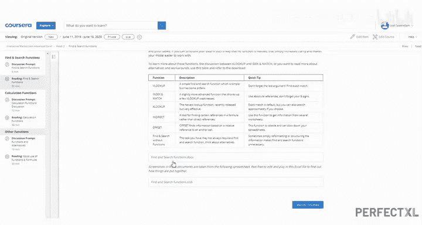
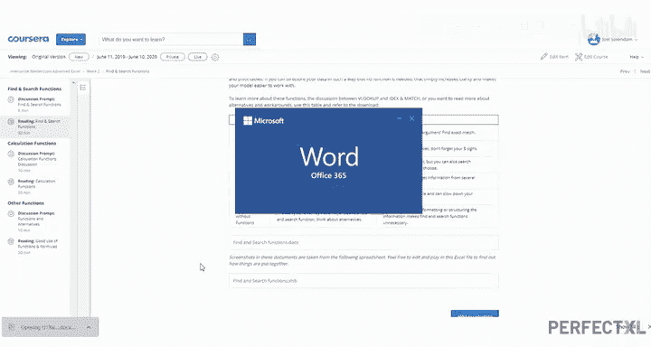

# 10：函数公式进阶与模型架构设计 📊

在本节课中，我们将梳理第二周关于Excel函数与公式的核心知识，并展望下一周关于电子表格结构与信息流的重要性。我们将回顾函数公式的关键作用，并初步了解如何构建易于维护和理解的电子表格模型。

---

欢迎回来。我的名字是Jan。祝贺你完成了第二周的学习，本周我们讨论了函数与公式。

函数与公式是电子表格的生命线与核心。正确使用函数与公式对于构建一个优秀的电子表格至关重要。这不仅关乎获得正确的结果，本周的重点更在于构建**能够持久、易于维护**的公式。

例如，一个结构良好的公式可能像这样：
`=SUMIFS(销售数据!C:C, 销售数据!A:A, ">=2023-01-01", 销售数据!B:B, "产品A")`

同时，这些公式也需要**让其他用户易于理解**。

我经常使用筛选功能来快速观察实验数据中的特定部分。

公式对于进一步理解数据中的动态至关重要。下周，我们将探讨电子表格结构以及**从数据到计算再到输出**的信息流的重要性。

E. V. Tier将阐述保持电子表格整洁的重要性、正确构建工作簿结构的关键性，以及他实际构建电子表格的方法。

接着，DT大学的教授Alion Deey将向我们简要介绍**简洁性**的重要性，即如何确保我们的电子表格易于理解、维护，以及如何减少错误。

然后，Ly大学的教授Felina Hemons将与我们进行实践探讨：**保护与隐藏信息**如何影响我们电子表格结构的质量。

理解电子表格的结构并弄清数据如何在其中流动极其重要，尤其是当电子表格开始变得庞大时。以逻辑方式设置你的电子表格对于构建一个运行良好的模型是基础。

优秀的电子表格拥有良好的结构，道理就是如此简单。

深入下一周的学习以了解更多关于此过程的内容，我们下周见。

---

本节课中，我们一起学习了函数与公式作为电子表格核心的重要性，其目标不仅是计算结果正确，更要确保公式的**持久性、可维护性与可读性**。同时，我们预览了下周课程的核心：**电子表格的逻辑结构、信息流设计以及保持简洁清晰的最佳实践**，这些是构建稳健、可靠Excel模型的基石。