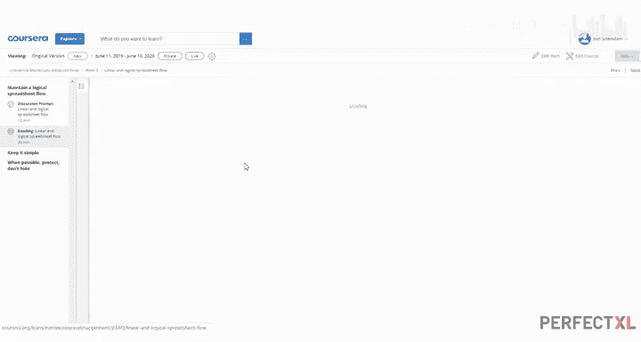
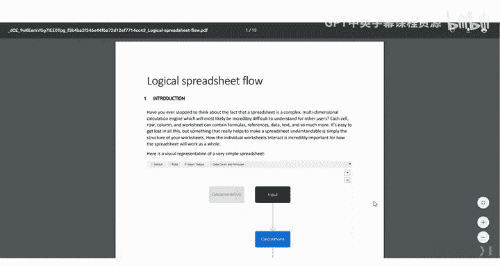

# 14：架构流程与成果优化策略 📊

在本节课中，我们将总结电子表格建模的核心架构流程，并探讨如何优化模型成果，确保其成为完整、可靠的解决方案。

---

上一节我们介绍了电子表格建模的基础概念，本节中我们来看看如何像建筑师一样构建电子表格的结构与逻辑流程。理解这一点至关重要。

我们鼓励您将电子表格视为建筑项目。实际上，在设计实验时，我会尝试可视化数据在 Excel 中的结构。这在我研究的设计阶段提供了极大帮助。

---

接下来，我们将探讨电子表格的最终化步骤，确保您的表格成为完整的模型与解决方案。我们邀请 Getsper Kamenzac 讨论电子表格的报告呈现方面——当所有数据计算完成后，您实际展示什么以及如何展示。

Lee Am Basig 向我们介绍了模型的检查、测试与验证方法。我们如何确保获得的结果是正确的？最后，Chendu 鼓励我们真正将电子表格视为软件作品，因为在许多方面它们确实如此。他分享了一些实用的收尾技巧，帮助我们将模型完善得更加出色。

Chendu 还指出，电子表格开发应包含**规划、构建与检查**三个阶段，每个阶段都同等重要。这一建议真正挑战我们认真对待检查与最终化过程。

电子表格中曾出现许多错误，其中一些甚至导致灾难性后果，造成数百万欧元的损失。因此，我们鼓励您严肃对待 Excel。

不要仅仅构建模型，而要构建**优秀的模型**。祝您在课程的最后一周顺利！

---

本节课中我们一起学习了电子表格的架构思维、报告呈现、验证方法以及最终优化策略。记住，优秀的模型离不开严谨的规划、构建与检查。