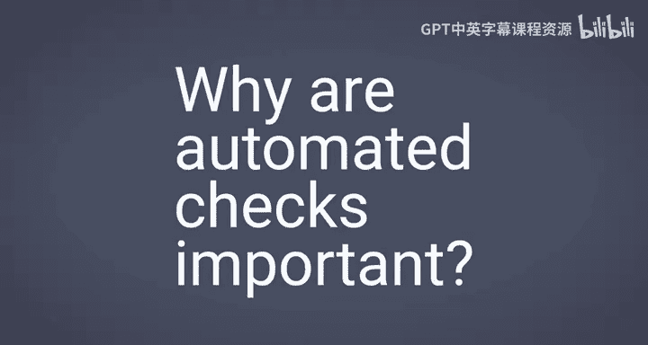

# 17：专业人士的Excel建模 - 模型校验与验证方法 🧪

在本节课中，我们将学习Excel模型构建中至关重要的环节：校验与验证。我们将探讨不同类型的检查方法，理解自动化检查的重要性，并掌握构建透明、可靠模型的核心原则。

---

## 模型检查的类型

上一节我们介绍了课程概述，本节中我们来看看模型检查的具体类型。在模型构建中，主要存在两种检查方式。

*   **自我检查**：这是一种手动评估，旨在判断模型是否“看起来”运行正常。这通常被称为“验证”。
*   **自动化检查**：这类检查可以自动运行，主要分为以下几种：
    *   **错误检查**：用于发现模型中的问题，例如公式错误（如`#DIV/0!`、`#N/A`、`#VALUE!`等）。
    *   **敏感性或情景检查**：确保模型在基础情景下运行。现实中存在因进行“假设分析”后忘记将数字调回基础值，而导致模型出错的案例。
    *   **其他预警检查**：即使模型在基础情景下运行正常，这些检查也能发出预警，例如提示“如果执行此项目，您可能会破产”。

我认为“检查”和“测试”这两个词可以互换使用。其核心目的是确保数字能够相互勾稽。例如，如果您将一项成本分解为五个组成部分，就必须确保它们加总后与原始总额一致。这就是一种检查或测试。

对我而言，“验证”是对数字进行反向核对。即追溯数据源，确保输入了正确的数字，没有出现数字错位等问题。这类工作可以由任何人完成，因此我们通常进行所谓的“自我检查”。但“自我检查者”不一定是模型的构建者，也可以是与此模型没有直接利益关联、相对客观的人。

此外，还有“审计”，这是由独立第三方执行的测试。他们会使用自动化软件并凭借经验，对模型进行一系列规定的测试。

---

## 自我检查的局限性与团队协作

自我检查的一个根本问题是，当只有我独自进行时，我永远无法发现自己逻辑中的错误。如果您认为`7 * 9 = 63`，您就会一直这么认为，并且没有理由去检查它。而其他人带着全新的视角来看，就能发现这个错误。因此，在一定范围内，让更多人审查模型是有意义的。但正如谚语所说，厨师太多也会搞砸汤。

以下是构建可靠模型的一些实用建议：

*   **实施自动化检查**：自动化检查非常有用。在我们构建的典型模型中，通常会包含**500到800个**检查项。您无需逐一查看，可以通过一个总检查项来汇总它们。将这些检查项列在一个页面上，如果检查通过则输出`0`，如果出错则输出`1`。最后进行汇总，如果总值大于或等于`1`，您就知道存在问题。对于接收模型的第三方而言，看到模型内置了大量检查且全部通过，自然会更加信任该模型。因此，在建模初期就设置自动化检查，会让后续工作轻松很多。
*   **遵循“拇指规则”**：人们常常高估自己的Excel能力，试图使用冗长复杂的函数来炫技。我建议遵循“拇指规则”，即**公式栏中的任何公式长度都不应超过您拇指的宽度**。保持简洁，这符合我所说的“透明度”原则。
*   **确保模型透明易懂**：我们必须面对现实。正如我之前所说，模型的存在通常是为了验证他人的直觉。如果模型没有给出他们想要的答案，他们可能会不断调整直到得到想要的结果。这是世界的运行方式。因此，模型必须足够透明，让他人能够理解。如果遵循“拇指规则”，您应该能够仅通过查看工作表（而不必查看公式栏）就能理解模型的逻辑。这样，建模就变成了一项团队协作的游戏。

---

## 课程总结

本节课中，我们一起学习了Excel模型校验与验证的核心方法。我们区分了自我检查与自动化检查，认识到自我检查的局限性以及团队协作与第三方审计的重要性。我们掌握了通过实施大量自动化检查来建立模型可信度的技巧，并理解了遵循“拇指规则”以保持公式简洁和模型透明的关键原则。记住，一个优秀的模型不仅是计算工具，更是一个清晰、可信、便于团队沟通的决策支持系统。