# 1：声誉危机？Facebook 遇上剑桥分析公司 🎭

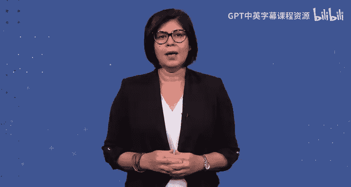

在本节课中，我们将概述这门课程的背景，并初步探讨 Facebook 与剑桥分析公司事件的核心。我们将了解 Facebook 的发展历程、其面临的声誉挑战，以及这一事件引发的广泛社会影响。

---

当提到 Facebook 时，你会想到什么？你是否记得自己首次创建 Facebook 账户的情景？你当时为何要创建它？你是否曾删除过自己的 Facebook 账户？你在 Facebook 上分享何种信息？你是否知道你在 Facebook 上分享的数据和动态会经历什么？

这些问题很多。或许最重要的问题是：这一切为何重要？我们是否应该关心？

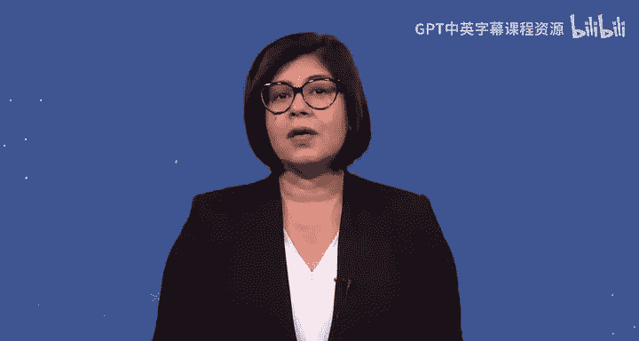

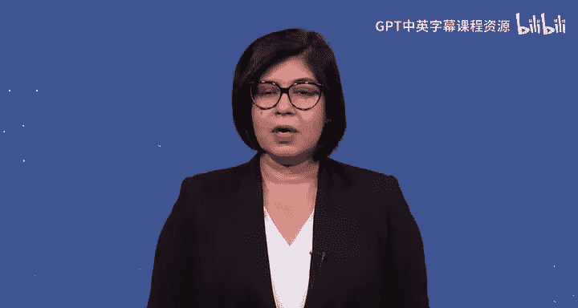

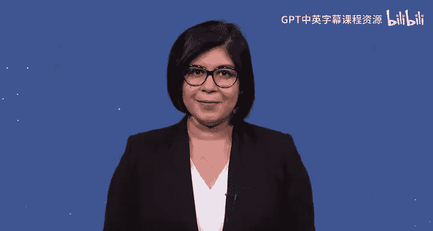

欢迎，我是维蒂·查德里博士，鹿特丹伊拉斯姆斯大学媒体与传播学副教授。😊

我与鹿特丹管理学院案例开发中心的同事们共同开发了这门名为“声誉危机：Facebook 遇上剑桥分析公司”的慕课。

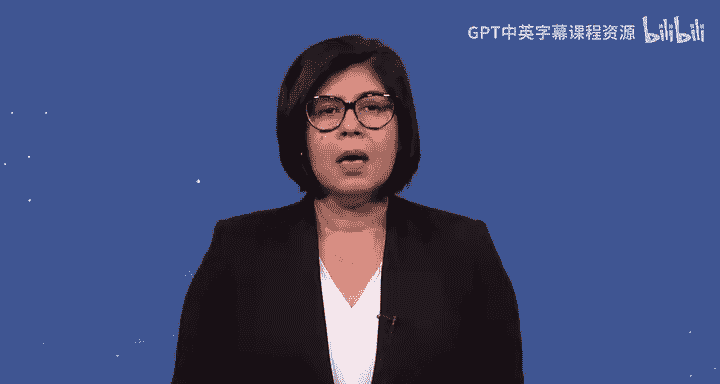

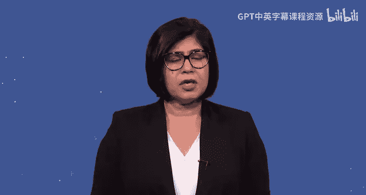

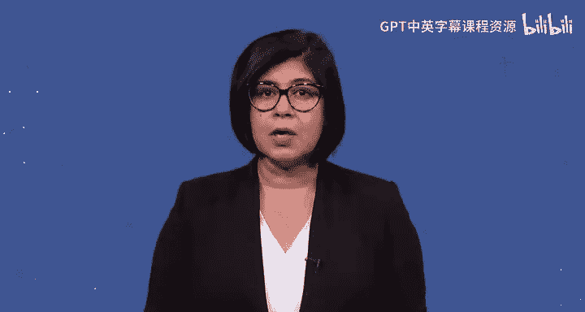

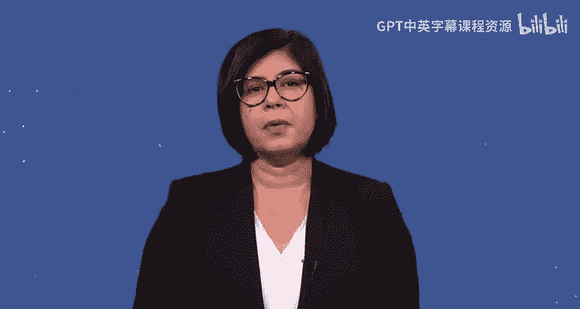

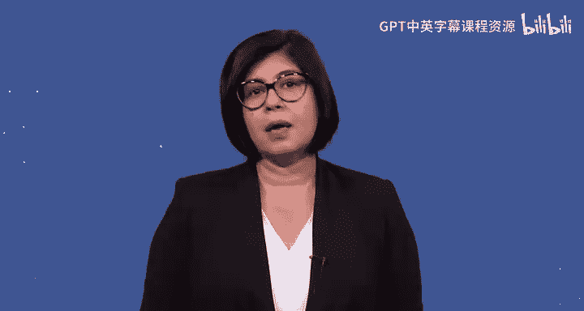

在本视频中，我将概述我们课程的背景。

你们中的一些人可能熟悉 Facebook 与剑桥分析公司的争议。这家英国分析公司在用户不知情或未同意的情况下，收集了 8700 万 Facebook 用户的数据，并利用这些数据在 2016 年美国总统竞选和英国脱欧公投前夕影响选民意见，以支持唐纳德·特朗普。

这里你可以看到一个时间线，追溯了 Facebook-剑桥分析公司事件的关键进展、其直接后果以及对两家组织的影响。

我们在 2020 年结束，当时 Facebook 宣布了多项措施，包括成立一个咨询监督委员会，以应对对其内容政策的批评。

在课程的任意阶段，你都可以链接回此时间线，以遵循这个复杂故事中事件发生的先后顺序。

我们将以此案例来说明当代组织在声誉、品牌形象、信任、领导力、隐私和伦理等方面面临的挑战。我们将深入探讨 Facebook 和剑桥分析公司丑闻对科技行业的影响，并关键性地概述其在社会政治领域的影响。

随着课程的深入，你会发现其影响是深远的，并不局限于某个时间点。

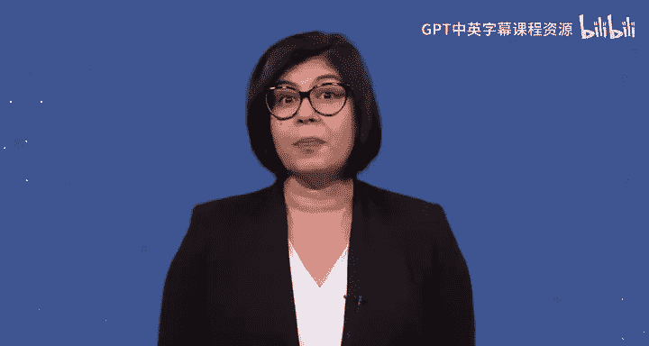

因此，无论你是传播学或管理学的学生，还是对危机和声誉管理感兴趣的从业者，或者只是对基于案例的学习以剖析现实挑战感兴趣，这门课程都适合你。

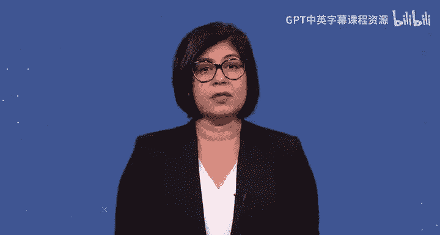

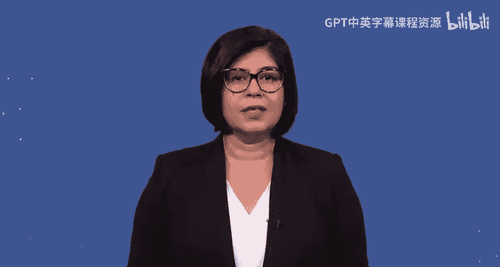

现在，让我们退后几步，为这个案例提供一些背景信息。

Facebook 的故事广为人知。19 岁的马克·扎克伯格和四位同学于 2004 年 2 月开发了“The Facebook”，最初是作为哈佛学生的社交网站，并迅速扩展到其他大学。不久之后，“The Facebook”正式更名为 Facebook。

到 2004 年底，Facebook 已拥有 100 万活跃用户。很快，Facebook 也吸引了企业使用该平台进行付费广告，据报道在 2006 年投资建立了一个成熟的内容广告销售团队。2019 年，广告销售贡献了 Facebook 707 亿美元总收入的 98% 以上。

因此，从 2004 年的低调起步，如今的 Facebook 是一个社交巨头，在全球拥有 30 亿用户。如果 Facebook 是一个国家，它将是世界上最大的国家，超过中国和印度。

这里你可以看到 Facebook 如何定义其使命：**赋予人们建立社群并使世界更紧密相连的力量**。

以及如何实现：**遵循赋予人们发言权、建立联系和社群、服务所有人、保障人们安全、保护隐私以及促进经济机会的原则**。😊

确实，Facebook 的价值主张一直围绕着社群和联系的理念。

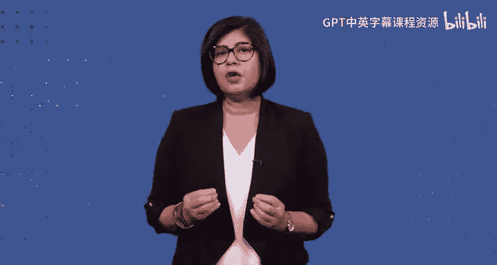
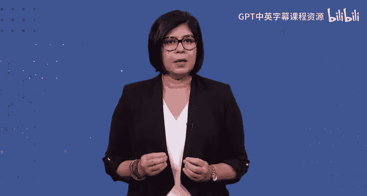

让我们看看公司如何定位自己。此时，你可以暂停视频仔细阅读。

现在，Facebook 的迅速崛起伴随着相当多的争议，从其起源和 2010 年电影《社交网络》的主题开始。据传，创始人、董事长兼首席执行官马克·扎克伯格据称窃取了三位哈佛高年级学生的创意，公司最终与他们达成了和解。

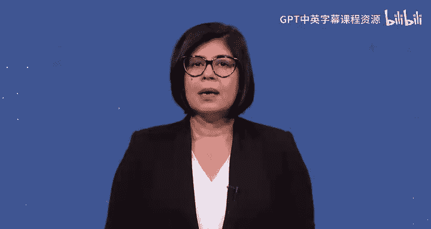
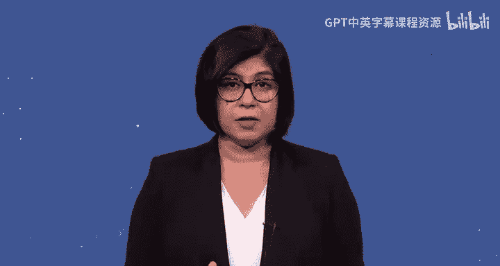
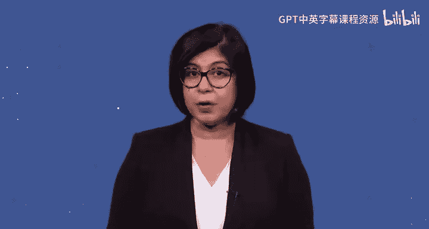
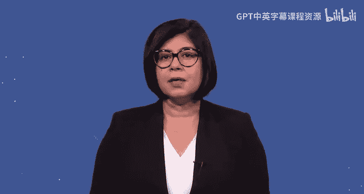
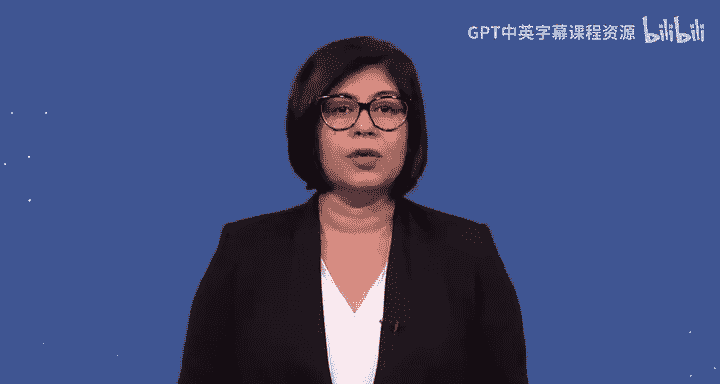

16 年来，Facebook 呈指数级增长，并发现自己卷入了性质更严重、规模更大的争议和辩论中，从用户数据的安全和隐私，到干预选举，再到在传播错误信息、假新闻和虚假信息中的作用。

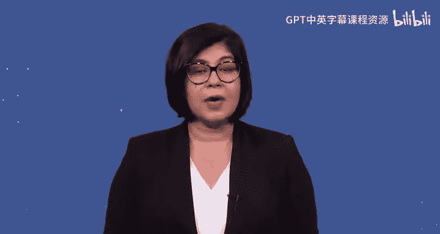
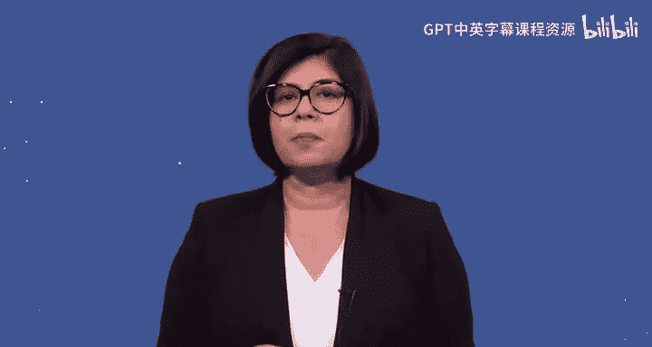
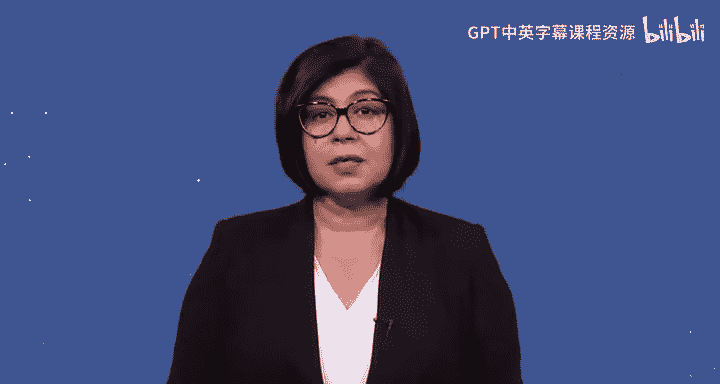
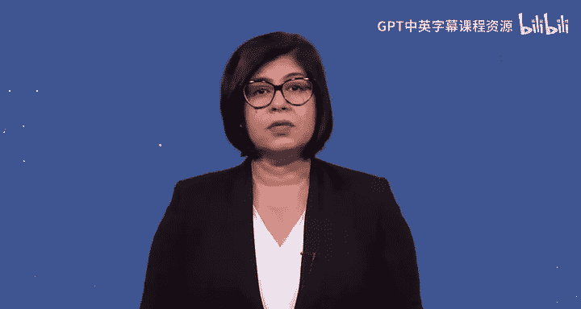

特别是在剑桥分析公司丑闻之后，Facebook 的品牌价值、声誉和信任度均有所下降。

随着隐私讨论的扩大，Facebook 的声誉遭受重大打击，从 2018 年全球 100 家最具声誉公司榜单的第 51 位降至 2019 年的第 94 位。

这里你可以看到，自 2017 年以来，Facebook 的品牌价值和排名均有所下降。该社交网络从 2018 年的第 9 位降至 2019 年的第 14 位，品牌估值下降了 12%。

随着批评声浪的增长，用户对 Facebook 保护隐私承诺的信任也显著下降。

矛盾的是，用户基数持续增长，财务表现也是如此。

这里你可以看到，2019 年，Facebook 在《财富》500 强榜单中排名第 57 位，这是按收入对最大公司的年度排名。当它在 2012 年首次进入该排名时，起点是第 482 位。

因此，尽管丑闻不断且信任度下降，Facebook 持续且稳定地上升至目前在《财富》500 强公司中的地位，引发了严肃的问题：Facebook 是否太大、太有影响力、太强大以至于不会失败？

然而，余波远未结束。Facebook 已宣布一些变革，以应对伦理行为、透明度和数据隐私方面的持续挑战，但它是否已为未来的声誉保障做得足够？

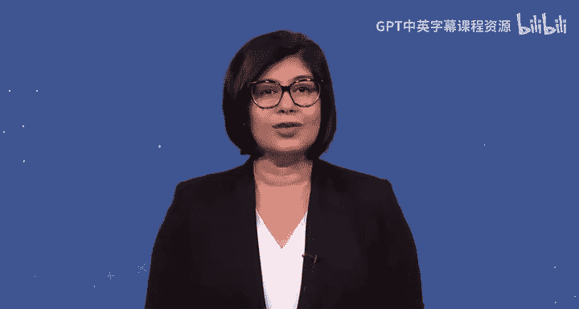
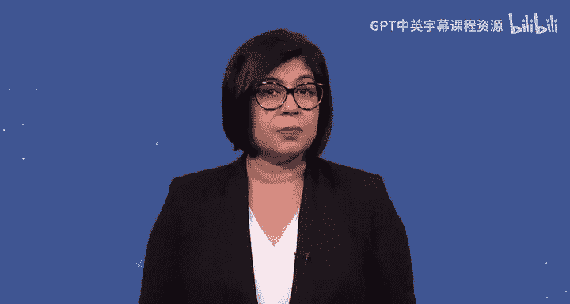
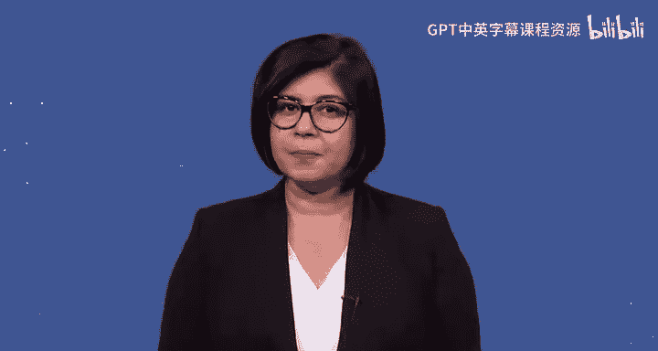

每周，我们将介绍一个与案例相关的主题，就像剥开洋葱的层层外皮，你将能够从不同的理论和研究视角分析这个案例。

通过将理论与实践相结合，这门慕课将使你能够分析 Facebook 的行动，并进行批判性思考：Facebook 未来需要做什么（如果需要的话）。

下周的主题全是关于声誉：它是什么、为何重要以及如何创建、维护和摧毁。我们还将听取专家意见，了解为何数据隐私问题构成了严重的声誉挑战，特别是对于像 Facebook 这样的科技公司。

你准备好深入探讨了吗？那么请观看下一个视频以了解如何进行。🎼

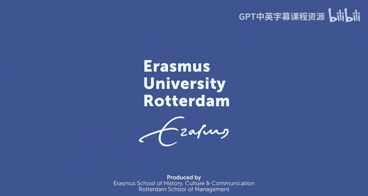

---

**本节课总结**

在本节课中，我们一起学习了“声誉危机：Facebook 遇上剑桥分析公司”课程的背景介绍。我们回顾了 Facebook 的发展历程、其核心使命与定位，并重点了解了剑桥分析公司数据丑闻事件的概况及其对 Facebook 声誉、品牌价值和用户信任造成的冲击。课程也提出了一个核心问题：在面临诸多争议的情况下，Facebook 是否“大而不能倒”？这为我们后续每周深入分析不同的理论视角（如声誉管理、隐私伦理等）奠定了基础。下一节课，我们将正式开始探讨“声誉”这一核心概念。