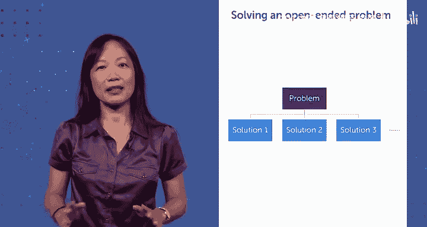

# 2：案例教学法入门指南 🧭

在本节课中，我们将学习什么是案例教学法，以及如何通过分析真实的商业案例来培养职场成功所需的关键能力。

---

当人们讨论职场成功最重要的能力时，通常会提到**创造力**、**批判性思维**、分析复杂模糊情境的能力，以及在不确定性中解决问题和做出决策的能力。

那么，如何培养这些技能呢？一个有效的方法就是钻研真实的商业案例。无论你是全日制学生，还是在职人士利用业余时间学习，案例教学法都能帮助你。

我是陶悦，伊拉斯姆斯大学鹿特丹管理学院案例开发中心的执行编辑。在本视频中，我将向你展示案例学习的基础知识。之后，你可以将所学付诸实践，通过解决案例来构建你的批判性思维能力。

---

## 什么是案例研究？📖

首先，什么是案例研究？许多人可能听过这个术语，但它对不同的人有不同的含义。有些人可能认为它是用于说服老板批准项目的商业计划书，另一些人可能认为是在学术工作中进行深入细致研究的调研案例。

但在这里，我们指的是教育者提供给学生的**教学案例**，目的是让他们通过真实情境学习。案例研究是社会科学教育中一种独特的学习工具。它是一个多层次的故事，将学生置于面临艰难困境的主角或组织的立场上。

通过间接体验那种充满压力的情境，你可以思考，如果你是负责决策的人，将如何分析和应对它。

---

## 如何使用案例研究？🔍

上一节我们介绍了案例研究的定义，本节中我们来看看如何使用它。第一步是理解案例试图教你什么。编写案例的教育者希望你达到什么目标？有时这在说明中会明确写出，但通常你需要逆向分析案例来找到答案。案例的开头和结尾部分通常会给你提示。

案例通常对应于**布鲁姆分类法**学习金字塔中的某一层级。你的任务是理解案例在该金字塔中的位置，以便相应地处理它。

例如：
*   情境是否已经明确定义，你只需要找到正确的理论工具并应用它？
*   或者你是否需要先进行彻底的分析和评估，才能理解真正发生了什么？
*   又或者是否需要更进一步，为问题想出你自己创造性的解决方案？

一旦你理解了应该做什么，就可以研究整个案例，并搜索用于分析和解决案例所需的相关信息。

例如，如果一个案例是关于声誉危机的，可能需要研究公司背景以找出危机的原因。它是否与**企业文化**、**领导风格**或**奖励制度**有关？你可能还想研究行业背景，看看市场竞争是否在其中起了作用。或者公众舆论呢？所有这些元素通常也包含在案例叙述中。

因此，不要仅仅把叙述当作一个故事来读。它远不止于此。请记住，分析和解决案例的线索往往嵌入其中。它几乎从来都不是一个直白的呈现，你需要进行一些深入的挖掘。

此外，一个案例并非只有一个正确答案。可以有很多不同的答案，但你需要为你自己的答案提供**合理的论证**。

---

## 还有哪些有用信息？📊

现在你已经仔细研究了案例内容，那么还有哪些信息对解决案例有用呢？

以下是需要关注的其他部分：

*   **图表与附录**：案例是精心设计的教育工具。没有任何附录是无缘无故放在那里的。通常，一个视觉图表比大量文字能提供更多信息。
*   **参考文献与注释**：务必查看参考文献、脚注或尾注。它们显示了教育者在构建案例时参考了哪些文章、视频或其他材料。这些信息可以为案例提供更丰富的背景，非常有用。

---

## 综合分析与得出结论 🧩

到目前为止，我们讨论了剖析和分析案例的步骤。下一步是将所有部分整合起来，得出结论。分析很重要，**综合**同样重要。

最终，你需要回到最初的目的，为案例的核心挑战生成一个连贯的解决方案。

---

## 案例学习的价值与本书介绍 💎

通过这种以整体方法应对现实挑战的案例学习ABC，你可以练习批判性思维、解决问题、决策制定、分析和综合技能，这些技能在职场中都极具价值。

然而，一个好的案例研究不仅仅教你技能。它也具有知识性。你可以通过阅读案例中呈现的事实来扩展知识。此外，由于它以故事形式讲述，读起来通常也很有趣。如今，越来越多的案例还包含视频，使学习体验更加有趣。

在我与来自伊拉斯姆斯大学历史、文化与传播学院的里耶·查雷博士共同编写的这本书中，你将处理**Facebook与剑桥分析公司**的案例。

通过分析一系列争议性事件，你将更深入地理解关于声誉管理的一切：其**核心概念**、其与企业文化和领导力的关系、其与举报和危机的相互作用，以及在数字时代和公众对企业社会责任意识日益增强的背景下所面临的挑战。

你可能已经对Facebook和剑桥分析公司的丑闻了解很多，但我确信这个案例会让你看到以前从未注意到的事情——这些事情不仅与本案中的公司相关，也与你自己的工作和生活息息相关。

享受这个案例吧。

---

本节课中，我们一起学习了案例教学法的核心价值、使用步骤（理解目标、定位分析、挖掘信息、综合结论）以及它能培养的关键能力。希望你能将这种方法应用到后续的Facebook案例中，获得深刻的洞察。