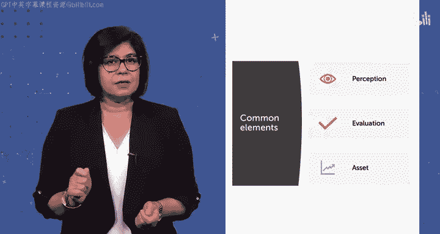
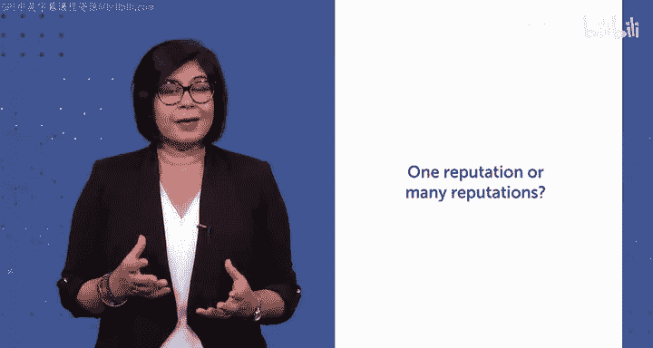

# 3：声誉管理的内涵、意义与实践路径 🏢

在本节课中，我们将学习企业声誉的基础知识，包括其定义、构成维度、重要性以及管理挑战。通过理解这些核心概念，你将能够分析声誉如何影响组织，并思考在危机中维护声誉的策略。

---

## 声誉的定义与核心特征

沃伦·巴菲特有一句名言：“建立声誉需要20年，毁掉它只需要5分钟。”这句话常被引用，以说明声誉的力量与脆弱性。

但声誉究竟是什么？它为何重要？乍看之下，声誉这个概念似乎简单直观，在日常对话中经常被使用。无论是企业、政府、国家、个人还是品牌，我们都说一切事物和每个人都有声誉。但这个普遍且全球熟知的概念实际上更为复杂。

我们今天的焦点是企业声誉。以下是一些关于企业声誉的经典定义。你可以随时暂停视频仔细阅读。

这些定义的共同点是，它们都声称声誉是利益相关者对组织的总体看法。**利益相关者**是指那些能够影响组织行动或受其影响的个人或群体，例如消费者、员工、投资者、供应商、媒体等。其次，声誉涉及相对于竞争对手对公司的某种评估。最后，声誉被视为一种宝贵的资产，通常是一种**无形资产**。尽管它是无形的，但声誉与有形的商业成果相关联，我们稍后将在视频中看到这一点。

---

## 声誉的多维性与影响

考虑到任何组织都有众多的利益相关者，研究人员认为，基于不同的利益相关者群体，一个组织可能拥有多种声誉。例如，消费者可能对同一组织有某种看法，而员工基于自身经历可能有不同的看法，这可能会产生问题性的声誉差距。

另一点需要强调的是，声誉是一个**多维结构**。这意味着声誉不是单一的或一维的。它由许多不同的元素组成并依赖于这些元素。例如，你可以看到声誉研究所概述的声誉驱动因素。根据他们的观点，声誉由七个维度组成，包括产品和服务质量、创新、工作场所实践、治理、公民身份、领导力和财务绩效。

在幻灯片中间，你可以看到声誉也具有情感维度，因为它能激发利益相关者的信任、自豪感和尊重，从而引导利益相关者以特定方式体验他们与组织的关系。

这一切为何重要？如果你看向最右边，你会发现声誉与支持性行为相关，无论是购买商品或服务的意愿，还是推荐一个组织等等。先前的积极声誉也被认为可以起到缓冲作用或产生**光环效应**，使组织在危机中获得怀疑的好处。

声誉研究所2020年全球声誉追踪报告的数据证实，声誉是支持度的预测指标。高声誉转化为更高的购买意愿、为公司工作的意愿以及在危机时期给予怀疑的好处。从这个意义上说，声誉是公司最有价值的无形资产，也是吸引利益相关者支持的磁石。因此，声誉管理在过去二十年中作为实践和研究领域蓬勃发展也就不足为奇了。

---

## 声誉管理的挑战

但建立和管理声誉并非易事。因为组织永远无法完全控制其声誉。想想声誉是如何形成的。它是通过直接经验和与组织的互动，或间接经验（如他人的经验或故事）构建的，或者通过新闻媒体或其他第三方信息源中介。因此，声誉是感知与现实之间的舞蹈。

组织不控制其声誉。充其量，他们能够塑造或影响利益相关者对自己的看法和故事。

但如果发生危机怎么办？之前我们说过，声誉可以在危机中起到缓冲作用。但这里需要考虑更多的变量。是什么类型的危机？严重程度和范围如何？谁负责？组织是受害者吗？这是一次事故吗？这是一个本可以在爆发前解决的可预防情况吗？

当你查看屏幕上的危机类型时，你会发现并非所有危机都是平等的。同样，对声誉的威胁也各不相同，在危机组织本身是受害者的情况下威胁最低。研究表明，可预防的危机或那些明知故犯的危机会造成最大的声誉损害。

---

## 总结与展望

总之，一个好的类比是将建立声誉比作建造房屋。就像房屋一样，声誉需要坚实的基础和持续的维护。当然，这使得声誉管理成为一项具有挑战性的任务，但也是组织必须持续进行的工作。

现在我们已经概述了声誉的基础知识，我邀请你仔细回顾案例时间线。在我们的讨论论坛中，反思那些可能影响Facebook声誉的关键事件。

在下一个视频中，我们将见到两位学术专家，听取他们对数据隐私问题的看法。为什么这对所有人，尤其是像Facebook这样的科技公司来说是一个日益增长的问题？考虑到数据的全球性，科技公司如何在法律和价值体系不同、习惯于不同数据隐私水平的世界不同地区做到道德、可信和有声望？

---

本节课中，我们一起学习了企业声誉的核心概念，包括其作为利益相关者总体看法的定义、多维构成、对支持性行为的重要影响，以及在危机中面临的挑战。理解这些是进行有效声誉管理的第一步。