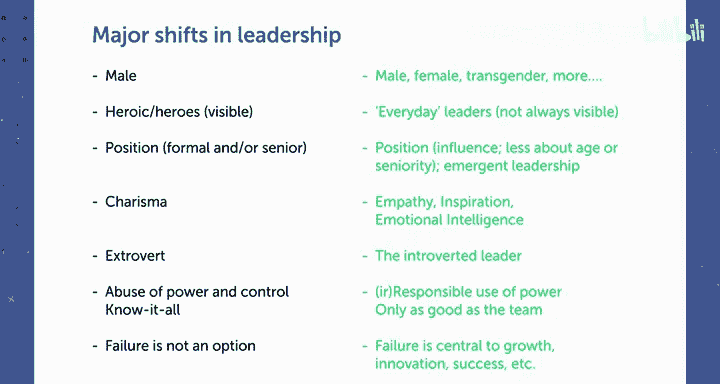

# 5：领导力的当务之急 🎯

在本节课中，我们将探讨领导力在当今动态商业环境中的重要性，并分析企业领导者面临的关键挑战。下一节视频中，我们将与一位学术专家深入交流，了解领导者在塑造企业声誉和文化中的作用，并剖析 Facebook CEO 马克·扎克伯格的领导方式。

现在，让我们开始学习。

## 领导力：一个被过度使用的概念？🤔

领导力是简历中最常被过度使用的词汇之一。它是否已沦为陈词滥调？从研究视角看，领导力研究领域极为广泛，难以在短片中概括。据估计，不同学科（从心理学、管理学传播学等）对领导力的定义多达 **35,000** 种。

然而，媒体对领导力的描绘往往更为简单化。光谱的一端是剥削、傲慢、专制的领导者，通常是滥用权力的公司老板。您可能在屏幕上看到的电影海报中认出某些领导风格。

另一端则是那些在灾难面前激励团队、凝聚国家或组织的领导者。无论是足球教练还是自由世界的总统，他们凭借口才和充满激情的演讲，能让人们忘却分歧，为共同的事业宣誓效忠。

现实并非如此非黑即白。那么，领导力究竟是什么？它是关于您所担任的正式职位，还是关于您展现的特定行为？

## 理解领导力的传统视角 📚

传统的领导力研究方法或许可以概括为特质论。该理论将领导力视为一系列特定的品质或技能。特质论强调领导者（主要是男性）是天生的，而非后天培养的，领导力由个人特征决定，例如外貌、智力、演讲能力和有吸引力的个性。

另一种突出的研究方法是风格论，它关注特定的领导方式或行为。例如：
*   **专制型领导**的特点是密切监督、决策集中且团队成员几乎不参与。
*   与之形成对比的是**民主型领导**风格，它更具包容性和参与性。

如今，领导风格多种多样，您可以在屏幕上看到一些示例。

第三种方法探讨领导力是否具有情境性，取决于特定情况。情境论更关注背景。因此，优秀的领导力取决于许多因素：手头的任务、领导者的权力、组织规模等。所以，没有一种单一的风格或特质能在所有情境中都有效。

这些方法并非错误或完全过时，但它们未能完全解释领导力的复杂性。

## 领导力的新视角：关系与过程 🔄

我们现在看到新的领导力方法正在兴起，它们不将领导力视为一种事物、一种特质或一种品质。相反，它们更关注领导力的沟通动态和过程。

这些方法将领导力视为**关系性的**和**非层级性的**。

沿着这一思路，领导力的一个定义是：**影响一个有组织的团体，使其努力实现目标设定和目标达成的过程**。

请注意对三个要素的强调：领导力是一个**影响过程**，旨在使组织能够**共同努力**，以实现某个最终目标或目的。

这个过程如何通过沟通实现？例如，领导者定下基调、构思愿景、塑造组织文化。通过故事、叙事和以身作则，领导者为组织成员创造意义、归属感或认同感。

在您的屏幕上，可以看到我们对领导力理解的一些重要转变：从传统的领导观念转向更现实、更复杂的概念化。例如，“领导者是男性”的假设正不断受到挑战。同样，领导力不仅基于正式职位或资历，也可能从组织的任何层级中涌现。

请花点时间思考这些转变，并反思您是否认同或同意它们。

## 当今商业领导者面临的实践挑战 🌍

回顾了该领域的主要发展后，让我们简要反思当今商业领导者面临的实际挑战。

从气候变化到难民危机，从网络安全到技术颠覆，从隐私问题到性别平等，从可持续性到健康挑战，有无数棘手问题让企业领导者夜不能寐。处理此类大规模社会问题需要远见和长期思维。

的确，在危机时期，领导者的角色尤为突出，因为危机伴随着高度的不安全感、疑虑和情绪。组织领导者如何帮助员工和其他利益相关者理解危机，对于减轻可能的声誉损害大有裨益。

但领导力不止于管理危机，它更延伸到组织从经验中学到了什么，以及如何恢复和重建。“绝不让一场好危机白白浪费”实际上是一条流行的建议。

总而言之，在期望更高、审视更严的变革环境中，大量的重大挑战共同创造了一个被称为 **VUCA** 的世界，即**易变、不确定、复杂、模糊**的世界。

在 VUCA 世界中领导需要勇气和创造力。企业能否很好地预测并为这些发展做好准备，将是领导力的真正考验。

## 下节预告 📺

在下一节视频中，鹿特丹管理学院的伊普·科内利森教授将回答关于马克·扎克伯格领导方式的关键问题。他将分享他对企业面临的领导力挑战的分析视角，以及企业应如何做才能保持相关性。

感谢观看。