# 6：领导力文化及其对企业的影响 🧭

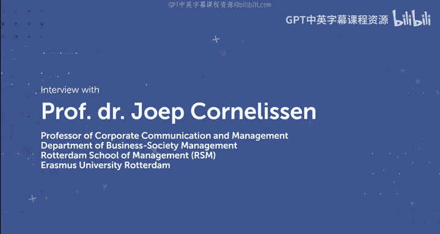

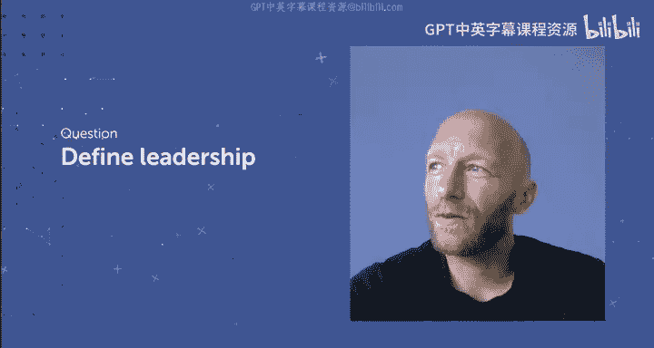

在本节课中，我们将探讨领导力这一宽泛概念的历史演变、现代内涵及其对企业文化和责任承担的核心影响。我们将以Facebook面临的挑战为例，分析领导力在应对声誉危机中的关键作用。

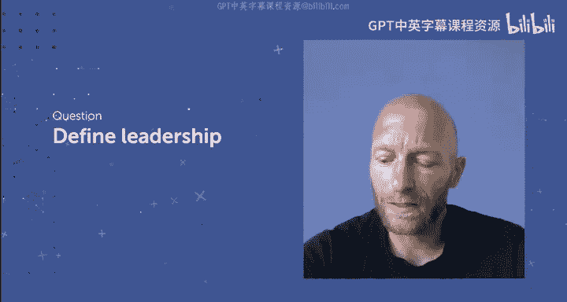

---

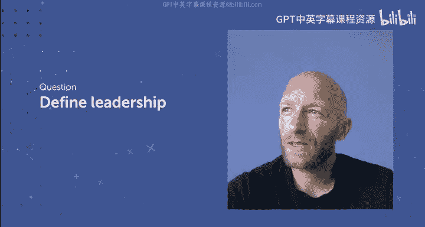

## 领导力概念的演变

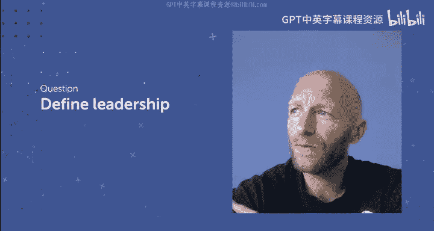

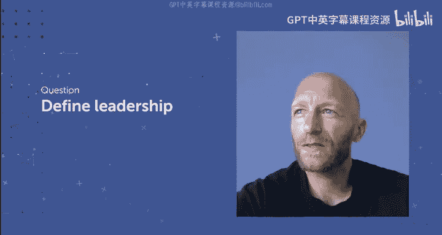

“领导力”是一个内涵丰富的术语，对不同的人意味着不同的事物。

历史上，领导力更多地与权力和影响力相关联。它意味着能够领导一支军队或一群人朝着特定方向前进。早期的学术领导力理论也反映了这一点，因此并未过多强调领导者为影响和指导追随者所需具备的特定特质或技能。

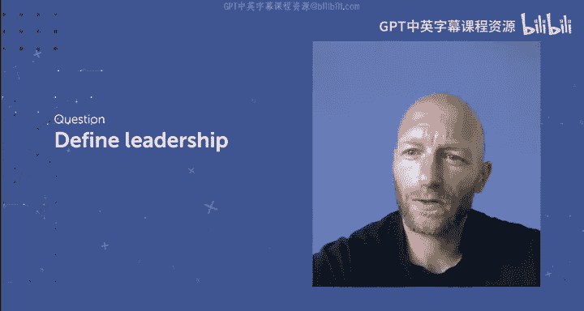

---

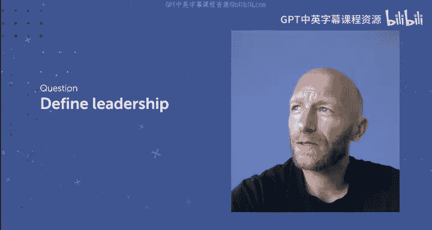

## 从特质到技能：现代领导力观

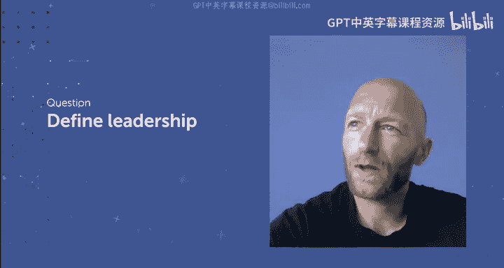

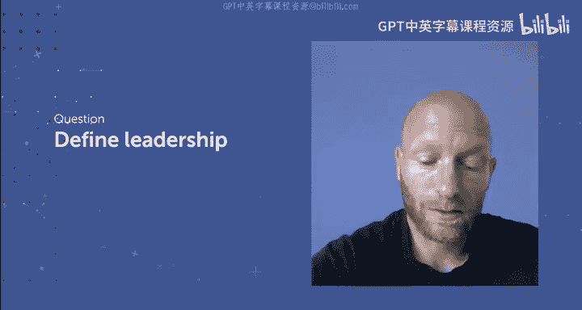

上一节我们介绍了领导力的传统定义，本节中我们来看看其现代视角的转变。

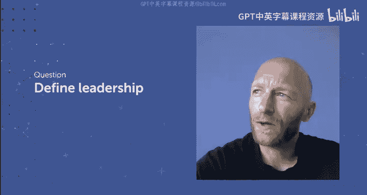

近年来，观点逐渐从基于特质的视角转移。现在更倾向于将领导力视为个人所从事的一系列技能或活动。这些技能并非特定人群的专利，而是任何人都可以在特定情境下运用或实践，以促使他人认同你的观点、加入你的行列或为实现特定目标而被动员起来。

从这个意义上说，领导力作为一个概念变得更广泛，它不再那么紧密地与特定的影响力职位或组织内的正式职位挂钩。

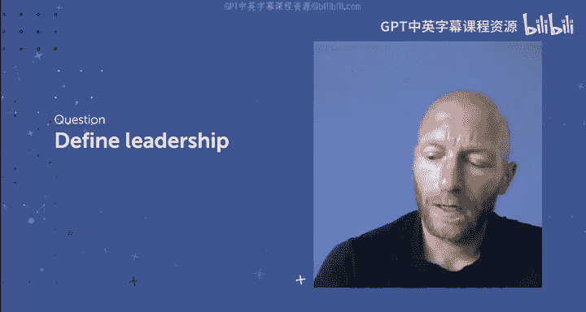

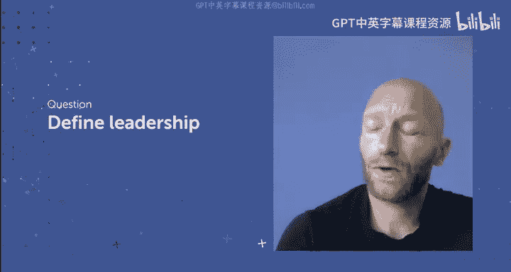

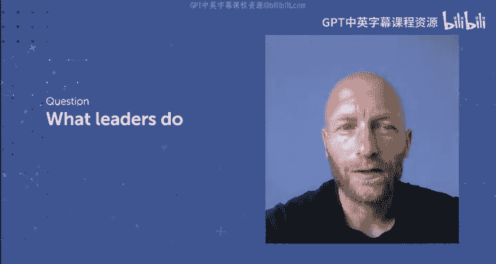

---

## 领导力的核心：从影响力到责任

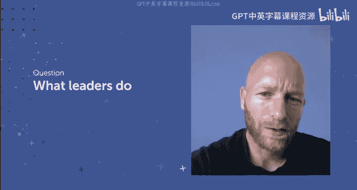

我认为当今领导力另一个有趣之处在于，它不再仅仅关乎影响力和权力，也日益关乎责任。因此，出现了许多关于首席执行官及其他掌权者需要做正确事情的讨论。

这一点体现在诸如“CEO行动主义”等概念中，即首席执行官代表公司就特定议题表明立场，并试图展示企业更广泛的社会责任。但这同时也意味着，这些领导者个人也需要对他们正在处理或倡导的某些议题产生责任感。

以下是领导者发挥作用的几个关键方面：
*   **激励与定调**：领导者激励他人，为组织设定基调。
*   **创造安全空间**：如果做得好，他们能在文化层面创造一个安全空间，让人们可以畅所欲言，公开提出问题。
*   **培育讨论文化**：通过上述做法，他们培育了一种人们可以讨论问题、深思熟虑的文化，而不是将问题掩盖，或仅以组织高层的视角来定义问题。

---

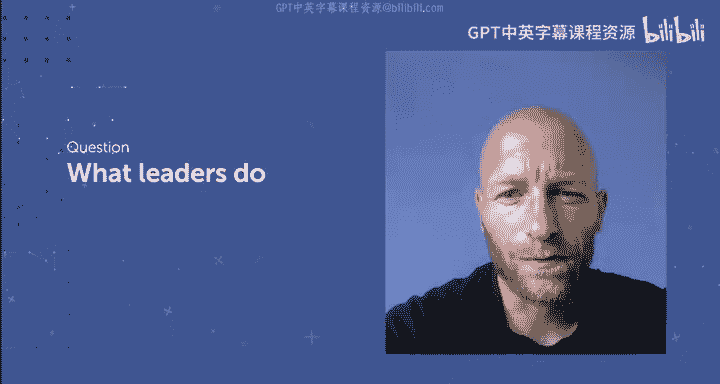

## 高层领导者的角色与挑战

如果我们真正思考那些处于组织顶层、拥有正式权力职位（如CEO或高层管理团队）的领导者，他们的角色是提供方向，同时也在组织内部激励人心并创造正确的风气和文化。

在方向层面，这就引出了关于责任的问题。你如何看待组织的目标？你如何思考企业的社会责任？我们的责任范围有多大？我们承担哪些议题，不承担哪些？或者甚至公开或主动地将某些责任外部化。这是一个极其重要的角色，也是一个非常困难的职位，任何身处此位的人都需认真思考，如何以更具社会责任感的方式推动业务发展，从而获得由此而来的良好声誉，以及利益相关者的认可与支持。

---

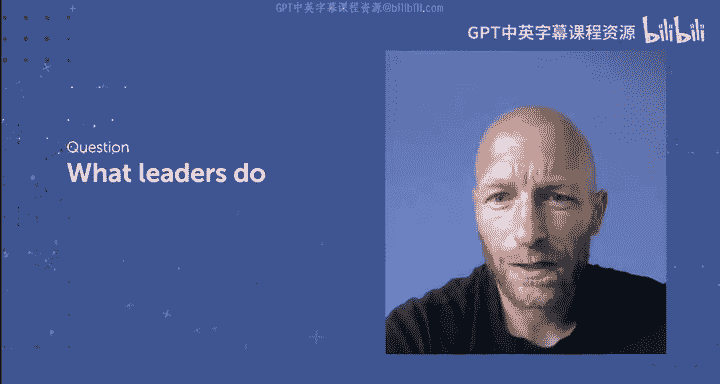

## 团队多样性与决策

重要的是，要有一个具备足够经验且足够多样化的团队，来挑战CEO的假设，并共同做出更好的决策。

我认为这一点可以联系到Facebook的案例。其高层管理团队可能缺乏应有的更替、发展以及因此带来的观点多样性。显然，你可以设立各种由精英人士组成的外部顾问委员会来提供一些意见，但这不会改变根本——需要改变的是高层管理团队本身。

---

## 当今领导者的道德考量

如今，企业的声誉面临风险，更多问题接踵而至，要求企业在这些问题上承担更大责任的呼声也更高。因此，我认为对领导者而言，开始思考事情的道德层面至关重要。

这包括你的个人信念、这些信念如何与组织的价值观、目标及其责任感相结合，并真正开始思考这些问题。我们看到这一点反映在所有现今流行的概念中，如道德领导力、CEO行动主义等。领导者需要积极处理这类议题，尤其是在环境和社会议题上，人们期望许多组织承担更大责任的时候。

你不能对此置之不理，你必须有自己的立场。这有时是费力的、恼人的、令人沮丧的，但这是人们的期望。也许最困难的工作就是你需要想清楚这些问题，你需要有一个说法，你需要明确你个人如何与这些议题产生联系，以及作为一个组织，你将如何应对这些议题，然后你需要将其引入组织并共同努力。

简单的方法是，正如我们之前讨论过的，坐视不理，相信问题会自行消失，按照一贯的方式运行你的商业模式，然后希望情况好转。但在当今时代，这可能不是最明智的做法。我们在许多类似Facebook的案例中看到了这一点。

---

## 案例分析：Facebook的领导力困境

现在的问题是剑桥分析公司丑闻，下周可能是仇恨言论问题。如果他们不改变应对方式、不改变责任感，如果领导层不改变，那么社会迟早会击垮他们，损害其声誉。我个人深信这一点。另一种类型的公司、平台公司或接口公司将会取代他们，但很可能拥有比他们更好的道德良知。

我认为这可以推广到许多硅谷公司。有很多像马克·扎克伯格这样的领导者，他们初期可能具备作为企业家发展业务所需的技能，显然对案例的发展有巨大的影响和投入，真正处于主导地位并掌控一切。

但这与你现在所需的技能和角色是不同的。现在需要的更像是政治家式的人物，需要对公司面临的困境有深刻的认识，而这些困境确实与其商业模式紧密相连。核心问题是：我们是一家对自己发布或平台上发布的内容承担一定责任的媒体公司，还是我们视自己为中介，仅仅传递内容，并出于支持言论自由的理念，让其不受我们约束和干预地自由发展？

我认为这也是Facebook的核心问题。美国的监管目前仍站在他们一边，他们并未被作为媒体公司来监管。然而，社会要求他们对在其平台上以及通过其平台发生的事情承担一定的所有权和责任。

这就要求领导者对这些关切保持敏感，权衡利弊，与利益相关者、发展伙伴进行深思熟虑的商讨，并思考公司如何能以理想的方式进步和改变，承担起其中一些议题的责任。

至少从Facebook最近几次爆发的危机来看，他可能不是领导Facebook应对这一局面的人选。他似乎仍然停留在旧思维模式中：控制、坐视不理，然后希望问题消失。显然，人们希望的是，在当前公司面临的压力下，领导者不仅能注意到，更能真正感受到这种压力。他需要进行换位思考，意识到他们不能继续按照过去的方式行事，应该承担起更大的责任感。

我知道他说过这些话，但更多是在前往欧盟委员会或向议员或国会作证时，更像是一种公关手段，并非他个人或公司层面深刻的责任感，也没有真正改变其责任意识的决心。因此，我并不乐观。我认为很可能需要新的领导层，但这就引出了另一个问题：除非被逼退位，作为大股东的他可能不会离开。

---

## 总结

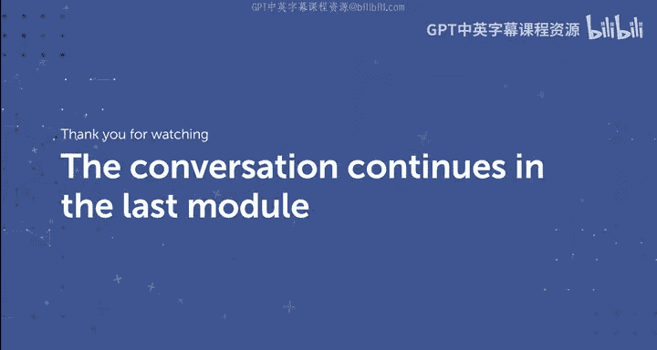

本节课中，我们一起学习了领导力概念从传统权力观到现代技能与责任观的演变。我们探讨了高层领导者在设定方向、培育文化和承担社会责任方面的关键作用，并分析了团队多样性的重要性。最后，我们以Facebook为例，深入剖析了当领导力与商业模式的核心困境脱节时，企业可能面临的持续声誉危机。有效的现代领导力要求领导者具备道德敏感度、换位思考能力，并真正致力于将更广泛的社会责任融入组织的发展战略中。