# 7：勇于发声：组织内部的不当行为揭露机制 🎤

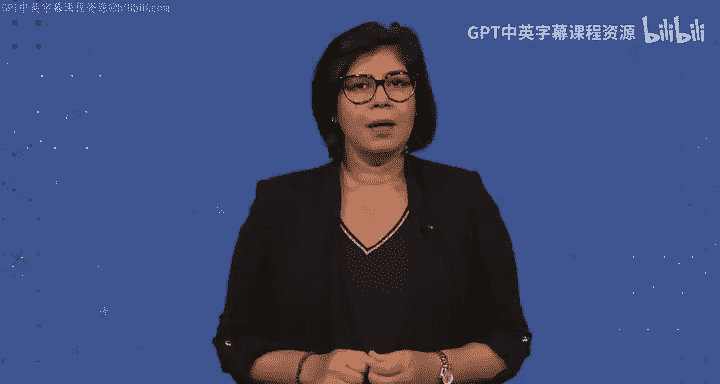

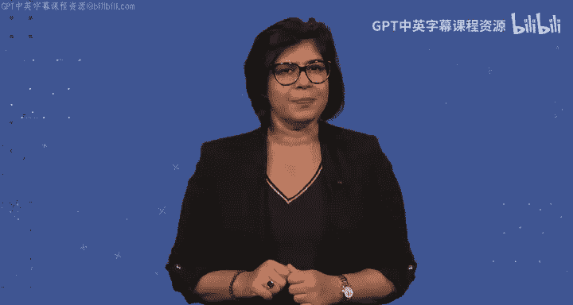

在本节课中，我们将要学习当员工发现其所在组织存在不当行为时，他们有哪些选择。我们将通过两个著名的商业案例，来探讨“吹哨人”行为如何改变了公司历史的进程，并分析其背后的伦理困境与风险。

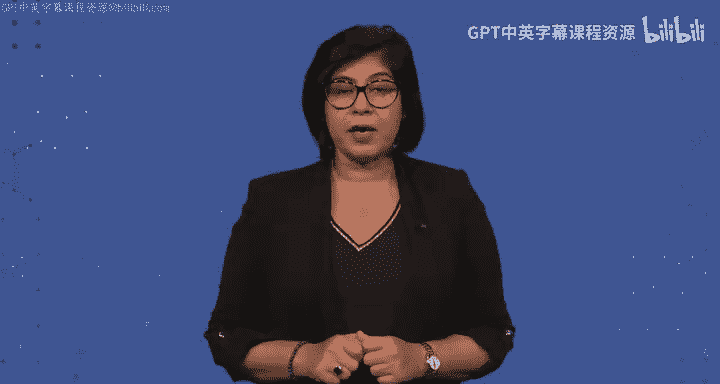

## 引言：当员工发现不当行为时

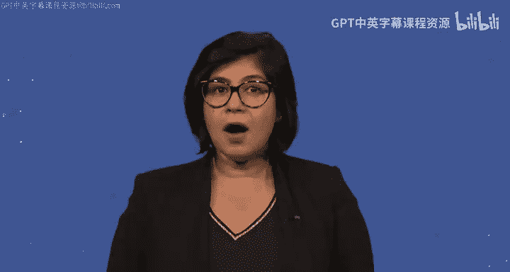

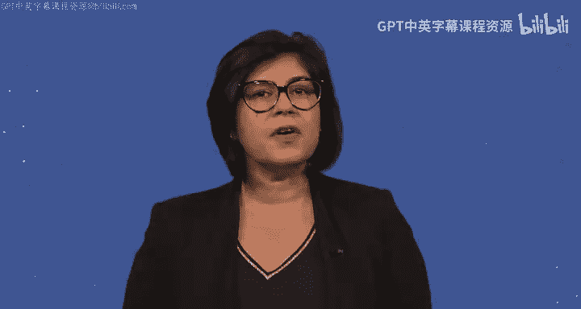

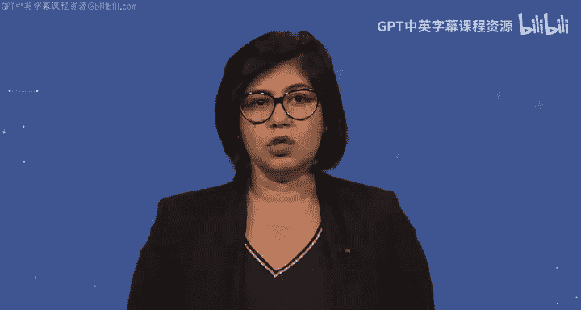

当一名员工在其组织内发现不当行为时，他们有哪些可用的选择？

本视频将审视两个著名的员工案例，他们揭露了不道德的商业行为，并在此过程中改变了公司历史的走向。

视频结束后，我们邀请您观看一个简短的动画，该动画将带您了解“吹哨”行为的基础知识：它是什么、为何发生、以及对吹哨人个人和相关组织而言的益处与风险。

## 两个改变历史的案例

上一节我们提出了核心问题，本节中我们来看看两个具体的商业案例。屏幕上的两位人物将因其揭露各自雇主——安然公司和世通公司在21世纪初的重大欺诈案——而永远被载入商业史册。

以下是这两个案例的详细情况：

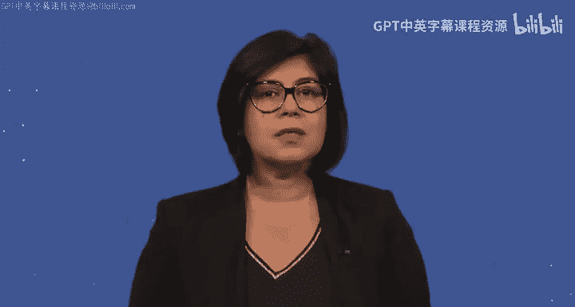

*   **安然公司案例**：安然曾是美国最大的能源交易和公用事业公司之一，也是华尔街的宠儿。2001年8月，时任安然副总裁的莎朗·沃特金斯向公司前首席执行官兼时任董事长肯尼斯·莱发出警告，指出存在涉及首席财务官杰弗里·斯基林及其他高管的会计违规行为。
*   **事件后果**：随着消息传开，美国证券交易委员会开始调查，后升级为对安然及其合伙企业的全面刑事调查。安然承认做假账，并修订了过去五年的财务报表，承认虚报利润，而实际亏损达**6.18亿美元**。2001年12月2日，安然申请第11章破产保护。其股价从2000年中期的每股**90.75美元**暴跌至2001年11月底的不足**1美元**。当时，安然的迅速垮台是美国历史上最大的公司破产案。
*   **员工损失**：许多持有价值数十万美元安然股票的员工，在崩盘前不被允许出售股票，从而失去了全部积蓄。这些员工后来提起集体诉讼，赢得了**8500万美元**的和解金。
*   **世通公司案例**：安然事件的尘埃尚未落定，电信公司世通又爆出欺诈案。该公司被发现在资产上虚增了高达**110亿美元**，导致**3万人**失业，投资者损失**1800亿美元**。这一欺诈行为是由辛西娅·库珀领导的世通内部审计部门发现的。

## 什么是“吹哨人”？

以上只是员工怀疑存在不当行为时，选择发声并表达担忧的两个案例，这个决定伴随着个人风险。这类人被称为“吹哨人”。

追溯至1963年，“吹哨人”的第一个已知定义是：**揭露秘密或告发他人的人**。

在沃特金斯和库珀分别于2001年和2002年进行揭露时，美国尚无保护吹哨人的法律。

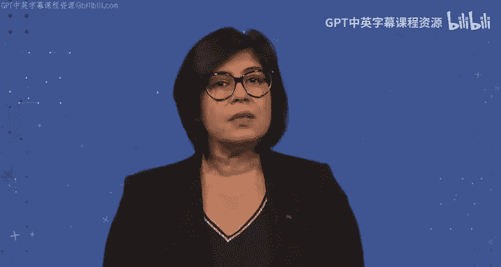

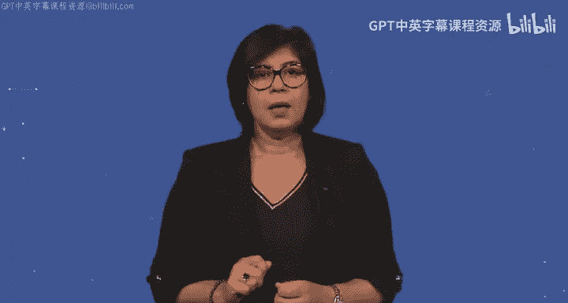

但受这两大丑闻的推动，美国政府于2002年紧急签署了《萨班斯-奥克斯利法案》，旨在通过使公司信息披露更可靠、更准确来保护投资者。

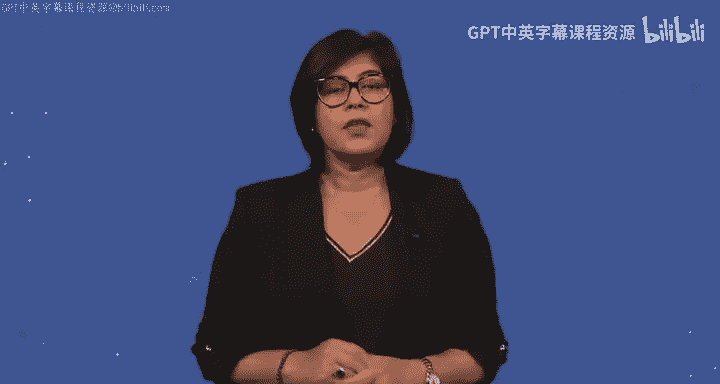

安然的莎朗·沃特金斯和世通的辛西娅·库珀，连同联邦调查局的科琳·罗利，被《时代》杂志共同评为2002年的“年度人物”。

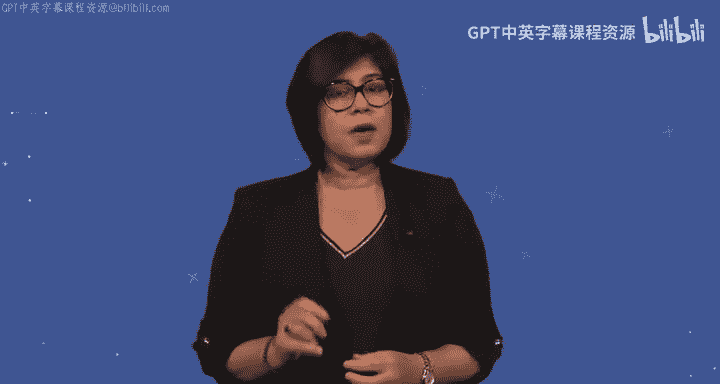

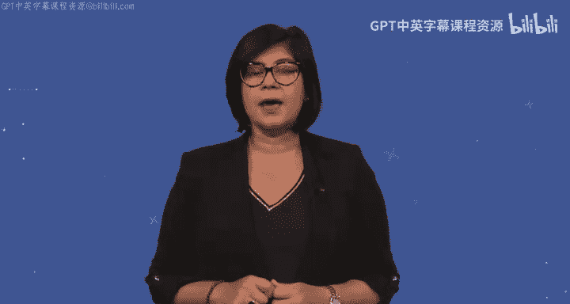

这些案例表明，揭露不当行为是符合道德且正确的做法。事实上，许多现实生活中的吹哨事件已成为成功电影的主题，例如《惊爆内幕》、《告密者》、《永不妥协》等。

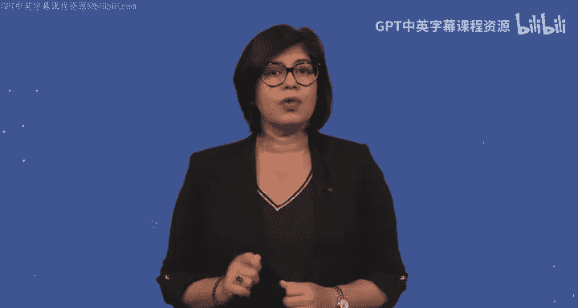

## 吹哨行为的双重面孔

那么问题何在？上一节我们看到吹哨行为被社会肯定，但本节中我们来看看其另一面。

如果你看屏幕，会看到韦氏词典中列出的一些“吹哨人”的同义词。不难发现，所有这些术语都是负面的。

将吹哨人等同于告密者、泄密者和背叛者，实际上是将他们指定为恶棍。对于某些阵营而言，吹哨行为可能意味着对抗正式的权力结构，因此这种行为可能被视为离经叛道和具有攻击性。

另一种思想流派则将吹哨人视为英雄。挑战根深蒂固的权力结构会带来很高的个人和职业风险，包括微妙和公开的报复形式。尽管现在有更多法律（如欧盟的《吹哨人保护指令》）来保护吹哨人免受此类负面后果影响，但这些法律受许多条款约束。因此，根据举报不当行为的国家、不当行为的性质及其他因素，保护可能无法得到保证。

我们的目标不是争论好坏，而是阐明这一现象所处的灰色地带。沃特金斯和库珀都广泛谈论过她们的经历，并在各自的书中记录了她们的故事。

在采访中，沃特金斯曾讲述了她所遭受的公开和隐蔽的孤立。库珀也反思了做出吹哨决定所带来的困境，即使这是正确的事情。

## 总结：视角取决于企业文化

从以上简要概述中你可以体会到，揭露组织不当行为并向权力说出真相会引发两极分化的看法。一方面，它可能被视为不忠诚或逃避采取建设性行动；另一方面，它可能被视为揭露邪恶和纠正扭曲的系统。

如何看待它，取决于**企业文化**。

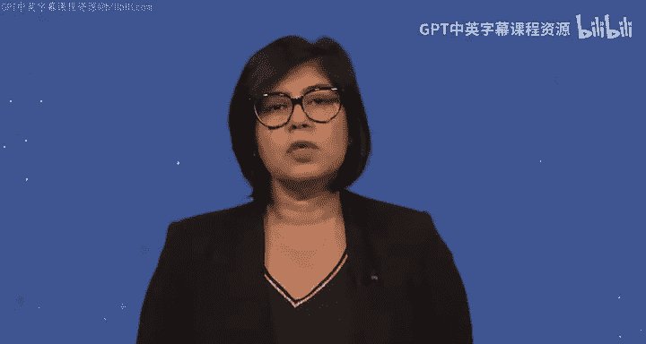

现在，我邀请您观看解释吹哨行为基础知识的简短动画，并思考其对治理、领导力和声誉的重要性和相关性。

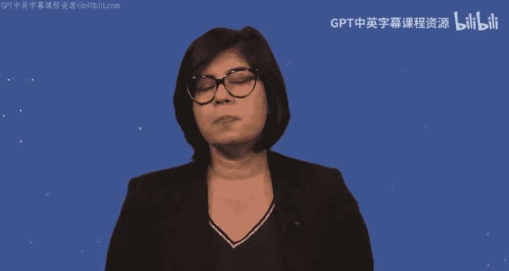

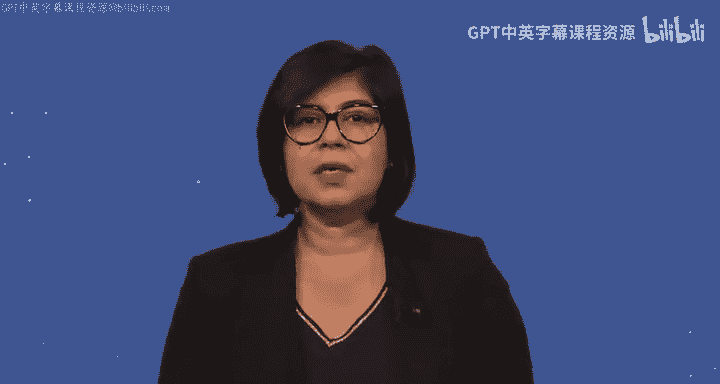

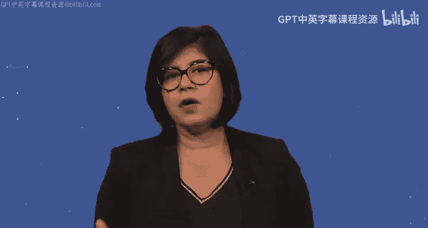

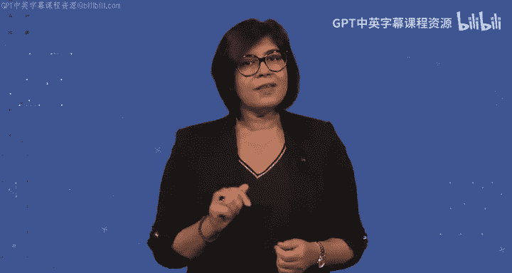

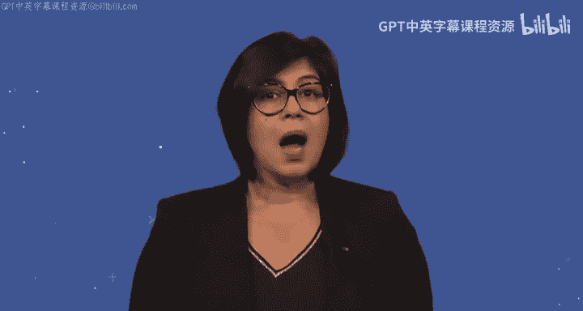

感谢观看。

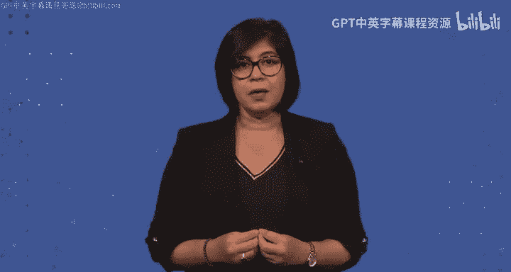

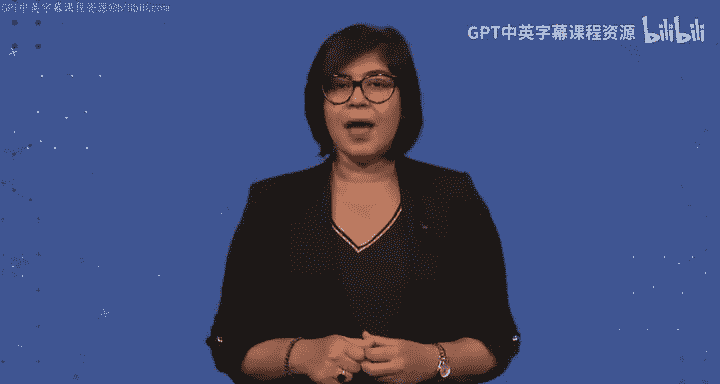

本节课中，我们一起学习了“吹哨人”的概念，通过安然和世通公司的经典案例，分析了员工揭露组织内部不当行为的动机、后果及其面临的巨大个人风险。我们探讨了社会对吹哨行为既可能视其为英雄之举，也可能贬其为背叛行为的双重看法，并最终认识到，对这种行为的评价很大程度上取决于具体的组织文化环境。理解这一机制，对于认识现代企业治理和商业伦理至关重要。