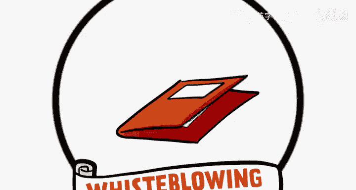
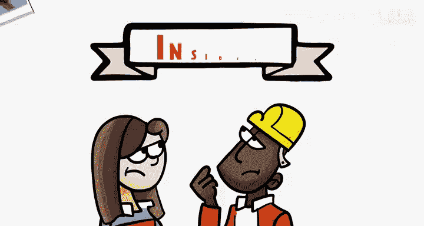
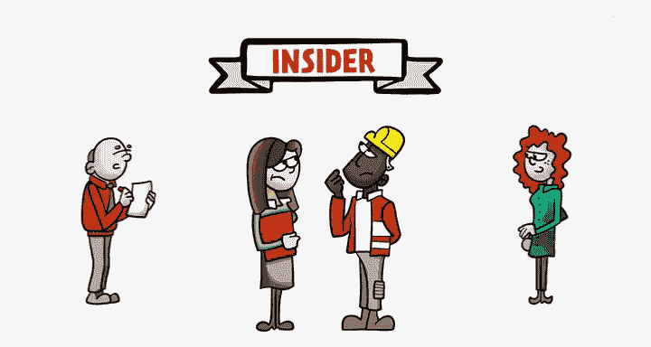
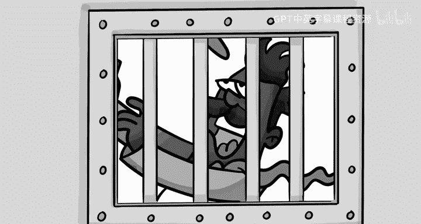
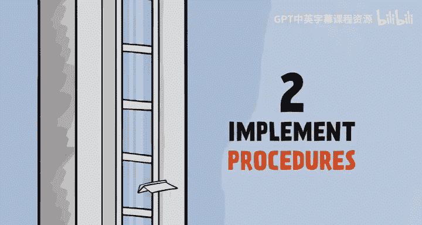
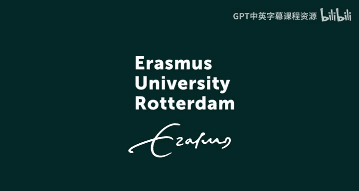

# 8：举报行为的道德勇气 🎤

在本节课中，我们将探讨“举报行为”这一概念，了解其定义、重要性、面临的挑战以及组织应如何建立保护机制。我们将通过一个具体案例来展开分析。

---

多拉曾是一名研究主管，她为公司构建了庞大的数据库。她发现管理层正在利用该数据库，通过散布恐惧和种族主义信息，针对特定人群达成政治目的。

她决定离开公司，并向媒体揭露了她所知晓的前雇主的全部不当行为。

多拉的行为被称为 **“举报”**。举报是指由组织内部知情成员揭露的、关于组织不当行为的信息披露，这些行为包括：
*   浪费
*   欺诈
*   滥用职权
*   腐败
*   危害公共健康与安全

**举报人**通常是公司内部人员，但也可能是任何披露了原本不为人知信息的人。

当不当行为足够严重时，举报有助于阻止或纠正有权势的个人或组织的行为，甚至可能拯救一个组织。

仅在美国，2019年就提交了5200份举报报告。

并非每个人都决定公开举报。许多人尝试进行内部举报，通常是向他们的上级报告。

然而，这类内部报告常常得不到妥善调查，甚至被掩盖。

此外，举报人可能会发现自己处境危险，面临报复、解雇威胁、羞辱或恐吓的风险。除了这些挑战，还缺乏保护举报人的立法。即使存在相关法律，也可能未得到妥善执行。在欧盟，直到2019年《举报人保护指令》生效，才有了区域性的举报人保护立法。

在当今要求透明度和负责任治理的环境下，企业可以在建立组织不当行为信号机制方面发挥领导作用。

那么，组织可以采取哪些措施呢？以下是关键步骤：

首先，建立内部举报人保护框架，确保举报人的**保密性**和**匿名性**。

其次，实施清晰的程序，包括对结果进行跟进并对流程进行**监控**。

最后，确保这些流程**嵌入**组织内部，并得到高层管理者的**承诺**。

多拉面临的情况并非罕见，但并非每个人都会像她那样采取行动。

你将如何权衡自己是否要做出举报的决定？

---

本节课中，我们一起学习了举报行为的定义与价值，了解了举报人面临的风险与挑战，并探讨了组织为鼓励和保护举报行为可以建立的有效机制。举报需要道德勇气，而一个健全的保护体系则是这种勇气得以发挥的重要保障。