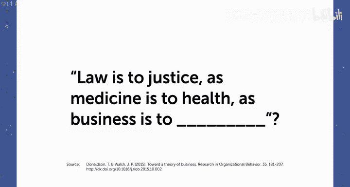
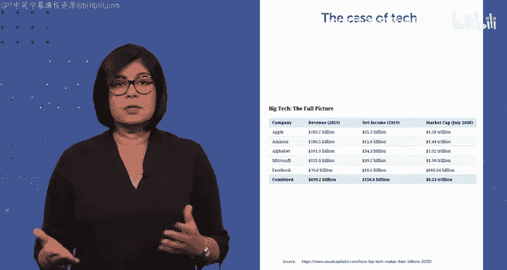
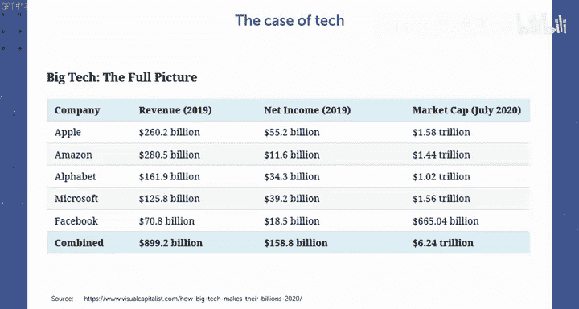
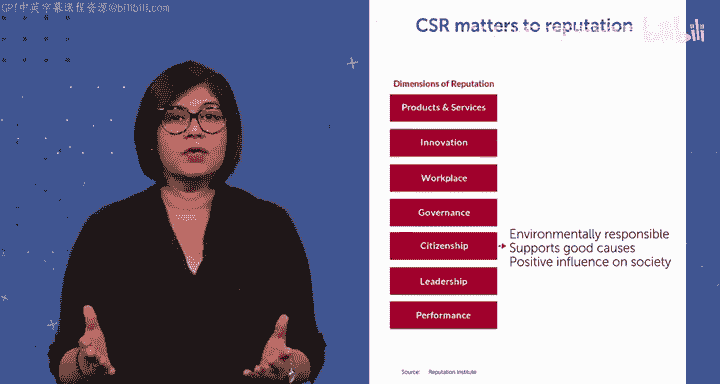

# 9：企业社会责任与企业的社会使命 🏢

在本节课中，我们将探讨企业社会责任这一核心概念。我们将了解其定义、重要性，以及为何在现代商业环境中，企业社会责任与企业的声誉和长期成功息息相关。

---

## 概述：企业的目的是什么？

欢迎来到第五周。本周我们将探讨企业社会责任的概念。

在开始之前，我们先来看一个填空题。屏幕上将显示一个不完整的陈述，你需要完成它。请写下你脑海中浮现的第一个答案，稍后可以在讨论区分享。

**陈述：**
法律旨在实现正义，医学旨在实现健康，那么商业旨在实现______。

对于许多人来说，第一个想到的词可能是“利润”。其他人可能会想到“服务”、“产品”、“资本主义”或“社区”。这个练习没有标准答案，其目的是引出本周核心议题：**企业的目的是什么？**

如果法律追求正义，医学追求健康，那么商业的目的是什么？或者，正如《经济学人》一篇文章所问：公司为何而存在？企业社会责任这个概念，正是源于这个根本性问题。

---

## 什么是企业社会责任？

企业社会责任，简称CSR，源于对企业目的的追问。企业是否仅仅为了最大化股东价值而存在，并排除其他一切？还是说，企业有更广泛的责任？

尽管CSR自20世纪70年代以来已发展成为一个重要的研究领域，并在近几十年成为普遍的商业实践，但目前并没有一个统一、普遍的定义。

以下是两个相隔数十年的定义，它们都是宽泛的概念化表述，为企业自行定义其责任范围、形式以及其认为具有社会责任感的活动留下了空间。

*   **早期定义**：企业社会责任是指企业超越法律和经济要求，为追求长远社会利益而承担的义务。
*   **近期定义**：企业社会责任是指企业将社会和环境关切整合到其商业运营以及与利益相关者的自愿互动中。

---

## 企业社会责任的实践方式

企业实践社会责任的方式多种多样。以下是几种常见模式：

*   **基于核心能力的模式**：企业选择与其核心业务能力相关的领域作为重点。例如，一家医疗健康领域的企业可能会致力于社区健康项目和确保医疗可及性。
*   **慈善捐赠模式**：企业向他们认为重要的事业（如教育或环境保护）捐赠资金和资源。
*   **三重底线模式**：这是一种更全面的方法，强调企业应同时关注**人、利润、地球**，全面审视其运营对社会、企业自身和环境产生的整体影响。

像联合国可持续发展目标这样的跨国倡议，也肯定了所有行动者必须共同努力解决重大社会挑战的必要性。

---

## 企业社会责任的共识

尽管在定义、方法和活动上存在多样性，但关于CSR的一些基本方面已达成共识：

1.  CSR将企业与社会视为相互交织、相互依存的。
2.  CSR将企业的责任从股东扩展到更广泛的**利益相关者**群体。
3.  CSR超越了法律合规和法律义务。甚至有人认为，CSR始于法律终止之处。

理论上，这一切听起来美好而崇高。企业成为行善者，努力平衡经济需求与社会关切。然而在实践中，情况则更为复杂。

---

## 理论与实践中的挑战

毕竟，管理中的主导范式一直是不惜一切代价追求利润。20世纪70年代，经济学家米尔顿·弗里德曼在一篇有影响力的文章中宣称：“企业的社会责任就是增加利润。”

从这种主导逻辑，转向“在做好事的同时做得好”的综合方法，这一转变并不容易。然而，全球化的过度发展、反复出现的企业丑闻、日益加剧的收入不平等、政治动荡以及社交媒体的兴起，都挑战了“一切照旧”的传统商业观念。

上一节我们介绍了CSR的理论共识，本节中我们来看看一个现实中的反面案例。

---

## 案例分析：大众汽车排放丑闻

让我们看一个例子。有些人可能熟悉大众汽车2015年的排放丑闻。调查发现，这家汽车制造商在其部分柴油车中安装了“失效装置”，以在排放测试中作弊。

美国环境保护署的调查发现，这些车辆在实验室测试中表现完美，但在实际道路上排放的氮氧化物几乎是允许水平的40倍。大众汽车承认，在销往美国和欧洲的1100万辆汽车中安装了失效装置。

结果，该公司在2015年遭受了有史以来最严重的年度亏损，达15.8亿欧元。丑闻曝光后的周一，其股价下跌了19%，四天内市值蒸发了30%。该丑闻的估计成本高达300亿欧元。

具有讽刺意味的是，在丑闻发生前，大众汽车位列全球声誉最佳的前20家公司之一。如屏幕所示，丑闻后，该公司甚至跌出了声誉研究所排名的前100名。

这并非唯一一个对企业及其利益相关者产生深远影响的、不负责任的商业行为案例，也绝不会是最后一个。

---

## 商业信任的现状

当然，我们不能一概而论。但在当代商业环境中，我们看到企业危机和失败的反复发生，已经削弱了对企业的信任。一些曾被视为企业社会责任典范的企业，也被发现从事了蓄意、不道德和操纵性的商业行为。

屏幕上显示的是爱德曼信任度调查报告的一些有趣数据。20年来，该报告一直追踪公众对四大机构（企业、非政府组织、政府、媒体）的信任状况。

2020年的报告将信任定义为两个属性的综合：**能力**（兑现承诺）和**道德行为**（做正确的事并致力于改善社会）。仔细观察图表，你会发现这四大机构中没有一家同时被视为既可信又有能力。

但或许更关键的是他们的发现：**道德驱动因素**（如诚信、可靠性和目标）推动了企业近76%的信任资本，而能力仅占24%。这值得所有企业深思。

---

## 科技公司面临的特殊挑战

科技公司今天尤其面临更高的信任危机。它们的影响力不仅来自其财力，还来自它们能够获取的个人信息的质量和数量。

我们对大型科技公司（谷歌、亚马逊、脸书、苹果，简称GAFA）的依赖，赋予了它们无与伦比的市场份额。

如果你看屏幕上的图表，你会发现2019年科技巨头的总收入接近9000亿美元。这超过了G20国家中四个国家的GDP。实际上，这意味着按GDP计算，大型科技公司是第18大“国家”，排在沙特阿拉伯之前，仅次于荷兰。

但是，科技巨头如何以及为何使用它们的权力和影响力，仍然是一个正在展开的故事。

---

## 为什么企业社会责任至关重要？

如果你还在问自己：但是为什么？为什么科技公司或任何其他企业应该关心社会责任？那么请考虑以下几点：

1.  **CSR关乎信任与声誉**：如果你回顾前几周关于声誉的讨论，你会发现CSR或企业公民身份是驱动声誉的因素之一。声誉良好的企业能激发利益相关者的信任、钦佩，并以与该组织有关联为荣。
2.  **来自消费者和员工的压力**：从长远来看，企业需要意识到变革之风正在从不同方向吹来。越来越多的调查证明，消费者和员工期望并要求公司将社会关切纳入商业行为。千禧一代尤其被视为变革的推动力。精通技术、数字互联的千禧一代，愿意惩罚不负责任的组织，并奖励那些负责任、有道德的组织。
3.  **社交媒体放大声音**：社交媒体也使不同的利益相关者群体能够发声和表达异议。特别是非政府组织和倡导团体，正在积极利用社交媒体来挑战企业的虚伪行为。
4.  **全球倡议与领袖呼吁**：像联合国可持续发展目标这样的跨国倡议，以及多位知名商业领袖的呼吁，共同强化了企业必须拥有社会目标的必要性。

这些持续的发展共同将聚光灯打在了企业在社会中的角色上。

---

## 总结

本节课中，我们一起学习了企业社会责任的核心概念。我们探讨了其定义、不同的实践模式，以及它为何对现代企业的声誉和长期生存至关重要。通过大众汽车的案例，我们看到了忽视社会责任的严重后果。同时，我们也了解到来自消费者、员工和全球倡议的压力，正推动企业必须超越利润，思考其更广泛的社会使命。在信任成为稀缺资源的时代，积极履行社会责任不再是可选项，而是企业可持续发展的必然要求。

感谢观看。