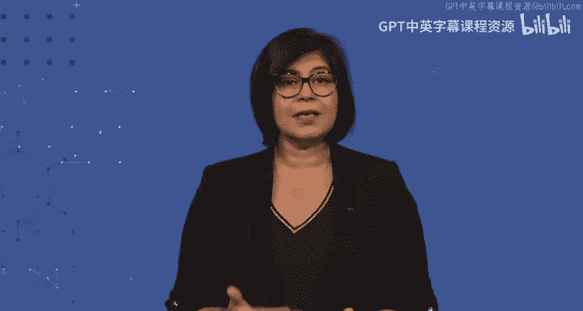
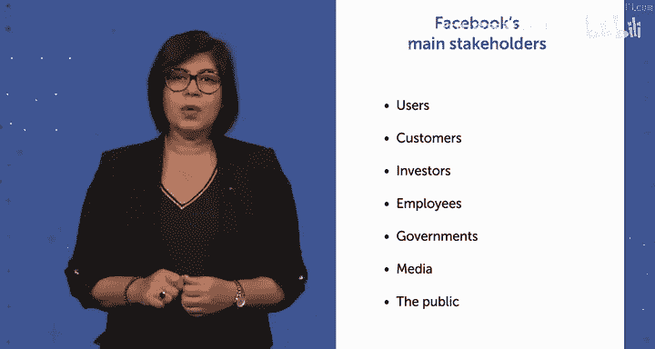
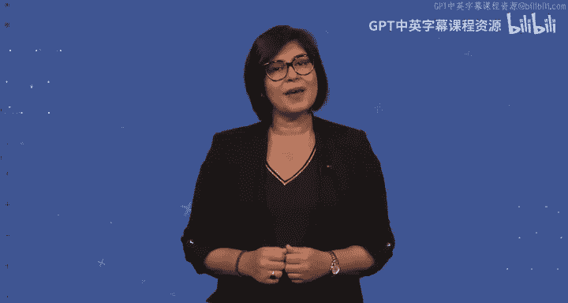

# 10：声誉危机？Facebook与剑桥分析公司事件总结 🎯

在本节课中，我们将对过去五周的学习内容进行总结，回顾Facebook与剑桥分析公司声誉危机的核心议题，并探讨Facebook及其他科技公司可以采取的前进路径。

---

## 课程回顾与核心议题

上一节我们介绍了本周的课程目标，本节中我们来回顾过去几周探讨的核心内容。

我们首先追溯了Facebook作为科技巨头的崛起历程，及其与剑桥分析公司事件的关联。

基于相关学术概念，我们反思了丑闻影响扩散后Facebook所面临的矛盾。

我们涵盖了多个广泛议题，包括声誉管理、数据隐私为何及如何成为声誉问题、多元数字环境中的领导力挑战、揭露不道德商业行为的利益相关者，以及平衡利润与目标的困境。

Facebook如何回应对其行为、治理和文化的批评？它是否采取了任何改进措施？

本周，你将有机会从Facebook的视角审视问题。你将了解到一些未包含在第一周案例中的新发展。

例如，2020年5月，Facebook成立了一个监督委员会，负责对其平台上的关键内容做出决策，例如仇恨言论、骚扰以及保护用户安全和隐私。

然而，尽管有此积极举措，在2020年7月，包括微软、星巴克、可口可乐和联合利华在内的500多家公司仍决定停止在Facebook平台投放广告。

这背后发生了什么？这些新发展意味着什么？

此案例引出了许多开放性问题，其中一些对我们理解商业、社会、数据和隐私至关重要。

案例中的一些事实存在矛盾。最引人注目的是Facebook的社会表现与财务表现之间的矛盾。

一方面，Facebook的声誉、品牌和信任度受到打击；另一方面，其用户基础和收入持续增长。

我们如何解释这一矛盾？超越Facebook本身，其他公司可以从中吸取什么教训？对于个人而言，我们可以做些什么来保护自己的数据、隐私和安全？

政府可以做什么？监管是否足够？

本周，我们将再次与专家一起探讨这些重大问题。

---

## 致谢与展望

本课程是许多人贡献和努力的结果。我们要感谢团队持续而慷慨的支持。特别感谢我们的学生助理Reminta Barreta，他撰写了案例的大部分内容。

我们还要感谢三位专家，他们贡献了专业知识，并分享了对此案例以及更广泛的数据隐私和领导力问题的见解。

我们希望你喜欢研究这个案例，并对大数据时代管理声誉危机有了更深入的理解。

再次感谢你加入我们的学习之旅。随着案例的持续发展，我们将密切关注Facebook的结果，并对你的建议保持好奇。

我们祝你一切顺利，并希望未来再次相见。