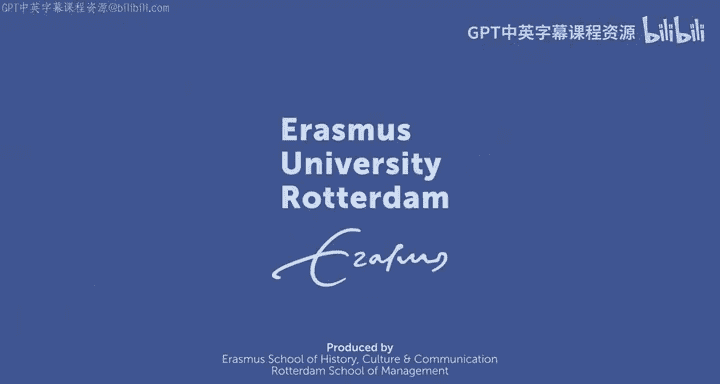

# 11：声誉危机？Facebook 遇上剑桥分析公司 🏢💥

## 概述

在本节课中，我们将探讨 Facebook 在“剑桥分析”数据丑闻后所面临的声誉危机。我们将分析一个核心悖论：为何在用户信任受损的同时，公司的财务表现和用户基数却持续增长。课程还将深入讨论数据隐私、科技巨头的责任，以及企业应如何从伦理层面而不仅仅是法律层面处理用户数据。

---

## Facebook 的声誉与增长悖论

上一节我们介绍了“剑桥分析”事件的背景，本节中我们来看看一个有趣的现象。

具体到 Facebook 和剑桥分析公司的案例，存在一个你可能已经注意到的有趣悖论。一方面，Facebook 的声誉、品牌价值和消费者信任在事件发生后立即受到重创，并且在一定程度上持续恶化。但另一方面，其用户基数和财务表现却持续增长。

那么，如何解释这个悖论？我们可能遗漏了什么？

---

## 悖论背后的原因分析

以下是几个解释这一现象的关键因素。

*   **收入来源不同**：收入持续增长，用户基数也在增长。即使最初可能有一些用户离开了 Facebook，但这是因为用户并非直接产生收入的一方。收入来自广告商，而非像你我这样拥有 Facebook 账户的普通用户。当然，如果广告商也是用户，两者是关联的。
*   **用户行为与数据质量**：即使用户基数略有萎缩，或者用户在 Facebook 上分享的内容减少，我仍然预期收入会增长。因为离开的更可能是那些本来就不太使用该平台的人。另一个方面是，如果你对自己发布和分享的内容更加谨慎，你实际上会发布和分享对你而言更相关的内容，因此这些数据的**信息质量**会提高，这对广告商来说更有用。
*   **商业底线驱动**：这是一个悖论，但只要底线在增长，只要在 Facebook 上投放广告的大型广告商不采取立场，我们预期收入将继续增长。2019年，Facebook 总收入的 98% 来自广告销售。
*   **生态系统的控制**：退一步看，Facebook 收购了 Instagram 和 WhatsApp，因此即使用户反抗 Facebook 并将部分社交活动转移到这些其他平台，从大局来看，这并没有太大区别。即使关注那些活动可能减少的用户，我们当然也可以区分**数据**和**元数据**。如果他们仍然使用 Messenger 应用，它仍然在被动地追踪信息。

---

## 用户为何难以离开？

回到这个悖论的想法，明知 Facebook 带来的危害却仍继续使用它。

如果你谈论的是一个在任何尴尬时刻（比如在电梯里）或刚醒来有空闲片刻时，很容易就能掏出来看看的应用，就很容易理解为什么我们无法轻易摆脱它。此外，还有一种**无可奈何**的感觉：你能真正处理多少关于隐私丑闻和泄露的故事？这就是**泄露疲劳**。之前我们谈到这类隐私和安全问题有更高的可见度，但与此同时，随着我们听到的案例数量增多，也存在某种泄露疲劳。

---

## 广告商的抵制与监管的局限

你可能听说过，今年七月，许多广告商决定停止在 Facebook 上投放广告。你对此有何看法？

你提到了 Facebook 从广告中获得的收入，基于此，我更愿意称 Facebook 为一家广告公司而非科技公司，因为其主要活动是广告，它是一个广告平台。大型广告商所占的份额并不像我们想象的那么大，实际上大部分收入来自中小型公司。大公司采取行动是好事，但我认为我们只需等待，看看最终效果如何。

之前你提到了监管部分，我同意需要更多监管。但同时，仅靠监管实际上无法解决问题，因为这不仅仅是合法地使用数据，还要**合乎伦理地**使用数据。而伦理是这些公司的员工需要具备的，以便真正实现改变，而不是仅仅在流程结束时打个勾。是的，从一开始就注重伦理，并在实践中真正实施，这样不是很好吗？

---

## 未来的教训与行动

那么剩下的问题是，这很可能不是我们第一次或最后一次听到这类问题。在你看来，Facebook 未来需要做什么？其他组织可以从这个案例或事件中吸取什么教训？

我不确定该如何看待 Facebook，特别是考虑到剑桥分析丑闻，以及马克·扎克伯格失踪五天又回来的整个事件。这些事情对 Facebook 来说每年都会发生，扎克伯格的道歉之旅再次上演。我不知道还能变得多么壮观或宏大，我好奇这会如何改变公众意识、政府和其他行业对 Facebook 这类平台的态度。

我认为从 Facebook 身上吸取的教训包括**数据最小化原则**：你真的需要每个公民或客户的 2000 到 5000 个数据点吗？这似乎可能有点过度，就像薯片中的钠含量过高一样。我们可以宣传我们正在如何稍微缩减规模。

这是一个有趣的类比，就像健康标签，但是针对平台的。也许我们可以朝这个方向思考。

---

## 留给观众的思考题

也许最后一个问题想问你们两位。从研究的角度来看，既然你们深度参与了这项研究，在思考隐私及其与责任、伦理和声誉的纠葛时，你们想留给我们的用户哪些亟待解决的问题或疑问？

是的，因为有很多问题无法立即回答。首先，多思考和阅读**数据隐私**和**数据安全**之间的区别，因为这是两个不同的概念，其区别非常重要。

其次是**信息质量**。在这个大数据时代，许多可能想成为 Facebook 那样的公司都非常渴望获取大数据，即大量数据。但拥有大量数据并不意味着这些数据有用，这就是信息质量的作用。因此，你不需要收集那么多数据。即使遵循数据最小化原则，你仍然可以推断出关于客户或用户的足够信息，以提供良好的服务、做出好的推荐，同时减少推断出可能影响他们隐私的其他信息的风险。

这两点很重要：安全与隐私，以及即使处理大数据也要关注信息质量。

我认为，正确定位隐私和安全绝对重要。我们不仅应该留意这些概念和价值，还要尽量避免陷入一种权衡模式，即认为这两者都重要，但在很多情况下我们只能拥有其中一方的更多。在许多情况下，我们应用和使用这些技术的方式仍然是可以协商的，我们可以思考在各种情境下既能保护隐私又能确保安全的方法，将隐私视为自主权。

但我也认为，随着通过可穿戴设备、Google Home 等新型设备收集数据的方式出现，即使如你所说减少了数据收集点，我们进行推断的类型，正如你提到的，也会导致全新的伦理问题。

我前不久听到的一个例子让我印象深刻：根据推断人们是否看起来醉酒，然后在那时向他们发送什么样的广告。这仍然在很大程度上是未知领域，所以我们应该小心。但即使以这个例子来看，我们似乎已经跨越了这条非常模糊的伦理界限。

不过，它仍然可以以一些好的方式被使用。例如，因为我研究中使用眼动追踪，有想法将眼动追踪应用于汽车中，检测你是否疲劳，然后汽车将停止运行。这些可以是非常好、非常符合伦理的应用。所以，获取数据本身并非天生就是坏的，关键在于你如何决定使用这些数据，并避免**功能蔓延**。

我认为这是眼动追踪技术的一个极佳应用，但正如你所说，它还可能走向何方？

---

## 总结

我认为这是一个很好的结束点，也是我们的一大收获：数据和大数据本身并非天生合乎伦理或不合乎伦理，真正持续产生新问题的是你**用这些数据做什么**。你们就许多与隐私相关的不同问题提供了非常有价值和丰富的视角，非常感谢你们抽出时间，安娜和丹尼尔。我相信我们会继续反思你们所说的。再次非常感谢。