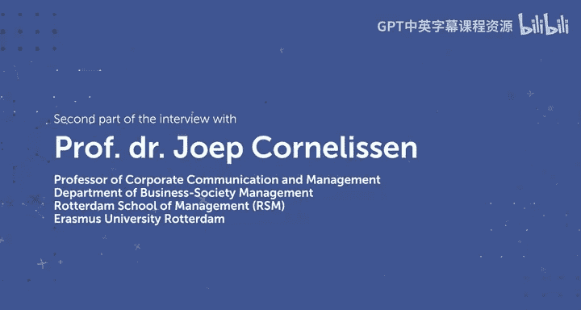
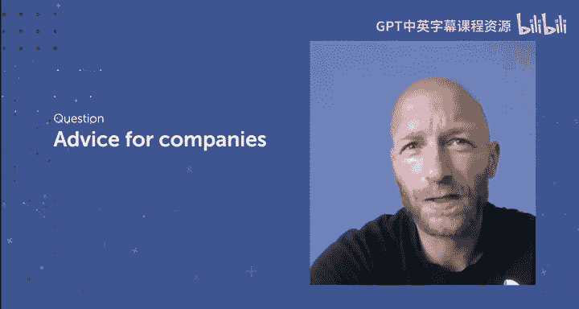
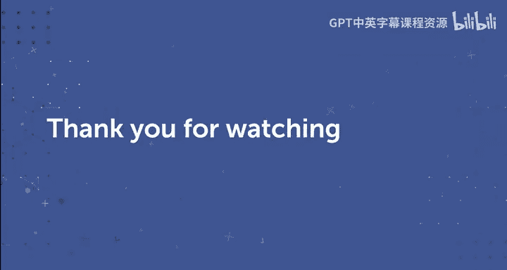

# 12：专家对话：领导力文化及其对企业的影响 🧠

在本节课中，我们将探讨专家视角下，企业的领导力文化如何塑造其应对危机的方式，并以Facebook为例，分析其商业模式、责任边界以及面对社会压力时的典型反应模式。

---

## 企业驱动力的本质 💡

上一节我们讨论了危机的基本面，本节中我们来看看驱动企业行为的核心力量。专家认为，像Facebook这样的公司，其驱动力主要来源于增长和利润。

**公式：** 企业核心驱动力 ≈ **增长 + 利润**

除非受到强大的利益相关者（特别是立法者、股东或主要客户/广告商）的压力，要求其承担不同的责任并改变行为，否则公司通常会在法律框架内持续运营并调整策略。即便如此，要真正重新思考像Facebook这类公司的责任边界，乃至改变其商业模式的根本目的，仍然需要马克·扎克伯格、雪莉·桑德伯格等高层展现出强大的领导力。Facebook目前似乎正艰难地应对这一责任问题。

## 颠覆性商业模式的挑战 ⚙️

理解了企业的核心驱动力后，我们需要审视其商业模式带来的具体挑战。这类商业模式在其运营的领域通常具有高度颠覆性。

它们往往怀有垄断特定市场、排挤其他竞争者的意图。Facebook就是一个很好的例子。通过这种主导地位，它使用户很难找到替代品来与全球各地的朋友保持联系。这是一种**粗放式的资本主义**形式，其首要且不惜一切代价的目标是增长和运营自身业务。

**核心概念：** 这意味着许多环境或社会问题被**外部化**了。对于Facebook而言，改变商业模式可能带来成本，例如业务回报减少或增长率受影响。因此，企业在责任相关问题上做出的选择会产生真实后果，这也使得Facebook当前面临的困境尤为引人关注。

## 社会危机与商业责任 ⚖️

当商业模式将问题外部化时，企业必然会面临相应的社会审视。Facebook正在经历的每一个社会危机（在其案例中主要是社会性危机），都围绕着一些根本问题：

*   企业是否应该以当前的方式运营业务？
*   企业是否应该忽视其业务带来的直接和间接影响？

这些问题涉及不平等、民主、隐私等诸多公众关切的重要议题。从议题沟通和危机沟通中我们得知，如果企业能建立良好的系统，预见到这些即将出现的问题和必然引发的公共辩论，许多事情是可以预防的。

## 企业的典型应对模式 🌀

那么，企业在面对这些压力时，通常会如何反应呢？尽管每家公司都有其独特性，但在处理这类问题时也存在许多相似之处。

以下是常见的应对阶段：

1.  **静观其变**：试图将问题外部化，或最小化自身相关责任，并从这个角度进行初步管理。
2.  **建立缓冲**：试图缓冲外部世界的影响，希望问题自行消失。如果问题没有消失，则会安排与利益相关者会面，或建立行业平台以展示在该领域的资质。
3.  **危机沟通**：如果问题依然存在，则进入危机沟通模式，试图通过讲述自身故事来最小化对声誉的损害。

这种行为方式并不总是正确的。它回归到之前提到的一点：许多公司处于这种思维和行为模式中，他们认为只要问责压力没有改变，只要没有受到媒体或利益相关者的严格审查和要求，就会继续原有的做法。这里缺乏远见，没有充分思考我们应该做什么、我们的责任应该是什么。

---

**本节课总结**：我们一起学习了企业领导力文化如何影响其决策，分析了以Facebook为代表的、以增长利润为核心驱动的商业模式的特性及其带来的社会责任外部化问题。我们还梳理了企业在面对社会危机时，从“静观其变”到“危机沟通”的典型反应链条，并指出这种被动应对模式往往源于缺乏前瞻性的责任思考。