# Mathworks《工程与科学计算机视觉（简介、机器学习、目标检测）｜Computer Vision for Engineering and Science》 p01 0_工程与科学计算机视觉.zh_en -BV1yJ4m13715_p1-

🎼，Computer vision algorithms are running on our phones。Cars， and even our refrigerators。

As cameras are added to more and more devices， the need for people with computer vision experience is growing rapidly。

 That's why Mathworks created computer vision for engineering and science on Coursera。😊。

In this three course specialization。You'll complete projects like aligning satellite images。

Training models that identify road signs。

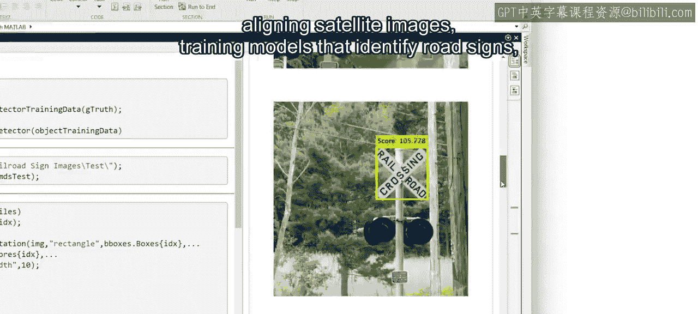

And tracking objects， even as they move out of view。Sounds exciting。

Let's see how you gain those skills。In course one， you will learn the fundamentals of computer vision。

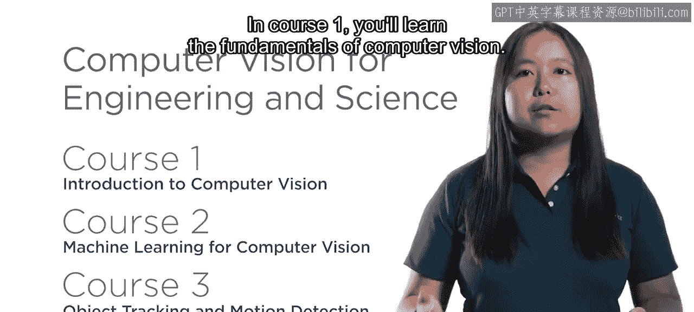

You'll apply a variety of algorithms to extract useful features from images。

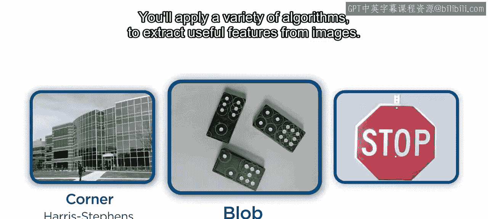

These features are used in many applications like image registration， classification and tracking。

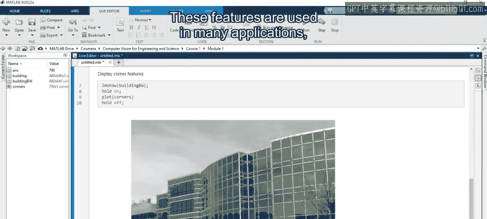

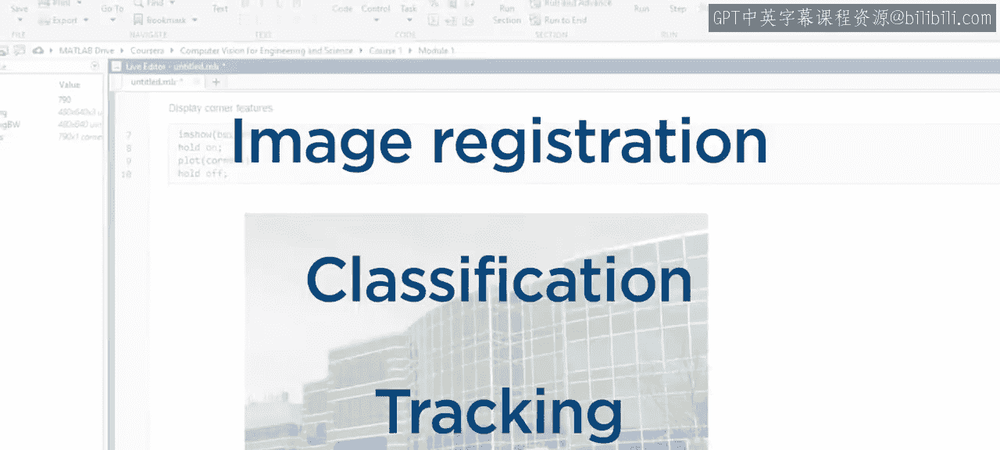

By the end， of course， one， you'll detect， extract and match features to align and stitch together images like these。

😊。

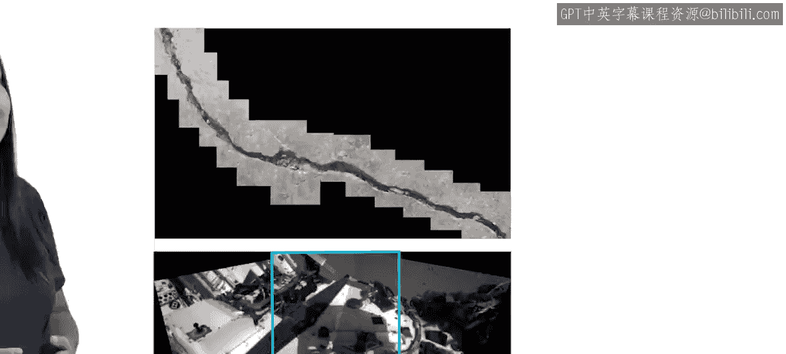

In course two of the specialization， you'll use these image features with popular machine learning algorithms to train image classification and object detection models。

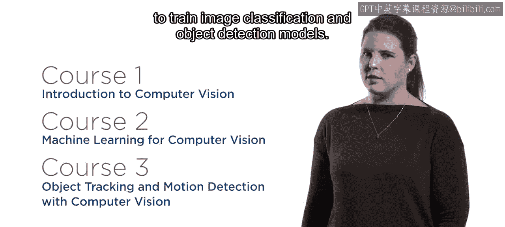

However， training a model is only one part of the workflow。To achieve good results。

 you'll learn to properly prepare your images for machine learning。

And evaluate the trained model on test images。

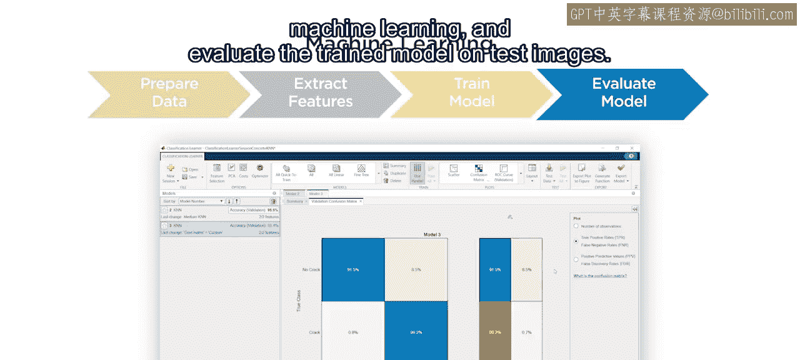

Importantly， the skills you gain also apply to deep learning。

 where feature extraction is done by the network during training。

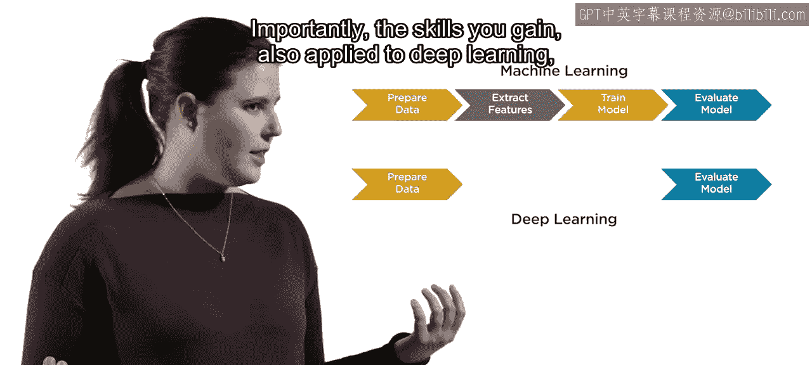

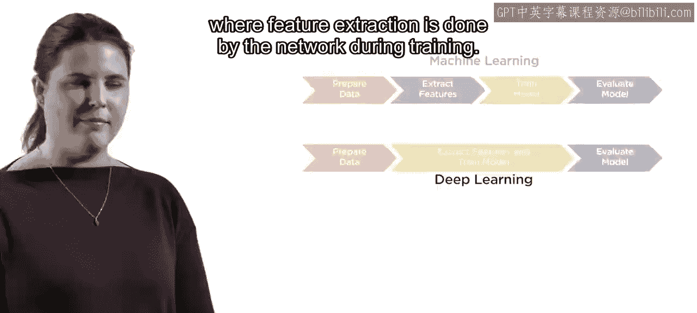

And speaking of deep learning。There are a growing number of models already available。In course 3。

 you'll import and use common deep learning models like Yolo to perform object detection。

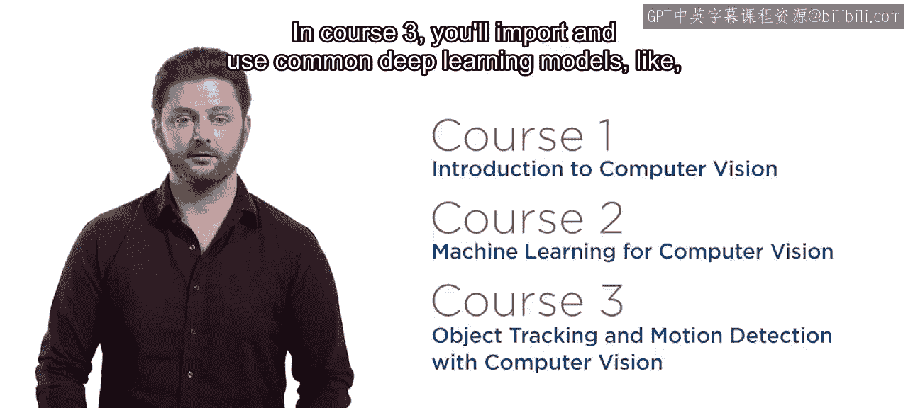

Detecting objects is often the first step in a larger workflow。

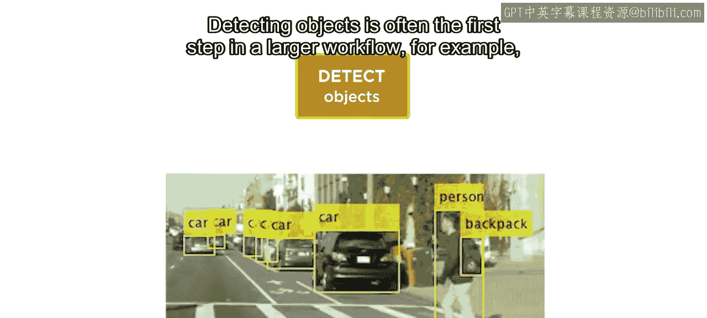

For example， detection is used with motion prediction to differentiate and track objects over time。

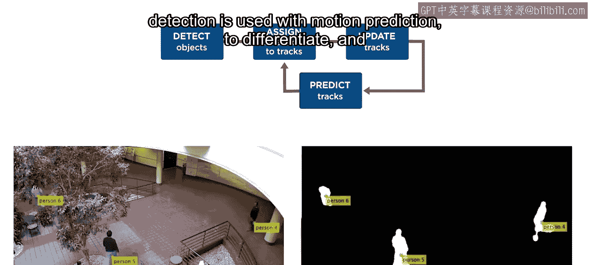

At the end of the specialization， you'll apply tracking to count the number of cars going in each direction on a busy road。

To be successful in these courses， it'll help to have some prior image processing experience。

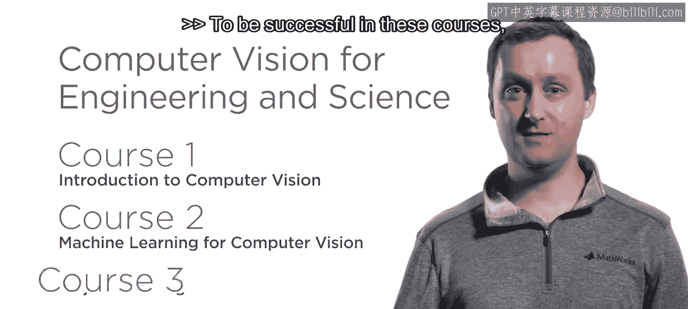

If you're brand new to working with image data。

We recommend also enrolling in our image processing for engineering and science specialization on Coursera。

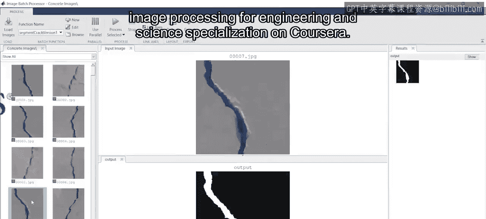

Computer vision is an exciting and growing field。

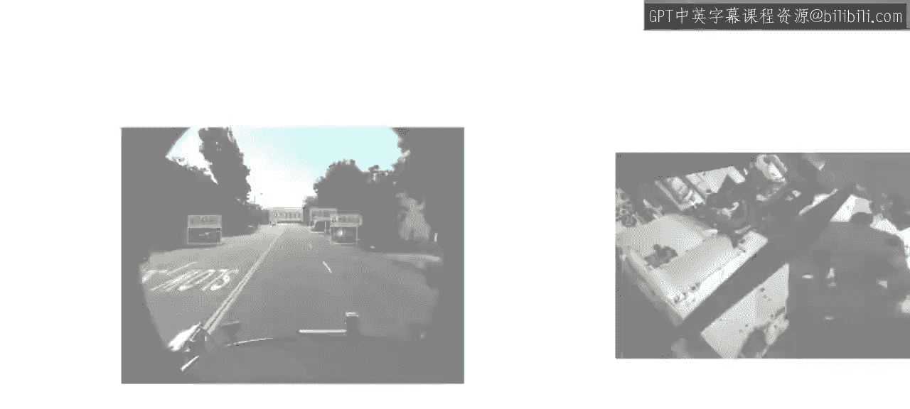

This specialization will give you the skills to succeed in a world where images and cameras are more important than ever。

😊，Let's get started。