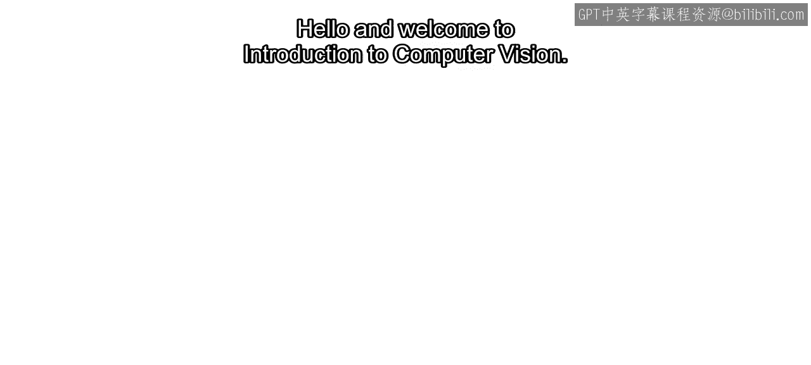
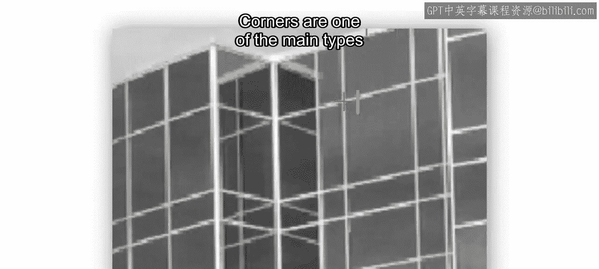
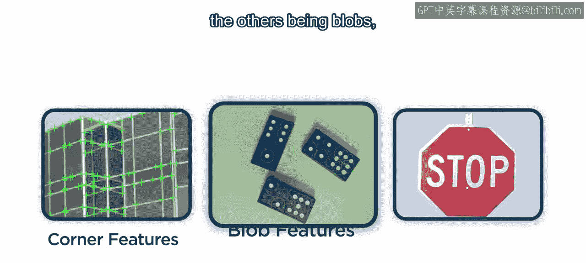
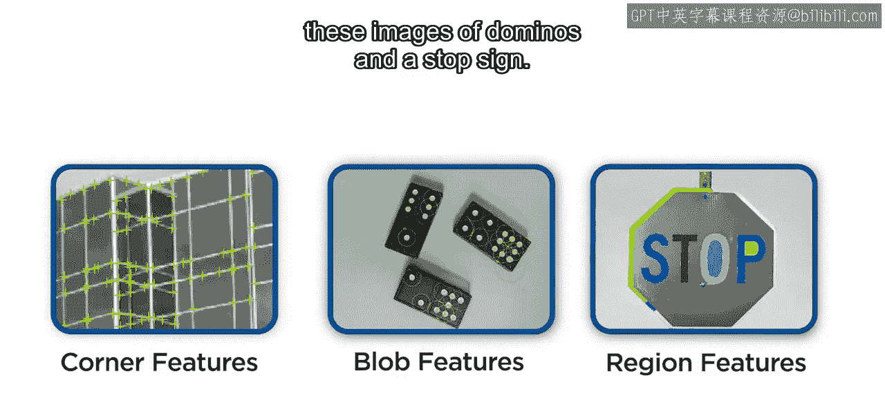
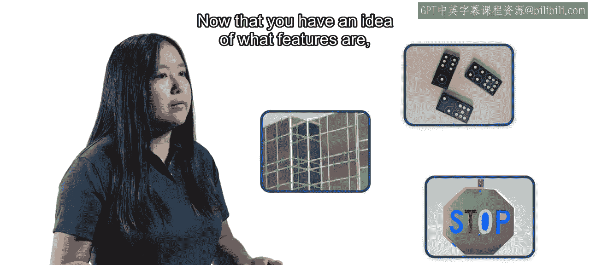
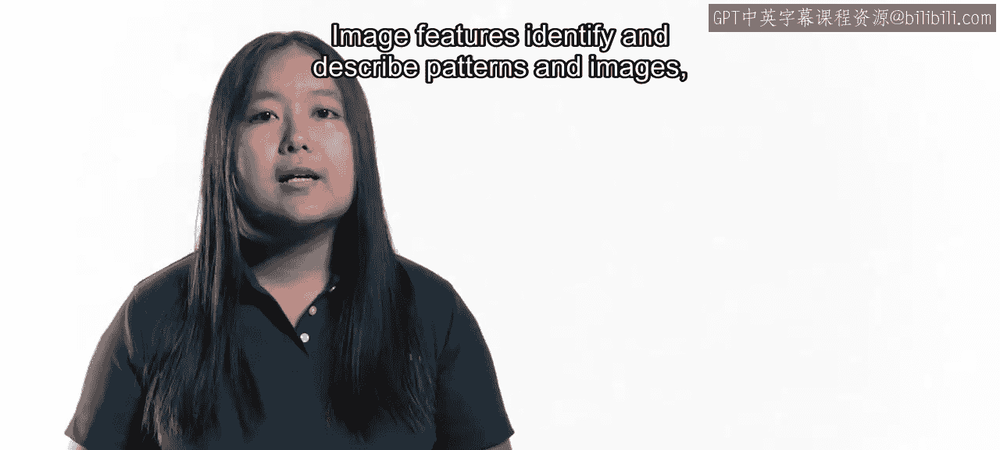
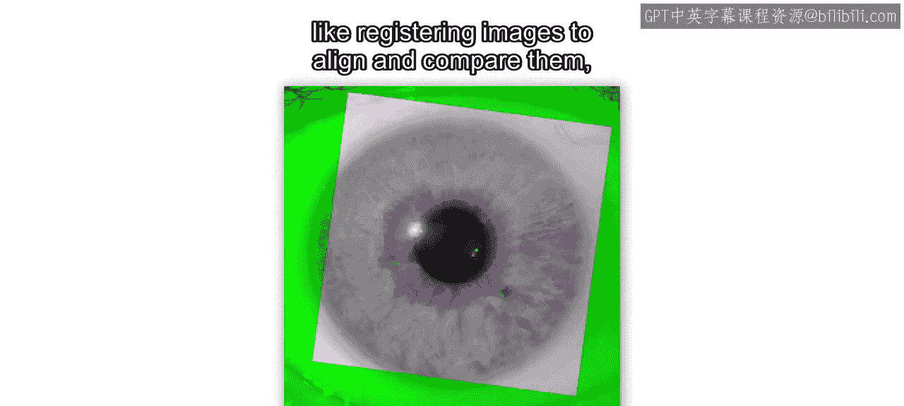
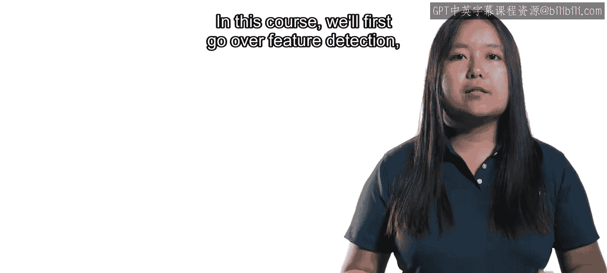
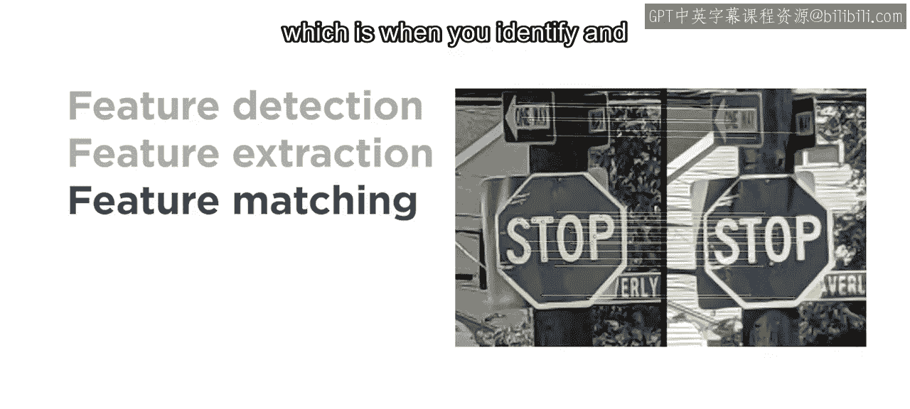
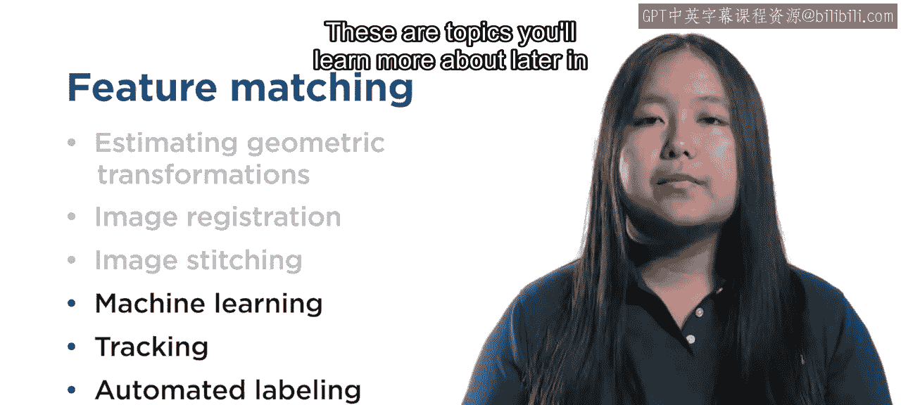

# Mathworks《工程与科学计算机视觉（简介、机器学习、目标检测）｜Computer Vision for Engineering and Science》 p02 1_简介- 什么是特征.zh_en -BV1yJ4m13715_p2-

🎼。

Hello and welcome to Introduction to Computer Vision。

One of the most important concepts in computer vision is image features。

 but what exactly is an image feature？To answer this。

 let's look at this grayscale image of a building。What do you notice first？You might say the pathway。

The doors。Or the person walking in the center。But computers are a little different。

Remember that a digital image is just an array of numbers。

 So features in the context of computer vision are more technical in nature。For example。

 a computer would see the numbers are presenting the intensities of this window corner and use these values to identify this location as having big changes。

The computer would be able to detect both the edges and the corner。

Corners are one of the main types of features in computer vision。

The others being blobs or areas in an image that differ in brightness from their surrounding neighborhoods。

And regions of uniform intensity， like those shown in these images of dominoe's and a stop sign。

Now that you have an idea of what features are， you may be wondering。

 why are they so important to computer vision。

Image features identify and describe patterns and images。

 which can be used to perform a variety of tasks。Like registering images to align and compare them。

Stitching images together to form a wider panoramic shot。

And classifying images into different categories。In this course。

 we'll first go over feature detection， where you will use multiple algorithms to identify the locations of features such as Harris Stevens for Cors and surff for blobs。

😊。

Next， you will learn about feature extraction， also known as feature description。

 which describes the neighborhood of pixels around a feature。You will also perform feature matching。

Which is when you identify and match similar feature descriptions in different images。

Feature matching is important to many workflows， such as estimating geometric transformations。

Image registration and image stitching。All of what youll explore in this course。And that's not all。

 They're also used in machine learning， tracking and automated labeling workflows。

These are topics you will learn more about later in this specialization。

Let's get started。