# Mathworks《工程与科学计算机视觉（简介、机器学习、目标检测）｜Computer Vision for Engineering and Science》 p04 3_提取特征.zh_en -BV1yJ4m13715_p4-

🎼。

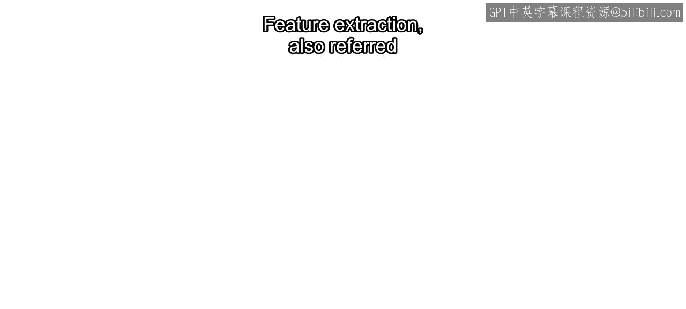

Feature extraction also referred to as feature description。

Produces a quantitative representation of a neighborhood of pixels around a detected feature。

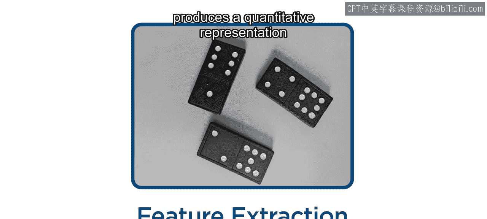

This often takes the form of a vector and is known as a feature descriptor。

A descriptor contains a lot more information about a feature than simply its pixel location and detection strength。

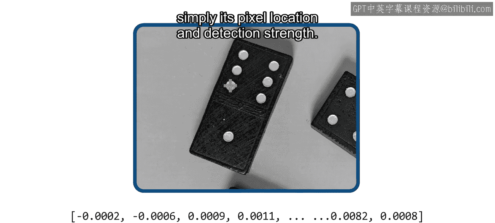

Feature descriptors are used in many ways。Using descriptors to match features in multiple images is a key step in many applications。

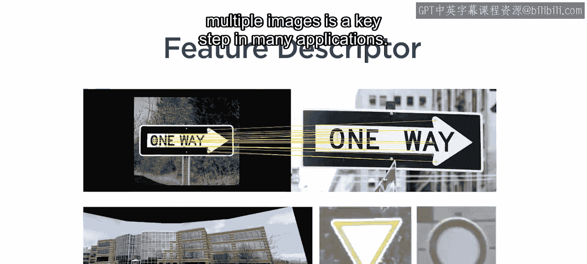

From image registration and stitching。To machine learning。

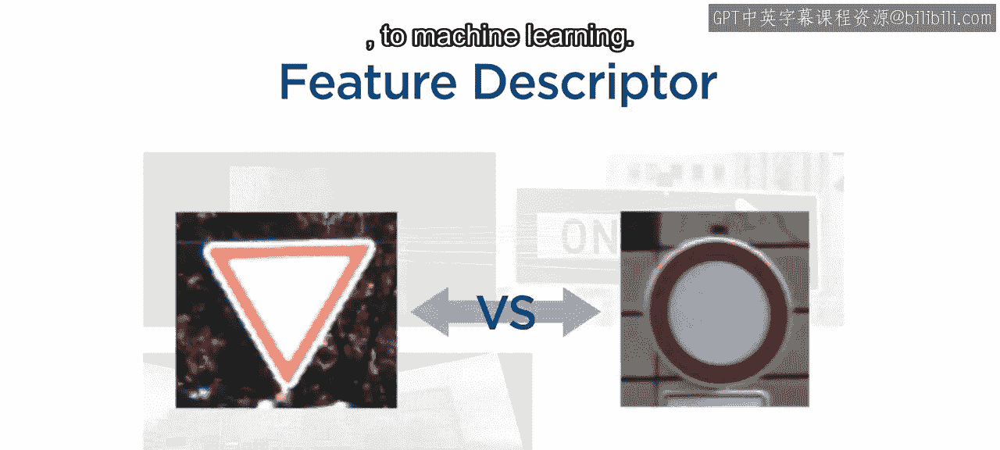

Just like with future detection。There are many different feature extraction algorithms。Such as surf。

Freak。And orb。In this video。We'll focus on the surf extraction algorithm。

Because it is used in image classification， and many other extraction algorithms use similar techniques。

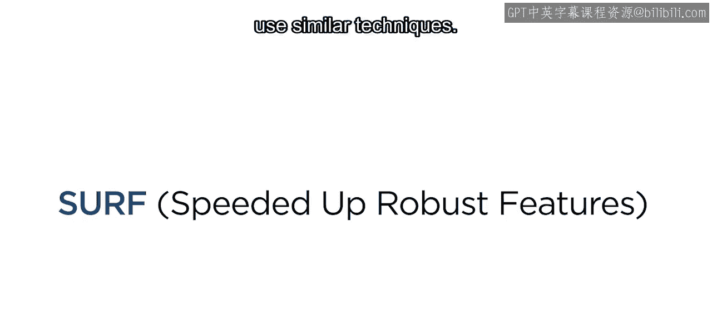

Let's begin by revisiting the surf features detected in this image of domino's。

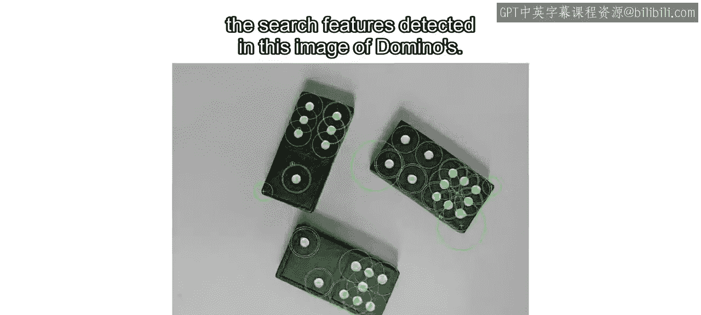

Remember that we changed the number of octaves to detect the larger blobs in the image。

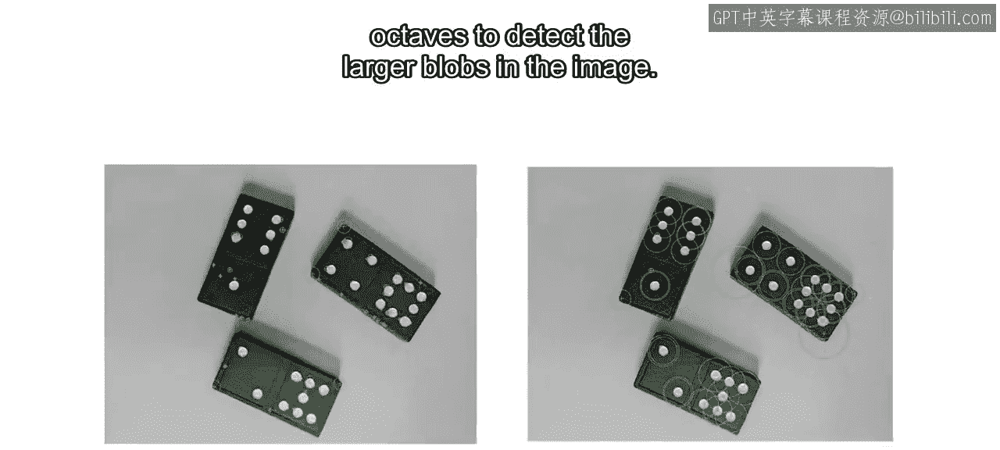

For each number of octaves， the algorithm searches the image at four filter sizes。

The number of octaves determines the range of sizes。

This means that the same feature could be detected at multiple scales。 and for this reason。

 Sur considered a scale invariant algorithm。After the detection step identifies the surf features。

The surf extraction algorithm then calculates their dominant orientations。To do this。

 the algorithm first identifies a circular neighborhood around the feature。

 denoted by the circle here。Then using the local gradient estimates of pixel intensities in this region。

 a dominant orientation is determined。This orientation might not mean much to us。

 but it allows the algorithm to more easily identify the same feature if it were rotated in another image。

Algorithms that have this property like Ser， are called rotation invariant。

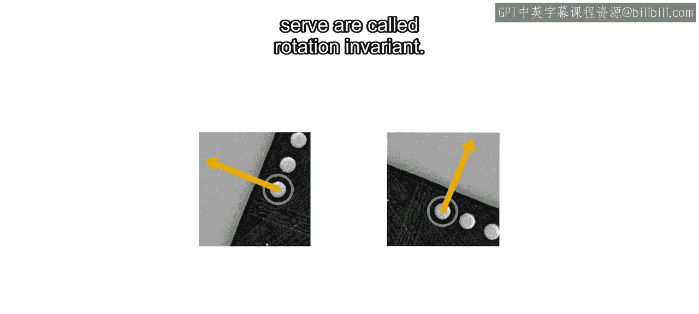

Surf then isolates a square region around the feature with two edges perpendicular to the dominant orientation。

 as shown。Afterwards， the square is divided up into 16 subreg。

And four gradient values are calculated for each subreion。Finally。

 all these values are collected into a vector to form the 64 value feature descriptor。

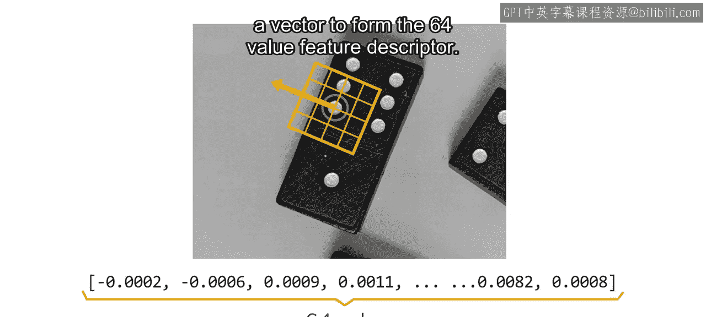

Note that not all algorithms are scale and rotation invariant。You may be wondering。

 why would I ever use an algorithm that isn't scale or rotation invariant。

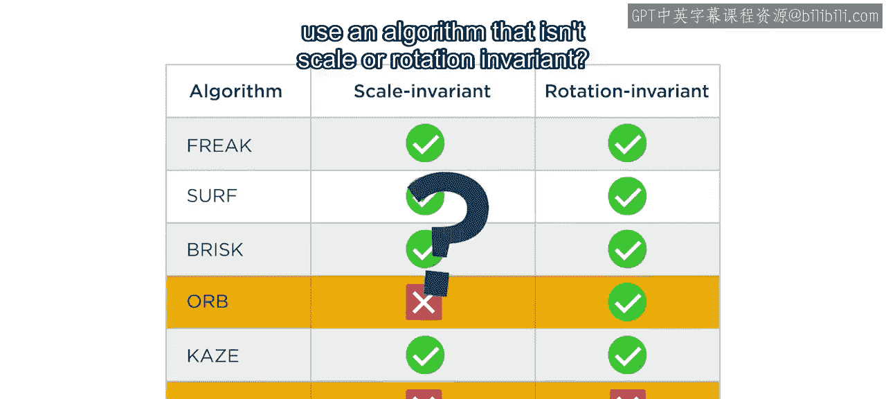

While these invariances may be very helpful for some applications。

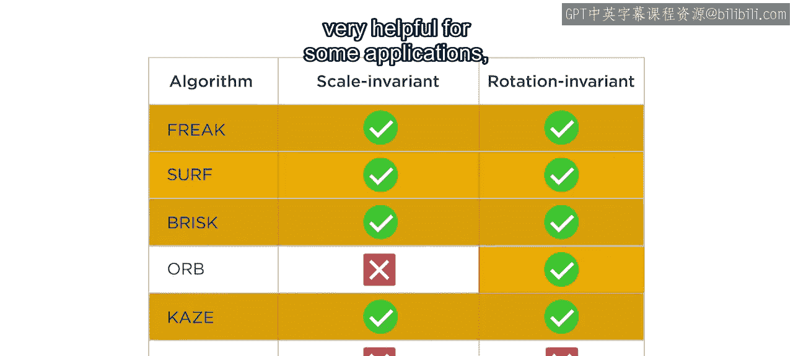

They result in more complicated and expensive computations。

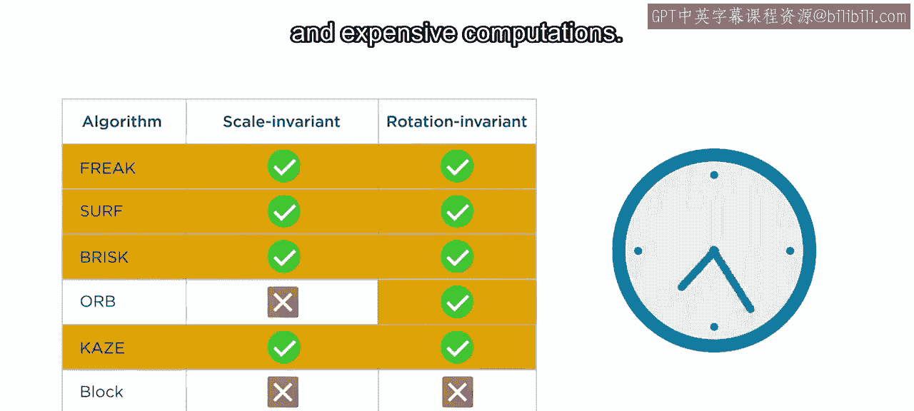

Depending on your application， you may have a fixed camera orientation and don't need to account for differences in rotation。

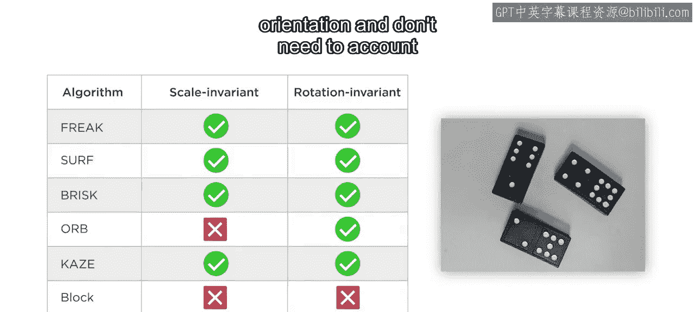

Or scale。

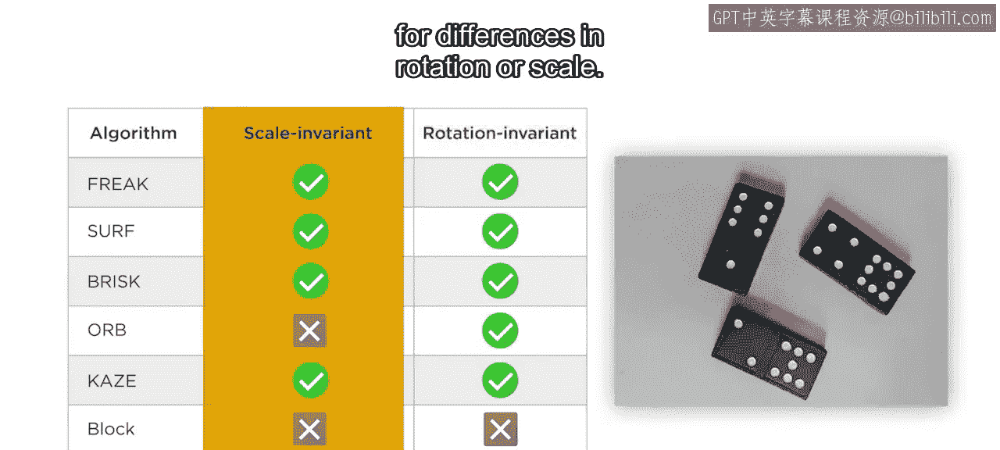

In these cases， you may choose to use a different algorithm that is not scale or rotation invariant for increased efficiency。

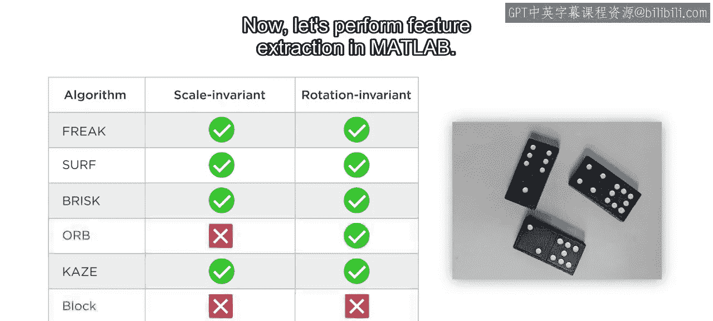

Now， let's perform feature extraction in MatTLb。You've already seen how to read in the image。

Convert it to grayscale。And perform feature detection。Next。

 apply the extract features function using the gray scale Domino's image。

And detected feature points as inputs。Matlab will automatically choose an extraction algorithm based on this input。

In this case， it chooses surf because our input comes from the ser detection algorithm。

This function produces two outputs。Features and valid points。

Features is a numerical matrix where each row represents a different features descriptor。

Valid points is an array that contains various properties about each extracted feature。

Note that the number of extracted features can sometimes be fewer than the number of detected features。

 If some of the features are too close to the edge of the image。In that case。

The neighborhoods would extend beyond the image， so some descriptor values couldn't be calculated。

Now that you know how to extract feature descriptors。

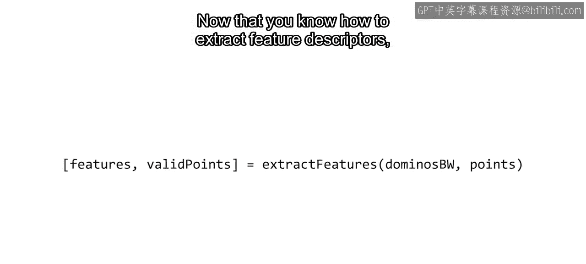

You are ready to move on to feature matching。Which you'll later apply to image registration and stitching。

 as well as image classification tasks。