# Mathworks《工程与科学计算机视觉（简介、机器学习、目标检测）｜Computer Vision for Engineering and Science》 p05 4_匹配特征.zh_en -BV1yJ4m13715_p5-

🎼。

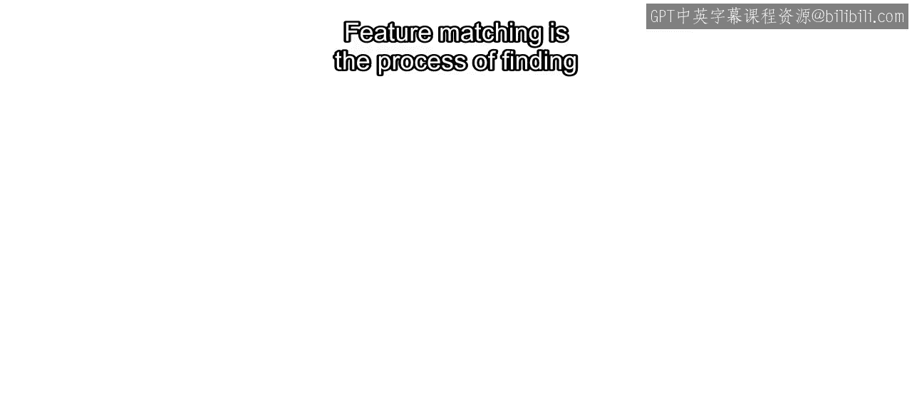

Feature matching is the process of finding pairs of similar features in two images。

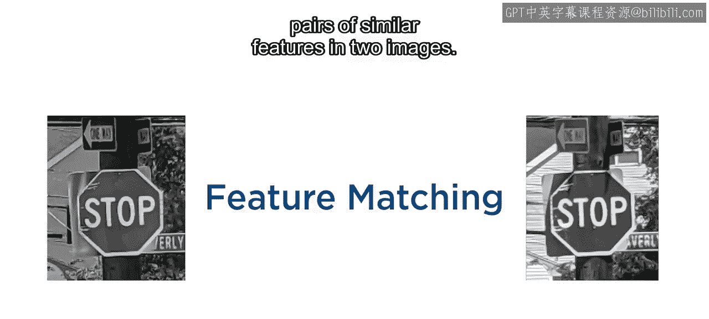

This oftentimes means finding the same points on the same object。

Or on distinct but nearly identical objects， under differentveming conditions。

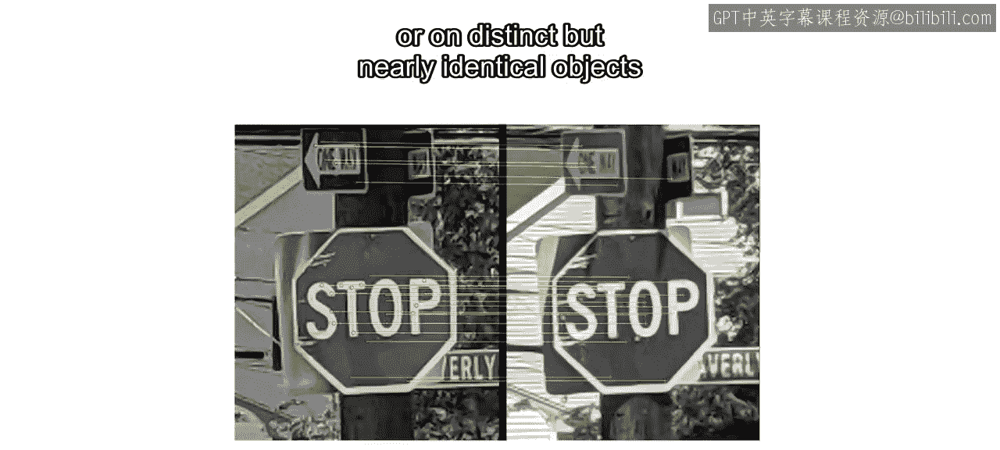

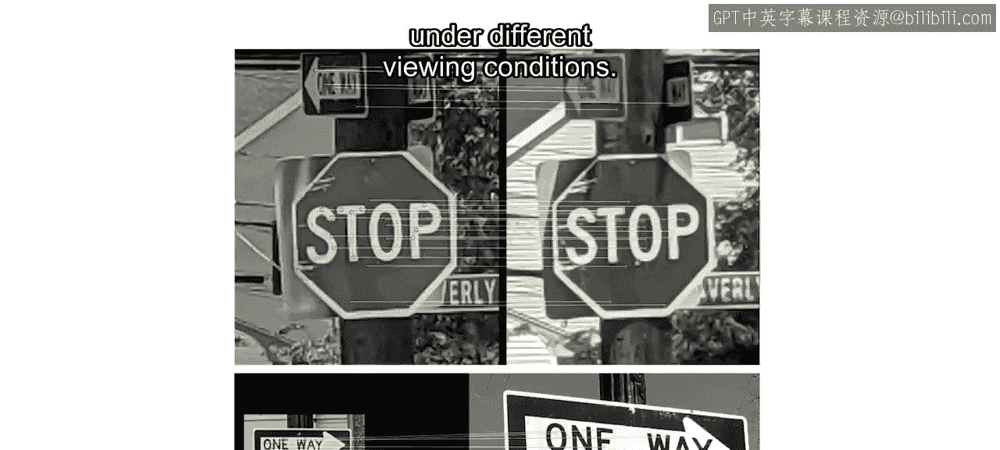

Feature matching is an integral part of applications like aligning satellite images。

Stitching multiple images together。And video stabilization， among many others。

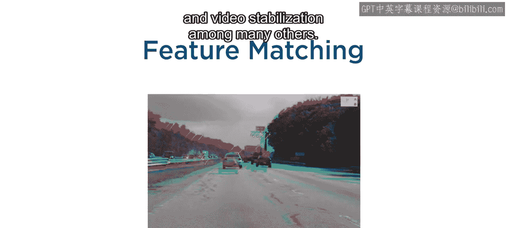

There are three steps to feature matching。Detecting features in a pair of images。

Extracting the feature descriptors from each image。And using them to find matching pairs of features。

So how does feature matching work？Let's consider this pair of detected surf feature points at the same spot on two different road signs。

As well as an additional point from a different area。

Each extracted feature descriptor gives you a quantitative description of a neighborhood of pixels around a detected feature point。

In this case。The ser descriptors are 64 valued vectors。

 with values calculated over a grid within each neighborhood。The similarity。

Or dissimilarity of the features。Is reflected in the similarity。

Or dissimilarity of the descriptor vectors。Each descriptor exists in a 64 dimension coordinate space。

But let's use two dimensions to illustrate the concept。A feature pair is a match。

 If the distance between them in the descriptor coordinate phase is below some threshold。

And not a match， otherwise。Here descriptor A and B are close enough to be a match。

While A and C are too far。

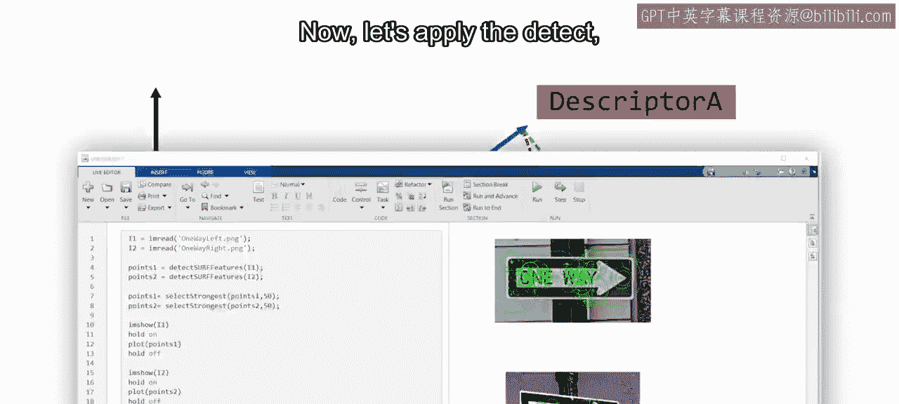

Now。Let's apply the detect extract match workflow in MATLAP。

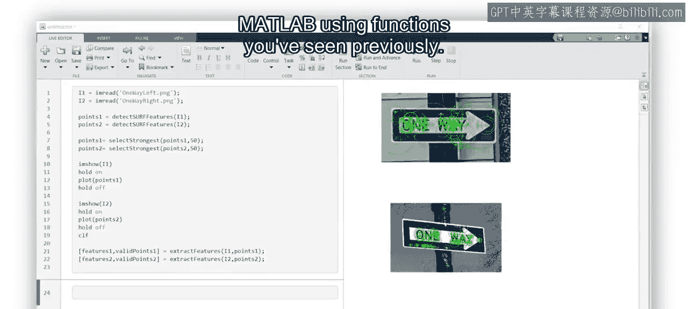

Using functions you've seen previously， we've already detected surf features in each image。

Selected the 50 strongest feature detections in each。

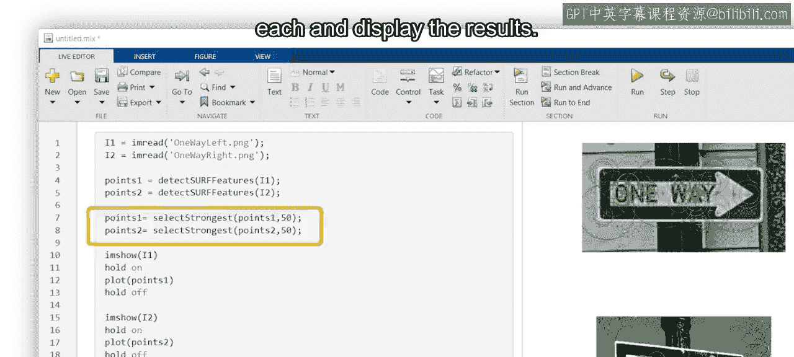

And displayed the results。We also extracted feature descriptors。

 along with the corresponding detection points。

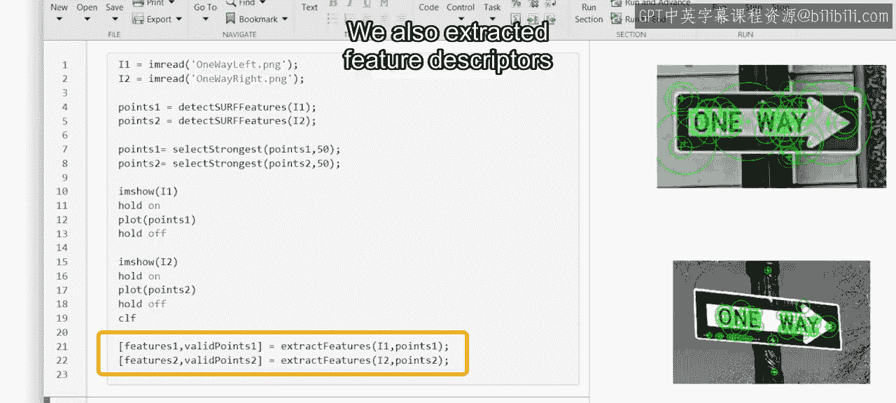

Now， use the Mat features function to determine the matches among all possible pairs in the two sets of feature descriptors。

The output is a list of index pairs。

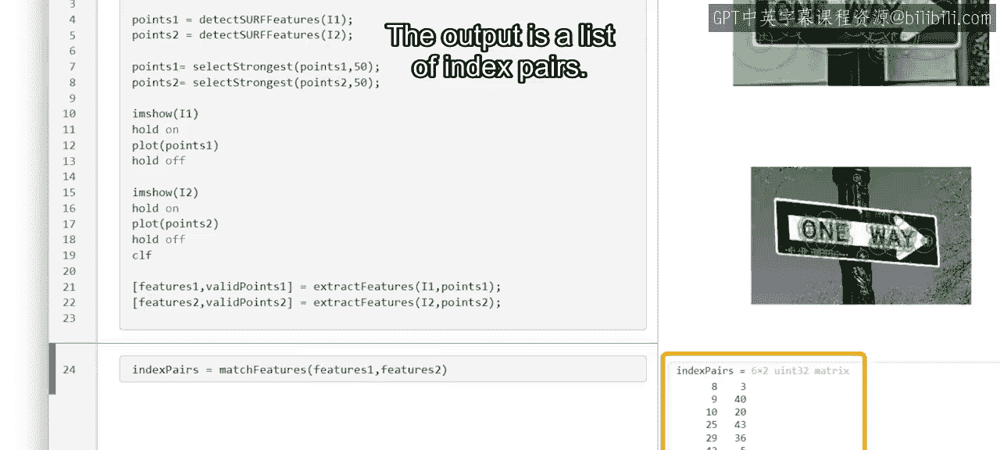

Each pair of indices。Corresponds to a matched feature descriptor pair。Here。

 the first column contains indices for features 1。And the second column contains indices for features too。

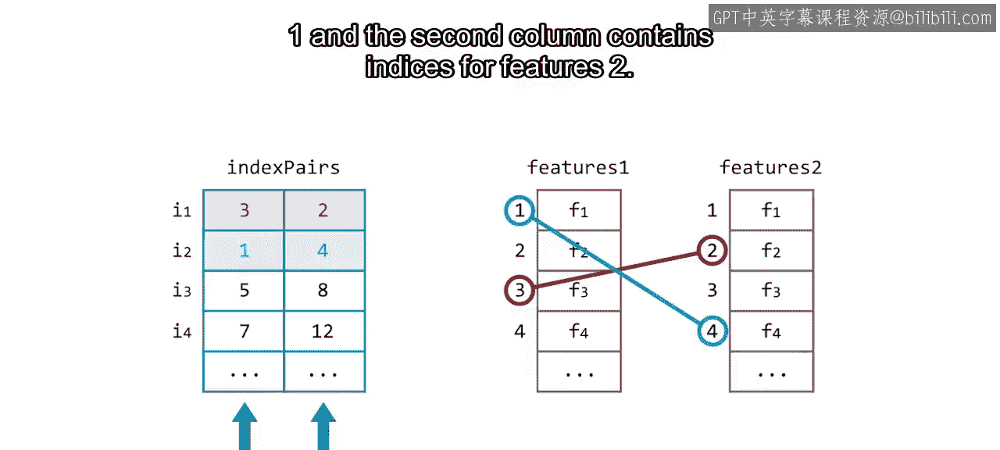

To get the locations of the features matched in each image。Use the first column of the index pairs。

To index into the valid points output for the first image。

And the second column to index into the valid points output for the second image。

Visualize the results using the show matched features function。With the first and second images。

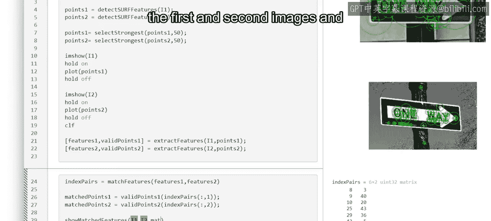

And both sets of matched points， as inputs。

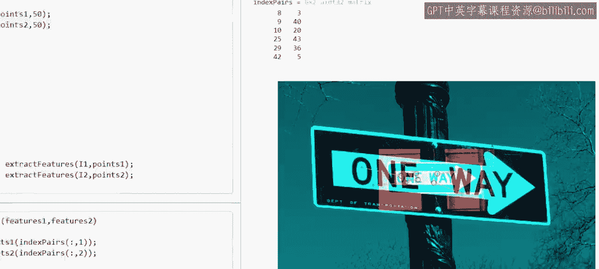

The default display from this function works better for image pairs that are the same size。

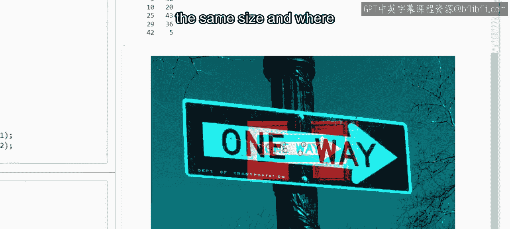

And where the same object is translated and or rotated。To see the matches more clearly here。

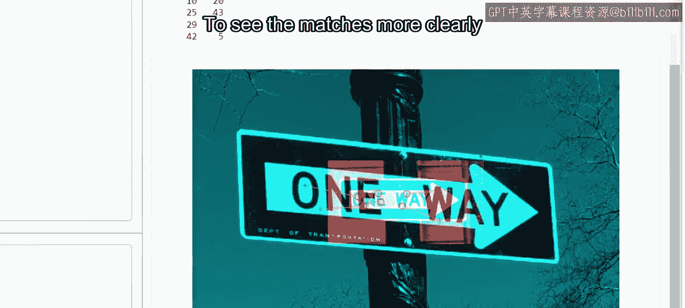

Add the montage option。

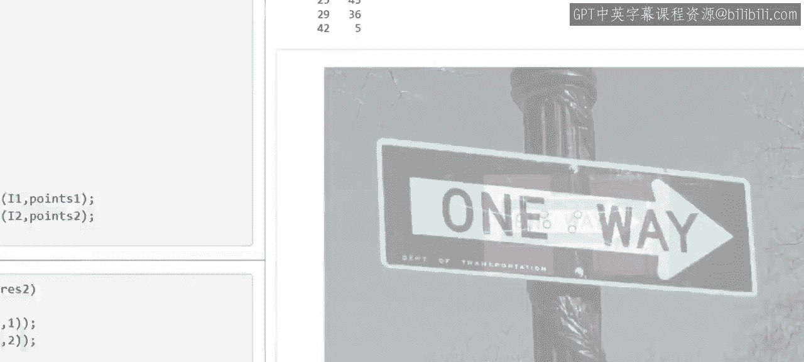

Now that you know the overall detect， extract， match workflow。

 you're ready to try it yourself at Matlad。

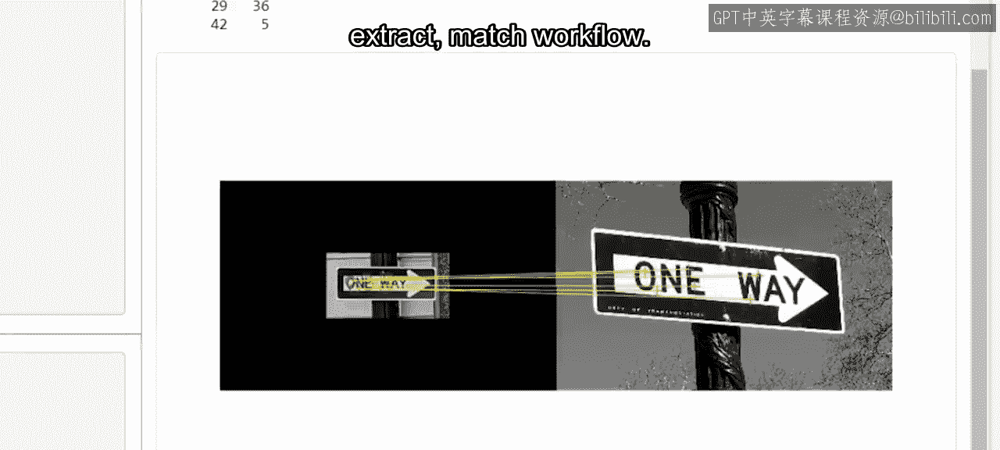

In the following reading。You'll practice and explore the detect extract match workflow further。

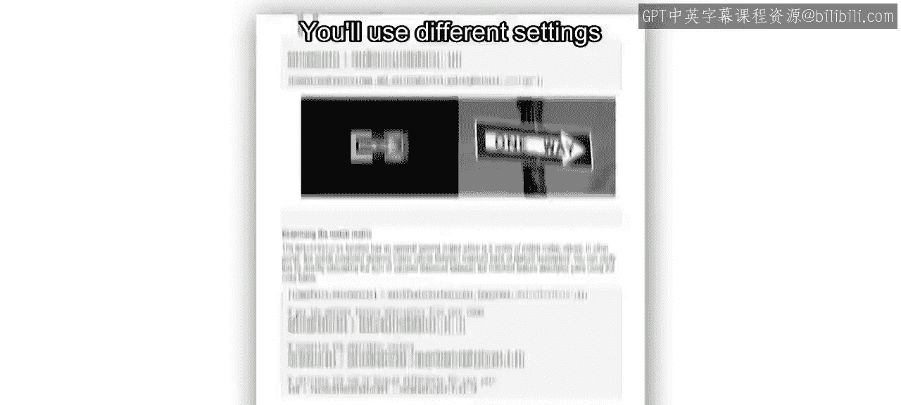

You'll use different settings for the matching threshold。

Match uniqueness and other parameters to improve matching performance。

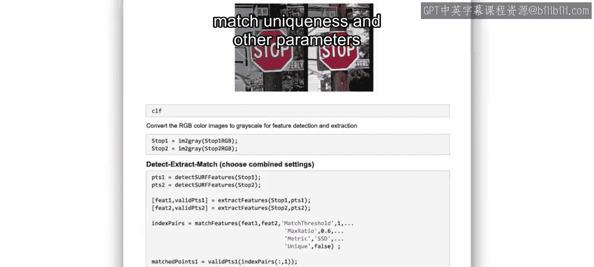

。