# Mathworks《工程与科学计算机视觉（简介、机器学习、目标检测）｜Computer Vision for Engineering and Science》 p06 5_估计和应用几何变换.zh_en -BV1yJ4m13715_p6-

🎼。

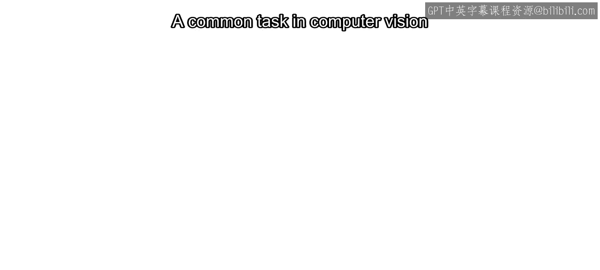

A common task in computer vision is measuring changes in perspective or motion between images。

Applications include image registration and stitching。Video stabilization。And motion estimation。

 just to name a few。In this video， you'll learn to describe the changes in perspective between images by estimating the geometric transformation。

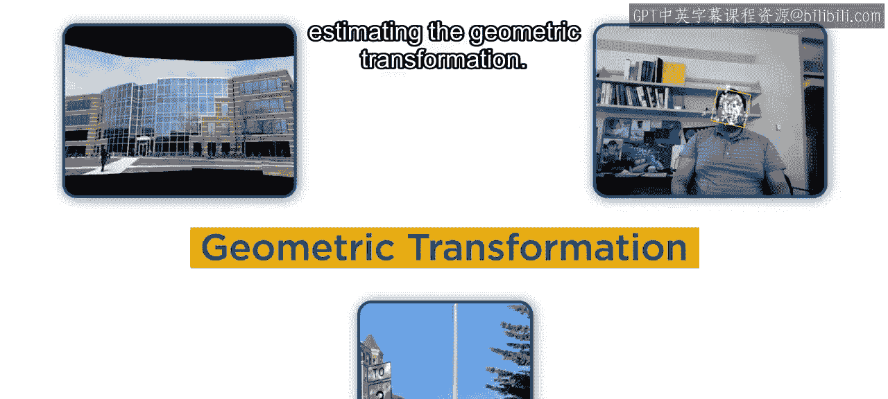

Geometric transformations for 2D images are based on five types of perspective changes。

 which will illustrate using this image of a stop sign。

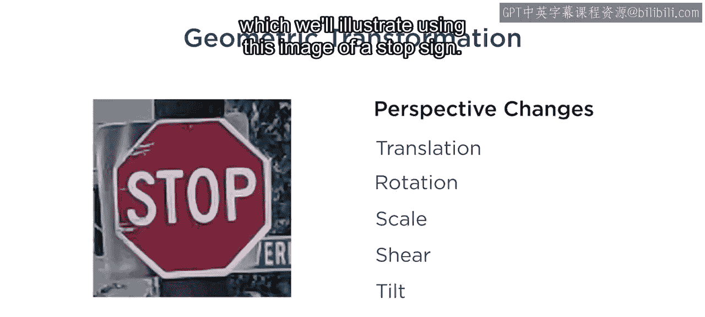

The types are translation。Rotation。Scall。Sheer。And tilt。

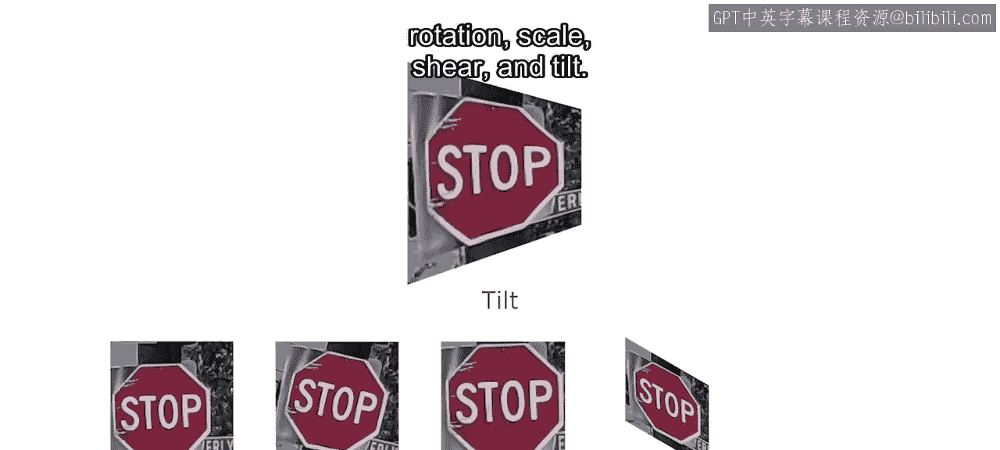

There are four kinds of geometric transformations。Each encompassing a different subset of these five types of changes in perspective。

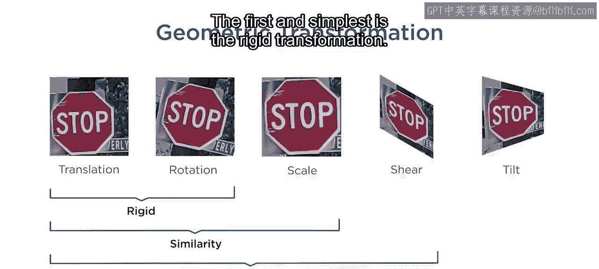

The first and simplest is the rigid transformation。

If two images only differ by rotation and translation。

Then the transformation relating to two is rigid。Note that the size and shape of an object remain constant after a rigid transformation。

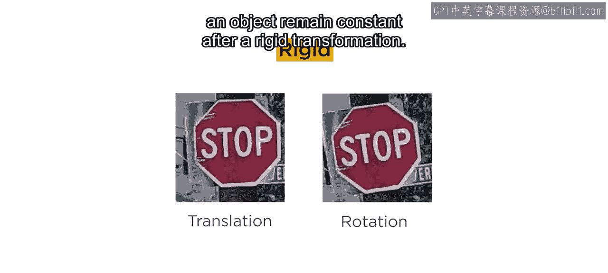

There should not be any changes in scale， shear or tilt。

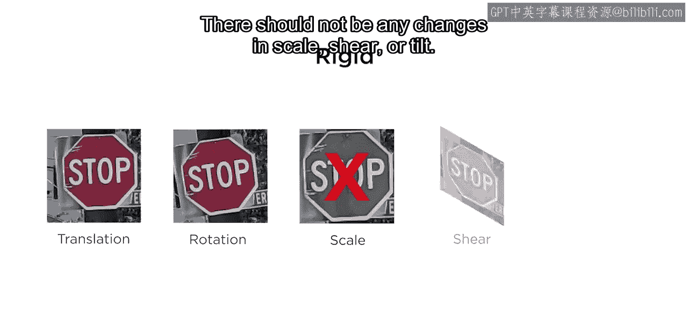

Next， there is the similarity transformation， which allows for scaling differences in the x and y directions。

 in addition to translation and rotation changes。

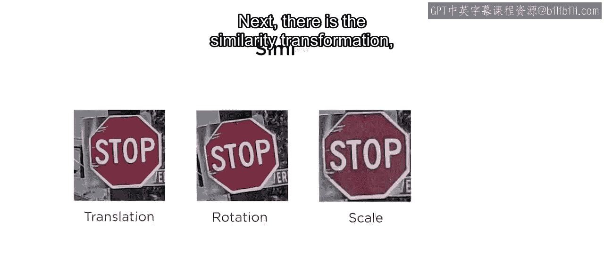

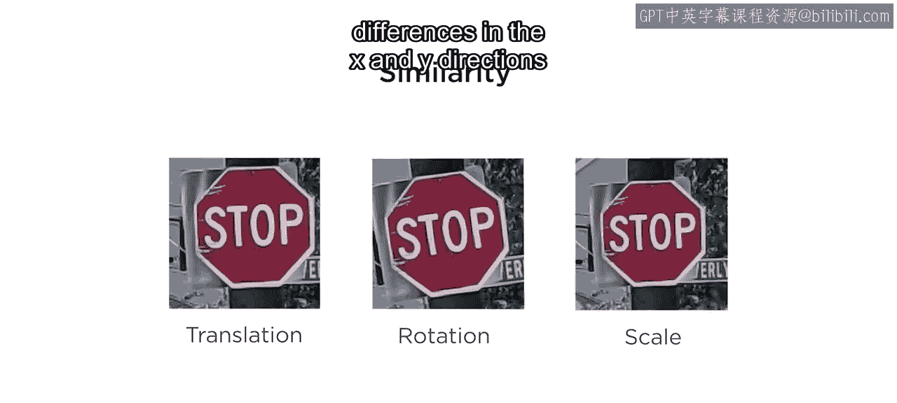

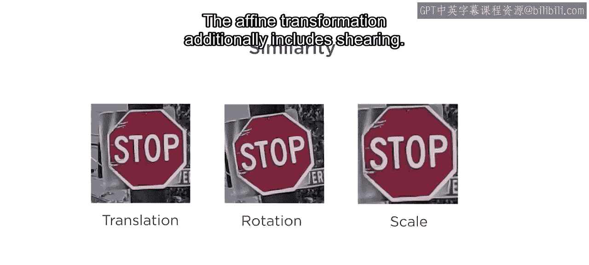

The Aine transformation additionally includes shearing。So parallel lines are maintained。

 even though the object may look quite different。

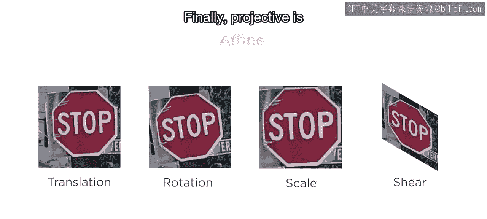

Finally。Projective is the broadest type of 2D geometric transformation。

With tilt or out of plain rotation being included too。

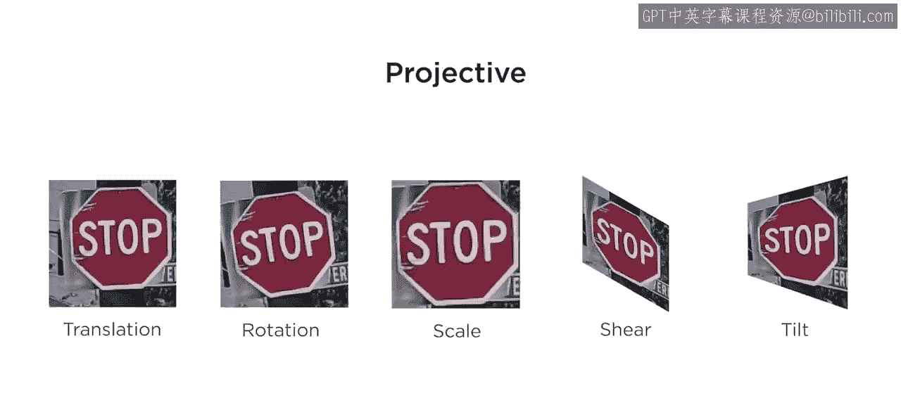

To perform geometric transformation estimation， you need the locations of matching points on the images。

 also sometimes known as control points。For example。

 a matching point pair here could be the bottom left corner of the letter T in stop。

Depending on the type of transformation， you will need a different number of matched pairs to compute an estimate for the transformation。

A simpler transformation like rigid， only needs two matched pairs。But a complex one， like projective。

 needs at least four pairs。

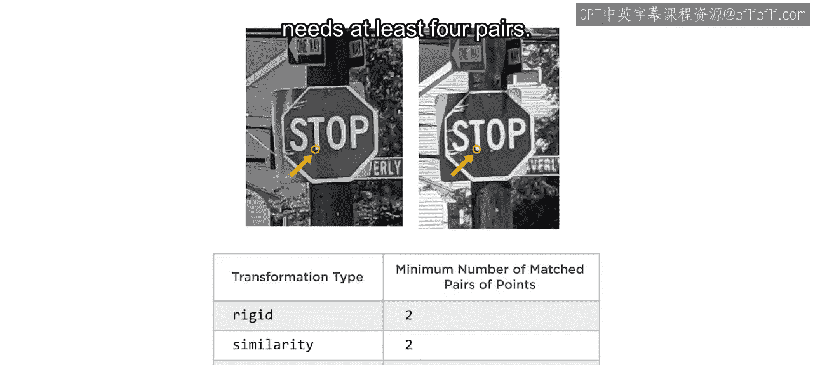

However， you usually want many more than a minimum number of matched pairs because it's often difficult to perfectly identify the same location in multiple images。

Feature based matching is a great way to get a lot of matched points。

But it usually produces some incorrect matches。Take these matched pairs of points， for example。

Because features are matched based on the pixel values in their local neighborhood。

There are some matched points where the local areas look very similar。

But they're clearly not referring to the same position on the object。

To make this transformation estimation more robust， an algorithm known as random sample consensus。

 or Rasack is often used。For simplicity， imagine we had only four matched point pairs。

This algorithm randomly selects a subset of the match points。

Estimates a geometric transformation from those pairs。

Applies this transformation to all the matching points in the first image。

To get a new set of locations。And calculates the distances between these transformed points and the actual points。

By repeating this process many times， the algorithm identifies and returns the transformation with the least amount of error。

It also identifies the matched points that fit the transformation， known as inliars。

And the outliers that do not。Let's now estimate the geometric transformation in MALB。Earlier。

 you saw how to match features between images。Here we read in the two stop sign images。

Convert them to gray scale。And detect， extract， and match serve features。

The matched points coordinates are saved as two variables。

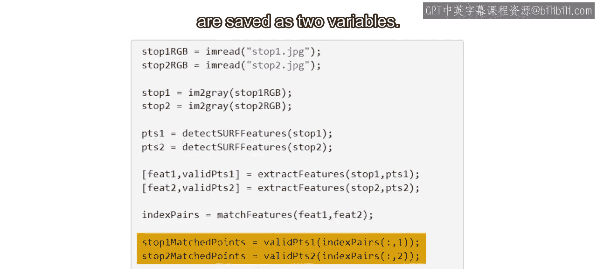

To estimate the geometric transformation。Use this function。

Pass in the matching points from the second image。The corresponding matching points from the first image。

And the transformation type as inputs。The stop signs in the images only seem to vary in translation and scale。

So similarity is the transformation type here。This creates a transformation that maps points in the second stop sign image to their corresponding locations in the first。

The function produces two outputs。 the geometric transformation object。

And a logical array indicating the matched point pairs that fit this transformation。

This vector of inlier indices can be used to remove the erroneous matches found during feature matching。

Using this geometric transformation object， you can warp the second image。

 so it's aligned with the first image using the IM Warp function。To compare aligned images。

 it's helpful to ensure that the output sizes are the same。

Use the output View option to set the size of the Warped image。

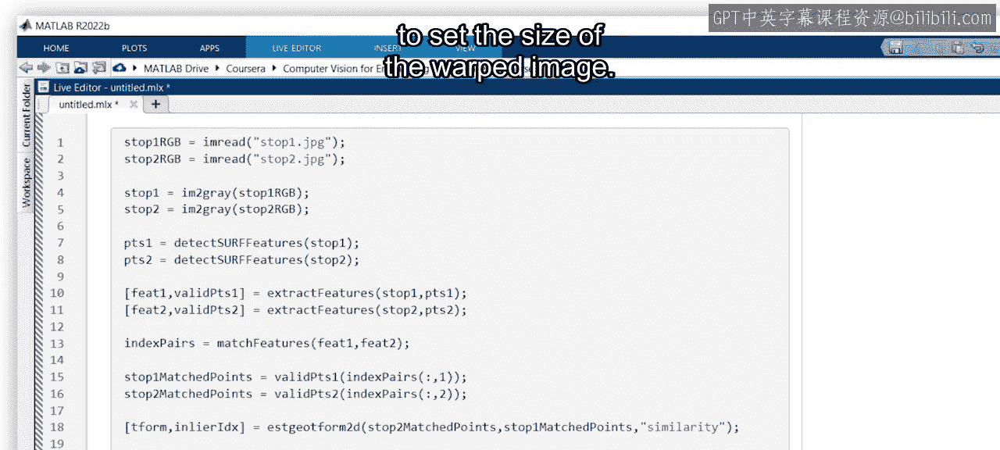

Now， use the IM show pair function to see the original two images overlaid。

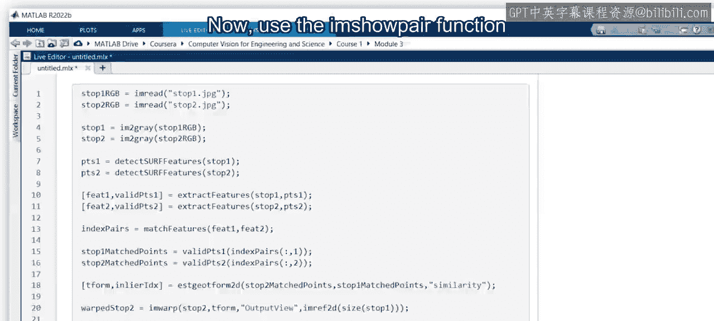

And compare that to the result from the Warped second image。The images are clearly aligned。

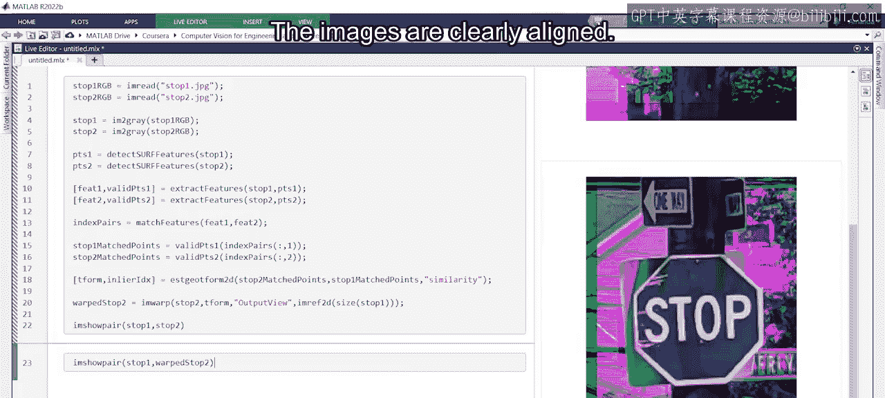

In this video， you' learn about the four types of 2D geometric transformations。Ridd similarity。

 a fine。

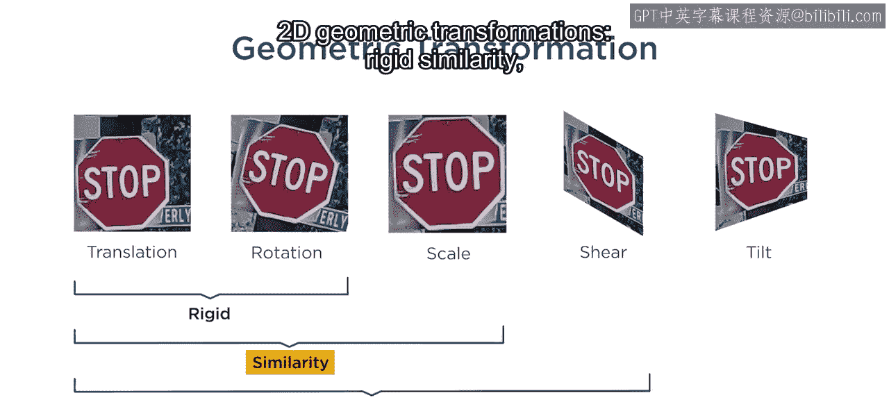

And projective。And how to estimate them in MatLb， given two images with matching point pairs。Next。

 you get to practice estimating geometric transformations on your own。

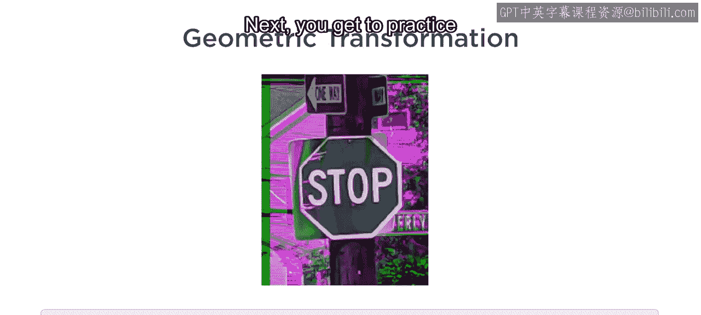