# Mathworks《工程与科学计算机视觉（简介、机器学习、目标检测）｜Computer Vision for Engineering and Science》 p08 7_可视化选择控制点.zh_en -BV1yJ4m13715_p8-

🎼。

Sometimes it is difficult to automatically find control points in pairs of images。For example。

 in these astronomy images， it's hard for feature detection to differentiate between stars。

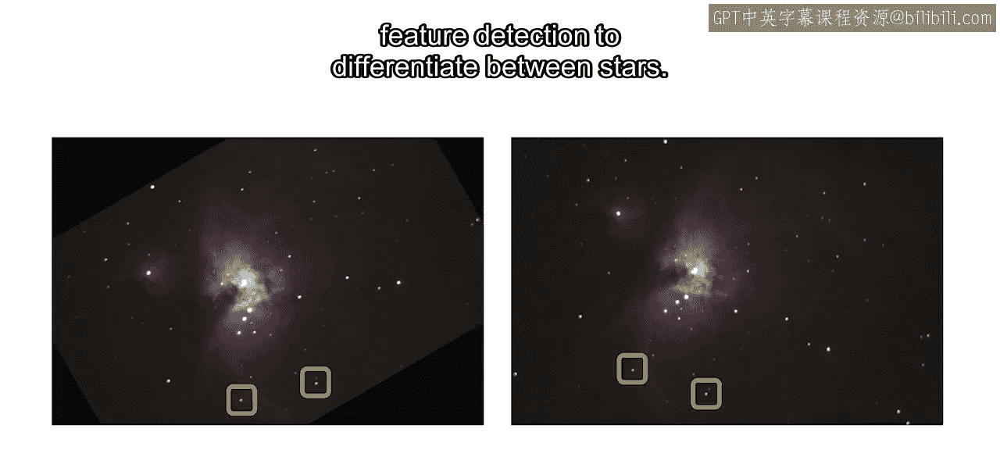

Alternatively， you might be working with satellite images。

Where corresponding areas look dramatically different。

Manual registration using hand selected control points is often more effective in cases like these。

In this video。You'll learn how to perform manual registration in MATLb using these two images of the Aion Nebula。

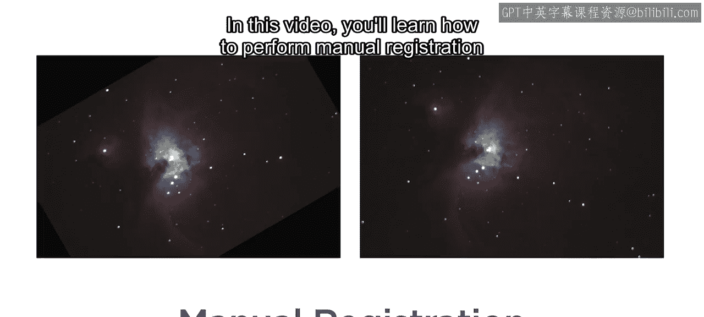

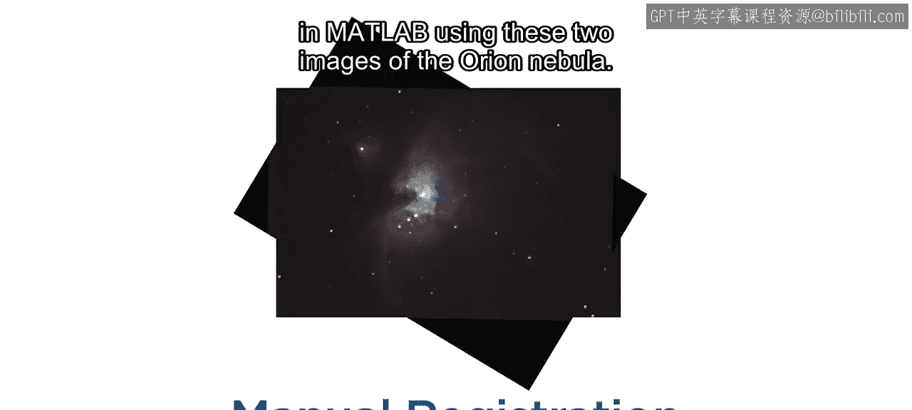

There are three steps。Selecting Control pointss。Inferring the geometric transformation between these points。

And using the resulting transformation matrix to align the images。

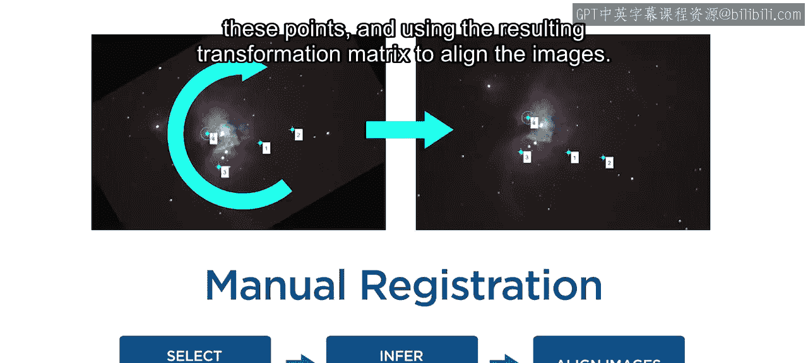

Start by opening MATLb and importing the two images into the workspace。

The first image known as the moving image， will be aligned with the second image or the fixed image。

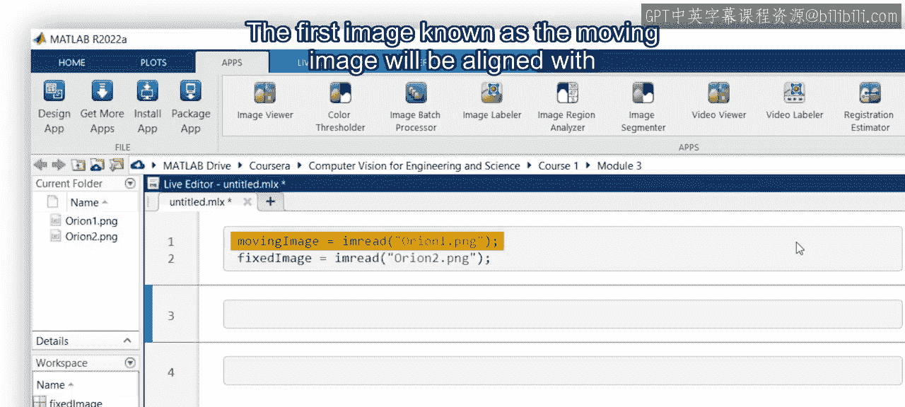

Next， you need to identify the Xy coordinates of the corresponding points on the images。

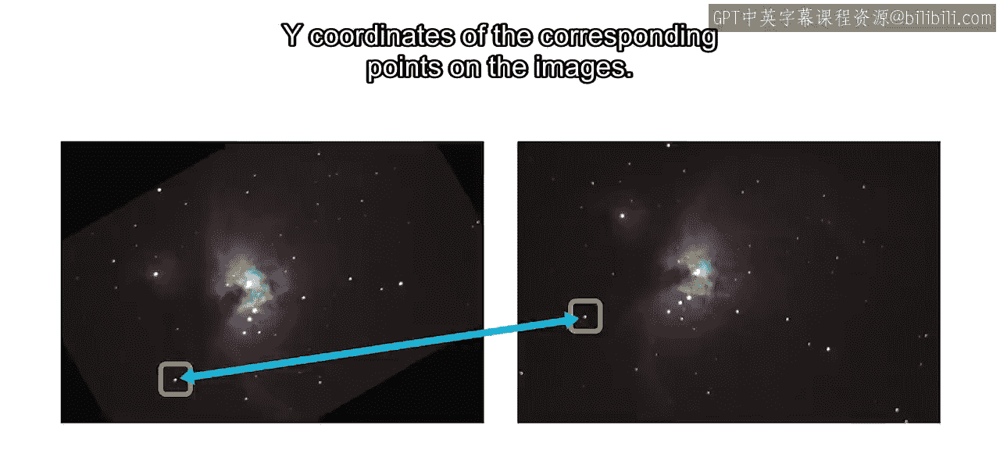

One way to do this is by viewing one of the images。Hovering your mouse over a star。

Recording the coordinates。And repeating these steps for the same star in the other image。However。

 this method is slow， tedious and prone to error。

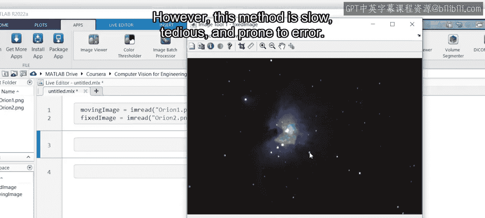

A better way is to use the control point selection tool。Open this tool using the C Select function。

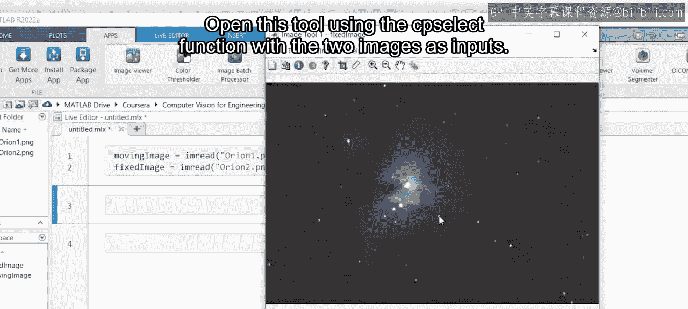

With the two images as inputs。

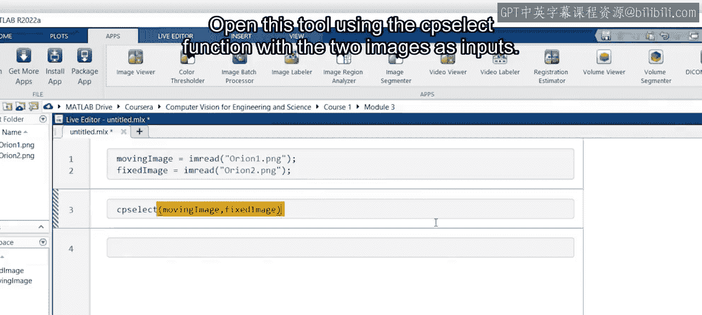

Once the tool is open， you'll see the moving image displayed in the bottom left。

The fixed image in the bottom right。And zoomed in sections of both images at the top。

Let's select a few control points using stars as references。

Depending on the type of transformation required。You will need a different number of control point pairs to infer the transformation matrix。

These two images differ by rotation and scaling， so a similarity transformation will align them。

This transformation only requires two control point pairs。

But selecting a few more usually gives better results。

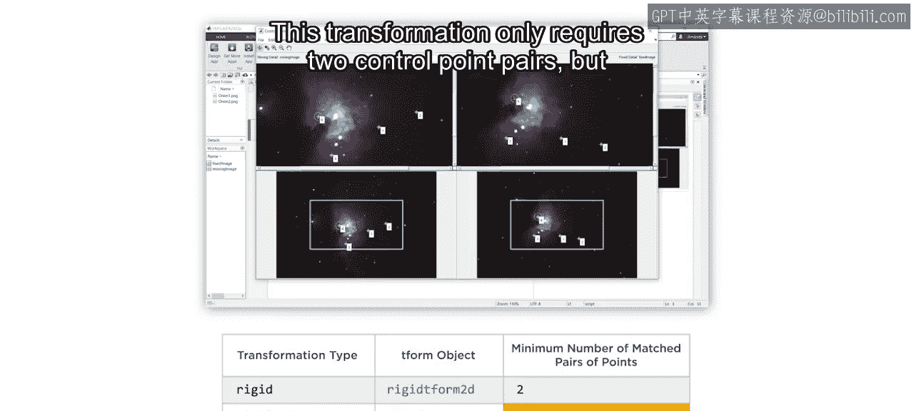

After selecting the points。Export them to the workspace as two matrices。Moving points。

 the XY coordinates of the control points on the moving image。And fixed points， the X。

 Y coordinates of the corresponding control points on the fixed image。

Then close the control point selection tool。Now， you can use these coordinates to create the transformation matrix。

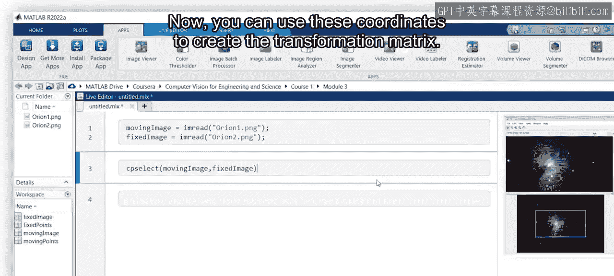

Then use IM Morp to apply the transformation matrix to the moving image。

Make sure the output is aligned with the fixed image using the output view option。Finally。

 view the Trans moving image beside the fixed image to check that they are aligned。

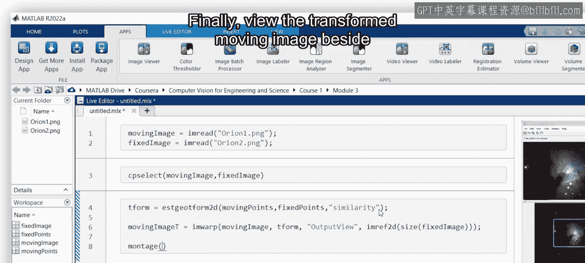

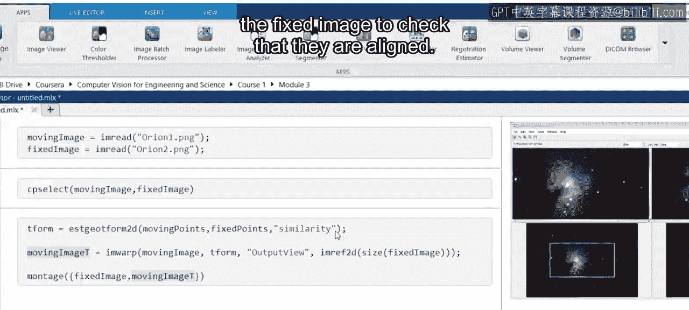

Looks great。

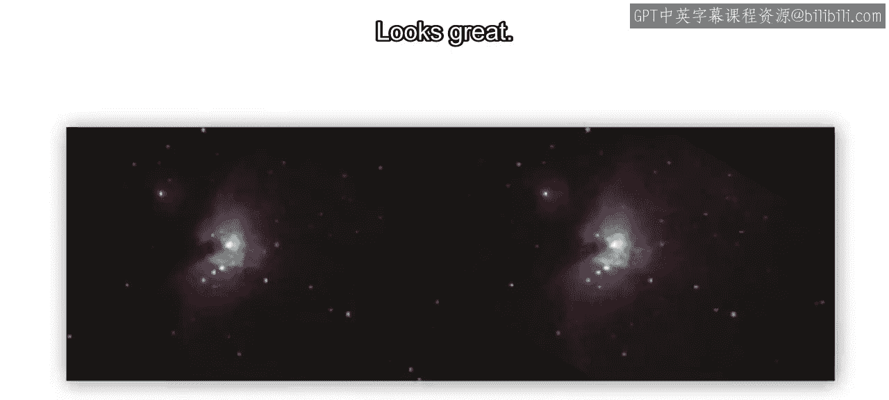

You now know how to visually select Control pointss in MatTLAb using the Control point selection tool。

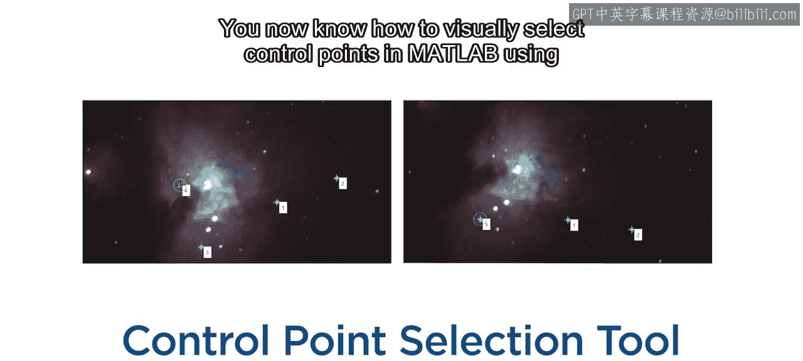

When you perform image registration on your own， remember that manually selecting control points is a good approach to consider if it's difficult to use feature matching。

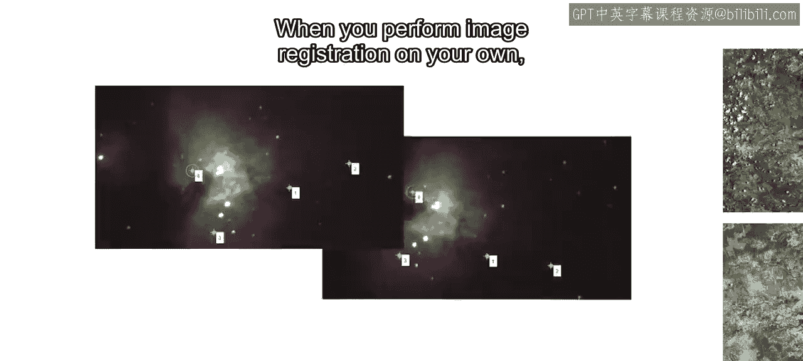

Or if you only have a few images。

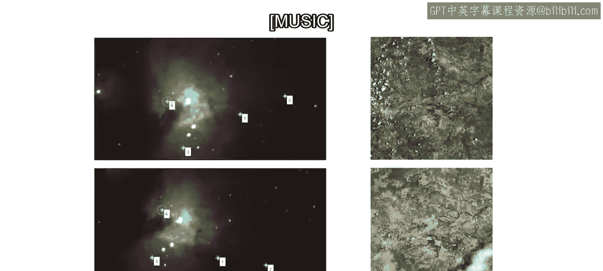

。