# Mathworks《工程与科学计算机视觉（简介、机器学习、目标检测）｜Computer Vision for Engineering and Science》 p09 8_拼接图像.zh_en -BV1yJ4m13715_p9-

🎼。

Basic image registration is useful when you have just two images that overlap。

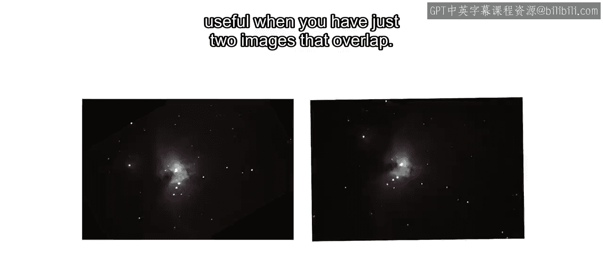

But what if instead you have many images that partially overlap to create a larger scene。

 and you need to join them together。This process is known as stitching。

It is a specialized form of registration。In this video。

 you'll stitch together sequential images of a concrete crack into one larger image。

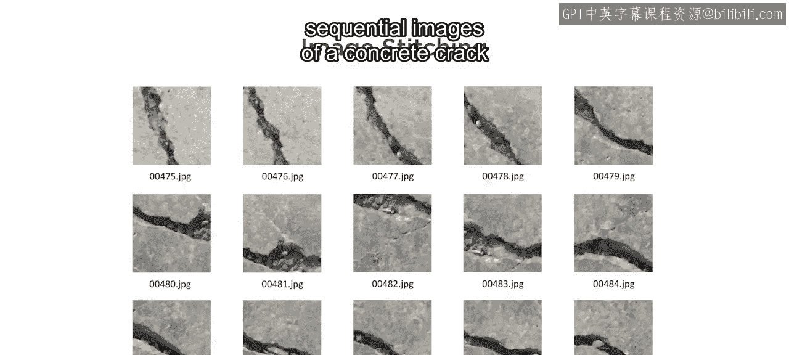

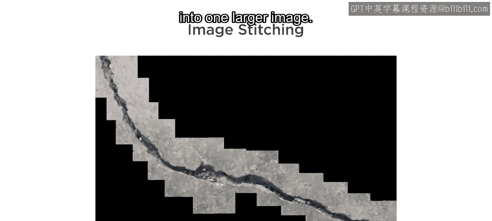

This process requires a fair amount of code to complete。

But we provide you with the script so you can experiment with it on your own。

Image stitching can be broken down into three main steps。Registering successive image pairs。

Initializing a template image。And creating the final panorama。

You're already familiar with the first step。

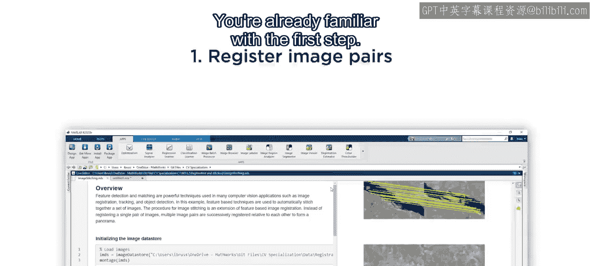

To register image pairs， you need to estimate a geometric transformation。

This can be done using the Regration estimator app。

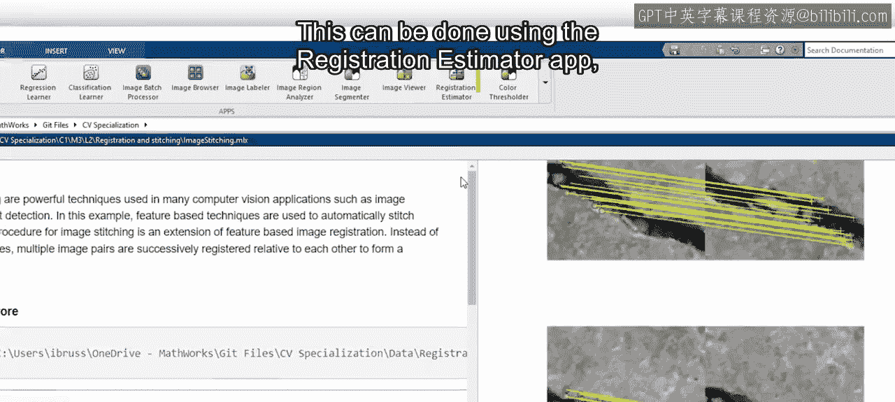

Which can then be used to export a registration function。

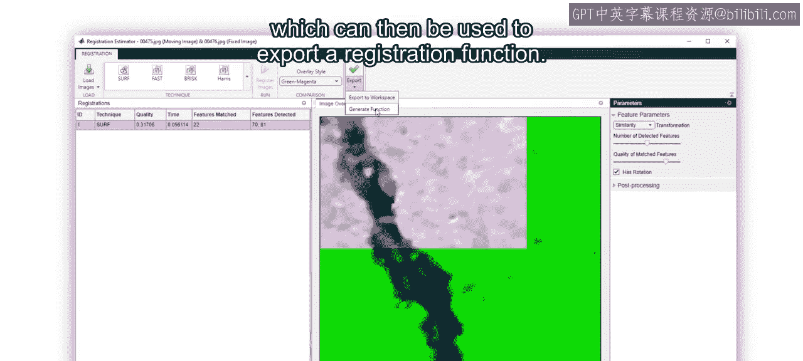

This function will be applied to pairs of successive images。

 such as the fourth and fifth ones shown here。Now， to calculate the transformations for all 14 pairs of images。

 you could run this code multiple times， but that would be very time consuming。Luckily。

 there is a better way。The solution is to loop through all the images using an image data store。

An image data store contains the location of the image files you want to process。

Then the images are only loaded when they are needed。

To estimate the transformation for all successive image pairs。

Use a for loop that cycles through the data store and applies the exported registration function。

After the transformations are estimated， there is a line of code to visualize the matches。

The last part of step1 saves each transformation to a new variable。

And then multiplies it by the previous image's transformation。

This last line is crucial for correctly placing the images in the template。

Remember that transformations contain directions on how to warp image coordinates。

The transformation estimated for image 2 warps it so that it's registered with image 1。Likewise。

 imagemage 3's transformation registers it to align with image 2。However。

 because we want to stitch all the images together。

 we need to carry over image 2's transformation so that everything is registered to image 1。

This process is repeated for all images and ensures that even though they are initially registered in successive pairs。

 they are all in the end， registered back to the first image。To accomplish this。

 the 2D image transformations inherit some useful properties from linear algebra。Namely。

 combining the effects of two transformations means multiplying their matrices together。

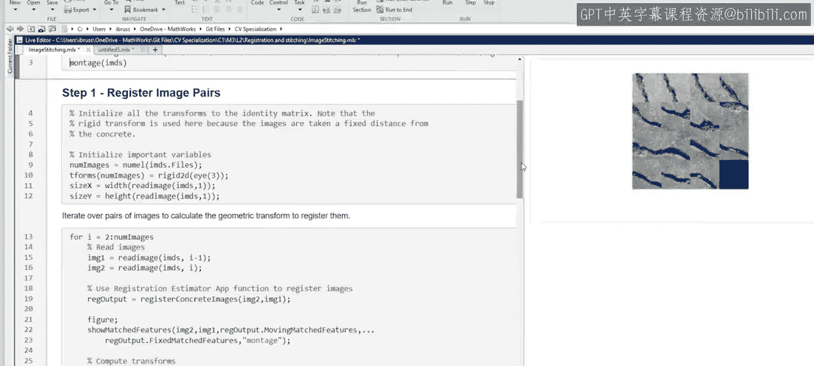

After running the code for step 1。You'll see the matched features for each successive pair of images。

Use them to confirm that the transformations are estimated correctly。Next is step 2。

Where you will create the template for the combined panoramic image。

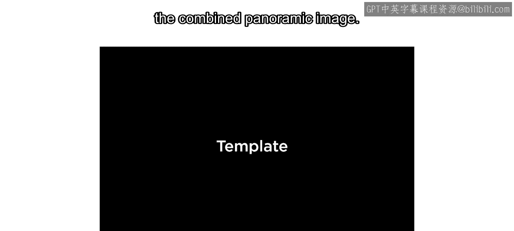

This is essentially a big blank image where all the crack images will be arranged。

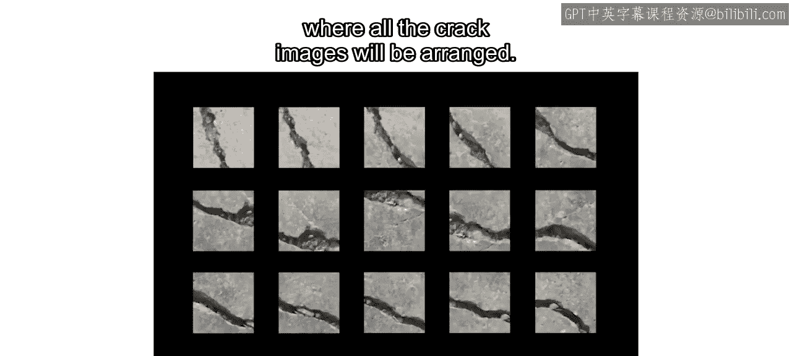

The code here calculates the width and height required by the template to ensure that all the transformed pieces fit properly inside。

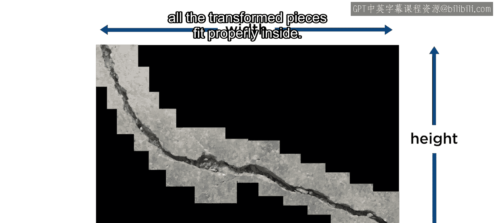

Then the template is initialized with the correct dimensions。Lastly is step3。

 where you'll combine all the component images into the template。To do this。

 you'll need to use a tool called Alpha Blender， which handles the operation of merging images together as they're placed on a template。

This final loop warps each image into place。And then adds it to the panorama。

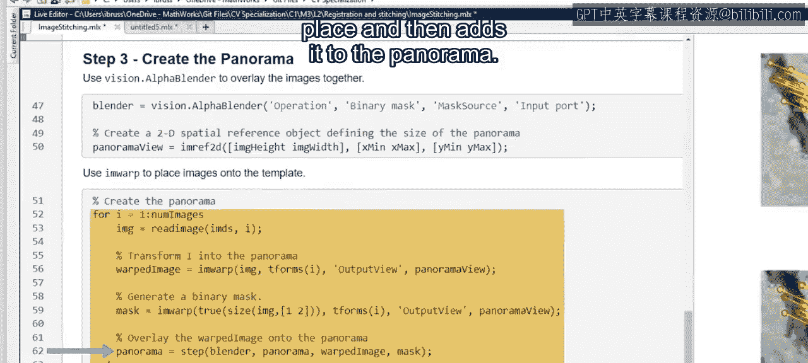

Running this last step gives you the final panoramic image。

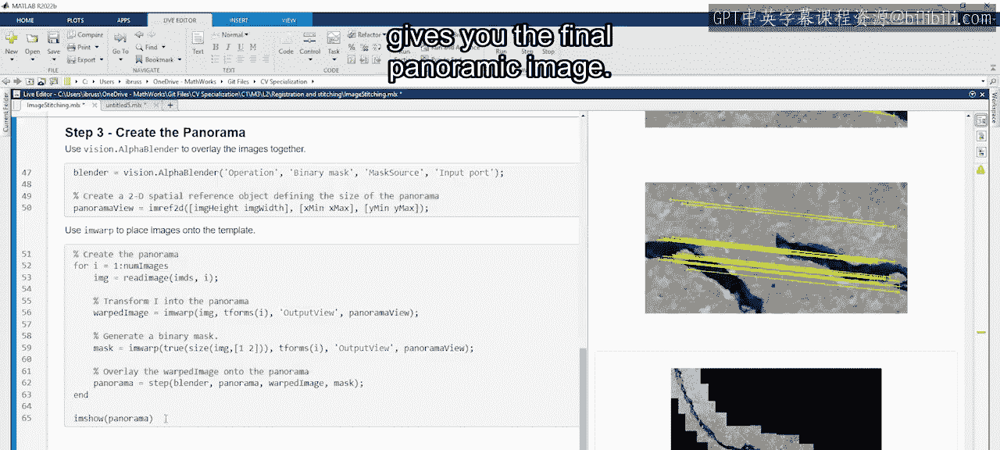

Looks like our stitching process worked great for this example。However。

 this script doesn't necessarily work for all cases of image stitching。

There are several unique applications， each of which may require changes to the script we've covered here。

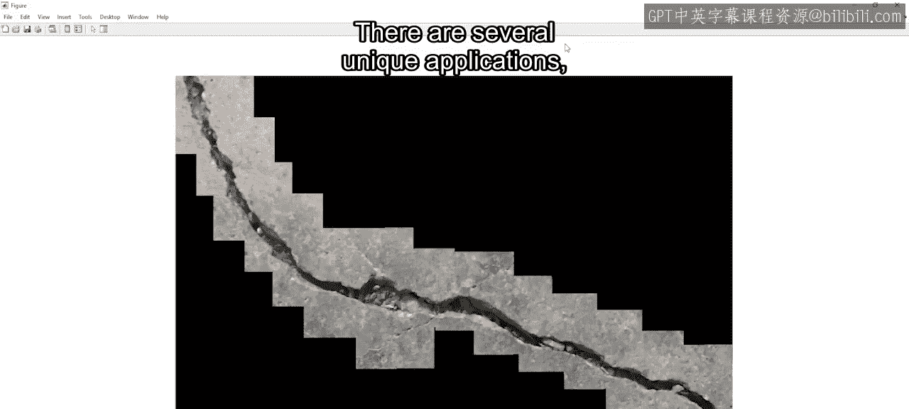

For instance， in step1， we use the feature based method for estimating geometric transformations。

However， if your images don't have strong features。

 you may need to visually select control points using a CP select tool。This way。

 you'll be prompted to match points for each iteration of the loop。

Another difficulty can be if you're stitching together images that require more complex transformations。

 like projective。Remember， in this script， the first image was held fixed。

 and all other images were moved to align with it。

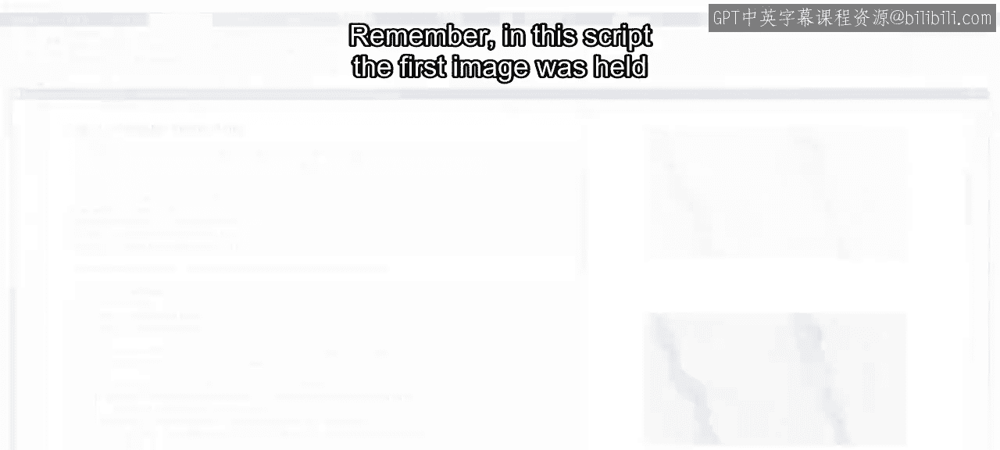

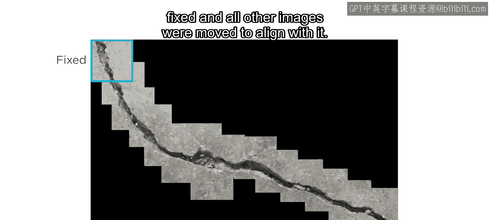

That's fine for rigid transformations， where there is no extreme warping。

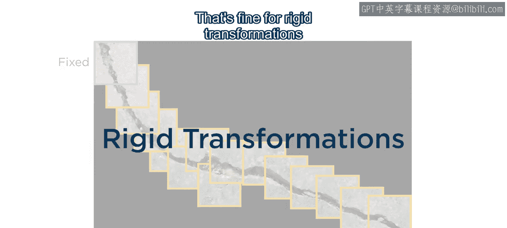

However， for projective transformations， things get tricky。Take， for instance。

 these three images captured by the Mars Curiosity Rover。In this case。

 successive projective transformations lead to significant warping at the end of the panorama。

To fix this effect， you can take advantage of another handy feature of linear algebra and multiply all the transformations by the inverse of the one you want to keep untransformed。

In this case， the middle image。

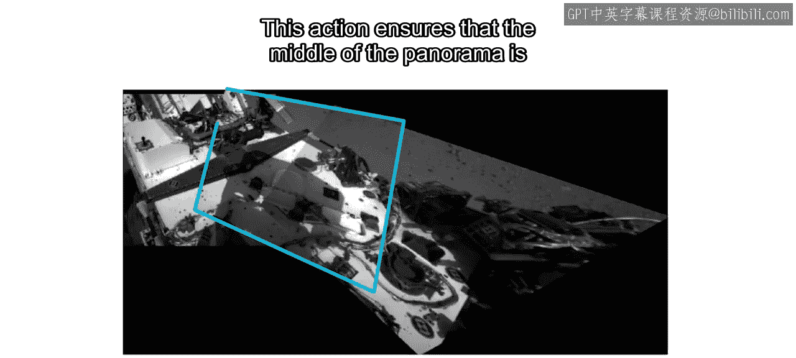

This action ensures that the middle of the panorama is undistorted。

And the warping effects at the edges are reduced。Now， let you know how to stitch images together。

Use this script to combine your own overlapping images。We're excited to see a result in the forums。😊。

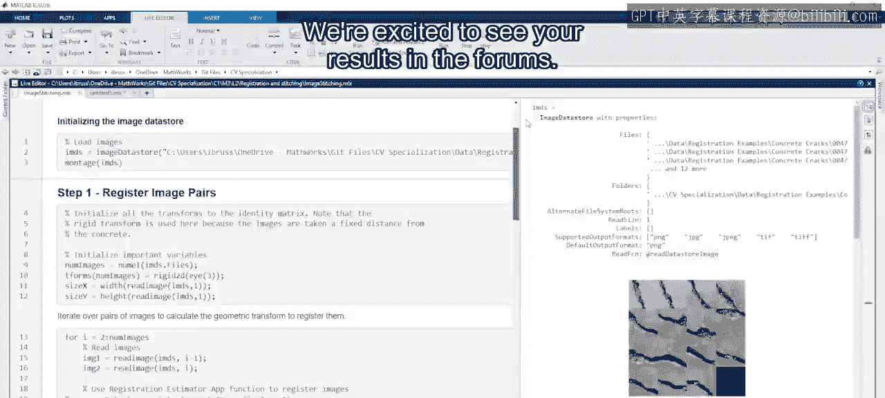