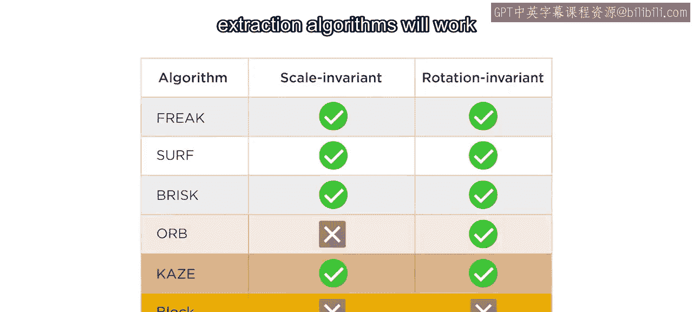
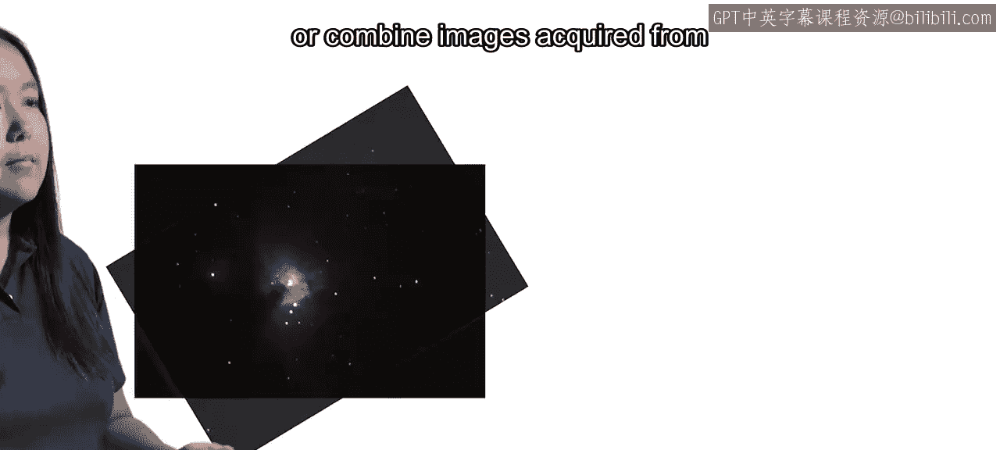
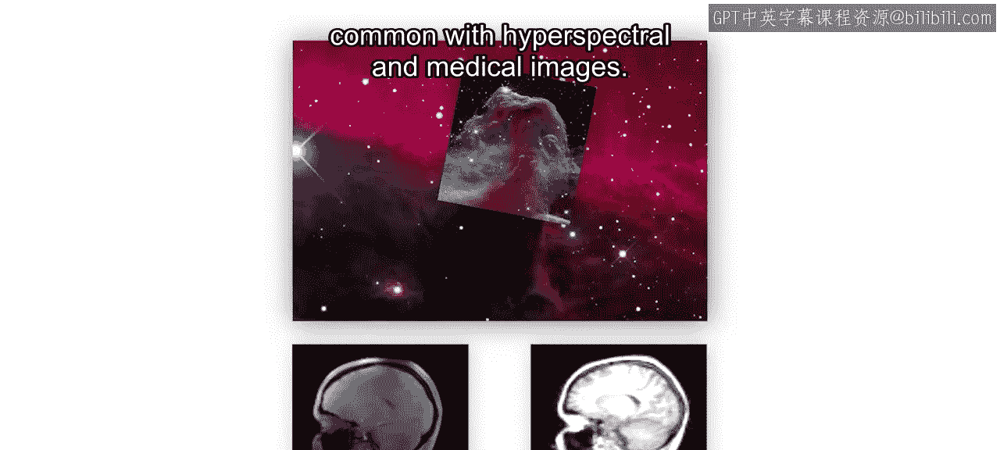
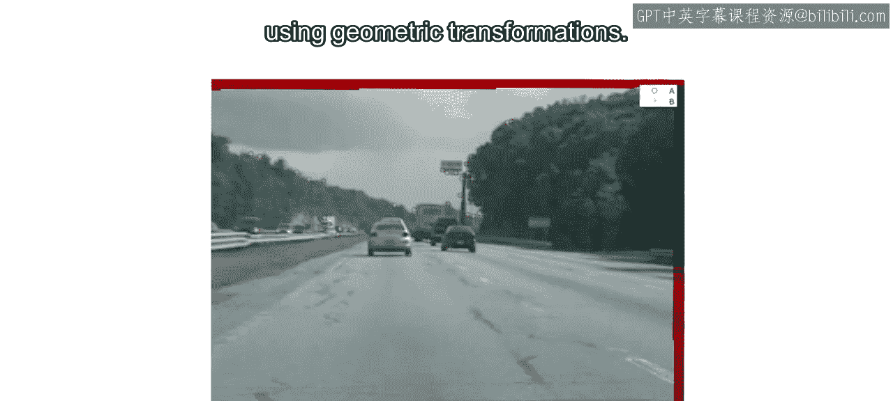
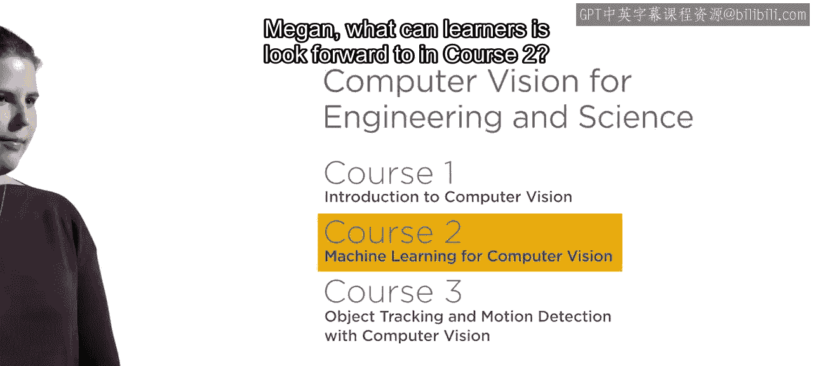
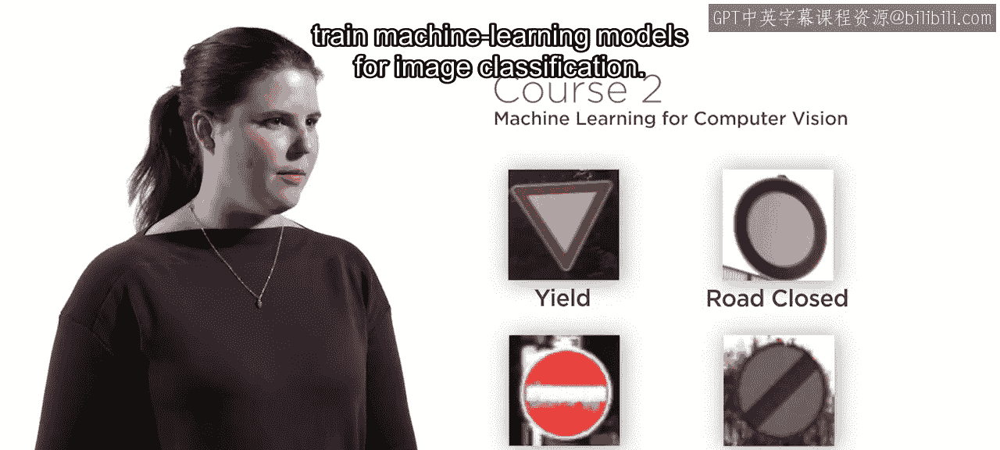
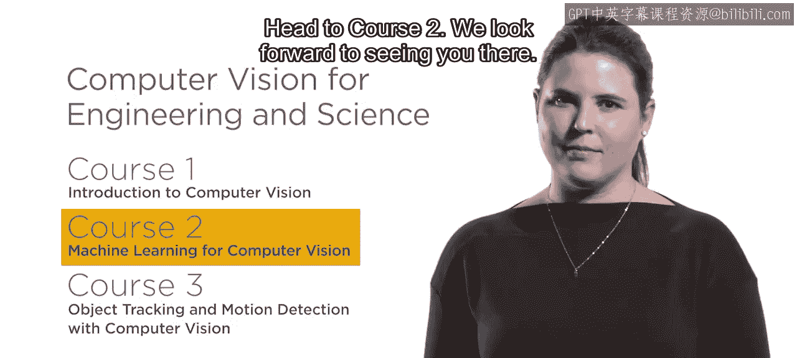

# Mathworks《工程与科学计算机视觉（简介、机器学习、目标检测）｜Computer Vision for Engineering and Science》 p10 9_计算机视觉简介总结.zh_en -BV1yJ4m13715_p10-

🎼，Congratulations on completing the course。Feature detection， extraction。

 and matching are key first steps for many computer vision applications。

It can be hard to know in advance which feature detection or extraction algorithms will work best for a specific problem。

But you are now able to quickly test different approaches and determine what works for your images。

Features are used in many applications， and in this course。

 you learn about some of the most common ones like image registration。

Registration is a key step whenever you need to compare images of the same scene taken at different times。

Or combine images acquired from different scientific instruments。

 as is common with hyperspectral and medical images。

But there are many other important feature based workflows in computer vision。

Such as detecting an object across frames in a video。

 and estimating camera motion using geometric transformations。

As you continue through this specialization， you will tackle new challenges using features。So Mehan。

 what can learners look forward to in course2？

Thanks， Amanda。In course 2 of this specialization， you'll use the features you learned about here to train machine learning models for image classification。

You'll also learn to train models for object detection。

Classification and detection are two of the most common computer vision tasks。 So head to course。

 too。 We look forward to seeing you there。😊。

