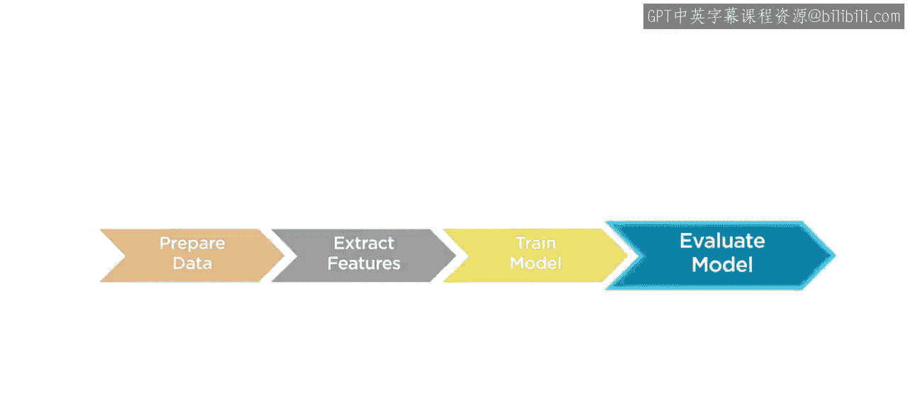
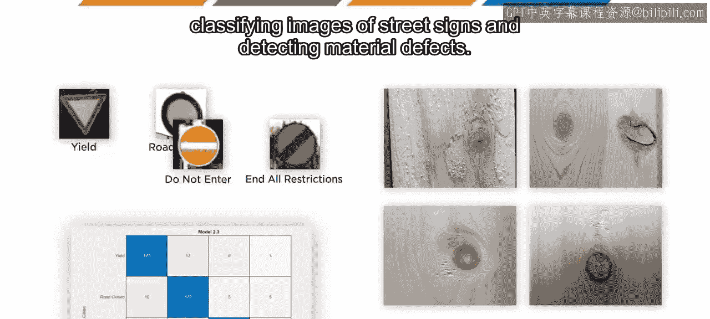
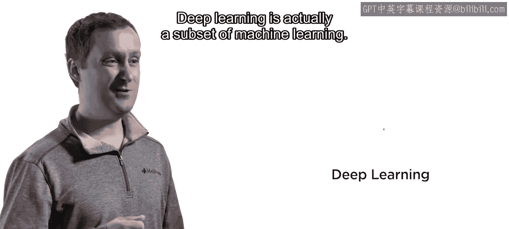
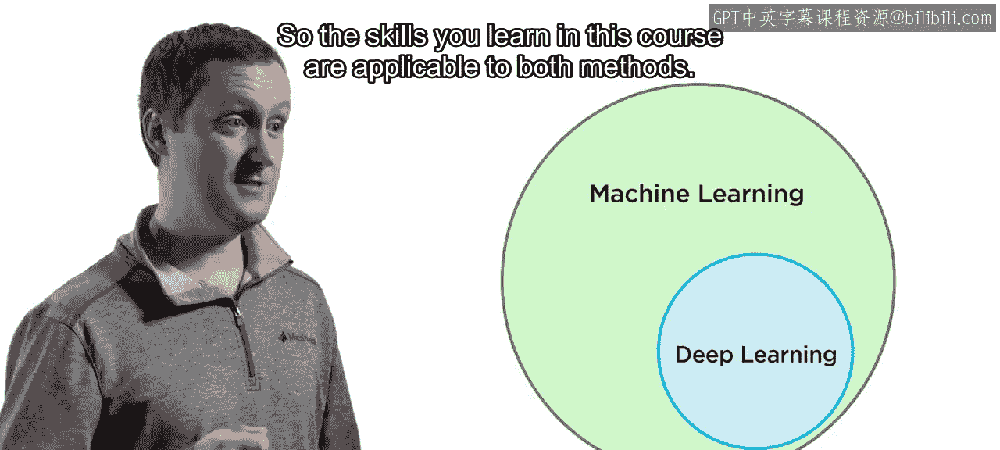
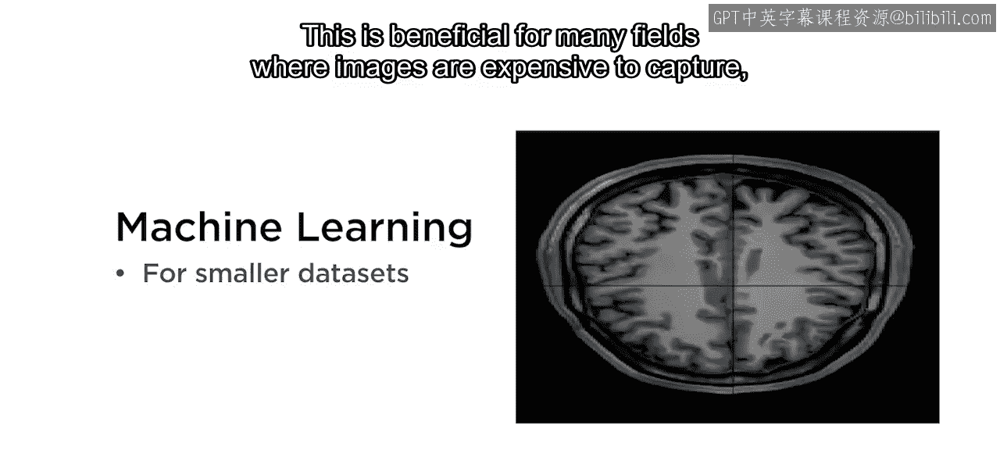
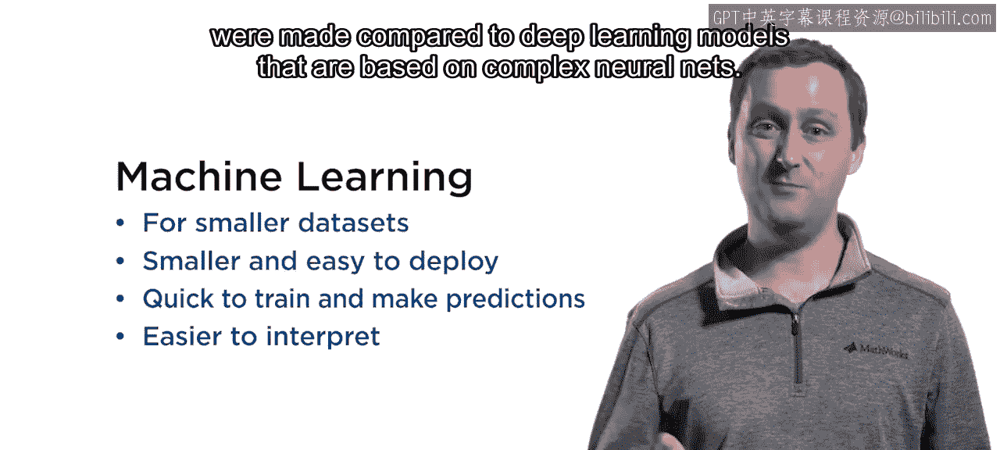
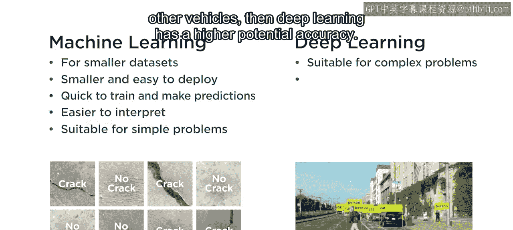

# Mathworks《工程与科学计算机视觉（简介、机器学习、目标检测）｜Computer Vision for Engineering and Science》 p12 1_计算机视觉机器学习简介.zh_en -BV1yJ4m13715_p12-

🎼。

Machine learning is a powerful technique for training predictive models。

In the field of computer vision， the data used for those models are images and videos。

The two most common applications of machine learning in computer vision。Are classification。

 which labels entire images， making predictions about their content and detection where objects are located within an image。

During this course， you'll apply a machine learning workflow。

Which will guide you through the process of developing and using a model from preparing your data。

To evaluating your results。

You'll then use this workflow to complete two projects。

Classifying images of street signs。And detecting material defects。

Another popular tool in computer vision is deep learning。

 which uses models built from deep neural networks。

Deep learning is actually a subset of machine learning。

 So the skills you learn in this course are applicable to both methods。

Deep learning can be powerful in certain applications。

But the standard machine learning techniques covered in this course are better suited for some common computer vision tasks。

For example， machine learning models are simpler and therefore can be trained using smaller data sets。

This is beneficial for many fields where images are expensive to capture， such as medicine。

Machine learning models are also smaller and easier to deploy。

This often makes it more practical to use machine learning for real time detection on small devices。

Furthermore， machine learning models can be much quicker to train and to make predictions。

They're also generally easier to understand why certain predictions were made compared to deep learning models that are based on complex neural nets。

This all means that machine learning is best suited for simpler problems。For instance。

 classifying these images of concrete as having or not having cracks is a great candidate for machine learning。

Alternatively， deep learning is useful for complex problems。For example。

 if you need to simultaneously locate pedestrians， bicycles and other vehicles。

Then deep learning has a higher potential accuracy。

For this course， we'll focus on scenarios where machine learning works well。

 We've provided a range of data sets with which to practice。

But you're also encouraged to test your knowledge on your own examples。

Completing this course will help you tackle some of the most common。

 yet challenging problems in computer vision。Remember， if you need help along the way。

 be sure to use the forms。

Good luck。