# Mathworks《工程与科学计算机视觉（简介、机器学习、目标检测）｜Computer Vision for Engineering and Science》 p13 2_机器学习工作流程.zh_en -BV1yJ4m13715_p13-

🎼，Machine learning is essential for many computer vision applications。

 from automated driving to fresh food distribution to disease diagnosis。

This video introduces a machine learning workflow that you will follow throughout this course。

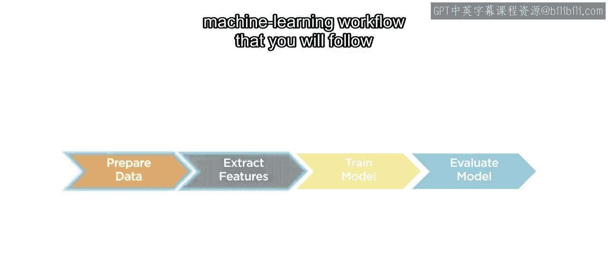

To train models that perform image classification。An object detection。

Think of this workflow as a roadmap that you can refer to as you perform machine learning on your dataset sets。

The final goal is to make predictions on new images that the model has never seen。

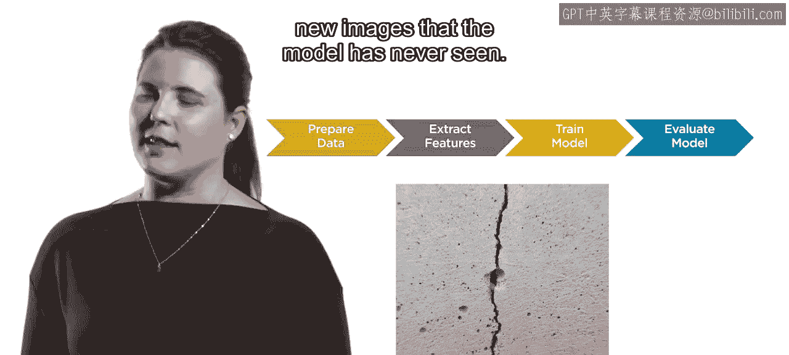

Ultimately， given a new unlabeled image， you will be able to extract features that the trained model can interpret to assign a label。

You create a model by training it with data called predictor features。In computer vision。

 these predictor features are extracted from a set of images。Before you can extract features。

 you must prepare your images。Classification and object detection models require two things to train。

A collection of image features and a label for each of these images。

Creating labels for your dataset set is the first step of preparing your data。

 They will serve as a ground truth。The next preparation task is to split your labeled data into training and test sets。

The training set will be used to train your model。The test set is put aside until later。

With any machine learning application， perform this step before proceeding with the workflow。

This is to avoid inadvertently biasing your test set， giving you misleading or incorrect results。

The last step of data preparation is to perform image processing as necessary。For example。

 spatial filtering or contrast adjustment can improve results for the next part of the workflow。

 extracting features。

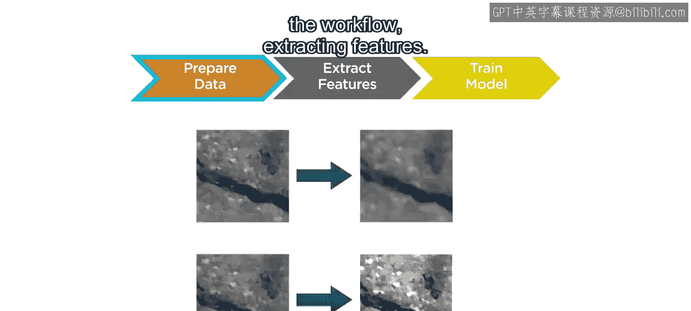

You've already learned some ways to extract features in course one of the specialization。

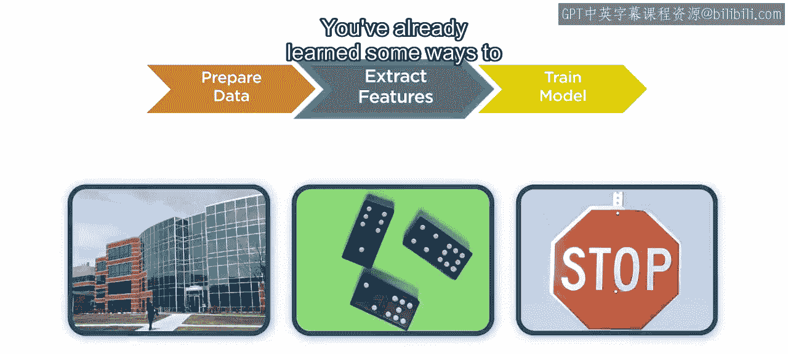

And you'll learn new ways here。

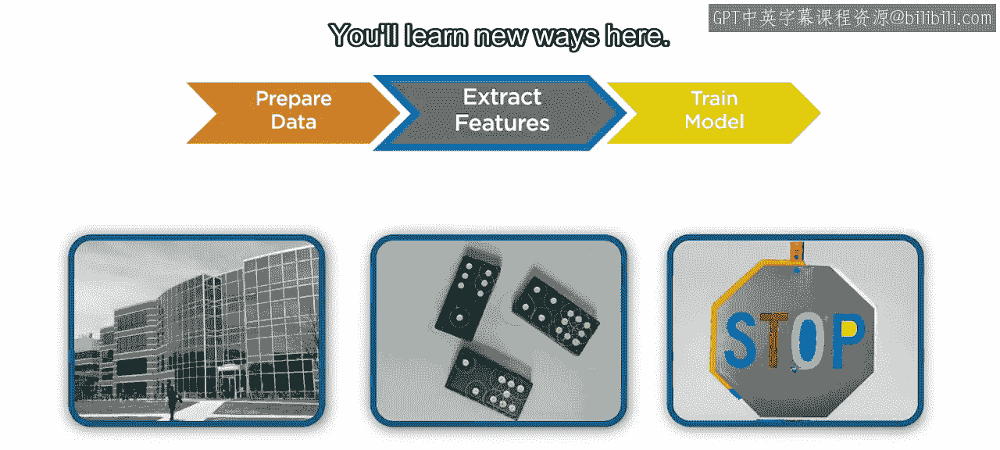

Once you have extracted features。You can use them in conjunction with the image or object labels to train your model。

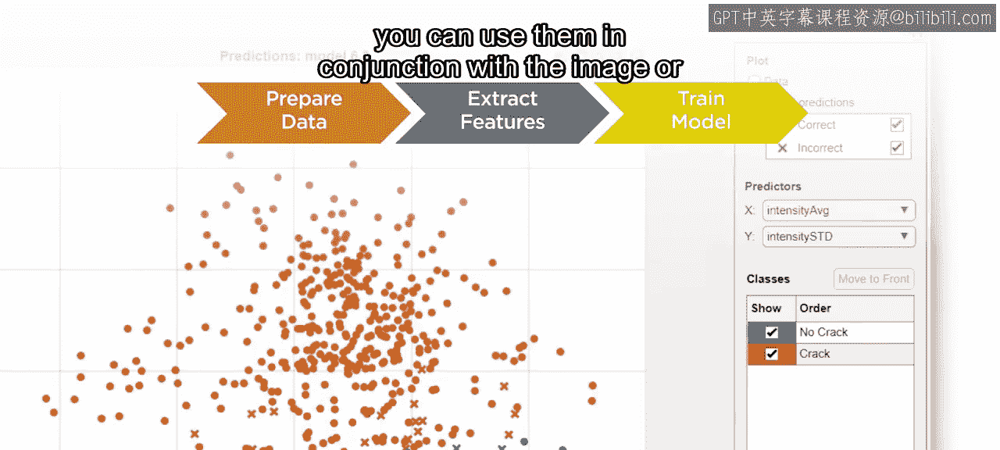

You will try a variety of different model types and learn how to improve your results by tuning model parameters。

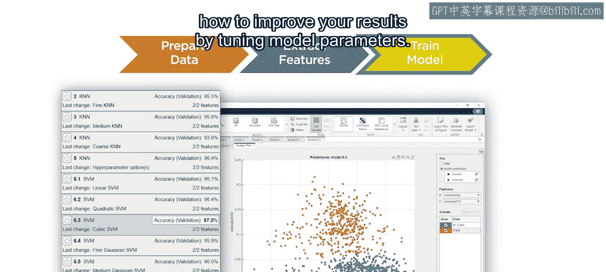

The last part of the workflow is to evaluate your trained model。

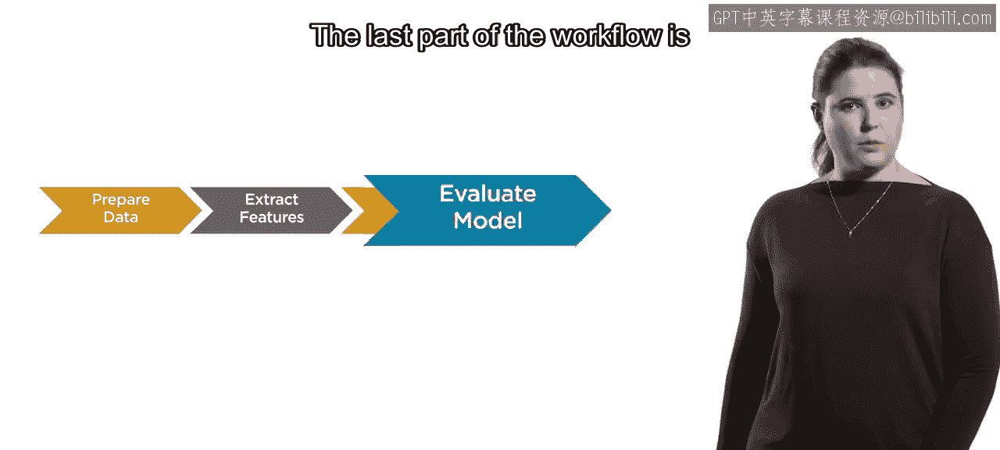

In this step， you determine which trained model works best for your application。

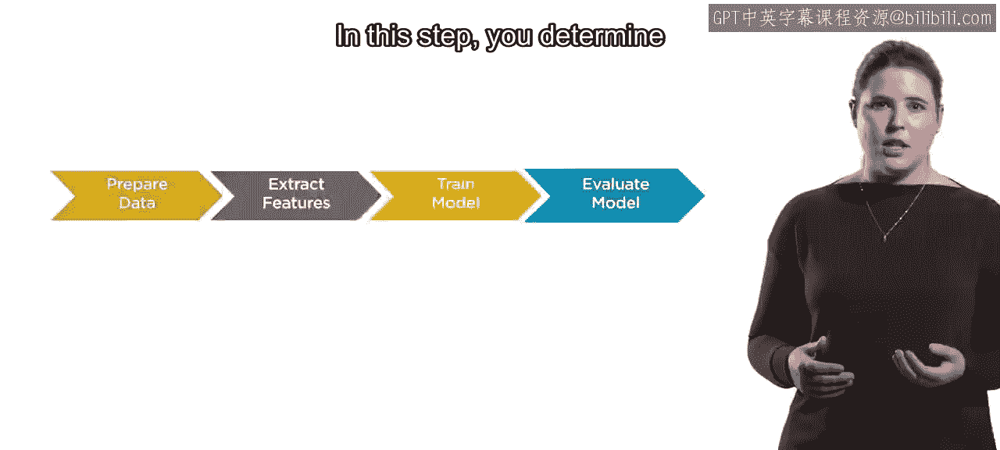

Using evaluation metrics such as accuracy and confusion matrices。

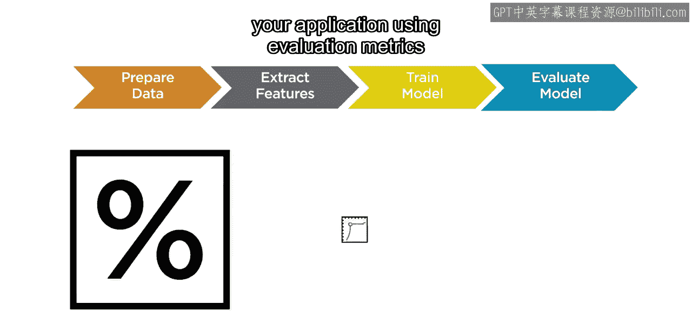

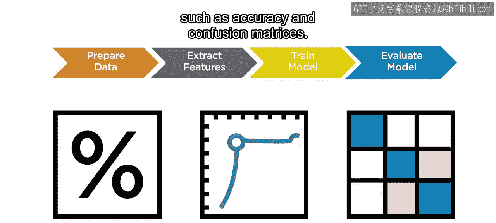

Remember the test set you set aside earlier。 Now's the time to use it。

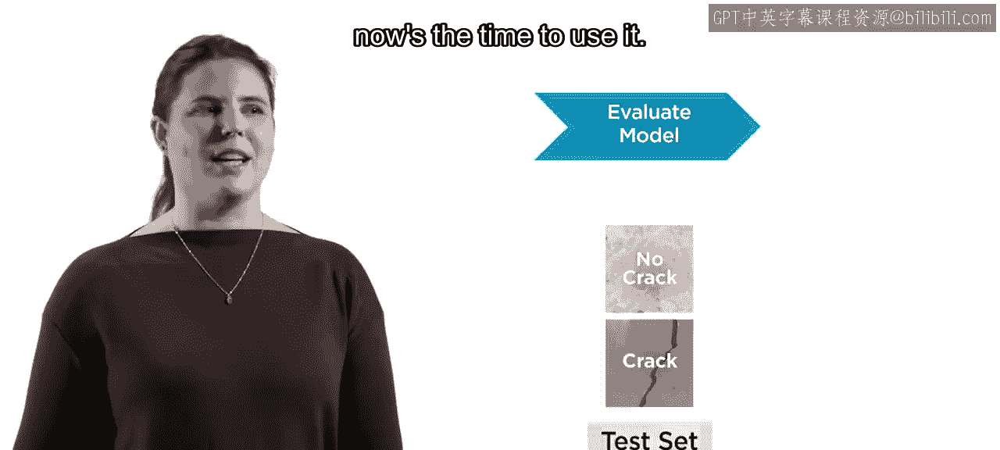

Apply your model to the test images and evaluate the results。

This gives you an estimate of how well the model will perform on new， unlabeled images。

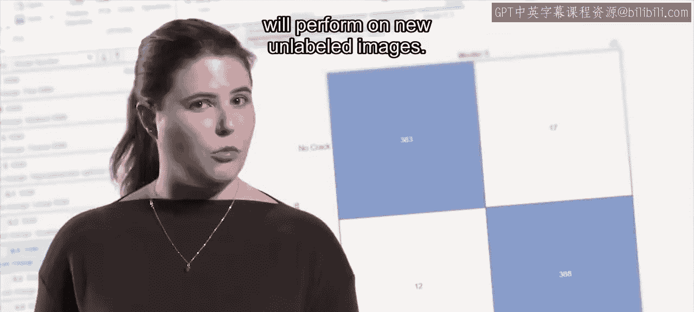

It's important to remember that you are not meant to go straight through this workflow only once per application。

Because machine learning is an iterative process， you'll often need to update your strategy and retry various steps for the best results。

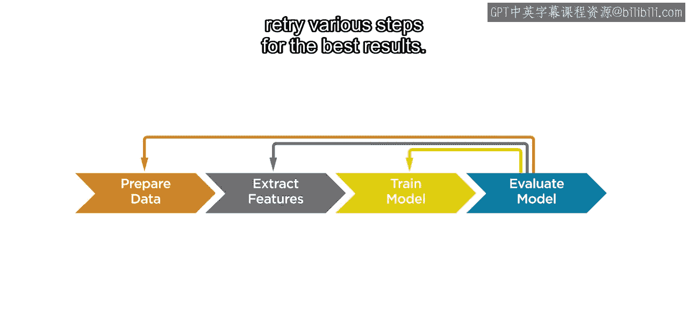

It's common to try a variety of approaches。

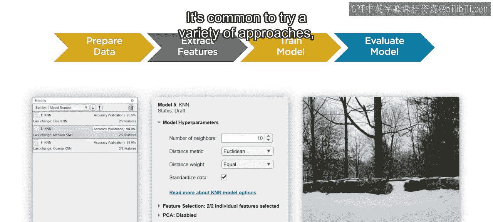

Including choosing different models to train。Tuning model parameters。

And selecting different types of features。In this course， we focus on traditional machine learning。

However， deep learning follows a very similar workflow。

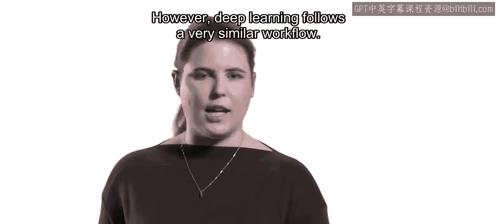

The key difference is that， with deep learning。

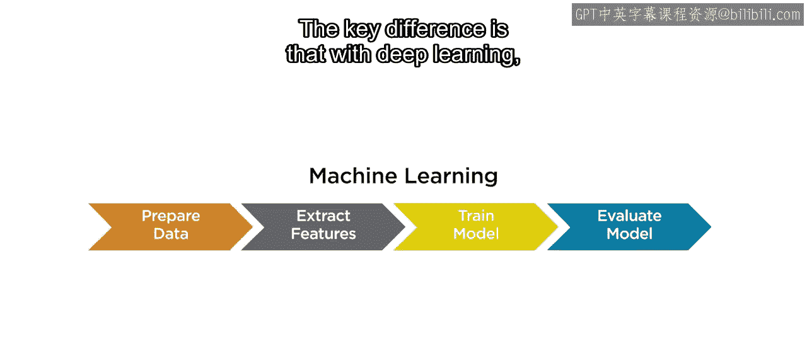

The extract feature step is performed by the model during training。

Taking the prepared images as inputs directly。

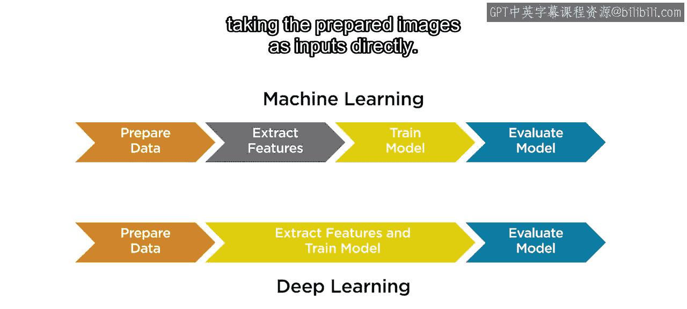

For this reason， machine learning is well suited to applications where your images have discernible features in common。

In this course， you'll learn to use a variety of tools to develop the best models for your dataset sets。

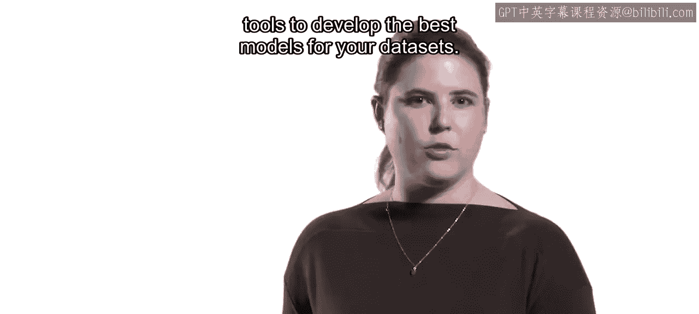

As you perform each of these steps， think about them in the context of the machine learning workflow。

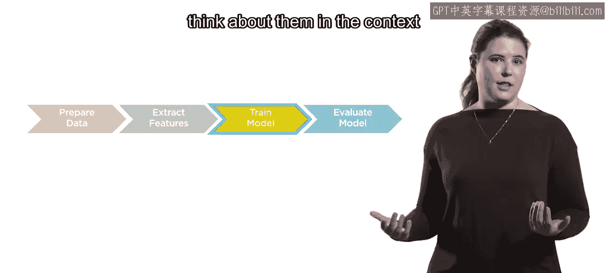

。