# Mathworks《工程与科学计算机视觉（简介、机器学习、目标检测）｜Computer Vision for Engineering and Science》 p17 6_特征袋简介.zh_en -BV1yJ4m13715_p17-

🎼，To train a classification model， you need every image in your data set to have a single value for each feature。

This way， there is a quantitative means to relate images to each other based on their relative values for shared features。

We will call these ready to Tra features， predictor features。

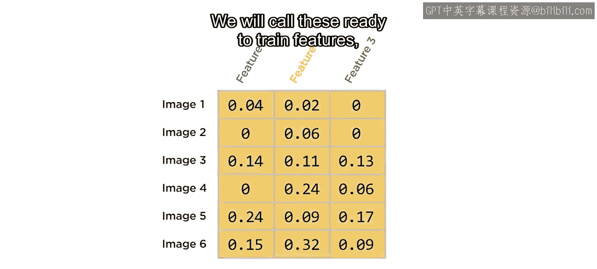

But how do you get these predictor features。Sometimes you can use simple predictor features based on the calculations you perform yourself。

However， often， you will be unable to find features that are distinguishing enough to successfully classify images。

For example。It was highly effective to use intensity based predictor features to differentiate cracked and uncracked concrete。

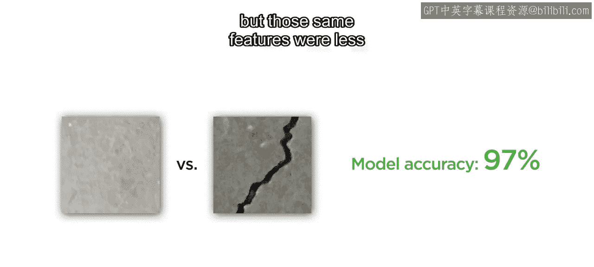

But those same features were less effective at classifying traffic signs。

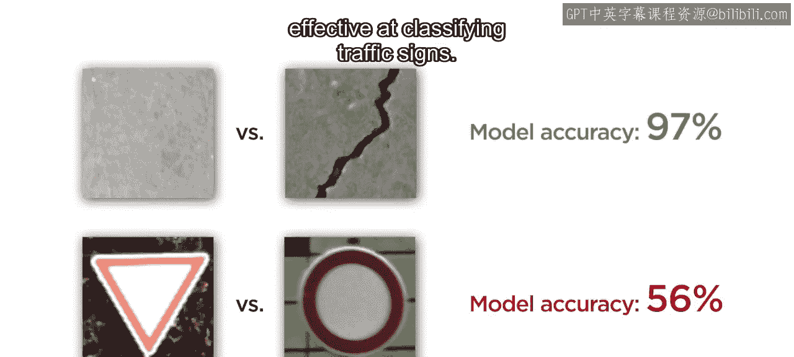

You can frequently get better results using one of the many algorithms available for extracting feature descriptors。

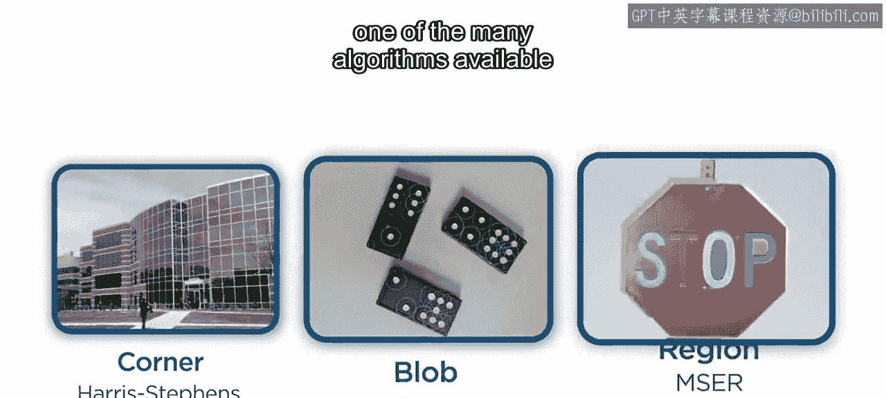

Due to small variations in the images， such as changes in lighting， angle and surroundings。

Even similar features will have different descriptor values。With no shared feature vectors。

 it is difficult to create the matrix we need to train a model。

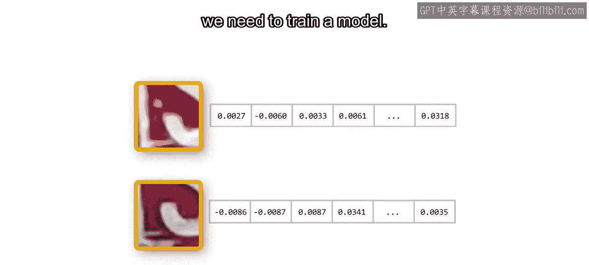

In this video， you'll see how the bag of features algorithm extracts feature descriptors from images and uses them to produce predictor features。

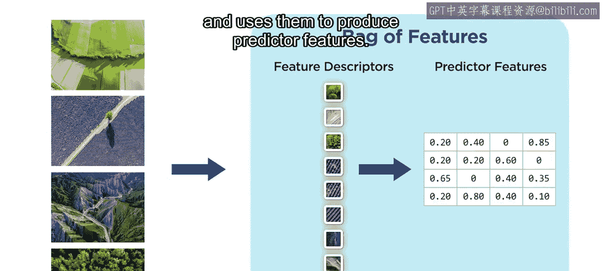

Consider this landscape image and its descriptors。Sometimes similar descriptors commonly occur in other images。

Sometimes they are rarely present in other images。And some are unique to just one image。

The bag of features algorithm creates a way to compare the images by extracting descriptors across all of them。

And clustering them into groups based on how similar they are。

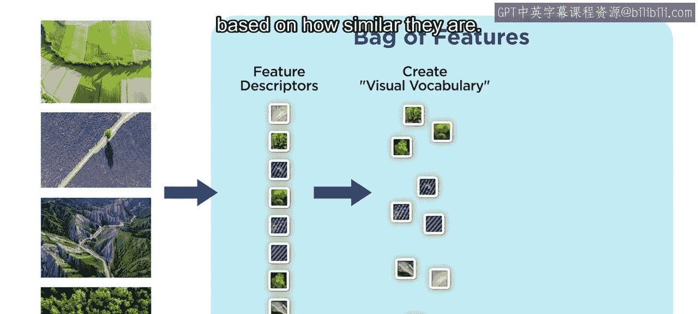

This process is called Cating a visualual vocabulary。

Descriptors with similar feature vectors will be closer than descriptors with dissimilar feature vectors。

In practice， this comparison takes place in many dimensions。

But only two are shown here for simplicity。The bag of features method uses the K means algorithm to cluster the feature descriptors into groups。

Similar descriptors will be clustered into the same group。

 while descriptors with dissimilar values will be assigned to different groups。

Each group is called a visual word。Collectively， the groups are the dataset set's visual vocabulary。

Because of this， bag of features is sometimes called bag of visualual words。

This terminology comes from a similar technique developed for text retrieval， called bag of words。

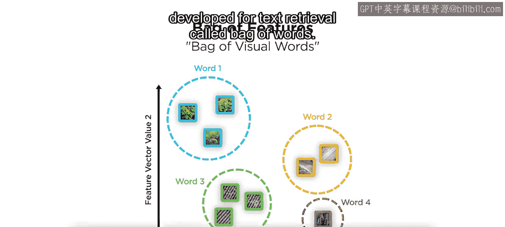

After creating a visual vocabulary， the algorithm revisits each individual image。

Each feature descriptor from a given image is assigned to a visual word。

The occurrences of visual words are tallied。And then scaled by the number of descriptors in that image。

These values will be your predictor features。Visual words that occur frequently in an image will have a predictor feature value closer to one。

And visual words that did not appear in the image will have a value of 0。

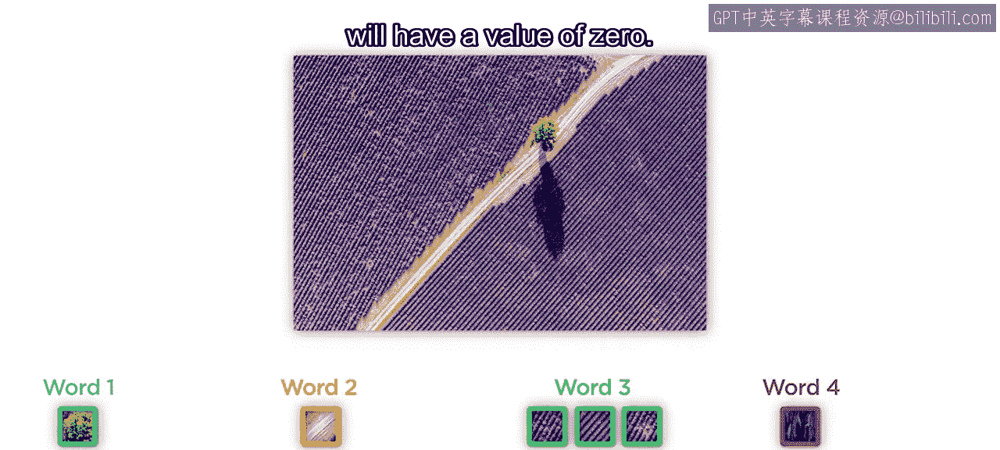

These visual word rates are recorded in an M by N matrix。Where M is the number of images in a data。

And N is a number of groups or visual words that appear across all images in the set。

These are your predictor features。

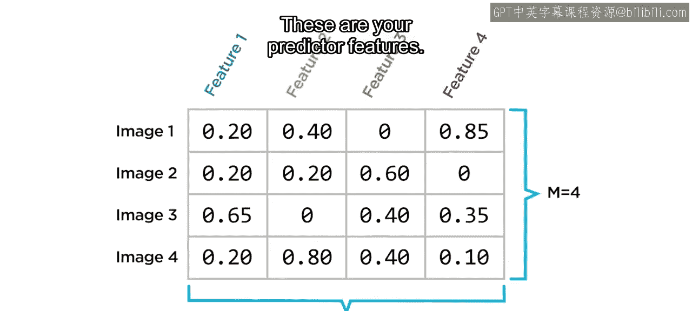

In summary， the bag of featuress algorithm prepares a data set of images for classification。

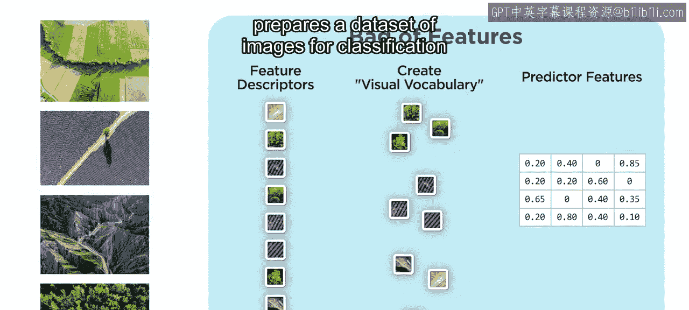

By extracting feature descriptors。Cluuttering them into visual words。

And tallying visual word occurrence rates in each image。Once you have this data。

 you are ready to train your model。

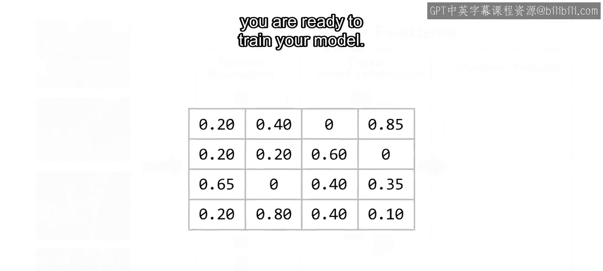

。