# Mathworks《工程与科学计算机视觉（简介、机器学习、目标检测）｜Computer Vision for Engineering and Science》 p18 7_使用特征袋分类图像.zh_en -BV1yJ4m13715_p18-

🎼。

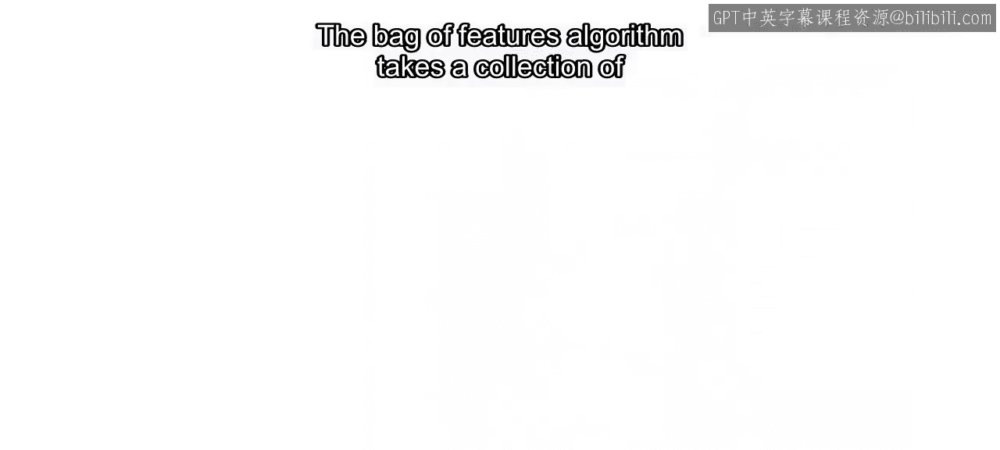

The bag of features algorithm takes a collection of images。Extracts feature descriptors。

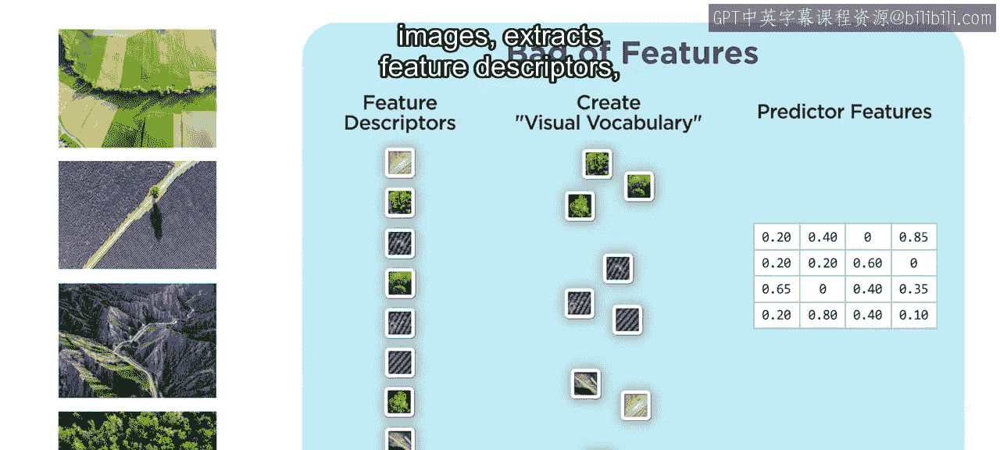

Creates a visual vocabulary。And tabulates the visual word occurrence in each image to create predictor features。

If this sounds exhausting， don't worry。

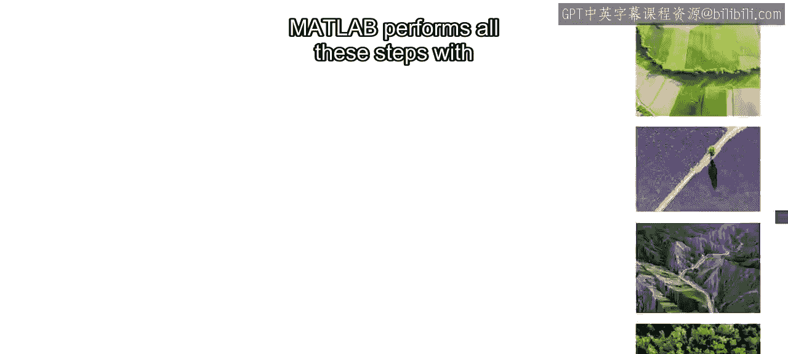

MatLAP performs all these steps with a single function， bag of features。

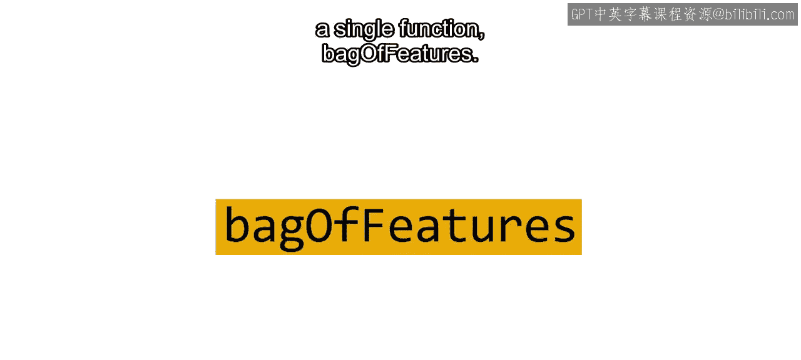

In this video。You use bag of features in MATLAb to create predictor features from images of roadside ground cover。

These images contain either snow。Or no snow。You'll explore several algorithm parameters to create predictor features。

Specifically， you'll choose a point selection method。Alter the grid size。And change the block width。

Then you'll use these predictor features to train a classification model。

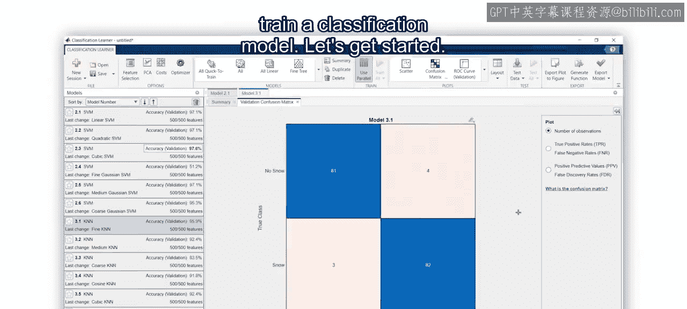

Let's get started。First。Perform some data preparation in Matlaap。

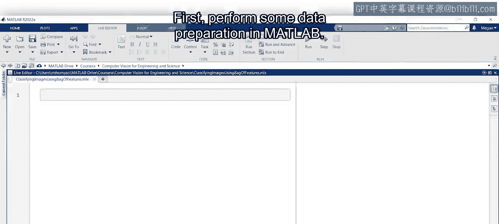

Use the folder of ground cover images to create a labeled image data store。

And then split the data into training and test sets。Now it's time to extract features。

Input the training image data story into the bag of features function。

This single line of code performs the entire extract feature step。

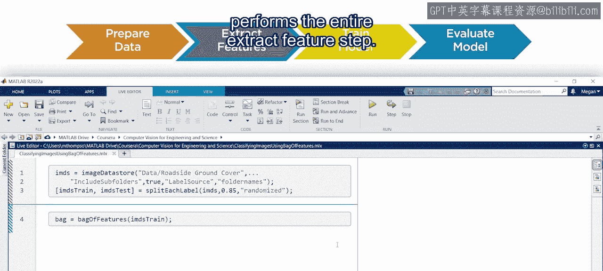

The function outputs a bag of features object， or bag。

Create a matrix of predictor features by passing this bag in the training image data store into the encode function。

The resulting matrix will have one row for each image。And one column for each feature。

500 features is the default。To prepare these features for the classification learner app。

Go ahead and convert this matrix into a table。Use the variableable names parameter to give each feature column a name。

Later， when you create a test set。You'll use the same variable names。Then add class labels。

Before you run this code， there are some optional parameters that you might consider changing to tailor the bag of features algorithm to your data。

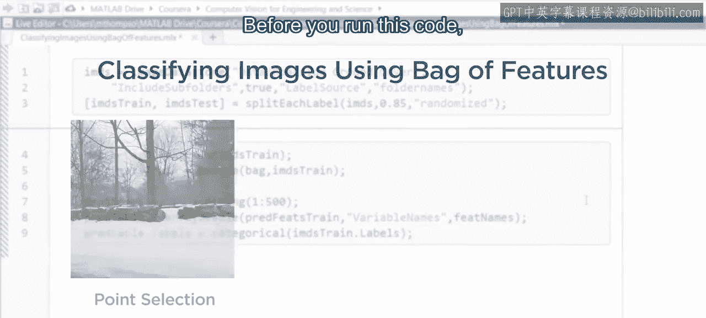

The point selection parameter lets you choose how the algorithm decides where to extract surf features。

It has two options。Dettector， which uses image characteristics to find extraction points。Or grid。

 which extracts descriptors from pre specified locations。

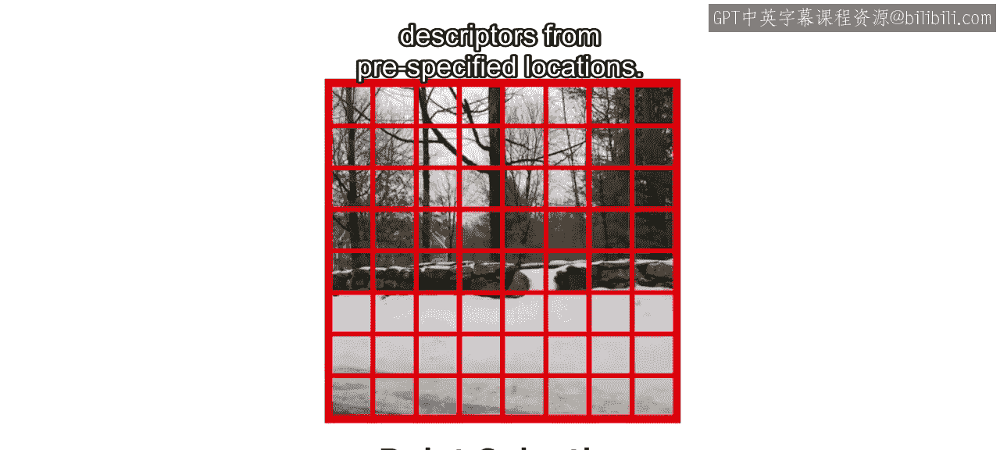

Because surf feature detection finds regions with high contrast and a specific size。

Detecting Sur features works best when distinct details are the most important parts of your image。

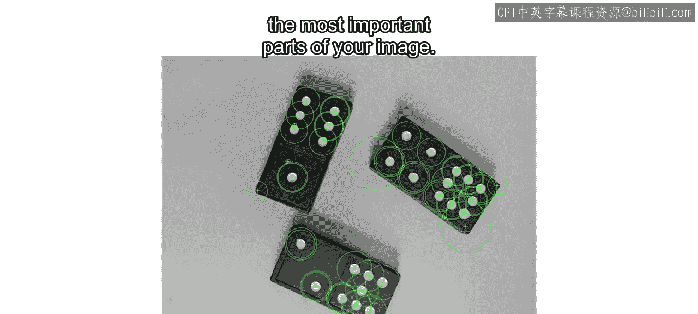

However， in many images， the most distinguishing characteristics don't have high contrast。

They are large areas with similar textures， for example， landscapes or road signs like this one。

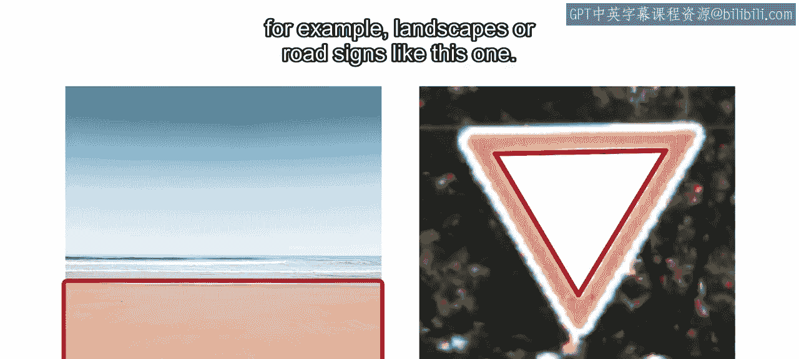

Despite their importance， these areas would have few detected features。

This issue occurs with the ground cover images。Serurf detection identifies many points in the branches and rocks。

But almost none in the snow。Which is the part of the image that you are most interested in。

In cases such as these， it's a good idea to extract feature descriptors along a grid。

With this method， you extract descriptors at a series of pre specified locations。

This skips the detection step in favor of collecting information uniformly across the whole image。

Grid is the default point selection method used by Baga features。

It works well for many images and is good to use when you're in doubt。

You can set the size of the grid and by extension， how many feature descriptors are collected with the grids step parameter。

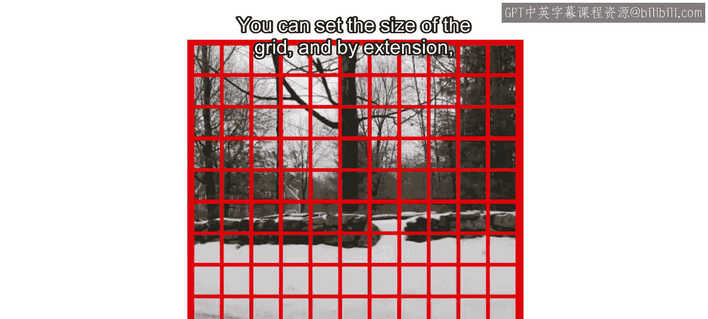

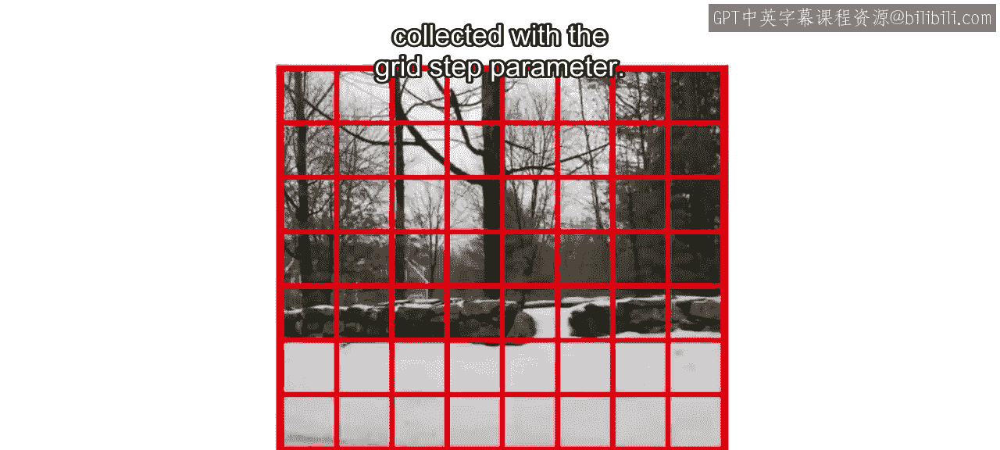

Smaller step sizes are useful in low resolution images。

Or in images where there are a lot of different textures。In these cases。

 you need the smaller step size to extract enough descriptors to adequately describe your image。

In the ground cover dataset set。The images have a high resolution and have a lot of large areas with similar textures。

The default grid step size of eight pixels would give you more feature descriptors than you probably need to train a model。

And would take a long time to extract from every image。

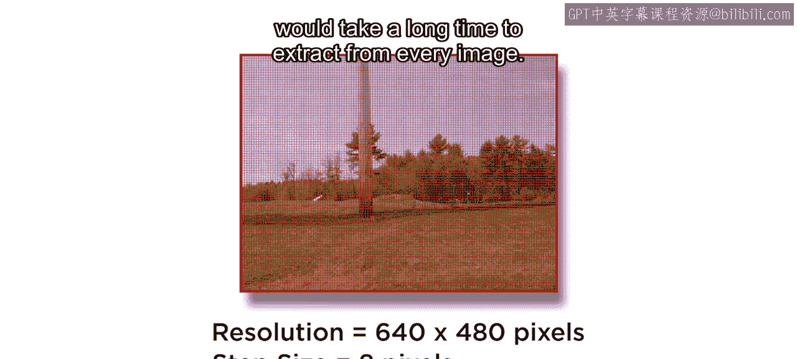

Back in Matlab。Speed things up by increasing the grid step size to 24。Recall that with surff。

 the gradient values of the surrounding neighborhood of pixels are used to calculate feature descriptors。

The block width parameter determines the size of this neighborhood。By default。

Serf uses four block sizes to extract feature descriptors。

Because you're looking for large regions of snow。You can use only the two largest default block sizes to decrease training time。

If the accuracy of your train models does suffer。You can always create a new bag with a smaller grid size。

 and more blocks。To give you an idea of the implications of creating a bag with a larger grid and fewer blocks。

When I created a bag with these parameters， it ran more than 15 times faster than with the default settings。

Run your code and create a table of predictor features。Depending on your data set and parameters。

 this could take some time。Now you are ready to train a model using these features。

Open the Classification learner app。And start a new session with your predictor features。

As you did in the training image classification models video。Train a few SVM。And K and N models。

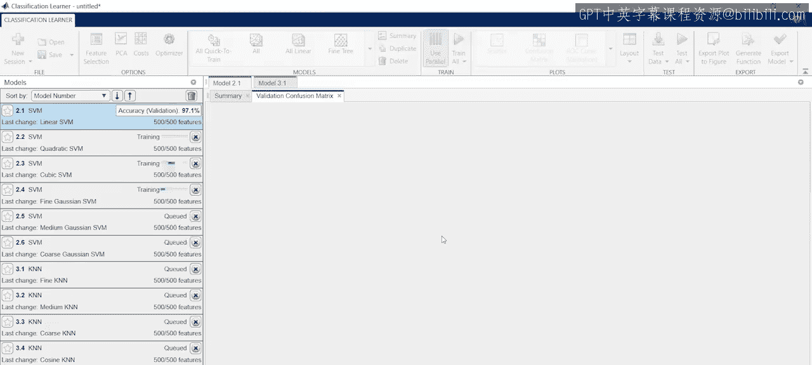

You can see that our best result is with one of the SVM models。

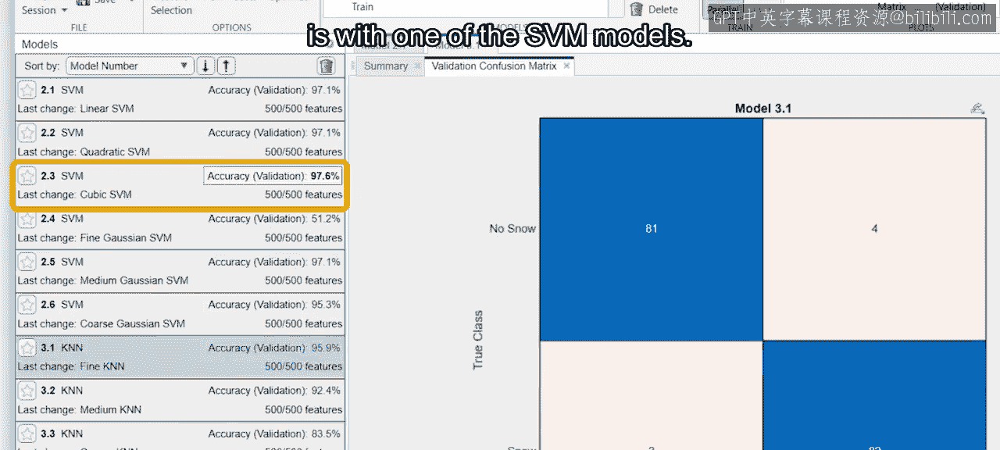

The last step is to evaluate your model with the test data you set aside at the beginning of this video。

Back in MatLb， prepare a set of predictor features using your bag in the test data。

Do not create a new bag from the test data。This would create new clusters unique to the test set。

So new predictor features wouldn't be comparable to the training predictor features from earlier。

It would be as if the training and test sets were speaking different languages。

Once you've created a matrix of predictor features for your test set。Convert it to a table。

And add labels。Remember the feature names you created for the training predictor features。

Include them again as the variable names parameter。This way。

 the model can find the right features to make its prediction。Finally。

 import the test predictor feature table into the app。And test all your models。

It looks like our training accuracy is comparable to our test accuracy。

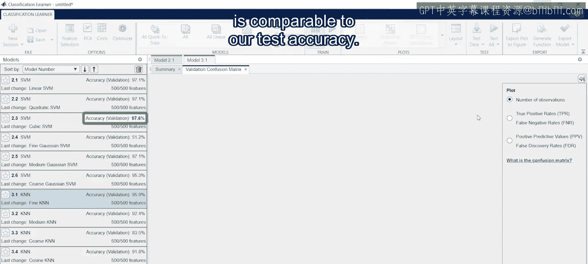

Great。😊，With just a few lines of code， you automatically extracted predictor features tailored to your data。

For more ways to customize the bag of features function。Check out the documentation。

