# Mathworks《工程与科学计算机视觉（简介、机器学习、目标检测）｜Computer Vision for Engineering and Science》 p22 11_机器学习物体检测.zh_en -BV1yJ4m13715_p22-

🎼，Classification is useful for labeling entire images。But often。

 you'll need to locate an object within a larger image or even identify multiple objects。

In these cases， you'll need to do detection。In this video， you'll learn to train an object detector。

Specifically， we'll cover the ACF algorithm， which stands for aggregate channel features。

ACF detectors worked by sliding a small window over an image and running a trained classification model。

If the classifier finds a positive result。Then the bounding box coordinates are stored。

Because ACF is repeated classification， this algorithm still follows the same machine learning workflow to train a model。

For the rest of this lesson， we'll train a detector using these images of railroad crossing signs。

The first step in preparing your data comes with the additional task of obtaining the ground truth data for your images。

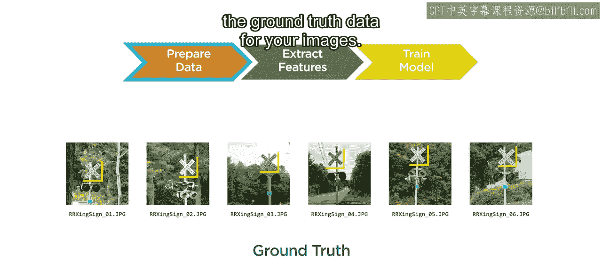

This data contains a list of the images and the bounding box coordinates of each object。

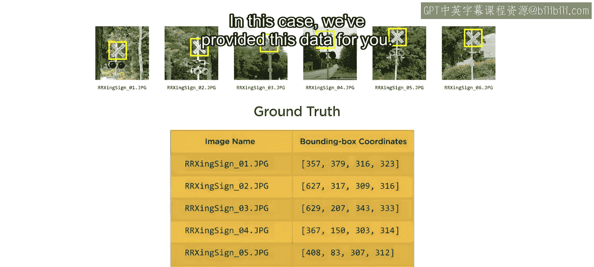

In this case， we've provided this data for you。The next step before training is feature extraction。

ACF is a popular machine learning detection algorithm because of its speed。It uses simple features。

 sometimes called channels that are quick to calculate， like pixel intensity。

ACF detectors use 10 channels to help detect objects。Three channels are from the LUV color space。

Where L is luminosity， and U and V specify color。One channel uses gradient intensity to measure edge strength。

And the remaining six channels measure the orientations of these edges。

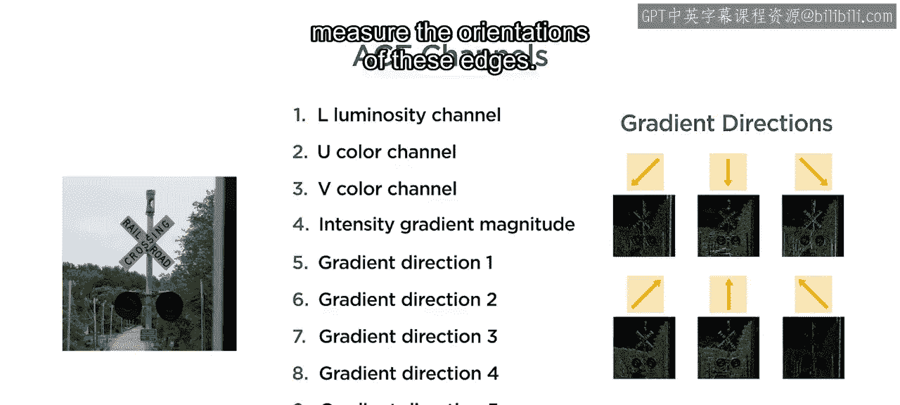

Together， these 10 channels identify distinctive characteristics of an object。For example。

 an animal could be identified using its colors。While railroad signs might be detected from their angled edges。

These channels are then combined or aggregated into a list of predictor features。

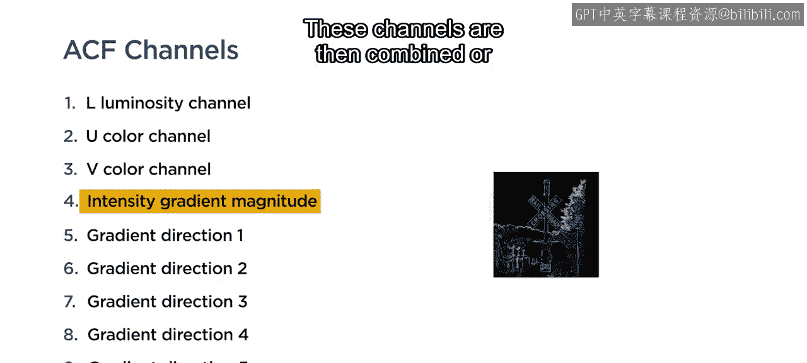

The ground truth is used to identify positive samples representing areas with the objects。

And negative samples of areas， not containing the objects。

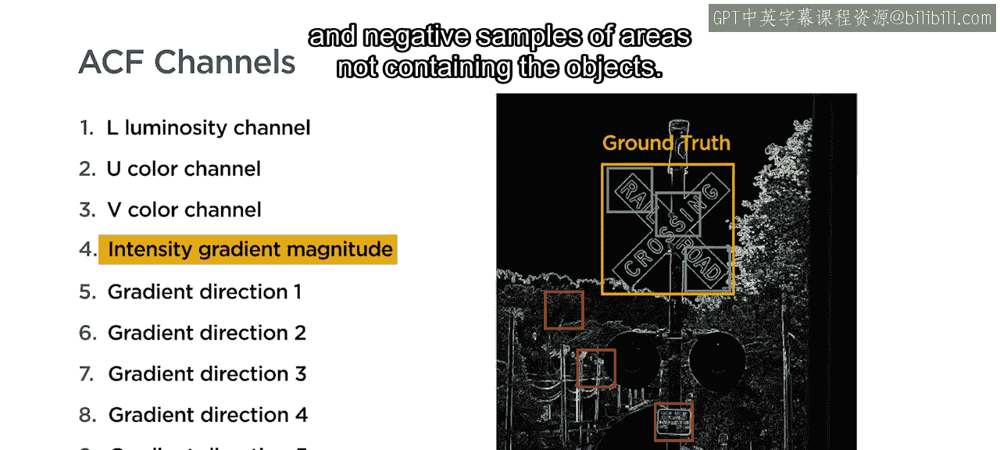

Finally， a detector is trained to differentiate between positive and negative samples。

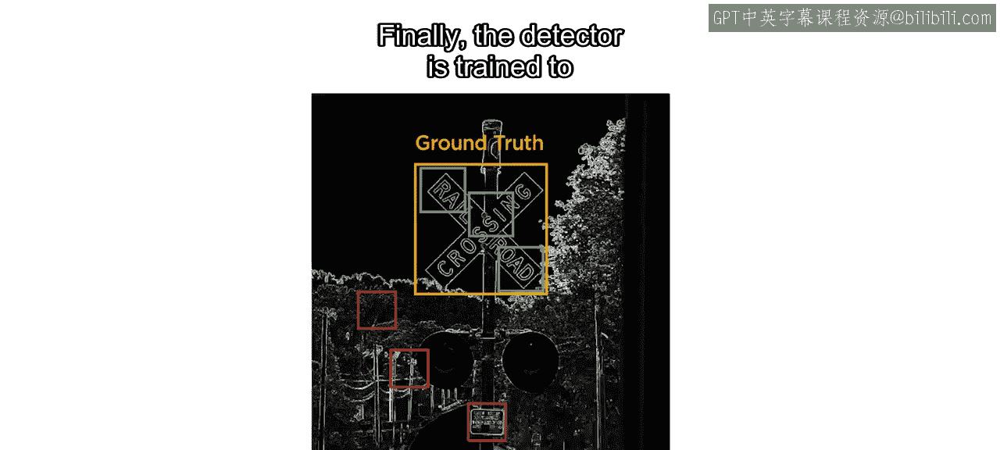

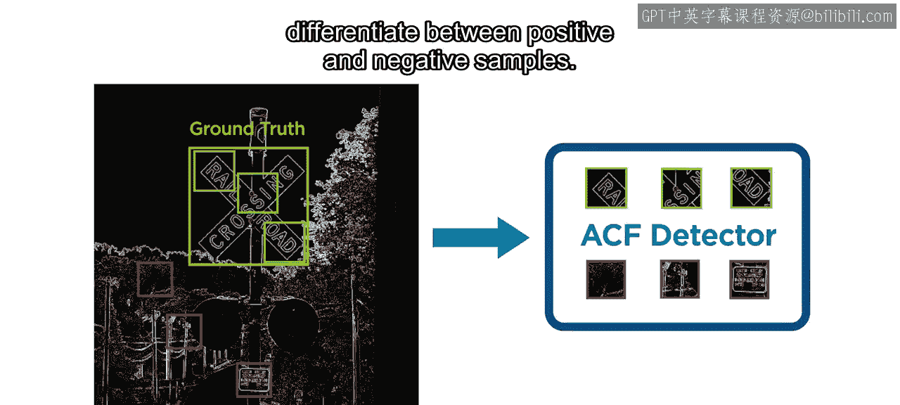

Using a train detector on an image requires repeatedly classifying sections of it within a sliding window。

Each window is assigned a score quantifying how closely its predictor features match those of the desired object。

If the score is above a certain threshold。Then the window is considered as positive。

 and the coordinates are saved as a bounding box。Depending on the sliding windows， size and spacing。

Bounding boxes may overlap。So the final step of detection is to merge them if they intersect enough。

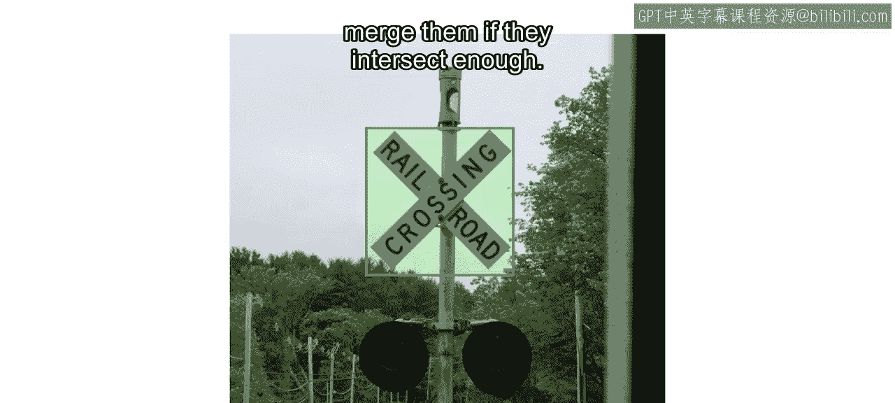

You now know the principle behind ACF object detection。So how do you do it in Mat lab。

The first step in preparing your data is to ensure that you have separate training and testing sets。

In this case， we've already separated the training and testing images into their own subfolds。

We've also provided the mat file containing the ground truth bounding box coordinates for each image。

Start by loading the ground truth variable into your workspace。

The next steps of extracting features and training a model。Are combined in the function。

 train ACF object detector。This function takes a table variable of the ground truth， as input。

Which you can generate from the ground truth variable using the function object detector training data。

The output of the train detector function will be a new variable that contains the train detector。

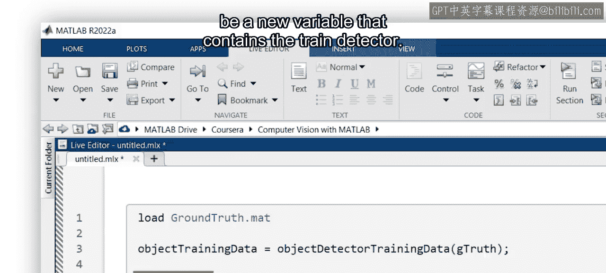

Now you're set。So， let it run。

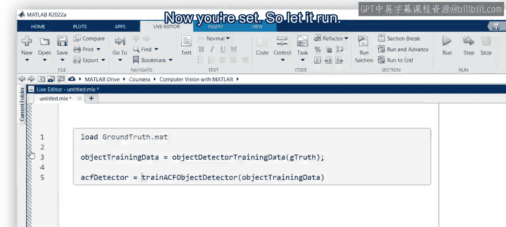

While the training continues， you can watch the progress in the output。And once completed。

 the train model is of type ACF object detector and is stored in the workspace。

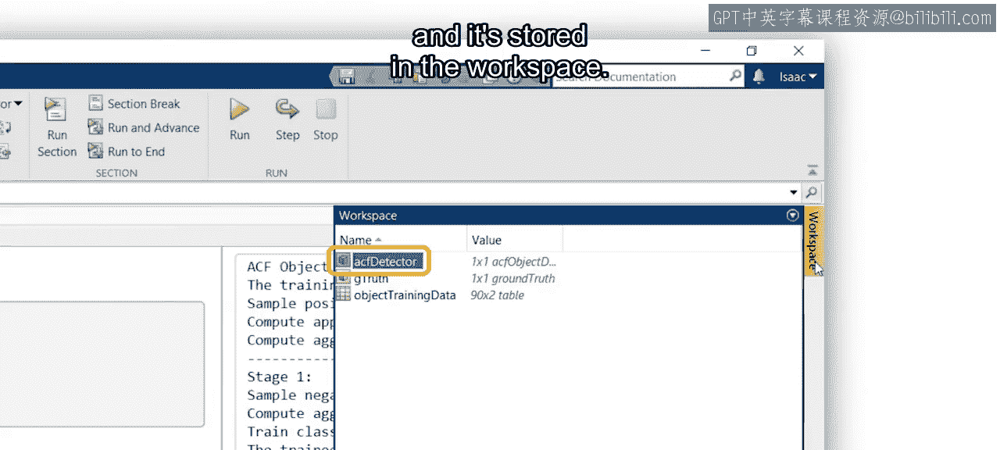

To apply it to some new test images， use the detect function。Which accepts the train detector。

And the image you want to apply the detection to。You can also detect on multiple images at once by using an image data store。

For example， here we'll pass in the data store of the testing images into the second input of the detect function。

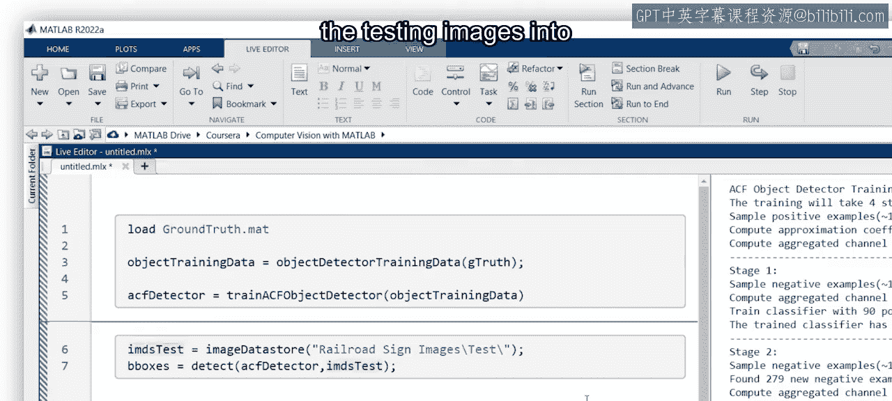

The output is a table containing bounding box coordinates and the score for any railroad signs that were detected。

In this case， there are only 10 images， so you can visually check the accuracy of your results directly in the live script。

To do this， first create a loop for your data store。

That overlays the bounding boxes of the detected objects on the image。

And displays the results in sequence。This detector did a great job isolating signs from the background。

 as there are no false positives。However， there are a couple images where the signs were not correctly detected。

But overall， not bad for a detector trained on only 90 images。

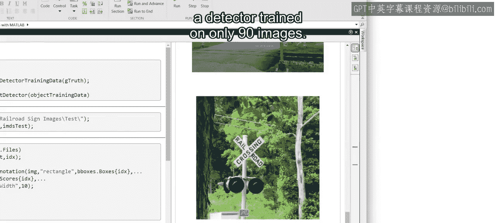

Keep in mind that there are many user defined parameters that we left as the default values。

 such as increasing the complexity of the model。Or constraining the size of the windows used during detection。

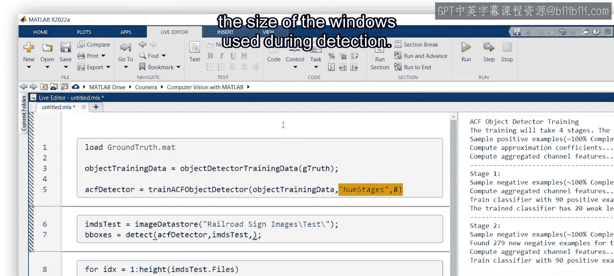

These parameters can be used to try and improve the accuracy of your detectors。

But usually with a trade off in speed。

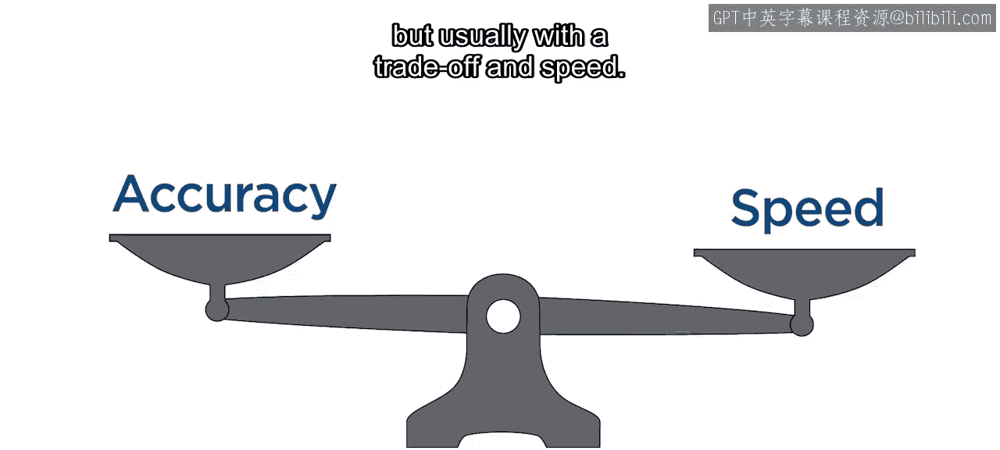

To learn more about these options。Be sure to visit the documentation。

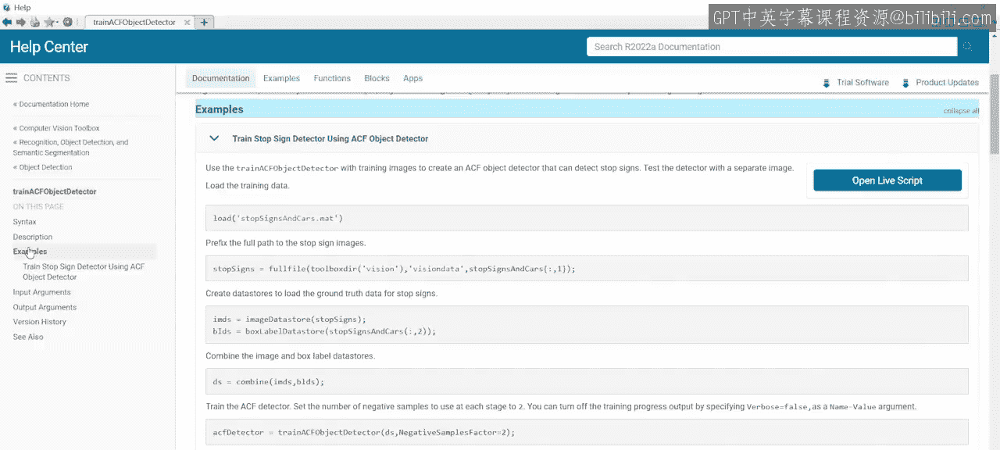

Yeah。