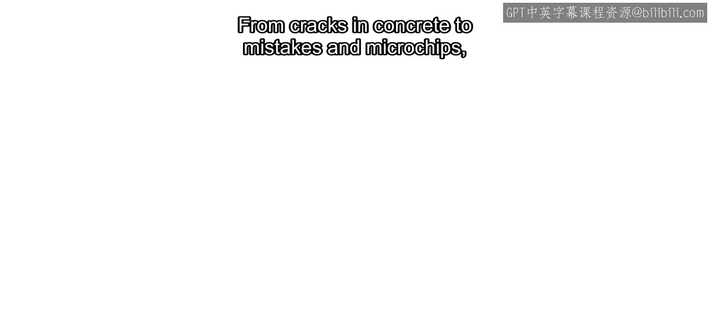
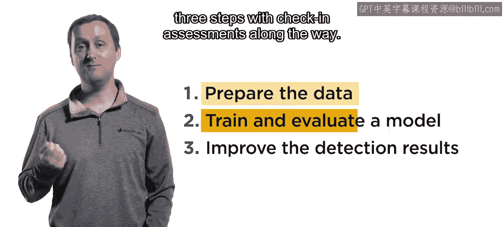
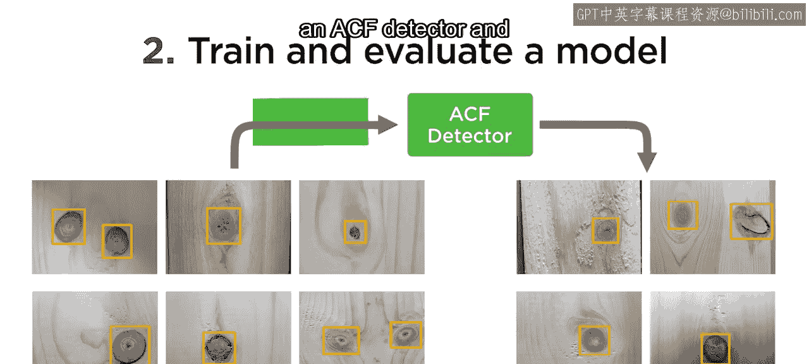
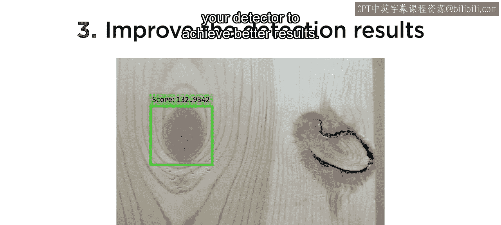
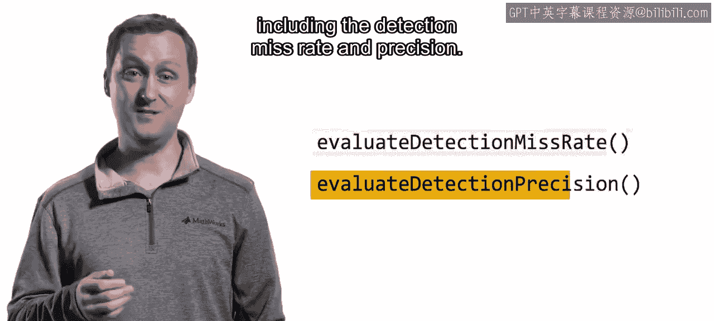
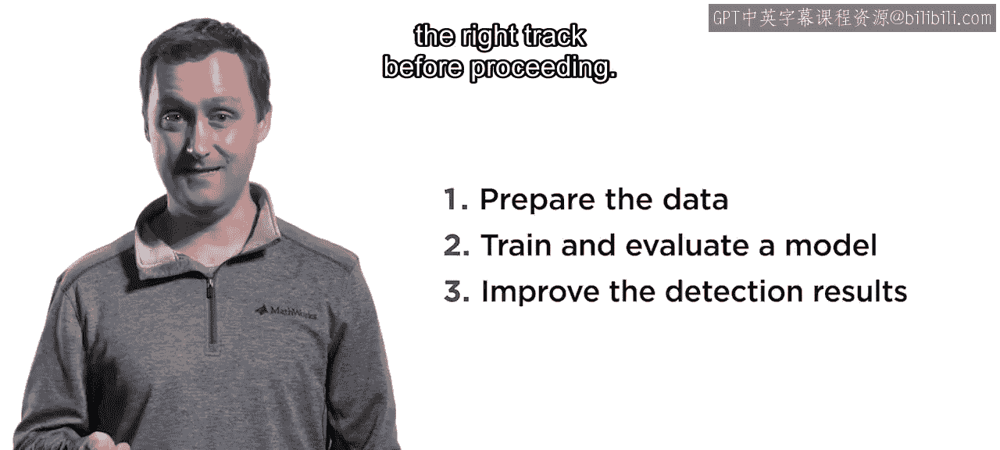
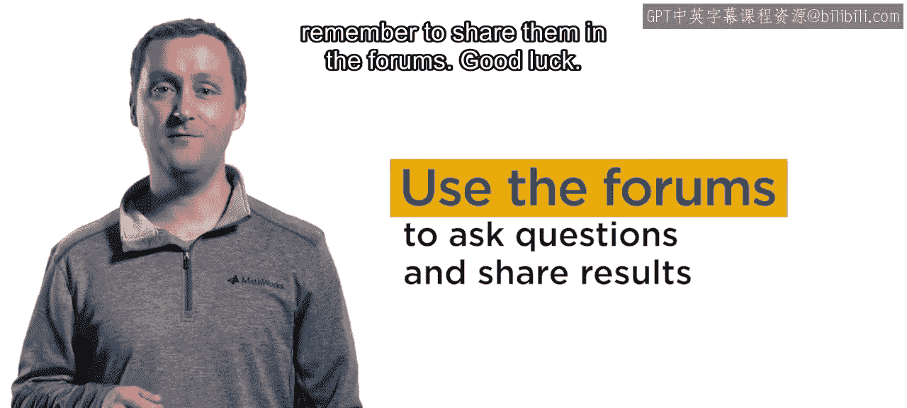

# Mathworks《工程与科学计算机视觉（简介、机器学习、目标检测）｜Computer Vision for Engineering and Science》 p24 13_物体检测项目简介.zh_en -BV1yJ4m13715_p24-

🎼。

From cracks in concrete to mistakes in microchips， locating defects is a common application for object detection。

For this project， you'll train an ACF detector on defects found in wooden boards。

This specific type of defect is called a knot。 knots exist where a branch was located on the tree and can reduce a board's strength。

Your goal is to train a detector that identifies all the wood knots and a set of test images。

This project is divided into three steps with check and assessments along the way。

In step1， you'll familiarize yourself with the data set。

The data has already been split into training and testing sets。

 and the training set has already been labeled for you。

You will need to label the test sets's ground truth using the image labeler app。For step 2。

 you'll train an ACF detector and evaluate your results on the newly labeled test data。

Remember that developing machine learning models is an iterative process。

The same is true for this project。 So in step 3， you'll improve your detector to achieve better results。

Along the way， you'll also evaluate some detection metrics。

 including the detection misrate and precision。

Be sure to complete each steps assessment in order。

 You're encouraged to try them any number of times to ensure you' are on the right track before proceeding。

If you have any questions or interesting results， remember to share them in the forums。

Good luck。😊，🎼。