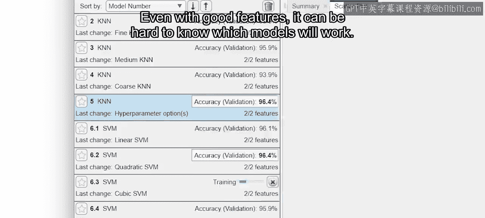
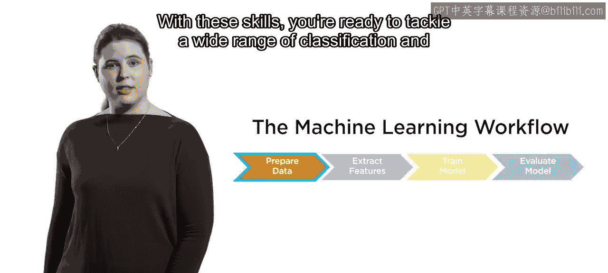
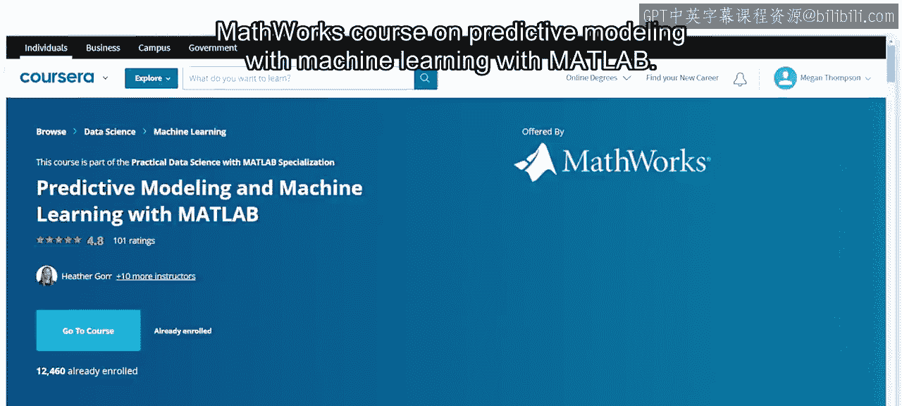
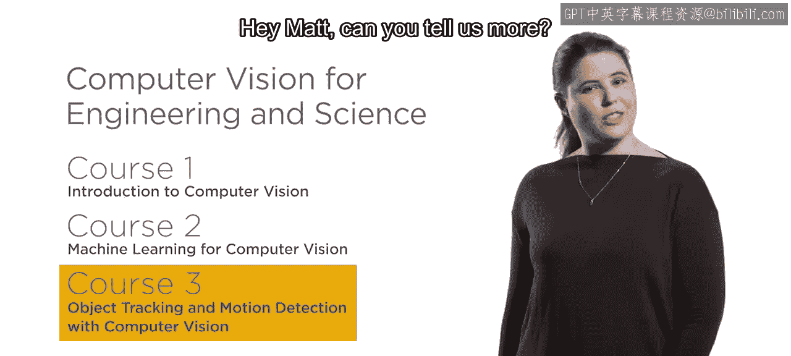
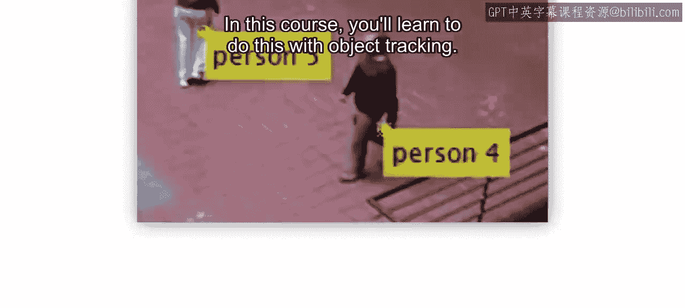

# Mathworks《工程与科学计算机视觉（简介、机器学习、目标检测）｜Computer Vision for Engineering and Science》 p25 14_计算机视觉机器学习总结.zh_en -BV1yJ4m13715_p25-

🎼，Congratulations！Classifying images and detecting objects are two of the most important tasks in computer vision。

Now you can do both with machine learning。Every application requires properly prepared data。

You're now ready to label images for classification or detection。

And split your data for training and testing。Each problem is different。

 The extracted features that work for one dataset set may fail for another。Fortunately。

 you've learned how to try a variety of approaches to find the best one for your images。😊。

Even with good features， it can be hard to know which models will work。

You are now able to quickly train different models。And evaluate your results。

You've not only performed each of these steps。 you've learned to iteratively improve your results and identify pitfalls using the machine learning workflow。

With these skills， you're ready to tackle a wide range of classification and detection problems from identifying defects to improving road safety。

If you're interested in exploring machine learning for other applications。

 check out Mathwork's course on predictive modeling with machine learning with Matlab。

But first， to keep learning advanced computer vision techniques。

 continue on to course 3 of the specialization。Hey， Matt， can you tell us more？

Thanks， Megan。In course 3 of this specialization， you'll leverage your familiarity with machine learning to use pretrained deep neural networks to perform object detection。

You already know a few ways to detect objects in images and video frames。

But how do you differentiate objects across many video frames？In this course。

You'll learn to do this with object tracking。

In the final project， you'll apply your new skills to track cars on a busy highway。See you there。

