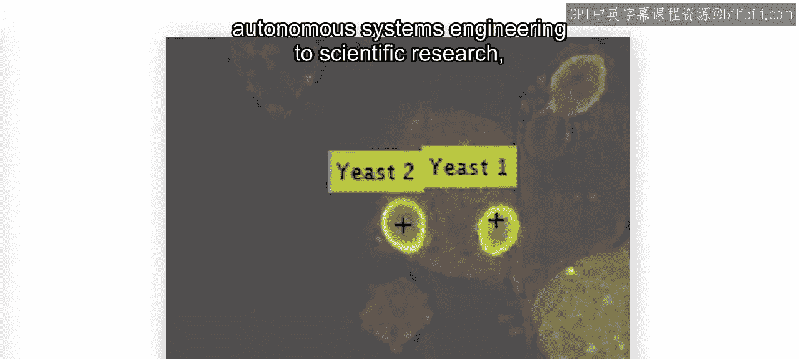
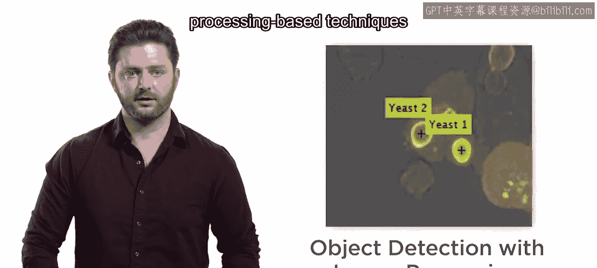

# Mathworks《工程与科学计算机视觉（简介、机器学习、目标检测）｜Computer Vision for Engineering and Science》 p27 1_物体跟踪和运动检测简介.zh_en -BV1yJ4m13715_p27-

🎼。

In many applications， from autonomous systems engineering。To scientific research。

You'll need to differentiate between objects and track them over time。Before you can track objects。

 you have to detect them。In this course。You'll start by detecting objects in videos using pre trained models。

 including deep neural networks。Many general and special purpose object detection models are readily available for use in MATLB。

Sometimes though， using a machine or deep learning model is unnecessary and inefficient。

So you'll also review image processing based techniques to segment objects of interest。

And you'll learn new tools。Like optical flow to detect motion and moving objects。However。

As far as detection is concerned， every new frame in a video is a whole new world。

Objects in one frame have no connection to previous frames。That's where object tracking comes in。

Object tracking enables you to distinguish objects over time。Reduce the effects of flawed detections。

And keep track of objects that are temporarily obscured from view。At the end of this course。

 you'll analyze highway traffic flow using the detection and tracking techniques you learned。

Let's get started。🎼。