# Mathworks《工程与科学计算机视觉（简介、机器学习、目标检测）｜Computer Vision for Engineering and Science》 p29 3_使用分割检测物体.zh_en -BV1yJ4m13715_p29-

🎼。

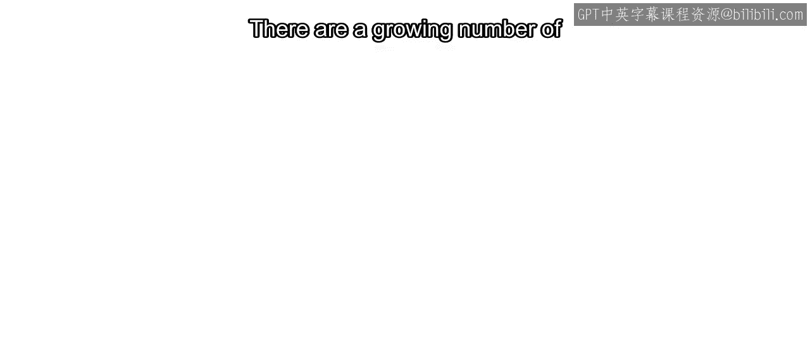

There are a growing number of pre trained models available to perform object detection。

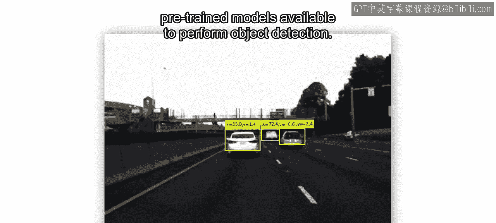

If you find a model that provides sufficient quality detection for your use case。You're good to go。

But what if you don't。You could trade a model。Keep in mind， though， that training models。

 especially deep neural networks， can take significant effort and resources。

 which may not always be readily available。In many circumstances。

 image processing approaches will be more than sufficient。

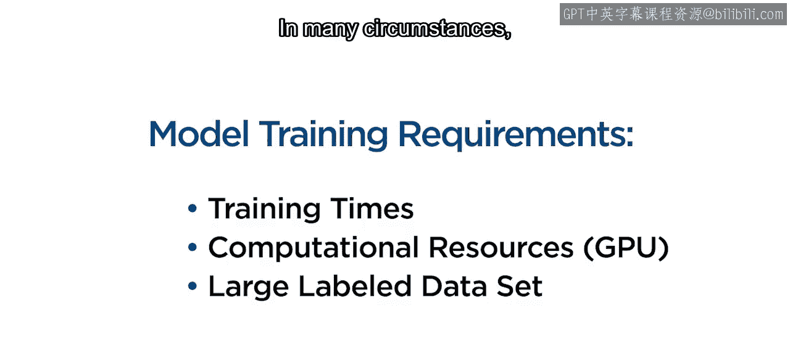

If you can consistently distinguish your objects of interest using intuitive visual features such as brightness。

Color， shape or size。

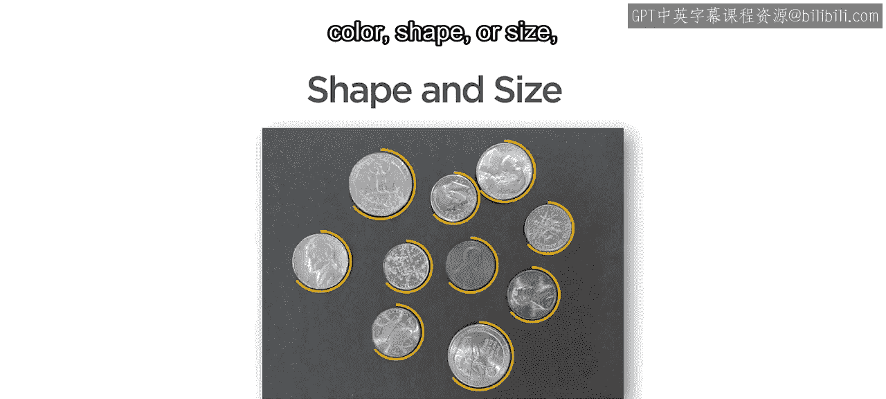

Then it is often more efficient to design an image processing algorithm， to segment them。For example。

Consider fluorescence microscopy。

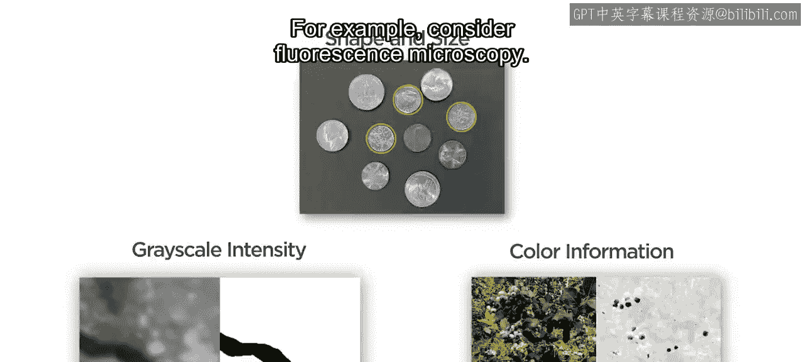

In this video， amoeba are attempting to digest yeast cells。The yeast cells are fluorescently labeled。

 so you should be able to segment them using the relative size。

 along with color information or gray scale intensity。

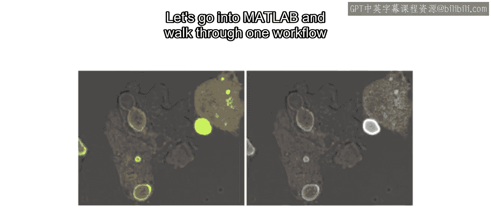

Let's go into Matlab and walk through one workflow to segment the yeast in the video using the grayscale intensity。

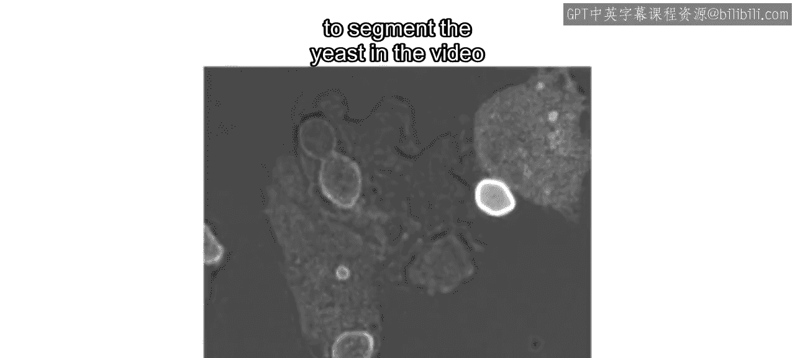

First， read the video into Matlab。Extract a sample frame。And convert it to grayscale。Next。

 open the image segmenter app。And load the gray scale image into the app。

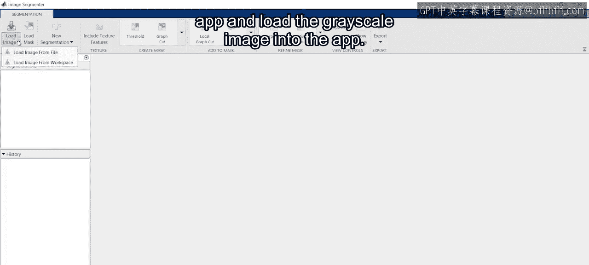

In this case， there's a strong difference between the bright fluorescence and the rest of the image。

So use a manual threshold on the grayscale intensity。To roughly segment the yeast。

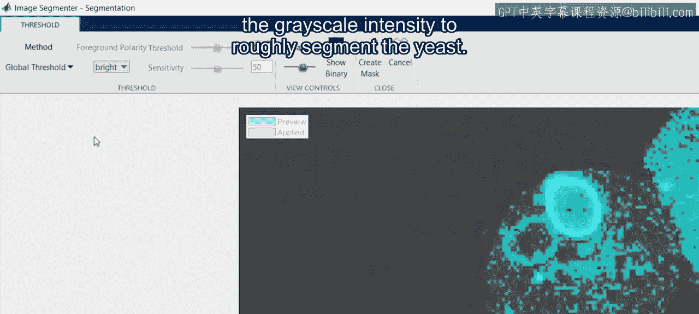

Here， we're missing the centre of the east。So use the fill holes feature to fill this region in。Now。

 the remaining artifacts are smaller in size than the yeast cell。

This means you can eliminate them with a morphological opening。

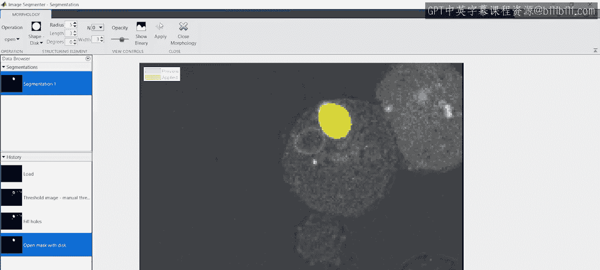

H， this looks good。To apply these steps to other frames in the video， export a function。

You could save this as a dedicated function file。But in this case。

 let's just copy it into the bottom of our script so we can call it anywhere in the script。

To apply these steps to the color frames of the video。Create a copy of the input with a new name。

Assign the gray scale conversion back to the original variable。And finally。

 update the mask image to use the color version。Don't forget to replicate the binary mask in all three color plains。

Now， let's test this function on the sample frame and view the results to make sure it works。

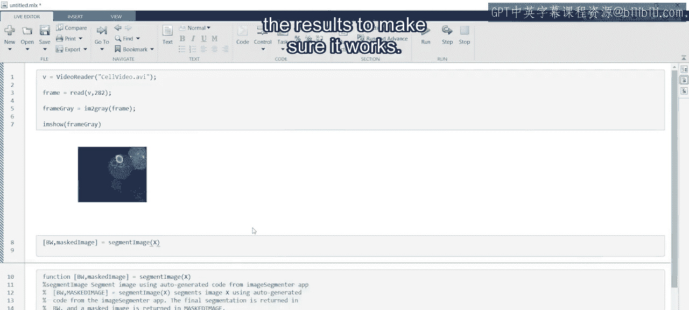

It's a good idea to test your segmentation function on a few other frames。

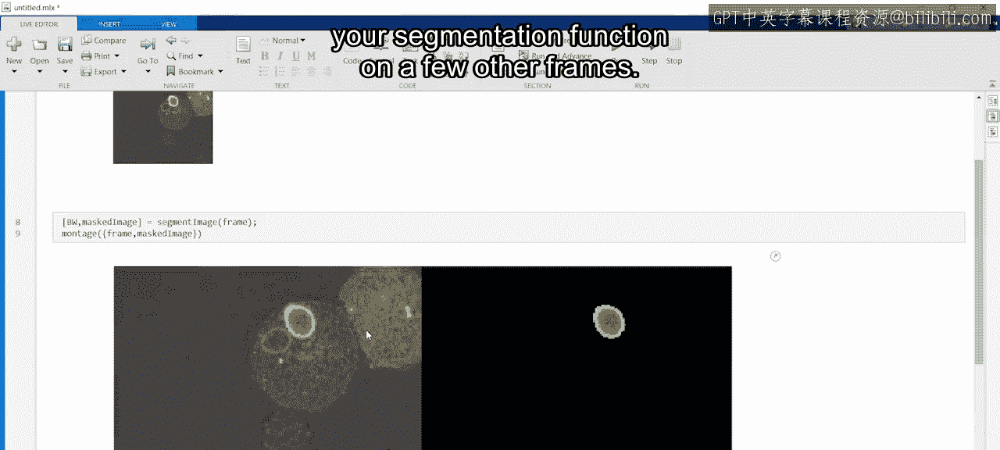

So， let's try another one。

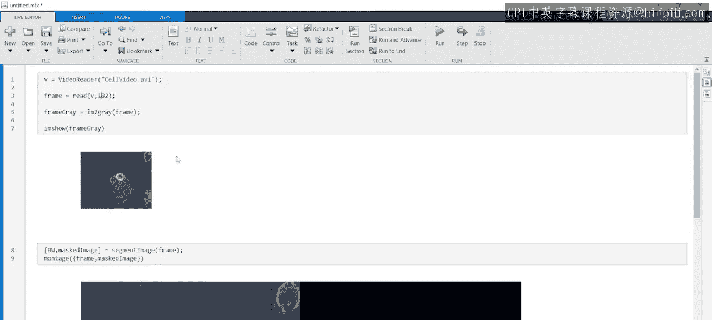

And one more for good measure。Looks good。To add a bounding box and label， like you saw earlier。

 first， use the region props function to return the bounding box for the segmentation。

Then use this result with the insert object annotation function。To add a labeled bounding box。

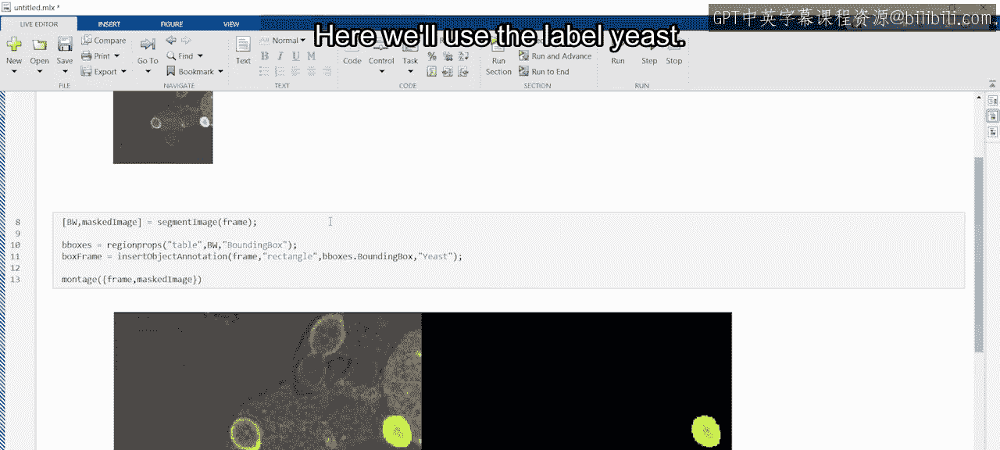

Here， we'll use the label yeast。Finally， check that the result is what you expect。

Now you're ready to process all the frames in the video。As you've seen previously。

 create a new video writer object。Open it。And close it。Then between the open and closed commands。

 use a for loop to iterate through the video frames。Finally， write each frame to the new video。

And there you have it。

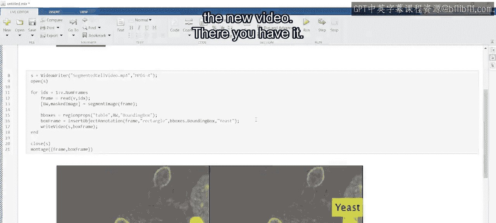

You've detected the high fluorescence yeast cells using classical image processing techniques。

In this video， we only scratch the surface of the image processing methods available in Matlab。

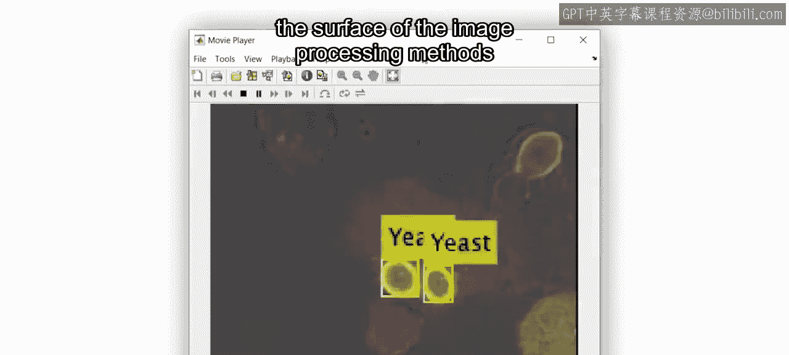

Many of which have useful apps capable of generating code， like you saw here。

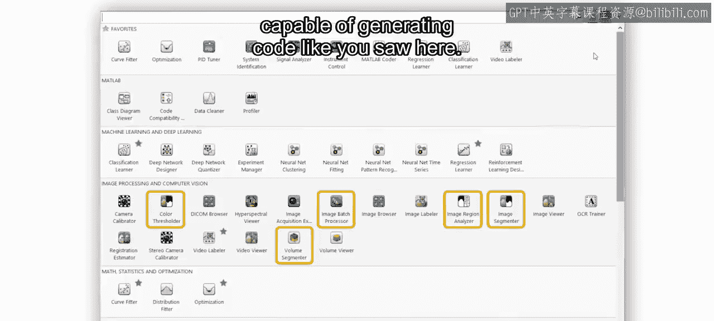

If you're unfamiliar with segmenting images in Matlab or feel like you could use a refresher on the functions and apps available for segmentation。

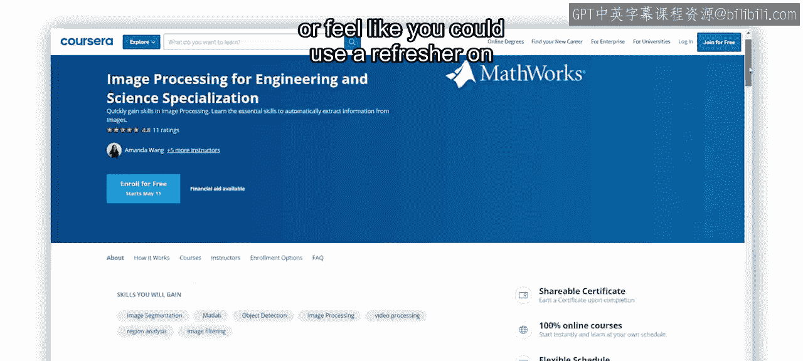

We have an image processing specialization available on Coursera as well。

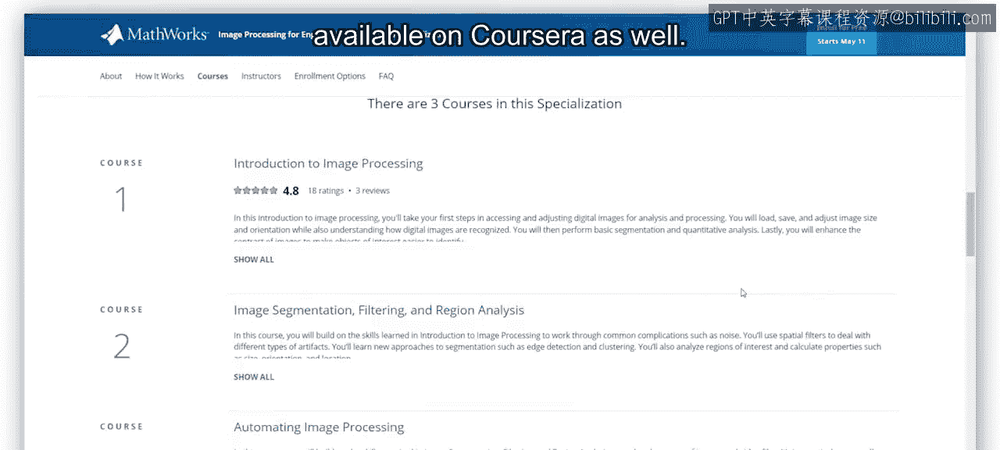

。