# Mathworks《工程与科学计算机视觉（简介、机器学习、目标检测）｜Computer Vision for Engineering and Science》 p30 4_检测运动.zh_en -BV1yJ4m13715_p30-

🎼，Motion detection is a common task in many applications。For example， by detecting motion。

 you can estimate the trajectory of objects， helping you determine if a person is crossing the street。

Or safely walking on the sidewalk。Other applications include camera stabilization。

And helping autonomous systems map their surroundings， just to name a few。

There are several ways to detect motion in a video clip。

A moving object against a stationary background can be segmented using background subtraction。

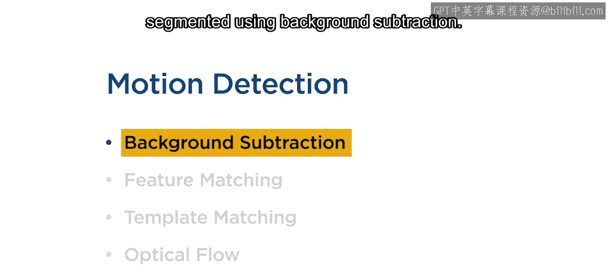

This method can be implemented with basic image processing techniques。

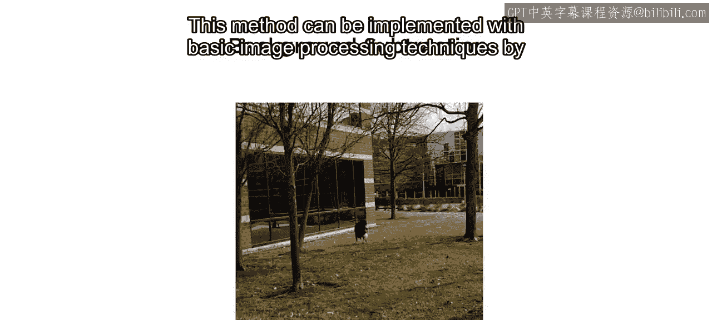

By subtracting a static background image from each frame。

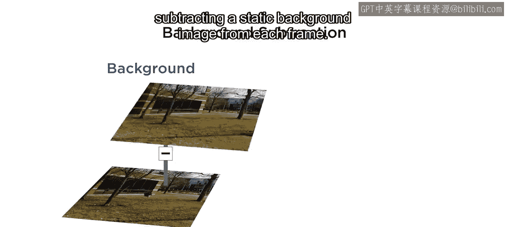

You can isolate moving objects。This， of course， requires a static background。

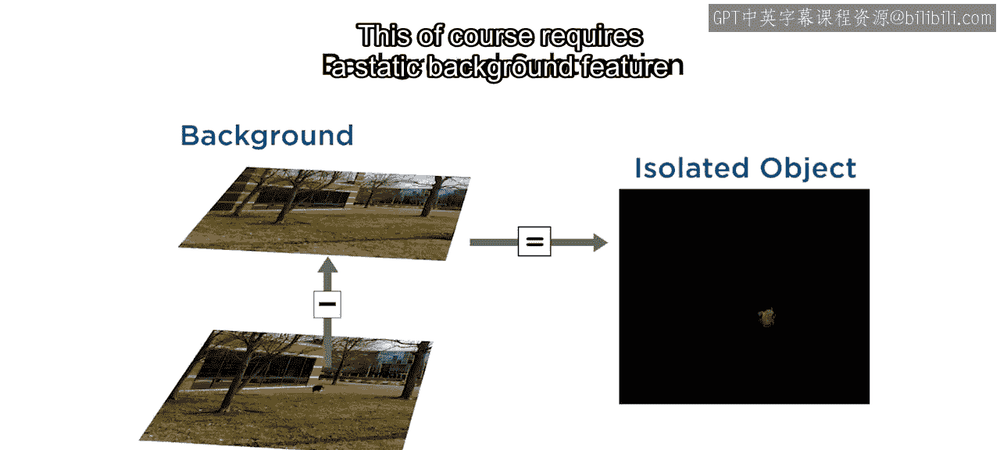

Feature based motion detection works similarly to image registration。

You detect and extract features from an object in one frame。

Then match those features in later frames。

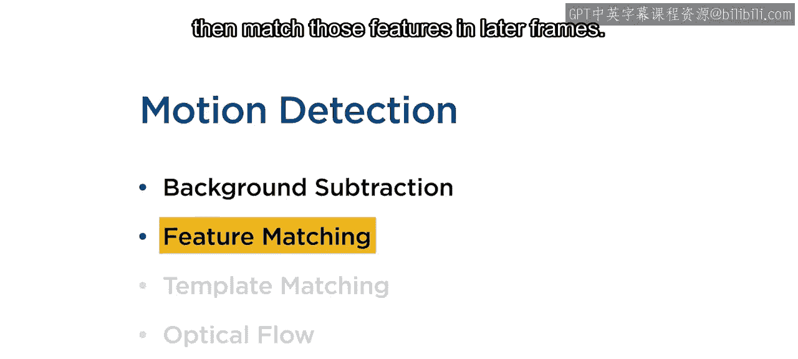

By doing so， the translation and rotation of an object can be computed。However。

 for this approach to work， you first isolate the object of interest like a face before extracting features。

In template matching， you select a portion of an image and search the following frames for that pattern of pixels。

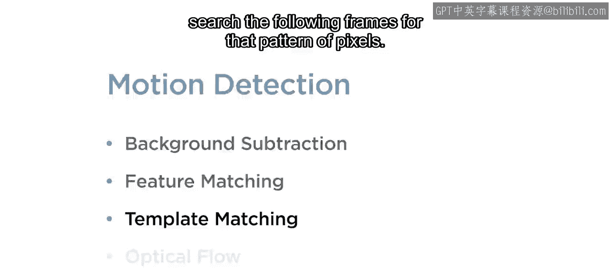

This method is especially useful for stabilizing jittery video。

 where orientation and lighting are consistent between frames。

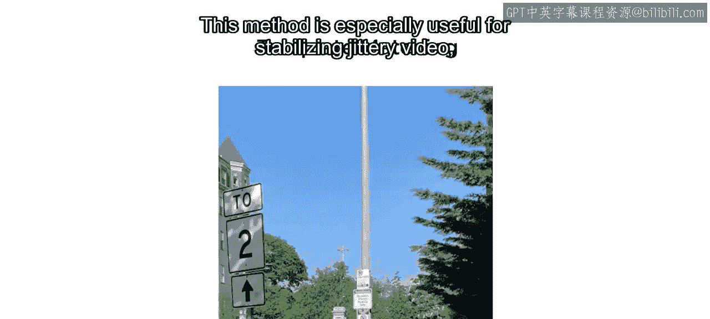

You determine the motion by keeping track of the template location in each frame。

You'll use template matching later in this course。

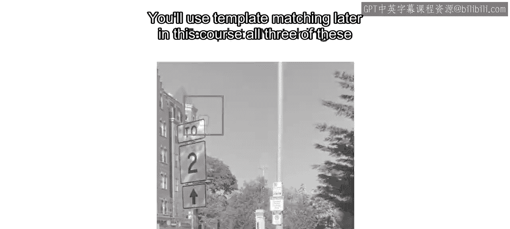

All three of these techniques require you to do some processing to detect motion。

Creating a static background image。Detecting the object of interest。

Or identifying an object that appears in the same orientation throughout the video to use as a template。

However， in some applications， none of these approaches will work。So what do you do？

Optical flow is a powerful technique to determine motion。

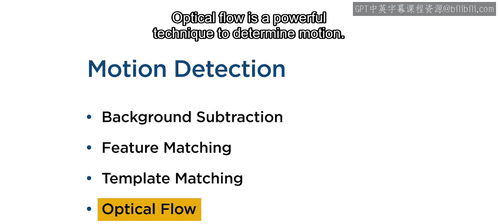

It uses the differences between subsequent video frames。

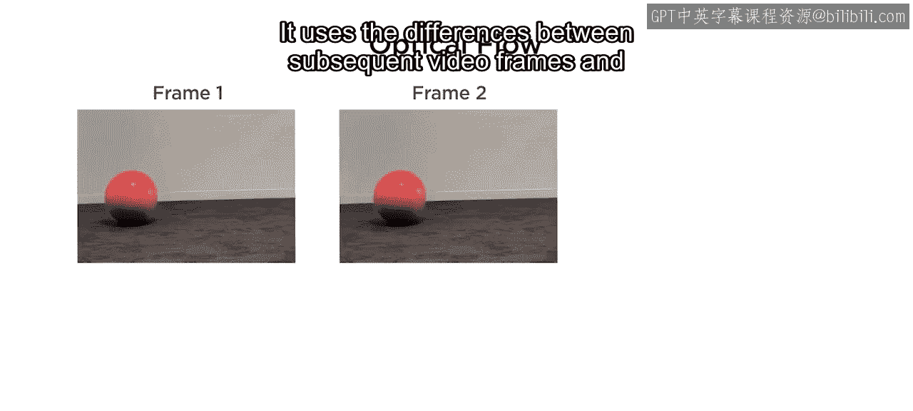

And the gradient of those frames。To estimate a velocity vector for every pixel。Thus。

 you don't need to first identify an object or static background。

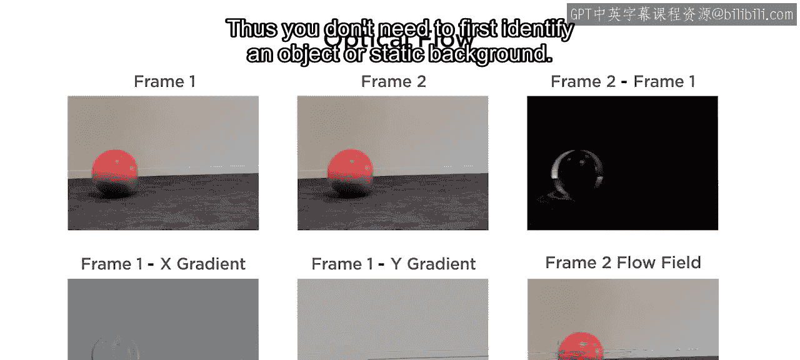

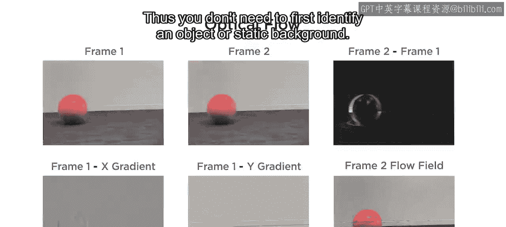

You can then annotate the video by adding the velocity vectors to each frame。

Objects moving right or left are easy to distinguish by the large arrows pointing in the direction of motion。

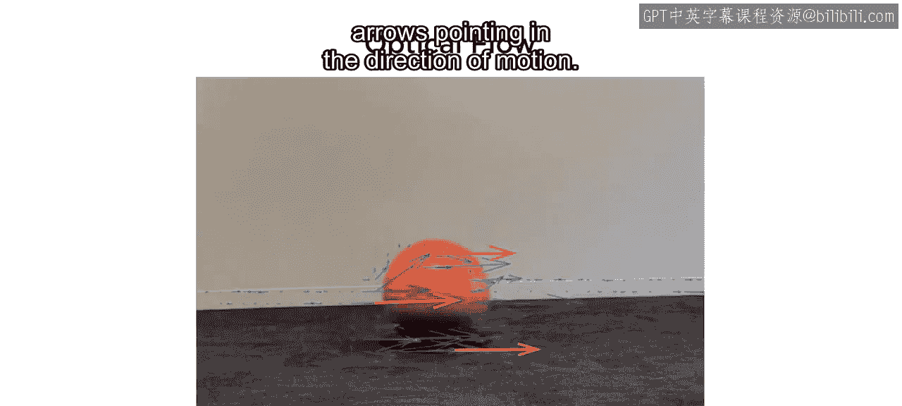

Vellocity arrows indicating motion towards or away from the camera， are less obvious。

Objects moving away from the camera will have outlines getting smaller。

 So the edges will have velocities that converge。

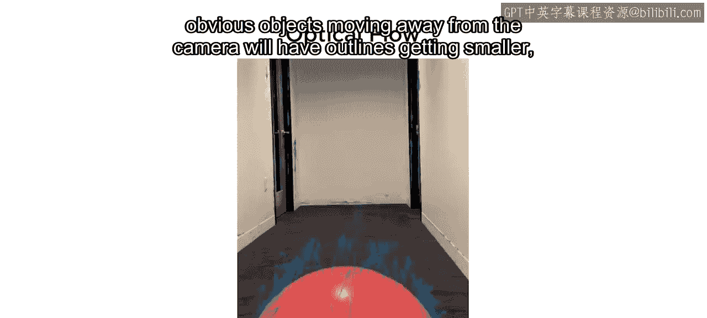

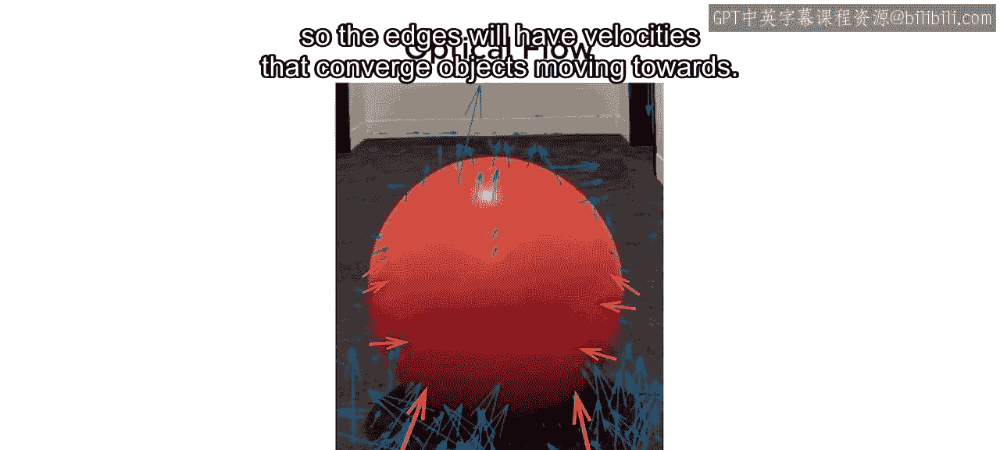

Objects moving towards the camera will get larger， and the velocity vectors will diverge。

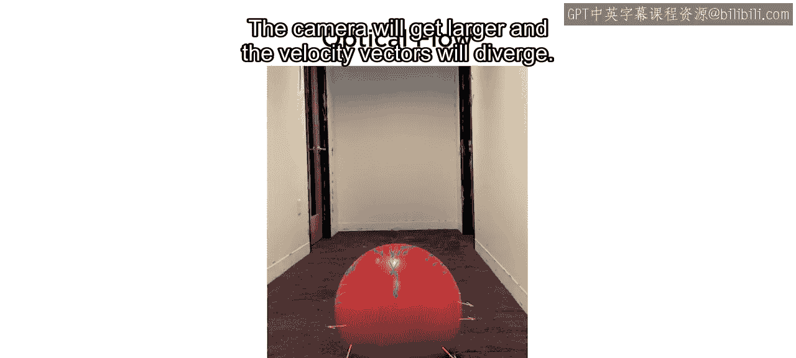

There is a key constraint with optical flow。The illumination of the scene must be approximately constant。

Because optical flow uses the difference in pixel intensities between frames。

 a shadow or change in lighting could appear as motion。

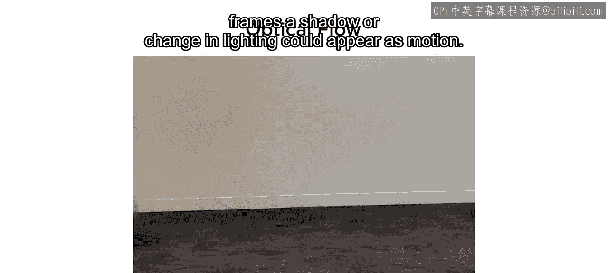

This affects the other approaches to motion detection as well。

 but it is still possible to match features or a template with some changes in illumination。

You already have the skills to determine motion using background subtraction and feature matching。

Next， you'll learn to apply optical flow and template matching。

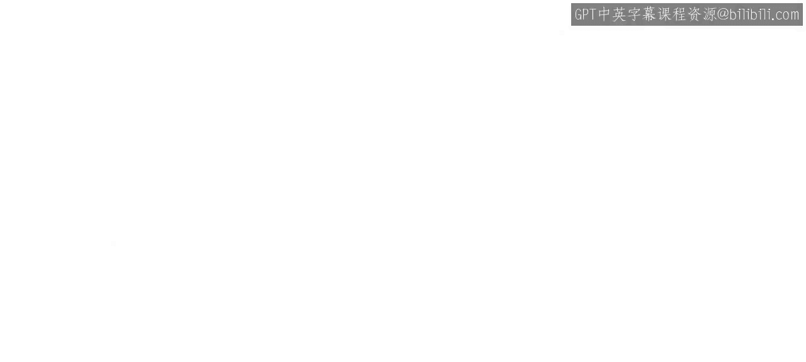