# Mathworks《工程与科学计算机视觉（简介、机器学习、目标检测）｜Computer Vision for Engineering and Science》 p31 5_使用模板匹配稳定视频.zh_en -BV1yJ4m13715_p31-

🎼。

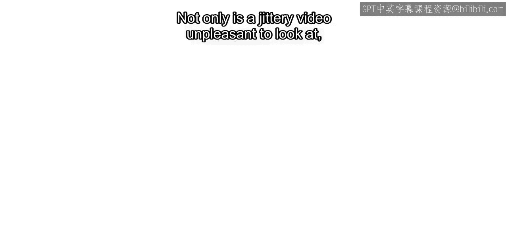

Not only is a jittery video unpleasant to look at。But it also complicates further analysis。

 like object detection and segmentation。

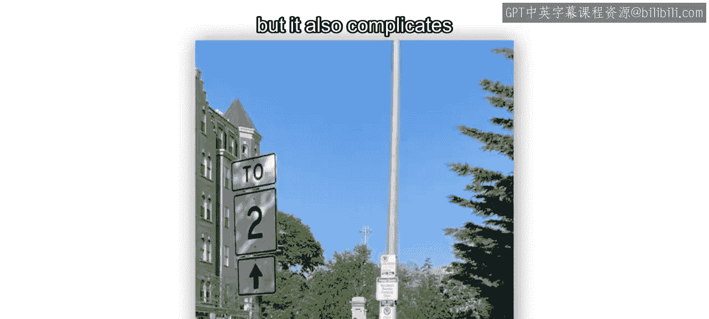

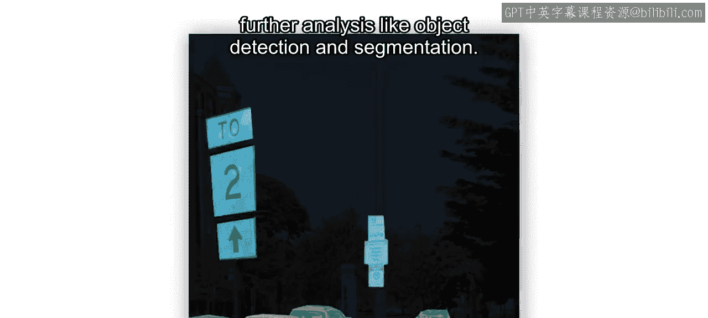

Here， you'll learn the steps needed to stabilize a shaky video。Specifically。

 you will correct the common problem of camera shake in the X Y plane。

When there is a stationary object to use as a reference。

This assumption means stationary object does not change size or orientation due to camera motion。

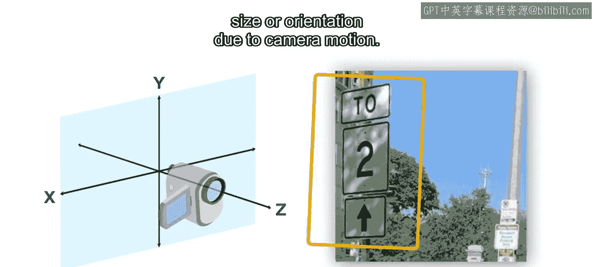

The process of stabilizing such videos consists of the following steps。Motion estimation。

Camera motion estimation。And video correction。Consider how the location of an object changes from frame to frame in a video。

The position of an object in the current frame。Is its position in the previous frame。Plus。

 the apparent motion between frames。You estimate the motion using techniques like optical flow or template matching。

Assuming the camera moves only in the XY plane。The apparent motion is the sum of the camera motion and object motion。

This is where it helps to have a stationary object in the video。

Then the component of the motion due to the object moving is 0。

And the apparent motion is entirely due to camera motion。

The last step is to perform video correction。You stabilize the current frame by subtracting the camera motion。

However。To stabilize the video with respect to the original frame。

You need to account for the cumulative motion of the camera from all previous frames。Thus。

 the stabilized frame is the current frame。Minus the cumulative camera motion from all previous frames。

To practice this process。

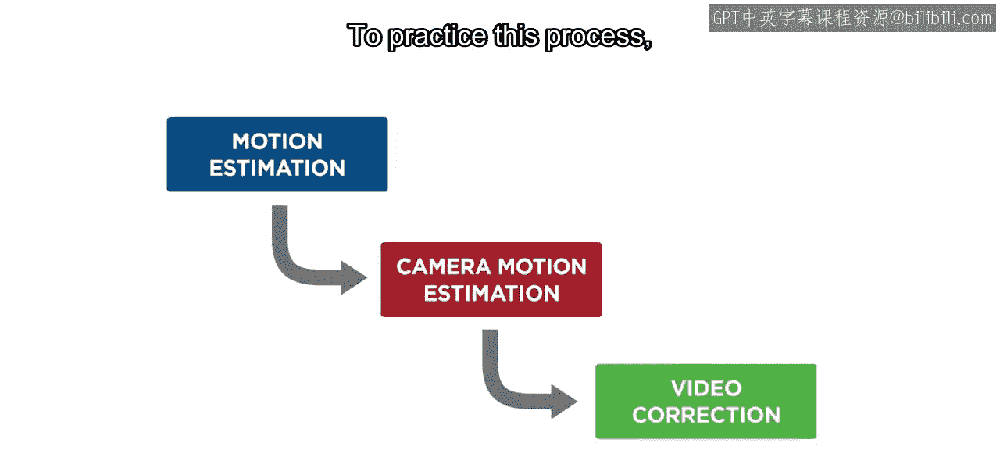

We have provided an example video and script in the course materials。Here。

 we'll cover the main components。The camera is moving in the X Y plane。

 but there are stationary objects that can be used for motion estimation。

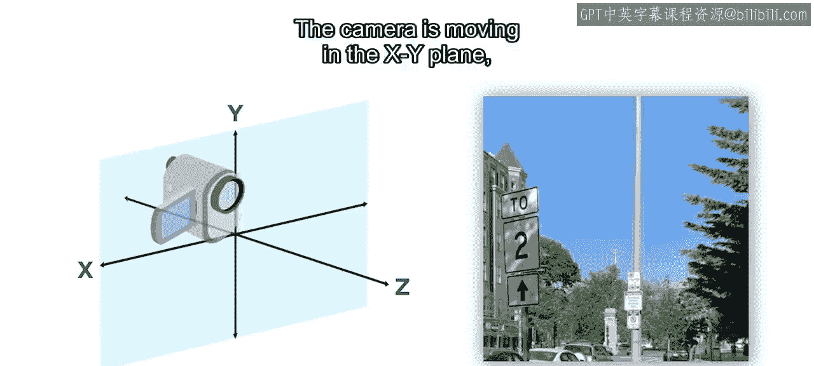

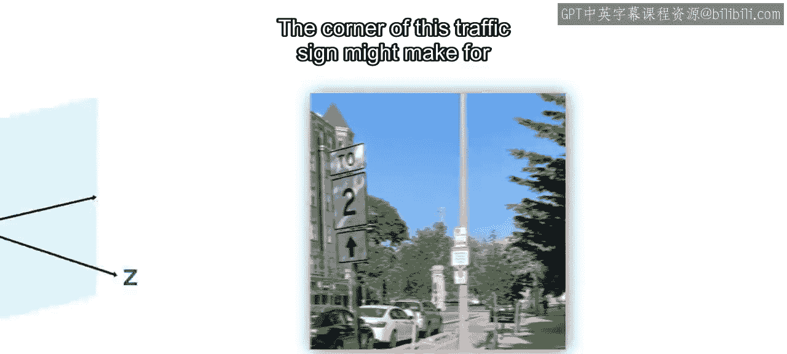

The corner of this traffic sign might make for a good object because it appears throughout the entire video and is not easily confused with other objects in its vicinity。

Window corners。Or this pole are not good choices because they are not unique and will be difficult to correctly match between frames。

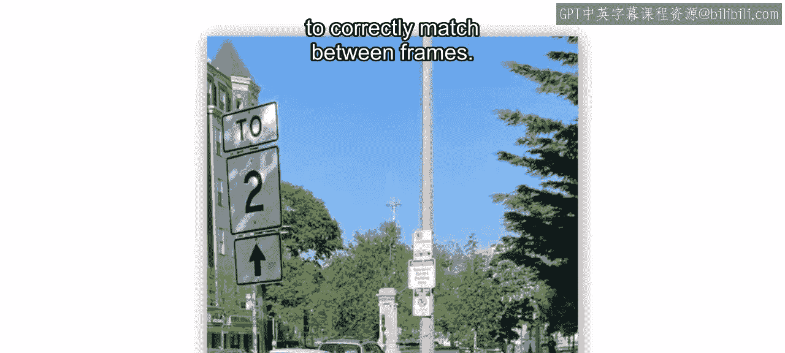

We'll use the template matching algorithm to establish the apparent motion。

 which is usually done on grayscale images。

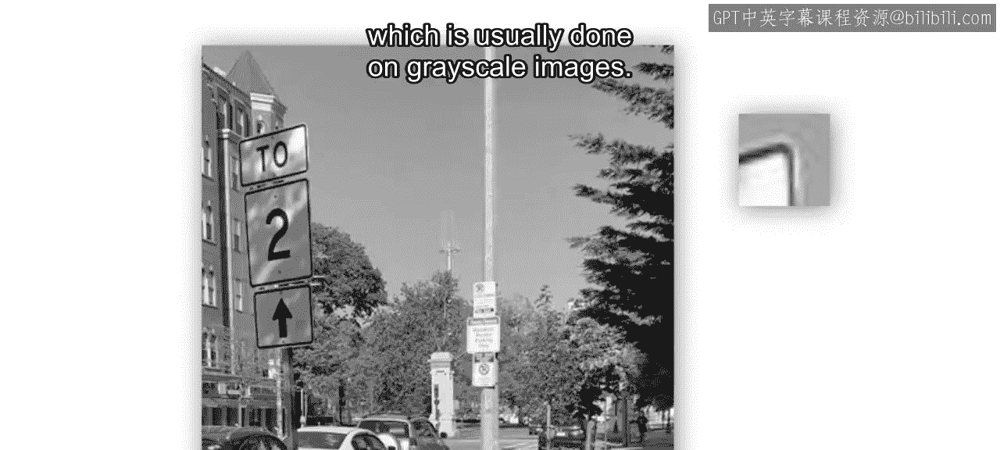

Template matching works by providing a template from a reference image。

And finding the closest match in a new target image。Like spatial filtering。

The template is moved across the image， and the sum of square differences。

 or SSD is calculated for each pixel in the target image。

The position with the smallest SSD corresponds to the position of the template and the new image。

In Matlab。You do this using the template matchcher object。While not necessary。

 it's a good idea to specify a region of interest to perform the search。This is more efficient。

 as the algorithm will search only in the specified region。

And using an ROI helps avoid an incorrect match from a similar region in the image。

To find the position of the best match， you call the template matcher by its name and pass the following inputs。

The target image。The template image。And the rectangular region of interest。

The region is given as a four element vector containing the pixel locations of the upper left corner。

And the width and height of the rectangle。The output is the position in pixels of the best match of the template in the target image。

The position points to the center of the template。

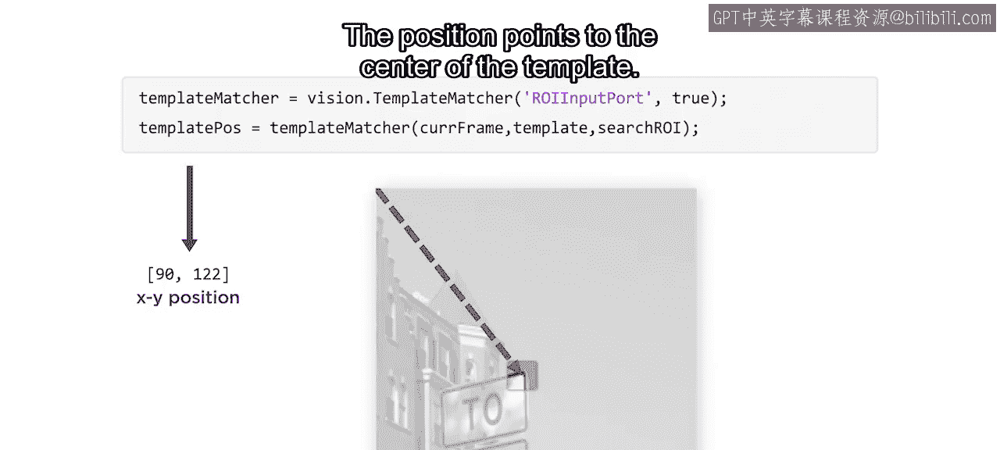

Because the sign is stationary。

Any differences in position。Is due to the motion of the camera。

Use the current and previous template positions to keep track of the cumulative motion of the camera。

Then。Use the I am translate function to shift the current frame by that amount。Here。

The current frame was translated 5 pixels in the positive X in Y direction。

 resulting in a small black border on the edges。

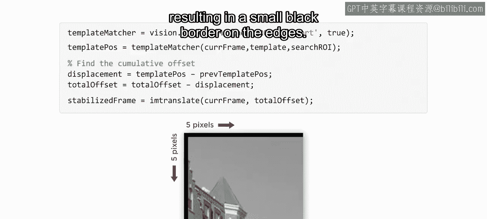

After applying the correction to all frames， notice that the edges of the video move because of the translation applied to each frame。

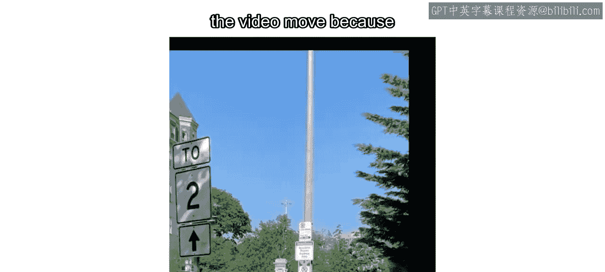

To correct this， crop the stabilized video to show only the parts of the scene that appear in every frame。

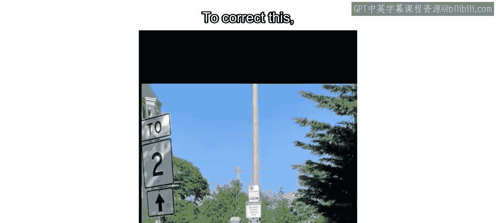

Now， you might be thinking， hey， that is still a shaky video。

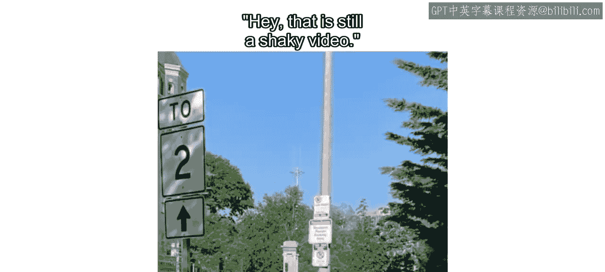

Let's look again。 but this time with a box around the starting location of two signs。

TheStized video has much less motion than the original。As the camera moves。

 parts of the background move in and out of view， giving the appearance of motion。

This should be expected if your video has a varying background。

You now know the main concepts and functions needed to stabilize a video using template matching。

To see a full implementation， including how to keep track of the cumulative motion。

 refer to the provided examples。

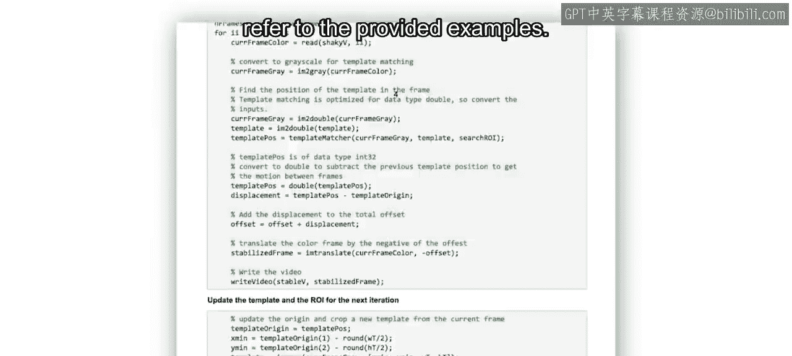