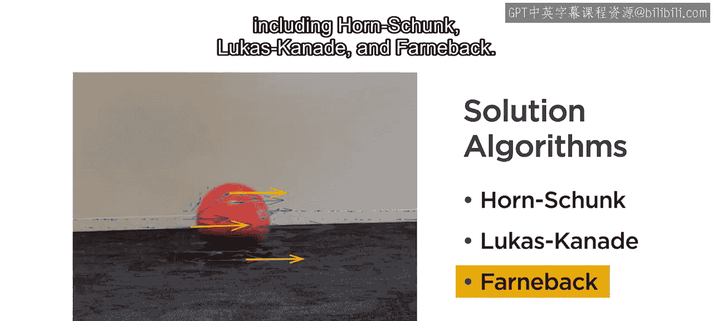
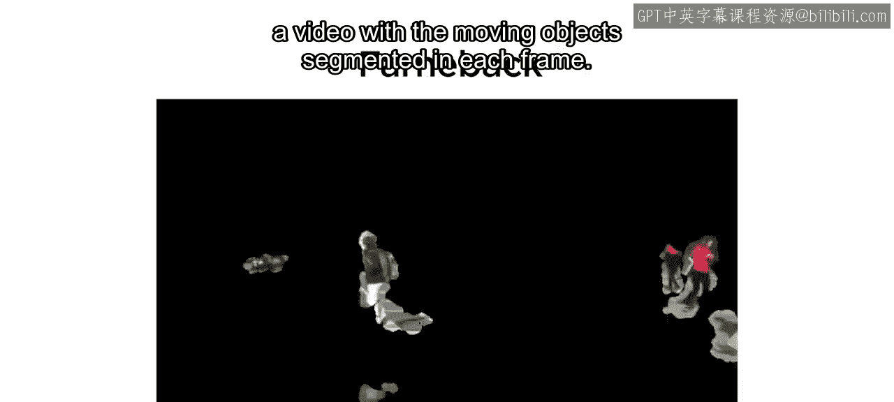
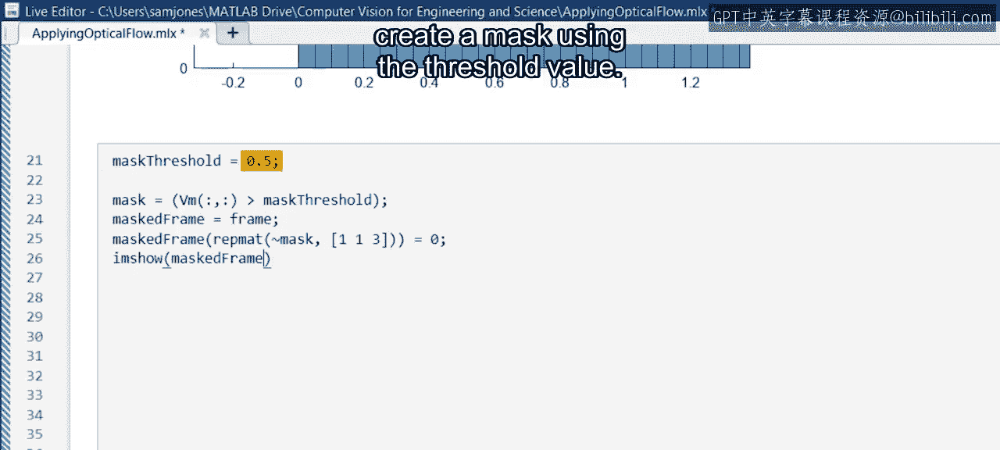
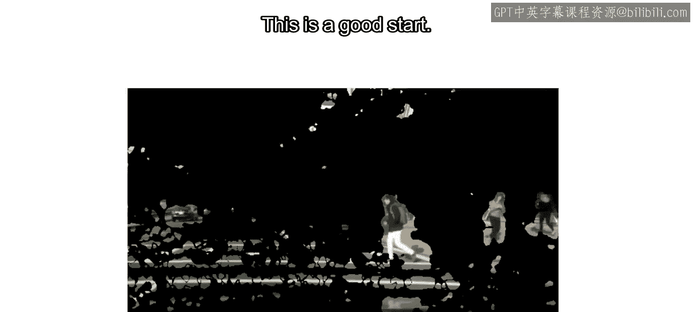
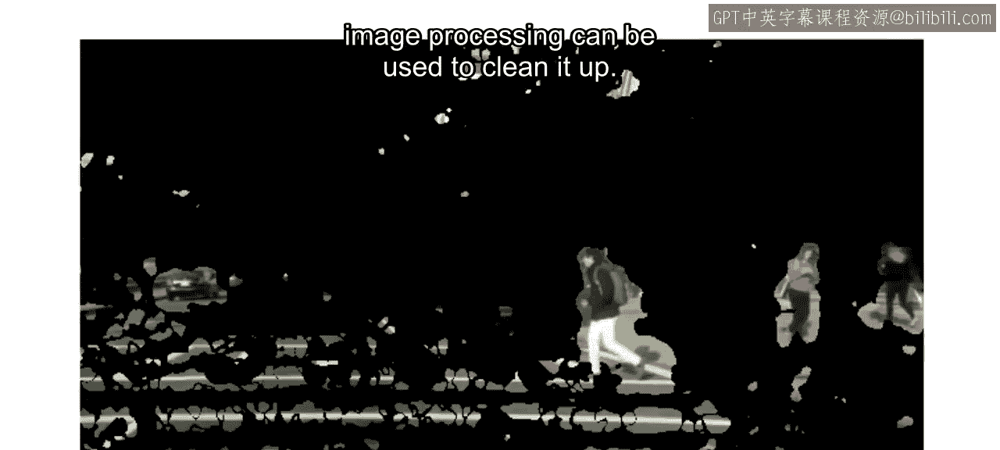
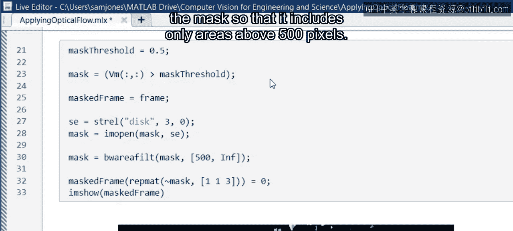
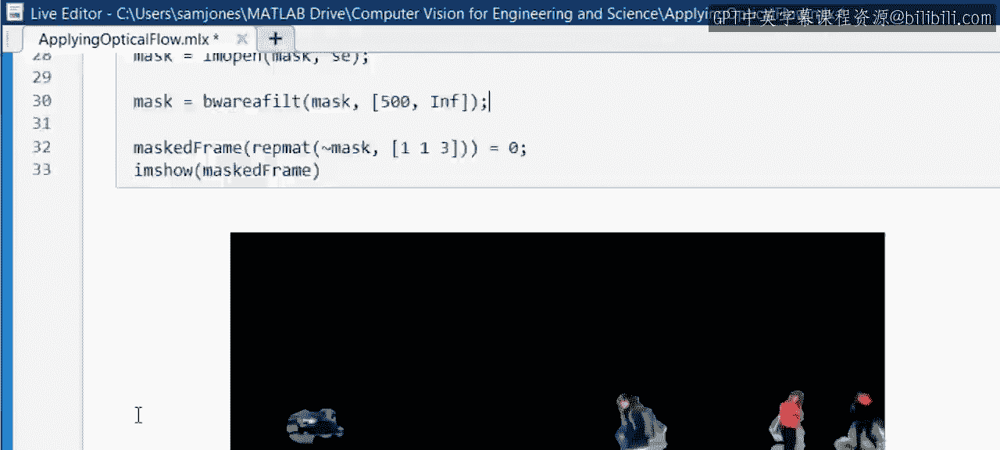
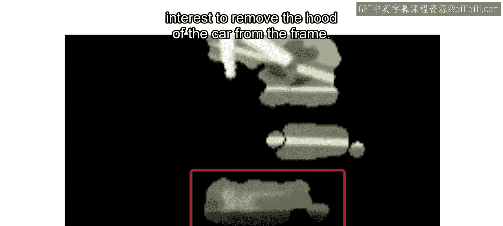
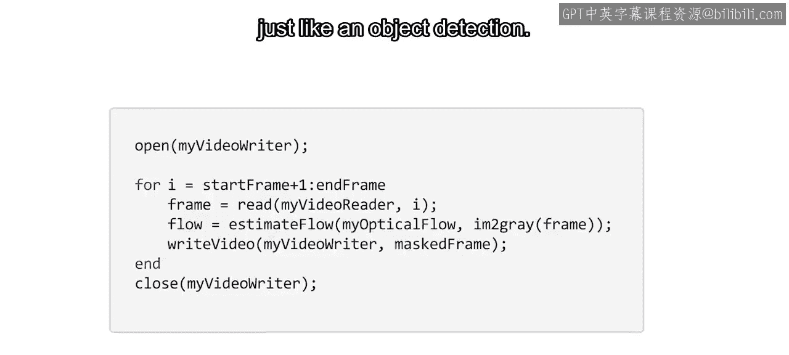
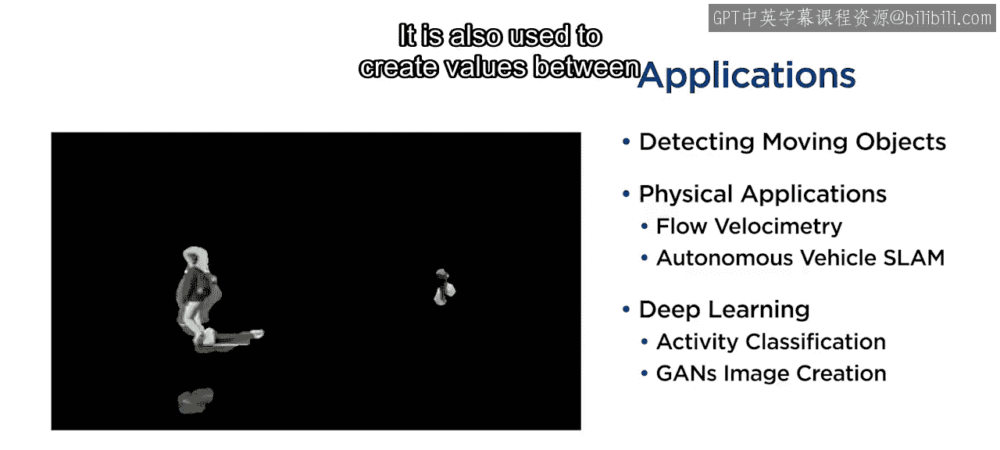

# Mathworks《工程与科学计算机视觉（简介、机器学习、目标检测）｜Computer Vision for Engineering and Science》 p32 6_应用光流.zh_en -BV1yJ4m13715_p32-

🎼，Optical flow is a powerful technique for detecting motion。

It eliminates the need to determine a static background。Detect and extract features from an object。

Or manually select a template to match。

All it requires to detect motion is two consecutive frames。How does it work？

The optical flow equation compares intensity values of the two frames to determine a velocity vector for each pixel。

Image intensity is calculated by converting the images to grayscale。The horizontal。

And vertical gradients in the images are computed。The difference in intensity between the two frames is also calculated。

These values are used to estimate。The horizontal。And vertical velocities for each pixel。

Because there is one equation and two unknowns， this system is underde。However。

 solution algorithms have been developed to estimate the velocities。Matlab provides several methods。

 including Hshunk。Lucas Canada and Farnabackac。

In this lesson， you will detect the motion of the pedestrians in the stash cam footage using the pharnoback method。

This modern algorithm has good performance and speed and works on a range of applications。😊。

Your final result will be a video with the moving objects segmented in each frame。

The syntax and workflow are the same for all optical flow methods。

So if the pharnaback method doesn't work for your application， you can switch methods easily。

To get started， create video reader and video writer objects。You'll also need an optical flow solver。

Let's focus on the portion of the video where the car is stopped at the crosswalk。

Between frames 96 and 565。Which were found using the video viewer app。

Read in the first frame and view it with I am show。There are several pedestrians in view。

 as well as both parked and moving cars。The optical flow solver must be initialized with the first frame。

This compares the frame to an all black image to create a base for future calculations。

Read in the next frame。And apply the flow solver again。

The optical flow variable stores the previous frame， so only the current frame is needed。

You view the resulting velocity vectors using the plot command to add them to the image。However。

 even this low resolution video has hundreds of thousands of pixels。

It would be impossible to see a vector for each one。To solve this。

 use the decimation factor name value pair to reduce the number of vectors shown。For this video。

 showing every 15th vector in the X and Y direction will work。Also， since frames are 1。

30th of a second apart， the motions will be very slight。

The skill factor will increase the lengths of these factors to be more visible。At this point。

 the pedestrian motion is clearly visible。And the direction and speed can be roughly determined by I。

That's a pretty good accomplishment with only a few lines of code。😊，There are a few problems though。

The buildings are not moving， but motion vectors are present。

All optical flow applications will have this type of noise due to the sensitivity of pixel level calculations。

How can you fix this？Use the velocity magnitude as a threshold to filter out the low level noise。

The optical flow solution contains the horizontal and vertical components of the velocities。

 as well as the magnitude and direction。A histogram of the magnitude distribution can be used to select the cutoff value。

There are a lot of pixels with very small velocities， since most of the frame is stationary。

After some trial and error， a threshold of 0。5 works for this video。

Recall that the goal is to detect moving pedestrians。Rather than looking at the velocity vectors。

 create a mask using the threshold value。

This will highlight the moving objects。

This is a good start。 The stationary buildings are no longer showing motion。

Raising the threshold will remove some of the other noise。

 but will also remove the slower moving portions of the pedestrians。

Since this is now a binary segmentation， image processing can be used to clean it up。

Morological opening removes most of the noise while preserving the outlines of the large regions。

Then use region analysis to filter the mask so that it includes only areas above 500 pixels。

Now， the moving car and pedestrians are well segmented。

There is also a reflection of a pedestrian on the hood of the vehicle。

You could eliminate this by using a region of interest to remove the hood of the car from the frame。

Now， apply the workflow in the entire video， just like an object detection。

Detecting moving objects is just one application of optical flow。

It is a powerful technique with many complex applications beyond the scope of this course。

It's also used in physical applications， including flow， fellowosymmetry and 3D mapping。

Optical flow is often used in deep learning workflows。

 like activity classification and image creation。It is also used to create values between video frames。

 improving video quality。

。

