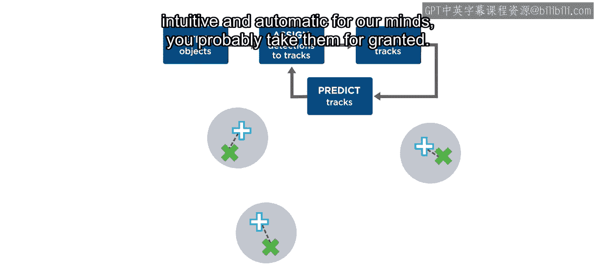
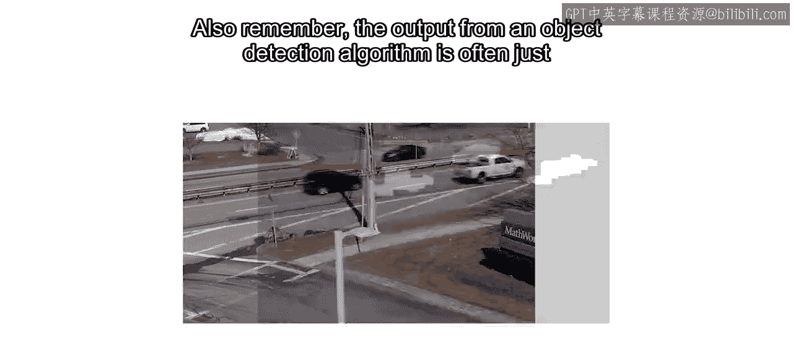
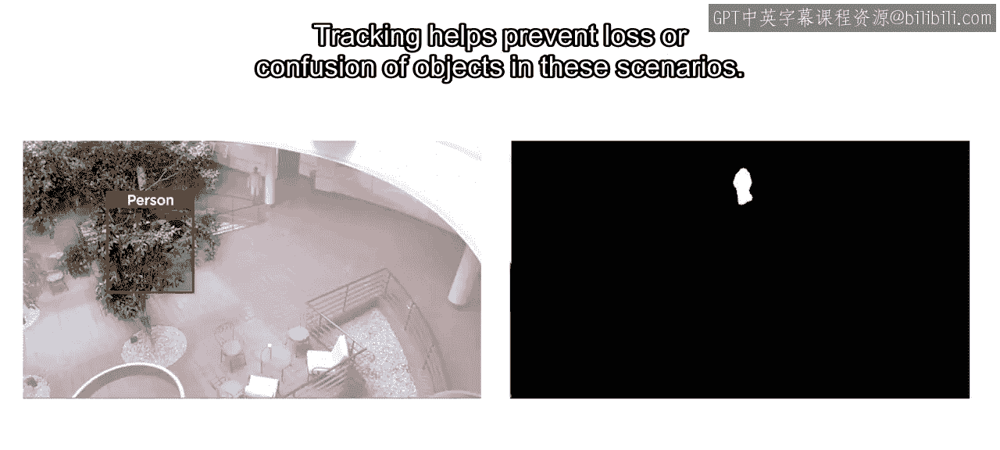
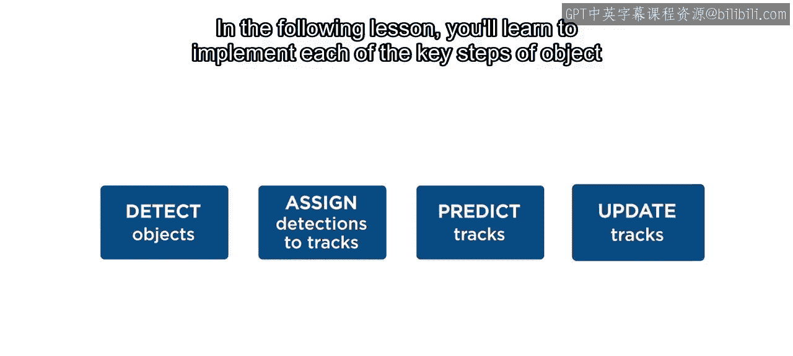
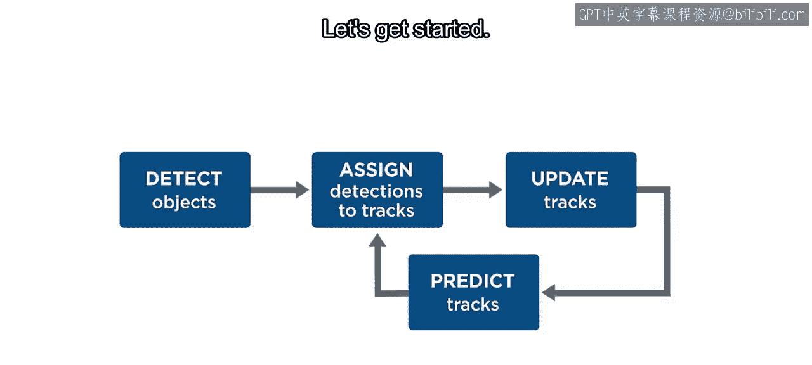

# Mathworks《工程与科学计算机视觉（简介、机器学习、目标检测）｜Computer Vision for Engineering and Science》 p33 7_物体跟踪简介.zh_en -BV1yJ4m13715_p33-

🎼，Object tracking is an inoccal part of autonomous systems engineering。Scientific research。

And countless other applications。Consider this cartoon example of a couple of moving objects。

For each frame。In addition to object detection， tracking involves repeating three main steps in a cycle。

The first is predicting a new location estimate for all the currently tracked objects aptly referred to as tracks。

 using existing detections， estimates and motion models。In this example。

 we assume the two objects continue moving with a roughly constant velocity。

The next step is to use the track location predictions。

 along with all the new object detections to match or assign detections to existing tracks。

 as well as determine which are left unassigned。Here。

 two of the detections were assigned to tracks 1 and 2 based on relative location to the predictions for each。

And another was left unassigned since it was nowhere near any predicted track location。

The third step is to use those results to update existing track estimates。

 as well as initialize or remove tracks for new or lost objects。

And the process is ready to repeat again。That all may seem complicated。

 but the core processes of object tracking are so intuitive and automatic for our minds。

 You probably take them for granted。

Consider navigating busy city streets。You observe or detect moving cars and pedestrians periodically。

But you also have predictions about what is going to happen in the immediate future based on your understanding of those things。

If you look away briefly。When you look back， you expect to see the same cars travelling steadily forward just a bit further ahead than before。

Similarly， while your view of a moving pedestrian may become obstructed。

You predict that you will see them emerge again in a new location based on their previous velocity。

Now， you might be thinking， sure， I do that。 But why is this so important for computer vision。

Do we really need more than detection。Well， even perfect detections represent an object at just one moment in time。

A computer needs tracking to connect the detections and recognize one object across frames。Also。

 remember， the output from an object detection algorithm is often just bounding boxes。

Or the centroids of labeled pixel regions。In practice， this output is often noisy。

Tracking helps smooth out the effects of detection noise。And as you know。

 objects can be obscured in some frames， causing detections to be lost。

Tracking helps prevent loss or confusion of objects in these scenarios。

In the following lesson， you'll learn to implement each of the key steps of objective tracking。

And combine them into a complete processing loop。Let's get started。

。