# Mathworks《工程与科学计算机视觉（简介、机器学习、目标检测）｜Computer Vision for Engineering and Science》 p34 8_实现物体跟踪 1 概念.zh_en -BV1yJ4m13715_p34-

🎼，Object tracking is done using a recursive loop。Assume you've detected objects in a given video frame。

Tracking involves predicting the locations of known objects， called tracks。

Assigning matches between the detections and existing tracks。

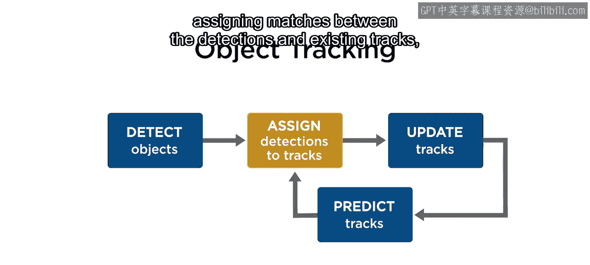

Updating the existing track estimates。Initializing tracks for new objects。

And removing tracks for lost objects。

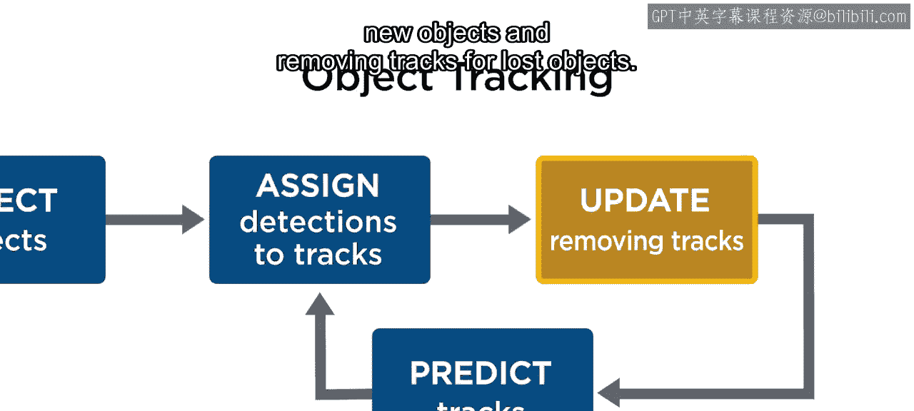

This set of steps is repeated over and over， at each frame。

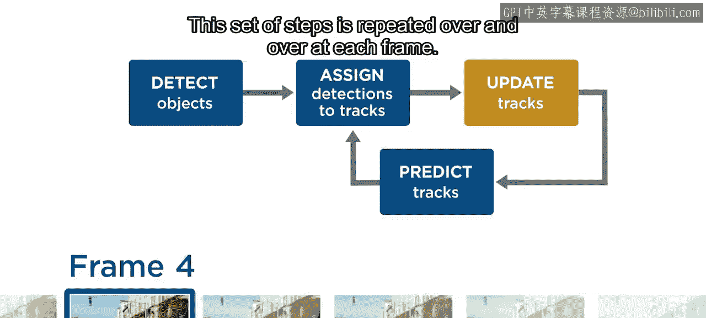

In this video， we'll take you through each of these main blocks in more detail。

 and you'll learn the components and processing steps required in each to build a functioning object tracking loop。

I know this looks like a lot， and it is， but don't worry， We'll go through it all piece by piece。

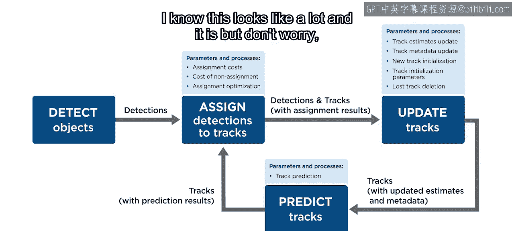

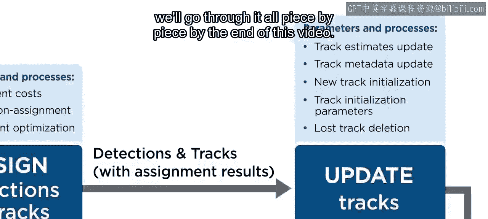

By the end of this video， you'll see that while there are a lot of parts。

 the job each does is relatively intuitive。The two main things you need at each frame are the set of detections。

And the set of tracks。These are the core variables of the tracking process。

Each detection will include information， like bounding boxes。Centroids。

And or other information on where things appear。It can also include additional data like object size or metadata associated with each detection。

Each track contains everything you want to know about a specific object over time。

You'll need a fair amount of additional information for each track。Things like an identifier。

A running count of frames in which the object has been detected， as well as other information。

We'll circle back to this when we get to the details of the update process。

The real core of each track is the estimator。You use the estimator to predict the location of a track and compare that with new detections。

If a track is assigned a detection。The estimator is then updated using the detection information before making a new prediction。

Remember， at each new frame。You need to predict the motion of objects to know where you expect them to be。

You use these predictions to determine which， if any detections。Should be assigned to each track。

But predictions are almost never perfect。And detections are often noisy or even missing from some frames。

You use the assignment results to either update the estimate or track location if a detection was assigned。

Or just use the prediction if there was no detection for the track that frame。In this course。

 you'll use a common filter as the estimator for each track。

The commonman filter is a powerful and widely used tool to estimate the true values of unknown and or noisy variables in dynamic systems。

While the details are beyond the scope of this course here。

 the commonman filter in each track generates a location prediction at every frame using assumed equations of motion。

Then the common filter in each detected track uses assumptions on measurement noise。

 motion model uncertainty and a recursively updated measure of internal estimation error。

To combine the prediction and detection into an updated track location。

The new track location will shift in favor of either the prediction。Or detection。

 based on the amount of uncertainty the common filter assumes for each。

You'll set parameters for these uncertainties or noise levels。

 as well as the type of motion prediction model to use when you initialize new tracks。

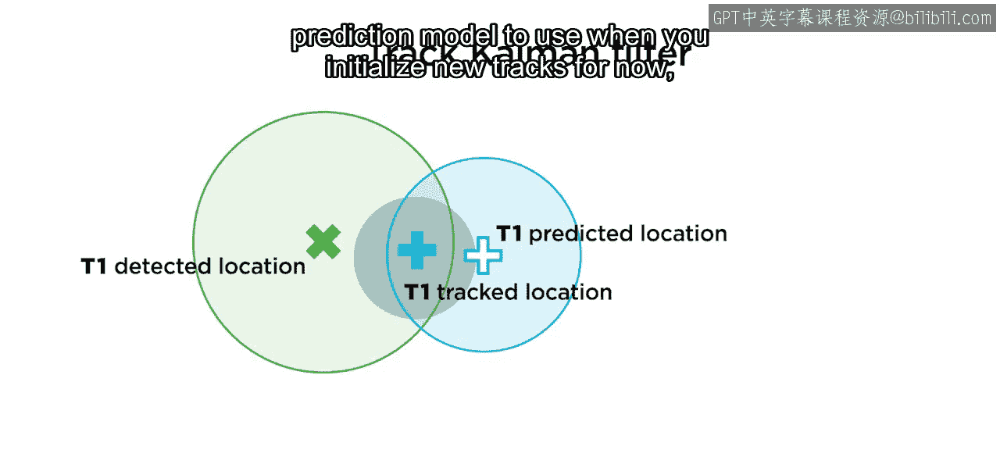

For now， let's go back to the overall process。We've covered the set of detections and tracks。

The predict block and the most crucial part of the update block。Now。

 let's see how to use the predictions to assign incoming detections to tracks。

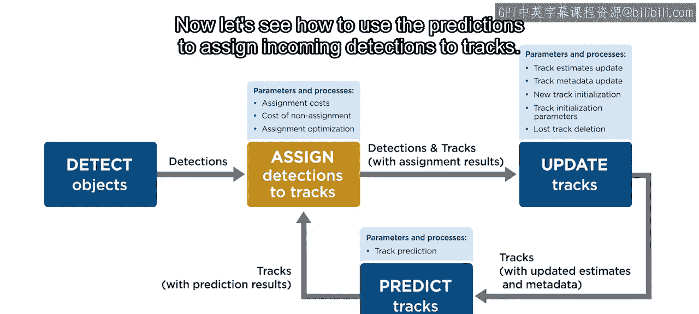

The assignment process takes the set of all detections in each frame。

And the set of all existing tracks and determines which pairs to assign。

Notice that there may be unassigned detections。Such as when a new object appears。

Or there is a false detection。There may also be unassigned tracks。For example。

 tracks that have been obscured from view。Or the detector failed to find。At each frame。

You need to evaluate multiple possible combinations of assignments between existing tracks。

And a variable set of new detections。 And determine the best one。

You do this by calculating a cost value for every possible assignment。

As well as the cost of non assignment。Which means leaving either a track or detection unassigned。

The assignment costs should be based on proximity。But can also incorporate additional information like size。

 shape， or even color。In this course， we'll assign costs using measures of distance from each prediction to each detection obtained from the track Coman filters。

So you won't have to come up with the assignment cost values on your own。Once you have all the costs。

You minimize the total cost over all possible combinations of assignment and non assignment。

Don't worry， this optimization is solved for you by a single function in MAlaap。Here。

 the minimum sum of costs is reached by assigning detection 2 to track one。Detection 3 to track 2。

And leaving both detection 1， and track 3， unassigned。This reflects a scenario where。

 due to their distance apart。The third track was more likely obscured or lost。

While the first detection more likely represents a new object or possibly noise。

 rather than a huge error detecting the third track。

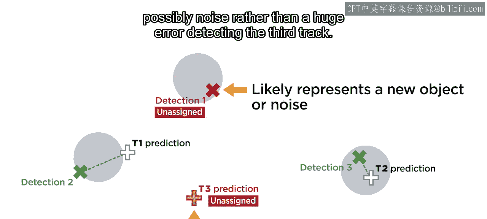

All right， we're almost done。

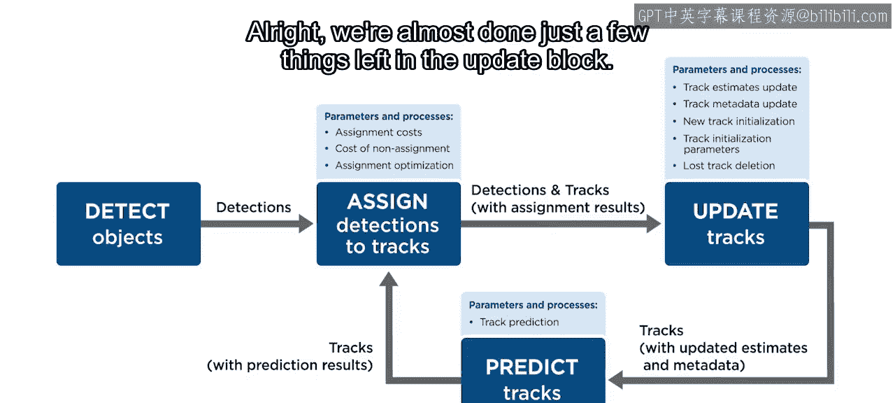

Just a few things left in the update block。

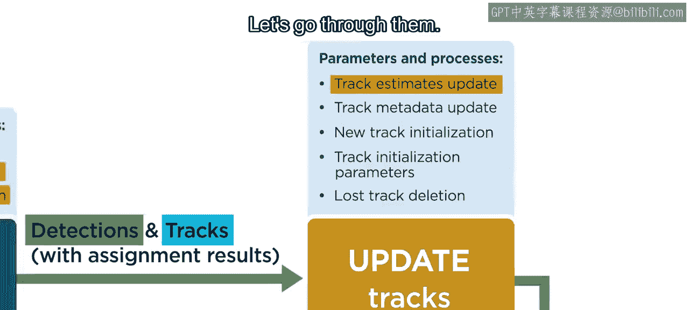

Let's go through them。The first thing to do is update the track locations。You saw this a bit earlier。

For those assigned a detection。You use the common filter update process。

For those tracks not assigned to detection。You use the common filter prediction。Next。

 remember that track metadata I promised we'd circle back to when we got to the update block。 Well。

 here we are。Track metadata can include almost anything you want。However。

 this usually includes things like a unique identifier。Total detection count。Overall， age。

Consecutive missing count。Confirmation status and whether it is currently detected or not。

A unique identifier is used to maintain and differentiate tracks across frames。

The total number of frames in which a track has been detected is used as a threshold to determine whether it is reliable enough to be considered a confirmed track。

This helps deal with noisy sporadic detections by keeping new tracks unconfirmed until they've been detected in enough times。

The number of consecutive frames the track has gone undetected。

The total number of frames it has existed。And the number of frames in which it was detected are used to determine when to consider a track has been lost and deleted。

Next， any detections that were not assigned are considered potential new objects。

So you create a new track for each。Initializing a common filter and setting initial metadata。

Since detections can be false。This is where the confirmed status we just mentioned comes in。

You'll only confirm tracks after a certain detection count。And finally， you'll use data on age。

 detected frames and consecutive missing frames to delete tracks that do not seem to be reappearing。

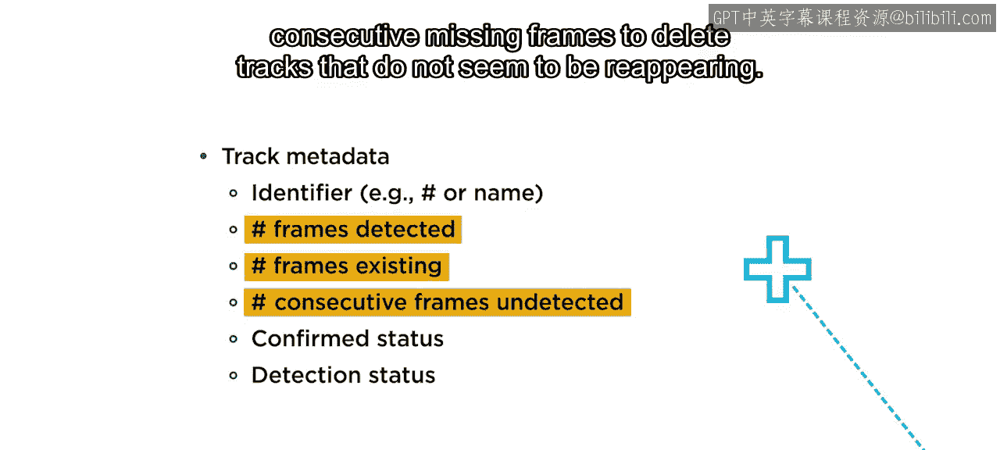

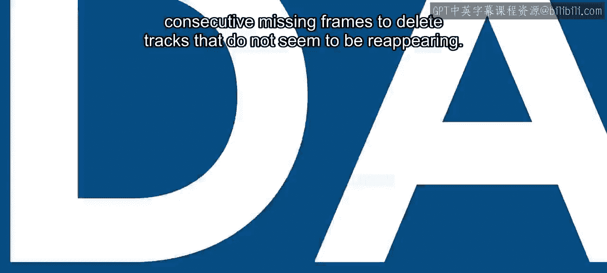

Well， you made it。This was a lot to take in。So don't worry if everything isn't perfectly clear yet。

You'll get plenty of step by step practice and reference materials in the rest of this lesson。

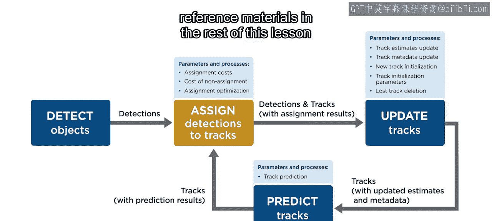

Yeah。