# Mathworks《工程与科学计算机视觉（简介、机器学习、目标检测）｜Computer Vision for Engineering and Science》 p35 9_实现物体跟踪 2 执行.zh_en -BV1yJ4m13715_p35-

🎼。

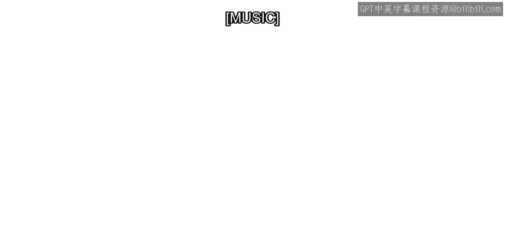

There are many processes and parameters you need to define to build a functioning object tracker。

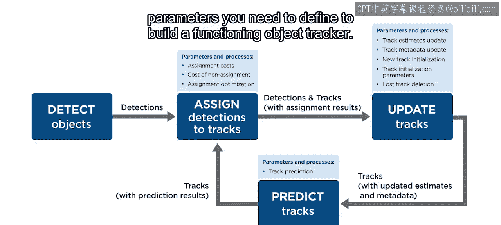

In this video， we'll take you through an example of how to implement each of these steps in MATLap。

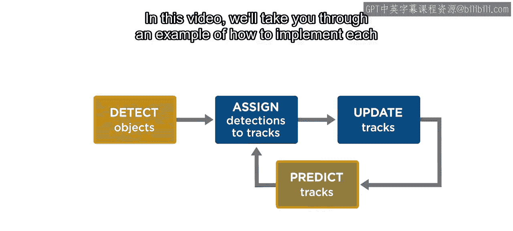

We'll test the overall algorithm out by tracking these cells。

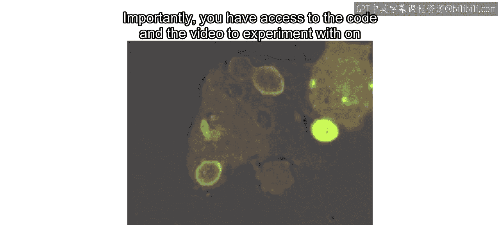

Importantly， you have access to the code and video to experiment with on your own。

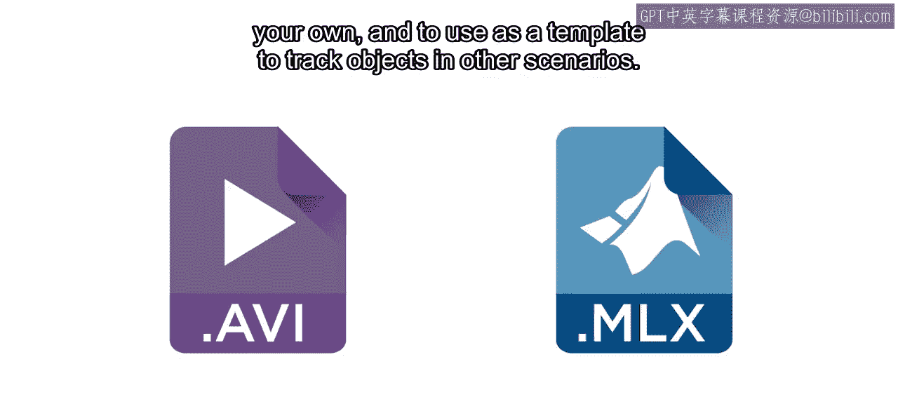

And to use as a template to track objects in other scenarios。

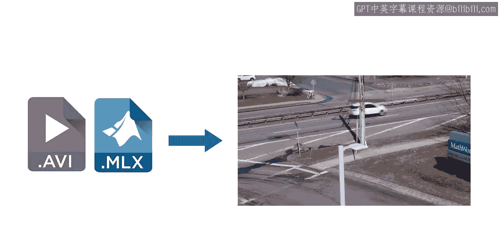

You implement the overall tracking process in a loop over each frame。

You use individual functions to perform object detection。Track prediction。

Detection to track assignment。And track updates。Of course。

 you'll want to have some way to save and display your results as well。

We could add this to our diagram as an additional block。The loop is purposefully a modular structure。

This enables you to substitute in a new function for a particular step。For example， detection。

While leaving the rest of the coat unchanged。Or。Add additional functions， for example。

 to analyze your results at every frame。For now， we'll focus on the core tracking algorithm you've seen previously。

While detection is a critical part of tracking。It's often developed independently and has been covered in previous materials。

We'll focus on the implementation details of the prediction。Assignment。And update processes here。Now。

 notice the set of tracks is initialized before the loop as an empty table。

This is to enable the loop to run when there are no tracks yet。

Let's see what happens for the very first frame with detected objects。

There are no tracks to make predictions on yet。 So nothing will happen in the predict function。

Similarly， since there are no tracks to assign detections， too。

 all detections will be passed through the assignment function as unassigned。

Initialization of new tracks for unassigned detections happens in the update function。So。

 let's examine this function first。By right clicking。And selecting open update tracks。

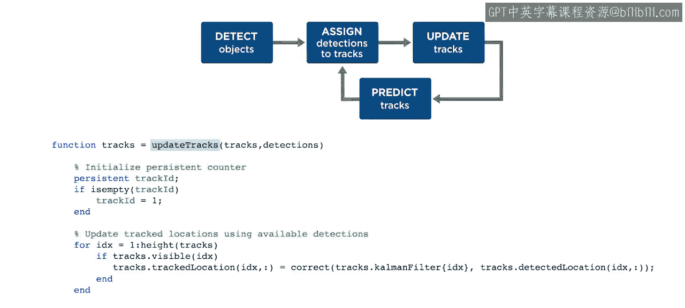

The first thing we do in this function is define a counter variable to use as a track identifier。

We use a persistent variable so that we can accumulate the count of how many tracks we've made through multiple updates。

Since this is the first time through and the tracks table is empty。

The code to update the track locations。Update track metadata。And delete loss tracks。

Is all skipped on this iteration。Don't worry， we'll be coming back to all of this in the following frame iteration。

Now， here， you assign new tracks to the unassigned detections。For each unassigned detection。

Initialize a common filter with the configure common filter function。

This function requires a set of parameters for a given tracking scenario。Here。

We use the detected centroid to define the initial location。

Set the filter type to assume constant velocity。And choose estimates for initial error。Motion noise。

And measurement noise。While the values for these parameters are largely going to come down to trial and error。

 remember that the relative size of the motion noise and measurement noise affects how much your filter trusts its own internal model or the detections respectively。

After that， you initialized track data。Create variables for the detected。Tracked。

And predicted locations。And initialize them all to the first detected location。

Then create a variable for track age and set it to one。A count of detected frames and set it to one。

Account of consecutive undetected frames and set it to 0。A detected flag and set it to true。

And a confirmed status。 and set it to false。Create a new track entry using all of these variables to form a single row table。

And add it to the tracks table。And increment the track I。

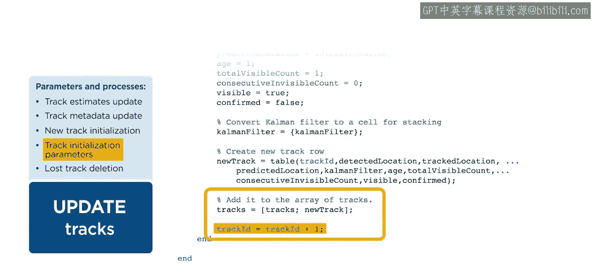

Okay， let's go back to the overall process and assume we are on the next video frame。

 and we have a new set of detections。Now， on this iteration。

 the predict function will make predictions for the tracks initialized previously。Let's see how。

This function takes the set of tracks in and predicts a location for each。

 then outputs the updated tracks。In MatTLb， this only takes a few lines of code。

Just loop through the table of tracks。And use the predict function on the common filter in each track to get a new predicted location。

The next function in the loop is detection to track assignment。

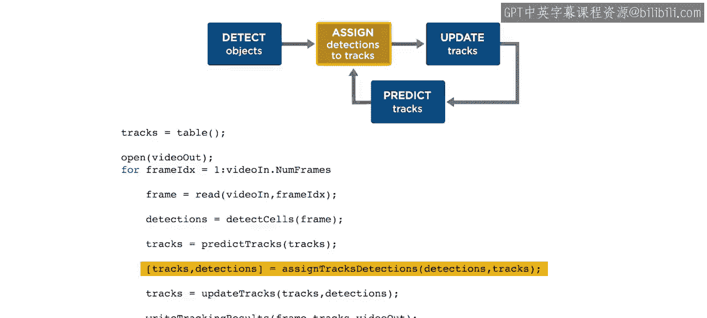

This function takes in the sets of detections and tracks and updates both with assignment information。

The first thing you do here is get the cost for each possible assignment by looping through the tracks table and using the distance function of the common filter with every detection location as an input。

Next， you set a cost of non assignment。Like the common filter parameters。

 this may take some trial and error when working with a new video。Just remember。

 the smaller this cost， the more likely you are to leave tracks and detections unassigned。

Then you solve the assignment optimization using the assigned detections to tracks function included with MAlaap。

The assignment's output specifies index pairs for the tracks and detections that were assigned to each other in each row。

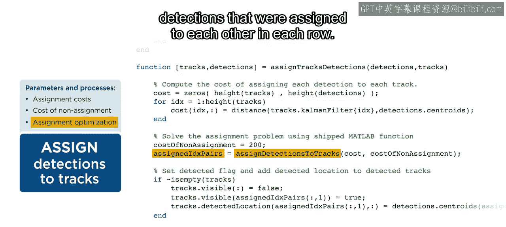

In the rest of this function， set the detected status to false for undetected tracks。

And true for detected tracks using the first column of the assigned index pairs。

Then add the detected centroid location to each assigned track using the columns of the assigned index pairs。

Finally， set an assigned status to false for unassigned detections。And true for assigned detections。

Using the second column of the assigned index pairs。Now。

 this time we have both detections and tracks when reaching the update block。

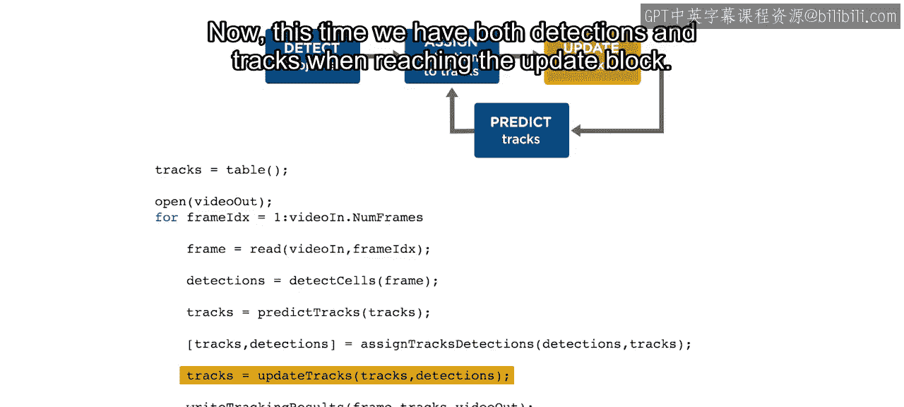

So let's take another look at that function。You've already seen the creation of the track ID counter。

This time， though， the tracks table is not empty。So for each track that is currently detected。

You update the track location using the correct function。

With the calmman filter and detected location as inputs。

Note that this does not simply replace the tract location with the detection。It uses the prediction。

 detection and estimates of uncertainty to create a new track location。

For any tracks that were not detected in this frame。

 you update the track location to be equal to the predicted location。Next。

 you update the track metadata。Start by incrementing the age for all tracks。

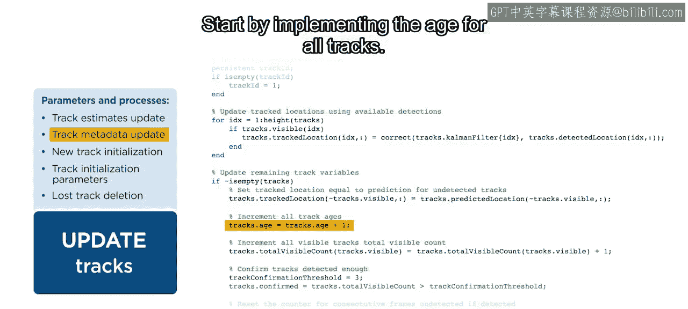

Then increment the total number of detected frames for all tracks that are currently detected。

Then use the total detection count to confirm tracks that have met a threshold。

This helps to filter out sporadic tracks created from false detections。For all detected tracks。

 reset the consecutive undetected count 0。For tracks that were not detected。

 increment this count by one。Next， you delete unreliable or loss tracks。

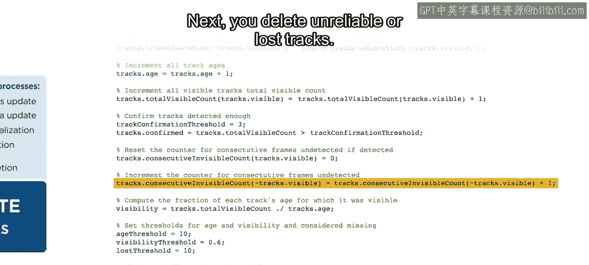

First。Calculate the visibility。Which is the fraction of each track's age that it was detected。Then。

 set thresholds for age。Low visibility。And the number of consecutive frames a track can go undetected until it is considered lost。

Use these thresholds to find the indices in the tracks table for which the track age。Visibility。

And count of consecutive frames undetected do not meet your thresholds。

And combine those indices to delete tracks that are both too new and low visibility。

 or which are considered lost。From there。Initialize a new track for each unassigned detection as you saw previously。

And that's it。

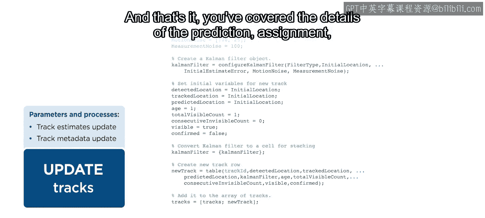

You've covered the details of the prediction， assignment。

And update processes over two iterations of the object tracking loop。Now。Of course。

 you'll want to see the results。So let's take a quick look at how we'll display results for this example。

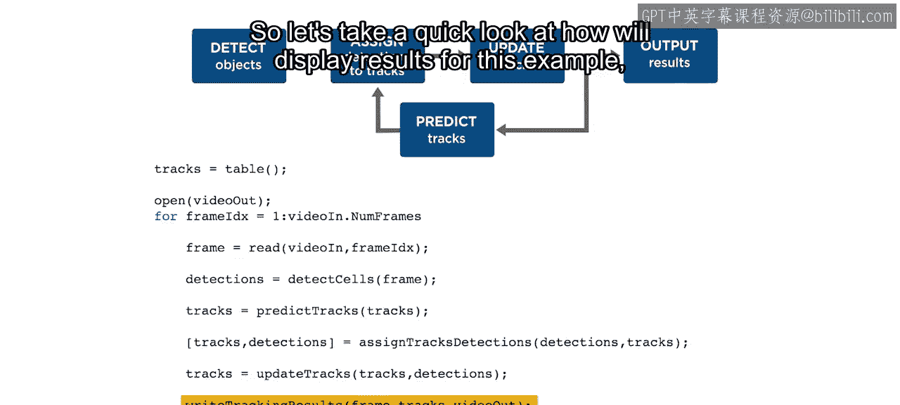

We first extract the confirmed tracks from the overall table using the confirmed status variable。

Then we create labels using the track Is。We place the label slightly offset from the locations so that both will be visible。

And finally， we add a plus symbol at the location of each track。Let's have a look at the results。

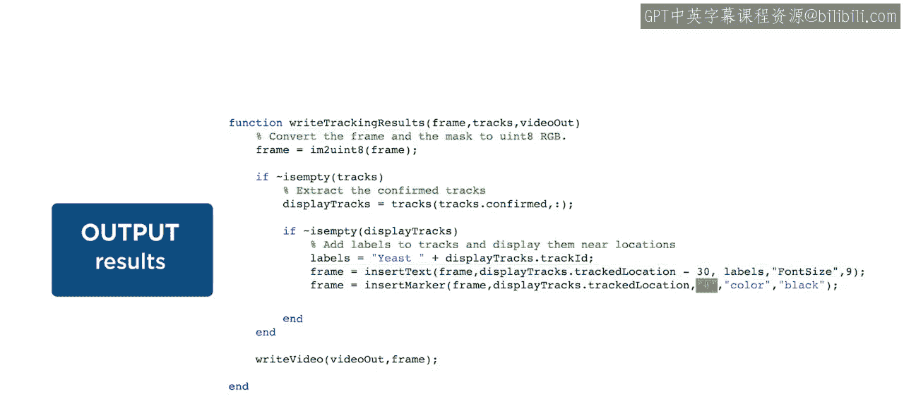

Looks pretty good。As the second E cell becomes bright enough， we start tracking it， as well。

Then as the first dies down in brightness， we stop tracking it and continue to track the second yeast cell。

Now it's your turn。

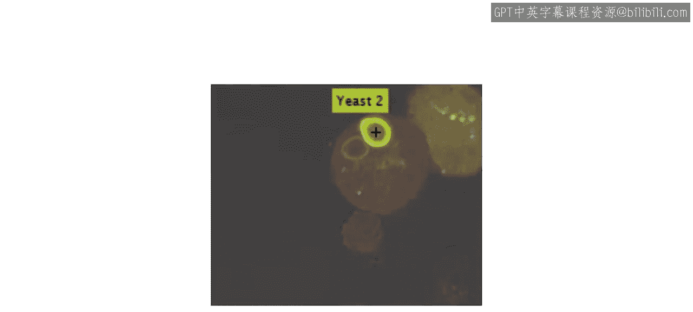

We've provided you with the code you saw here to get you started。

Save a backup copy and play around with the parameters on your own to see what effects they have。

Try displaying more information， such as the detection or confirmation status。

Ask for help on the formss， if you get lost。When you're ready。

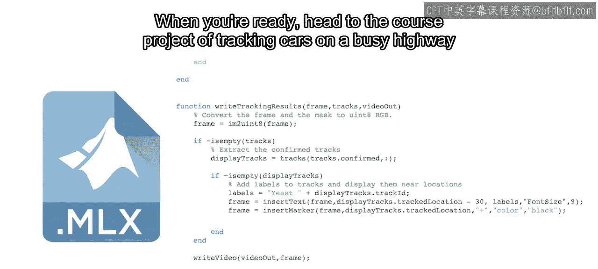

Head to the course project of tracking cars on a busy highway to apply your new skills。

