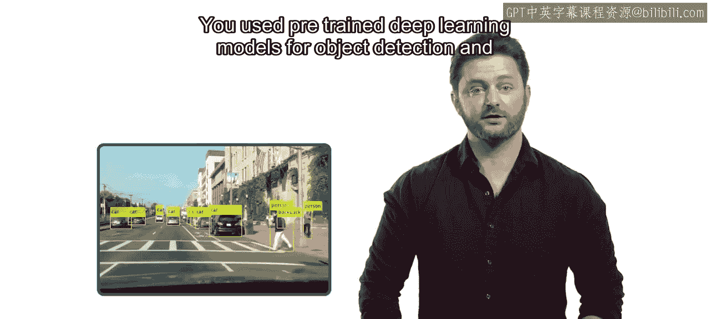
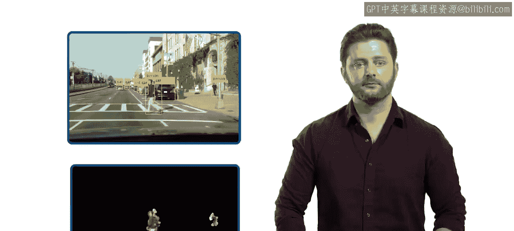
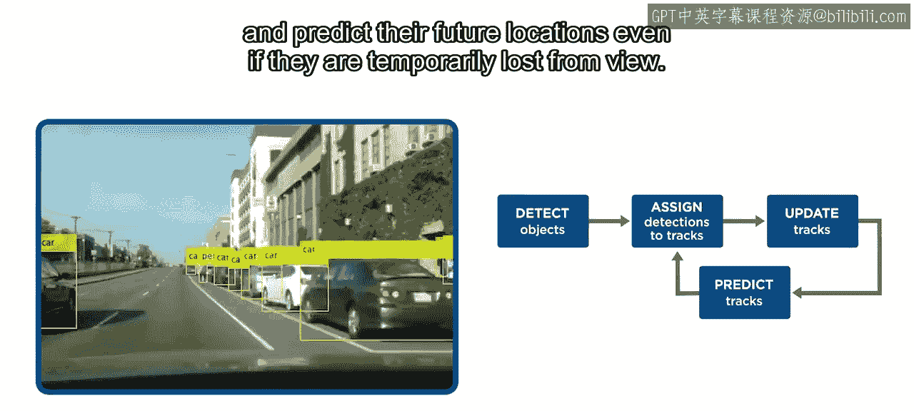
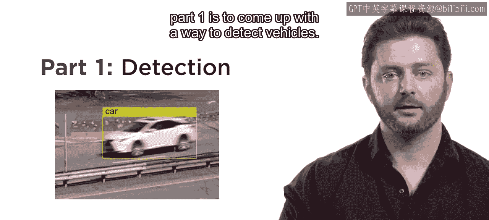
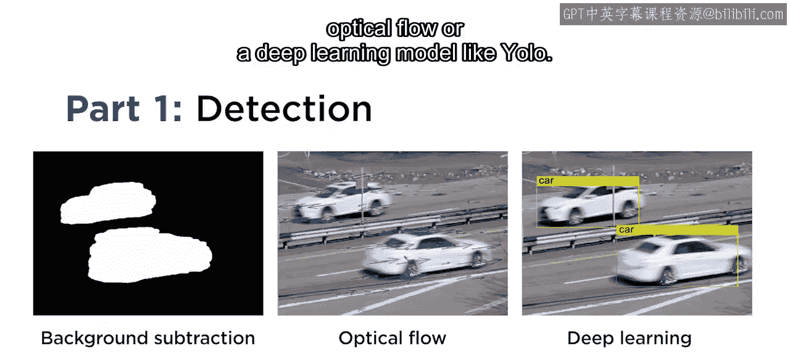
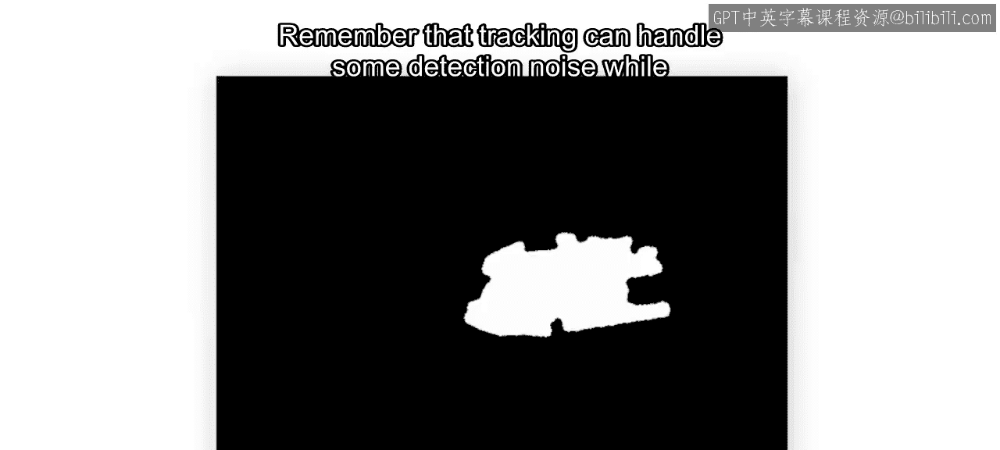
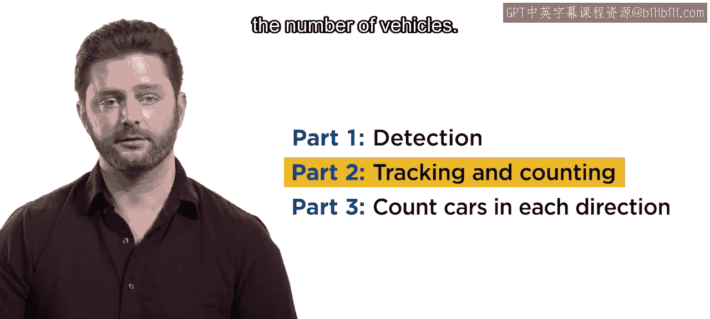
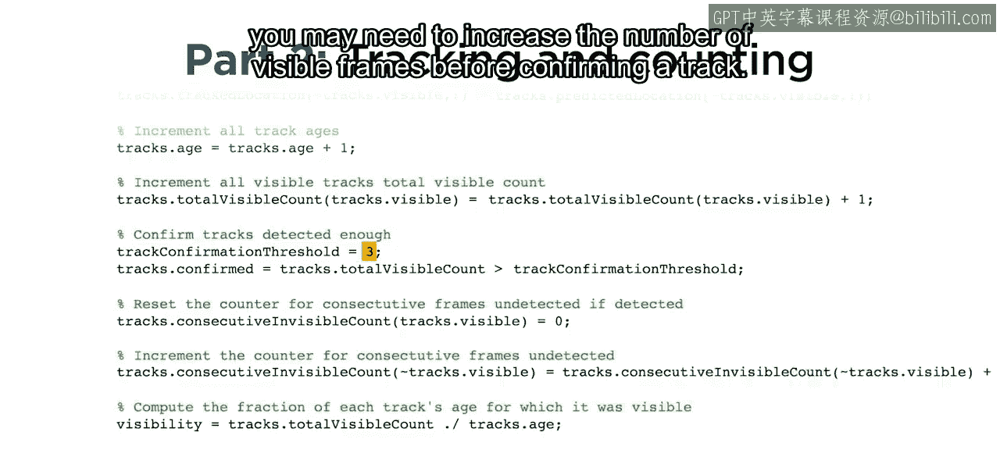
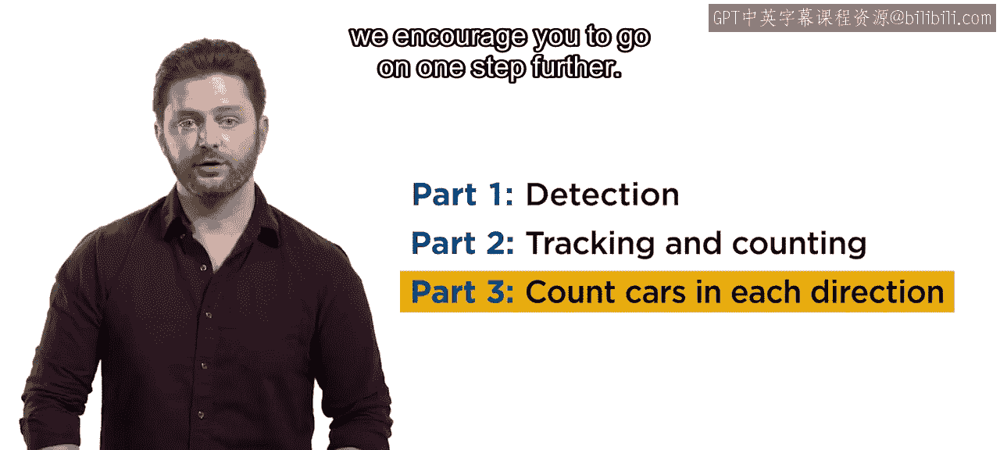
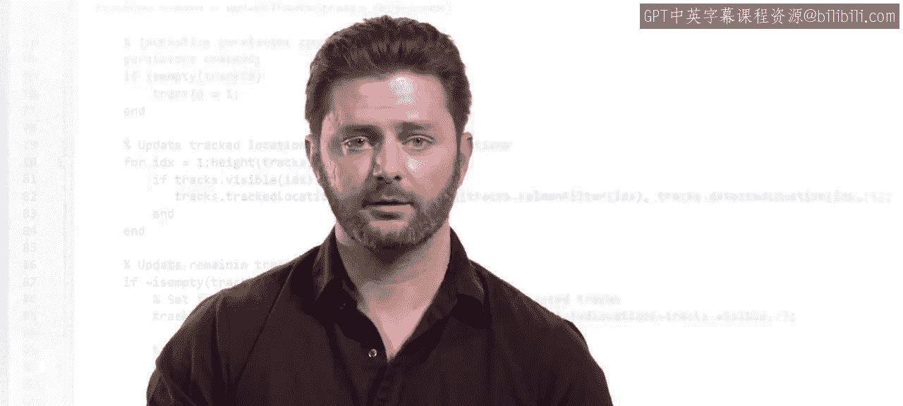

# Mathworks《工程与科学计算机视觉（简介、机器学习、目标检测）｜Computer Vision for Engineering and Science》 p36 10_交通流量项目简介.zh_en -BV1yJ4m13715_p36-

🎼。

Congratulations on reaching the end of the course。You've added several new techniques to your computer vision tool set。

You used pretrain deep learning models for object detection。

And applied optical flow to detect moving objects。

In many applications， like autonomous systems， detection is only one part of a tracking workflow。

But you're now able to apply tracking to identify individual objects across frames。

And predict their future locations。Even if they are temporarily lost from view。

Now it's time to apply your new skills to a final project。

If you completed our image processing specialization， you detected cars in a video similar to this。

This time， you need to add tracking。To count each vehicle and its direction。

This project has many possible solutions。And you're encouraged to try a variety of approaches。

To help， we've broken the project into three parts。

Part one is to come up with a way to detect vehicles。

Some ideas include using background subtraction。Optical flow。Or a deep learning model like Yolo。

You don't need the detection to be perfect。Remember that tracking can handle some detection noise。

While completing the detection task， consider if your approach would work in different weather conditions。

Or times of day。Also consider the processing power required。Ylo is a powerful model。

But it takes significant time to process the entire video。

These are important considerations for your own projects。

The next task is to implement a tracking algorithm that successfully counts the number of vehicles。

There are several key parameters you'll need to explore and update to successfully track each vehicle。

For example。If your detection algorithm is a bit inaccurate。

You may need to increase the number of visible frames before confirming a track。

After completing parts one and 2。You've done enough to pass the project。

But we encourage you to go on one step further。

Part3 is to count the number of vehicles moving in each direction。To do this。

 you'll need to add additional code to determine the direction of each of your confirmed tracks。

You can do this using the state property of your common filter。Or if you use optical flow。

You can use the flow vectors for your detected objects。No matter the approach。

 you'll need to add some extra bookkeeping to the code。

Great work reaching the end of the course。By completing this final project。

 you'll have a real world example that showcases your new skills。Good luck。

